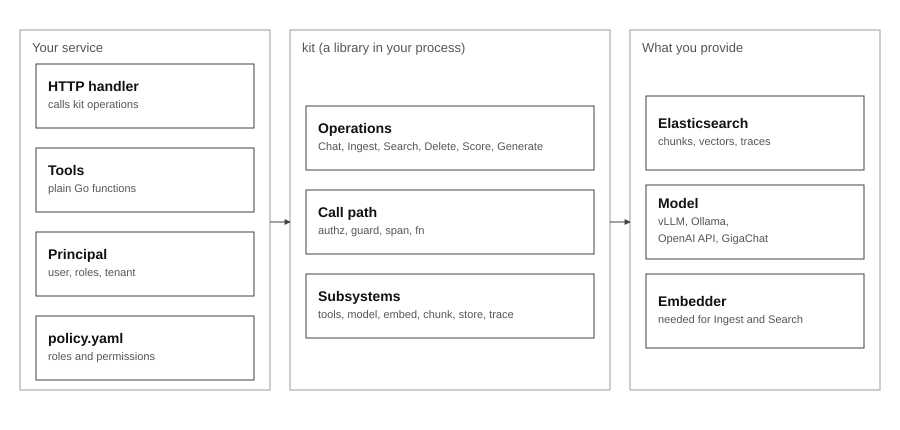
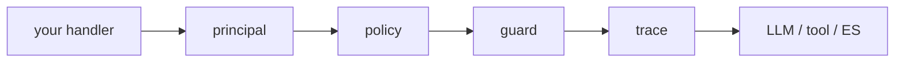

# Gobellim

**[English](README.md) · [Русский](README.ru.md)**


[](LICENSE)


Native Go primitives for using LLMs safely: retrieval, tool calling and
guardrails behind one permission-checked call path.



## See it in 60 seconds

The [demo](./demo) is a support bot on a Clean Architecture skeleton with a
seeded knowledge base. The first run pulls the images and the embedding model;
after that the stack starts in about a minute.

```sh
cp demo/.env.example demo/.env                 # add GIGACHAT_CREDENTIALS (skip if the file exists)
docker compose --env-file demo/.env \
  -f demo/deploy/docker-compose.yml up -d
```

The bot logs `knowledge base ready` and `bot listening` on `:8080`. Ask it a
question as `root` and as `alice`: `alice` gets a refusal for the weather,
because that tool is removed from her schema before the model sees it. The
endpoints and a ready-made `curl` are in [demo/README.md](./demo/README.md).

Retrieval, typed output, guardrails and traces are the same call path the
library gives you.

## The delta: one handler, made safe

An ordinary HTTP handler calls your LLM client directly:

```go
func (h *Handler) Chat(w http.ResponseWriter, r *http.Request) {
	var req chatRequest
	if err := json.NewDecoder(r.Body).Decode(&req); err != nil {
		http.Error(w, err.Error(), http.StatusBadRequest)
		return
	}
	answer, err := h.llm.Complete(r.Context(), req.Prompt)
	if err != nil {
		http.Error(w, err.Error(), http.StatusBadGateway)
		return
	}
	writeJSON(w, map[string]string{"answer": answer})
}
```

The same handler with Gobellim:

```diff
 func (h *Handler) Chat(w http.ResponseWriter, r *http.Request) {
     var req chatRequest
     if err := json.NewDecoder(r.Body).Decode(&req); err != nil {
         http.Error(w, err.Error(), http.StatusBadRequest)
         return
     }
-    answer, err := h.llm.Complete(r.Context(), req.Prompt)
+    ctx := kit.WithPrincipal(r.Context(), kit.Principal{
+        UserID: req.UserID, Roles: req.Roles, Tenant: req.Tenant,
+    })
+    res, err := h.app.Chat(ctx, kit.ChatRequest{
+        Messages: []model.Message{{Role: model.RoleUser, Content: req.Prompt}},
+    })
     if err != nil {
         http.Error(w, err.Error(), http.StatusBadGateway)
         return
     }
-    writeJSON(w, map[string]string{"answer": answer})
+    writeJSON(w, map[string]string{"answer": res.Message.Content})
 }
```

That is the whole change in the handler. The app is built once at startup
(`kit.New`, below). `Chat` authorizes before any model or store call, runs the
guard on input, tool results and output, traces the turn, and exposes only the
tools the caller may use.

## What Gobellim adds

You keep the handler, the `ctx` and the Elasticsearch client you already have.
Gobellim adds four gates:



- **principal** — who calls: user, roles, tenant.
- **policy** — what the caller may do; deny by default.
- **guard** — deterministic L1 rules plus the required L2 detector.
- **trace** — every call is recorded, masked by default, and scoreable.

Each is a gate on the call path, not a hook you can forget.

## Why Gobellim

Gobellim is a library, not a service: you keep your handlers, your concurrency
and your infrastructure. Each claim below is structural, and each one has code
and tests behind it.

- **One call path, no bypass.** Every operation runs through
  [`internal/call`](./internal/call) — authorize, guard, span, execute — and
  [`internal/importrules`](./internal/importrules) is the build-time guard on the
  package graph.
- **The model gets no say in access.** Tools the caller may not use are removed
  from the schema before the model runs and re-checked when they execute
  ([`authz.AllowedTools`](./authz/authz.go), `TestAllowedTools`).
- **Search cannot widen across tenants.** Tenant and ACL are part of the kNN
  filter, and search is deny-by-default ([`store/filter.go`](./store/filter.go),
  `filter_test.go`, `filter_fuzz_test.go`).
- **Traces carry masked text by default.** Raw message text is not persisted
  unless you opt in ([`trace/policy.go`](./trace/policy.go), `pii_test.go`).
- **L2 is required on purpose.** An internal security review or certification
  usually expects an ML layer. `guard.L1Only()` exists for explicit L1-only runs
  and is visible in `Health()`, never silent (`D80`).

General-purpose Go LLM frameworks give you adapters. You can wrap one with a
policy and a guard yourself — and then you own that wrapper and its tests.
Gobellim is that wrapper, already tested: the hardening, egress and concurrency
suites ship with it.

## Install

```sh
go get github.com/KirillYuzh/Gobellim
```

## Quickstart

```go
app, err := kit.New(ctx, kit.Config{
	ES:      es,     // optional: your store.ES client (retrieval, memory, traces)
	LLM:     llm,    // vLLM, Ollama, OpenAI-compatible or GigaChat
	Policy:  policy, // authz.Load("policy.yaml")
	GuardL2: guard.L1Only(), // evaluation path; production: guard/gliner (-tags ort)
})
if err != nil {
	return err
}
if err := app.Setup(ctx); err != nil { // creates the indexes once; a no-op without ES
	return err
}

// A tool is a typed Go function: its schema and validation come from the type.
if _, err := kit.Tool(app, "get_weather", getWeather, kit.Desc("Current weather for a city.")); err != nil {
	return err
}

// Every call carries the caller's identity.
ctx = kit.WithPrincipal(ctx, kit.Principal{UserID: "u-1", Roles: []string{"user"}, Tenant: "acme"})

res, err := app.Chat(ctx, kit.ChatRequest{
	System:   "You are a support assistant. Answer briefly.",
	Messages: []model.Message{{Role: model.RoleUser, Content: "Weather in Moscow?"}},
})
```

`GuardL2: guard.L1Only()` is the explicit evaluation path: `New` logs a warning
and `Health()` reports `GuardL1Only: true`. In production set `GuardL2` to the
shipped ML detector built with `-tags ort`; a nil `GuardL2` is
`ErrInvalidConfig` (D80).

`ES` is optional: without it, chat, tools and `Generate` work, while retrieval,
ingest, memory and trace persistence need Elasticsearch (or, for traces, a
`trace.Sink`).

## Policy in one screen

Deny by default, then allow exactly what a role needs:

```yaml
version: 1
default: deny

roles:
  user:
    permissions: [chat, search, "tool:kb_search"]
```

Two ready-made starting points:

```yaml
# Read-only support: retrieval and memory, no generation.
version: 1
default: deny
roles:
  support:
    permissions: [search, memory]
```

```yaml
# Admin: the wildcard grants every permission and every tool.
version: 1
default: deny
roles:
  admin:
    permissions: ["*"]
```

`tool:<name>` is the per-tool permission; a tool the caller cannot use never
reaches the model's schema.

## Operations

| Operation     | Permission    | Notes                                              |
| ------------- | ------------- | -------------------------------------------------- |
| `Chat`        | `chat`        | bounded tool loop; permissions re-checked per call |
| `ChatStream`  | `chat`        | guarded sliding-window stream                      |
| `CallTool`    | `tool:<name>` | one tool through the same call path                |
| `Memory*`     | `memory`      | thread history, recall and working memory          |
| `Generate[T]` | `generate`    | typed output, validated against its schema         |
| `Ingest`      | `ingest`      | chunk, embed and index                             |
| `Search`      | `search`      | BM25 + kNN under the caller's ACL                  |
| `Delete`      | `delete`      | remove a document                                  |
| `Prune`       | `prune`       | retention by age                                   |
| `Score`       | `trace`       | attach a score to a trace                          |

`Ingest`, `Search` and `Delete` require a non-empty `Tenant`, so an operation can
never widen across tenants.

## Guardrails

<!-- derived: BR-26 -->

Input, tool results and output all pass the guard. L1 — deterministic rules
(Russian personal IDs and prompt injection) — is in the core and always runs.

L2 is the ML layer and is required: `Config.GuardL2` must be set, or `New`
returns `ErrInvalidConfig` (D80).

- **Evaluation / first run.** Pass `guard.L1Only()`: the composition is exactly
  L1, `New` logs a warning, and `Health()` reports `GuardLayers: ["L1"]` and
  `GuardL1Only: true`. It is a visible, explicit choice, not a silent default.
- **Production.** Pass the shipped `guard/gliner` detector, built with
  `-tags ort`. It is the baseline this project targets; an internal security
  review or certification usually expects an ML layer.

A remote guard service is not implemented (D76).

## Learn more

- [Documentation →](./docs)
- [How-to guides →](./docs/guides)
- [Runnable demo →](./demo)

## License

[`MIT`](LICENSE)
