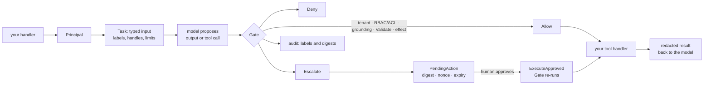

# Gobellim

**[English](README.md) · [Русский](README.ru.md)**


[](LICENSE)


Execution and policy layer for one LLM use case inside an existing Go service.
Gobellim is a library, not a platform: it starts no server, database or broker,
and the core module has no required dependencies.


The main invariant:

> The model may propose text, arguments or an action. It cannot grant itself
> permissions, change policy, register a tool or execute a side effect outside
> the Gate.

## Status

P0 and P1 from [`DESIGN.md`](./DESIGN.md) are implemented: typed tasks, typed
tools, schema by tags, labels and handles, the Gate, tenant binding, audit
events, limits, a sequential workflow with approval cards, sealed
continuations, resume checks and a `database/sql` claims store.

P2 is not implemented: replay/diff, detectors, HTTP approval handlers,
OpenTelemetry, quorum, compensation, and editing an approved action.

The runnable, notebook-style examples live in
[`examples/notebooks`](./examples/notebooks/README.md).

## The delta: one handler, made safe

An ordinary HTTP handler calls your LLM client directly:

```go
func (h *Handler) Chat(w http.ResponseWriter, r *http.Request) {
	var req chatRequest
	if err := json.NewDecoder(r.Body).Decode(&req); err != nil {
		http.Error(w, err.Error(), http.StatusBadRequest)
		return
	}
	answer, err := h.llm.Complete(r.Context(), req.Prompt)
	if err != nil {
		http.Error(w, err.Error(), http.StatusBadGateway)
		return
	}
	writeJSON(w, map[string]string{"answer": answer})
}
```

The same handler with Gobellim:

```diff
 func (h *Handler) Chat(w http.ResponseWriter, r *http.Request) {
     var req chatRequest
     if err := json.NewDecoder(r.Body).Decode(&req); err != nil {
         http.Error(w, err.Error(), http.StatusBadRequest)
         return
     }
-    answer, err := h.llm.Complete(r.Context(), req.Prompt)
+    res, err := h.task.Run(r.Context(), h.principal(r), TicketInput{
+        TenantID: principalFromRequest(r).Tenant,
+        TicketID: req.TicketID,
+        Body:     req.Prompt,
+    })
     if err != nil {
         http.Error(w, err.Error(), http.StatusBadGateway)
         return
     }
-    writeJSON(w, map[string]string{"answer": answer})
+    if res.Status == gobellim.TaskApprovalRequired {
+        // res.Pending is the escalated action. Nothing was executed.
+        writeJSON(w, map[string]any{"status": "approval_required", "action": res.Pending.Card})
+        return
+    }
+    writeJSON(w, map[string]string{"answer": res.Output.Reply})
 }
```

The handler keeps its `ctx`, its tooling and its business functions. Gobellim
adds one place where every model-initiated call is decided, and one place where
an approval resumes it.

## What Gobellim adds



- **Principal** — who calls: user, tenant, roles. It comes from your auth layer,
  never from model text.
- **Gate** — one function that turns a proposed action into `Allow`, `Deny` or
  `Escalate`. Unknown tool, invalid arguments, an authorizer error or a tenant
  mismatch are never `Allow`.
- **PendingAction** — a serializable escalation: resolved arguments, digest,
  nonce, expiry, and an HMAC that ties it to the engine that issued it. It is the
  only way to execute what a human approved, it is single-use, and an approval
  endpoint must never accept its fields from a client.
- **Audit** — labels, digests, decisions and counters. No prompt text, no raw
  arguments, no secrets.

Each is a gate on the call path, not a hook you can forget.

## Why Gobellim

Gobellim is a library, not a service: you keep your handlers, your concurrency
and your infrastructure. Each claim below is structural, and each one has code
and tests behind it.

- **One call path, no bypass.** Every model-initiated tool call is decided in
  [`gate.go`](./gate.go); the model loop in [`task.go`](./task.go) cannot reach a
  handler without it. [`internal/importrules`](./internal/importrules) is the
  build-time guard on the package graph.
- **The model gets no say in access.** Permissions and effects are declared on
  the tool ([`tool.go`](./tool.go)), checked by your `Authorizer`, and re-checked
  when an approved action resumes.
- **Raw secrets stay out of the prompt.** Input fields and tool results are
  masked or replaced with handles ([`handles.go`](./handles.go),
  [`redact.go`](./redact.go)); the model can only reference a handle.
- **An approval is a bound, single-use action.** The digest covers the tool and
  its arguments; the nonce is claimed before the handler runs
  ([`claims.go`](./claims.go), [`flow/`](./flow)); and the engine's HMAC rejects
  an action it did not issue ([`approval.go`](./approval.go)).
- **Audit is not a log of everything.** Events carry labels and digests, not
  values ([`audit.go`](./audit.go)); an unfinished run is audited as a failure,
  never as success.

General-purpose Go LLM frameworks give you adapters. You can wrap one with a
policy and a guard yourself — and then you own that wrapper and its tests.
Gobellim is that wrapper: the Gate, the approvals and the security suites ship
with it.

## Install

```sh
go get github.com/KirillYuzh/Gobellim
```

## Quickstart

The application keeps its handler, its `context.Context` and its business
functions. Gobellim fixes the model loop around them.

```go
type TicketInput struct {
	TenantID string `gobellim:"source=principal,required"`
	TicketID string `gobellim:"source=application,required"`
	Body     string `gobellim:"required,sensitivity=pii"`
	OrderID  string `gobellim:"sensitivity=secret"`
}

type TriageOutput struct {
	Category string `gobellim:"required,oneof=billing|technical|other"`
	Reply    string
}

type RefundArgs struct {
	OrderID string `gobellim:"required,ground"`
	Cents   int    `gobellim:"min=1,max=5000"`
}

type RefundResult struct {
	RefundID string
	Status   string
}

refund := gobellim.Tool[RefundArgs, RefundResult]{
	Name:       "orders.refund",
	Effect:     gobellim.Write, // required: the zero value is rejected
	Permission: "orders:refund",
	Resource: func(p gobellim.Principal, a RefundArgs) gobellim.Resource {
		return gobellim.Resource{Type: "order", ID: a.OrderID, TenantID: p.Tenant}
	},
	Validate: validateRefundAgainstBusinessRules,
	Run: func(ctx context.Context, p gobellim.Principal, a RefundArgs) (RefundResult, error) {
		return orders.Refund(ctx, p.Tenant, a.OrderID, a.Cents)
	},
}

engine, err := gobellim.New(
	gobellim.WithModel(model),               // your adapter; see plugins/gigachat
	gobellim.WithAuthorizer(existing),       // your RBAC/ACL
	gobellim.WithAudit(gobellim.SlogSink{}), // required; or plugins/langfuse
	gobellim.WithLimits(gobellim.Limits{
		MaxInputBytes:  32 << 10,
		MaxOutputBytes: 16 << 10,
		MaxToolCalls:   3,
	}),
)
if err != nil {
	return err
}

task, err := gobellim.NewTask[TicketInput, TriageOutput](engine, gobellim.TaskConfig{
	Name:        "ticket.triage",
	Instruction: "Classify the ticket and propose a reply.",
	Tools:       []gobellim.ToolDef{refund},
})
if err != nil {
	return err
}

res, err := task.Run(ctx, principalFromRequest(r), in)
if err != nil {
	return err
}
if res.Status == gobellim.TaskApprovalRequired {
	// res.Pending is the escalated action. After a human approves it:
	//   out, rec, err := task.ExecuteApproved(ctx, requester, approver, res.Pending)
}
```

`gobellim.New` uses functional options. A nil model, authorizer or audit sink is
`ErrInvalidConfig`; there is no permissive default and no silent run without an
audit trail. In a test that ignores audit, pass
`gobellim.SlogSink{Logger: slog.New(slog.DiscardHandler)}`. Budgets can be tightened per
task with `TaskConfig.Limits`; a zero field inherits the engine value.

## The Gate

Every model-initiated call goes through the Gate: tenant binding, grounding,
RBAC/ACL, business validation, then the effect ceiling. Grounding comes before
the ACL so a resource id the model invented never reaches your `Authorizer`, and
authorization comes before `Validate` so a business rule never runs for a caller
who could not perform the action anyway.

| Worst argument integrity | Read  | Write    | Egress | Destructive |
| ------------------------ | ----- | -------- | ------ | ----------- |
| `Trusted` / `Validated`  | allow | allow    | allow  | escalate    |
| `Derived`                | allow | escalate | deny   | deny        |
| `Untrusted` / no labels  | allow | escalate | deny   | deny        |

On top of the table:

- `Effect` is explicit. Its zero value is `EffectUnknown` and `NewTask` rejects
  it, so a mutating tool cannot silently become `Read`.
- `Resource` is required for `Write`, `Egress` and `Destructive`: without a
  target the ACL check would silently degrade to RBAC only.
- an empty label set is `Untrusted`, not `Trusted`;
- `Resource.TenantID` must match `Principal.Tenant` (an empty value is filled
  from the principal);
- an `Authorizer` error is `Deny`;
- an unknown tool or invalid arguments is `Deny`;
- an argument marked `ground` must be an existing handle; a raw value is `Deny`;
- a business `Validate` error is `Deny`;
- the model's own claims about permissions never matter.

**How an argument becomes `Validated`.** A handle-backed argument whose
business meaning the application confirmed is `Validated`: the runtime minted
the handle for this run, and `Tool.Validate` passed. Free model text stays
`Derived`. A tool without `Validate` never gets the promotion, so a write still
needs a human. This is the only path from model input to an unattended
`Write`/`Egress`, and it still requires RBAC/ACL.

## Schema by tags

The supported subset is deliberately small and fails closed.

| Tag                    | Meaning                                                      |
| ---------------------- | ------------------------------------------------------------ |
| `required`             | reject the zero value (not allowed on `bool`)                |
| `source=principal`     | the value must equal the matching field of `Principal`       |
| `source=application`   | the value is application state and becomes trusted           |
| `untrusted`            | explicit untrusted input (the default for an untagged field) |
| `sensitivity=pii`      | replace email/phone/card-like matches with handles           |
| `sensitivity=secret`   | replace the whole value with one handle                      |
| `sensitivity=internal` | label only; no masking                                       |
| `oneof=a\|b`           | string enum                                                  |
| `min`, `max`           | numeric range, or item count for a slice                     |
| `ground`               | the argument must be an existing handle                      |

`source` and `ground` apply only to strings. `sensitivity` applies to strings
and `[]string`. Supported field types: `string`, `bool`, integers, floats,
slices of scalars, and nested structs up to two levels. `time.Time`, `[]byte`,
maps, pointers, interfaces, embedded structs without an explicit `json` name
and deeper nesting are rejected by `NewTask`. This is intentional: a schema that
does not match `encoding/json` would lie to the model.

The model-facing JSON Schema is generated from these tags, but the runtime
decodes and validates the arguments again. The schema is not a security
boundary.

The same `sensitivity` tags apply to a tool **result** before it re-enters the
model context: a `secret` field becomes a handle and a `pii` field is masked.
A result struct is ordinary Go, so `time.Time` and `json.Marshaler` values are
passed through unchanged. An unknown tag on a result is a configuration error,
not a silent no-op.

## Grounding is a handle

A `ground` field accepts only a handle minted for this run. The model cannot
invent an ID and cannot copy an unrelated trusted string. To let the model
reference a value, mark the input field `sensitivity=secret` (or
`sensitivity=pii`). `source=application` labels the value `Trusted`, but does not
create a handle by itself.

```go
type TicketInput struct {
	OrderID string `gobellim:"sensitivity=secret,required"`
}
type RefundArgs struct {
	OrderID string `gobellim:"required,ground"`
}
// The model sees {"OrderID":"<h1>"} and may pass "<h1>" to orders.refund.
```

## Human approval

`flow` is the sequential, code-driven workflow. It never resumes a Go stack: it
suspends at a step boundary, seals the minimal state into a token and continues
from the next step after the checks in `DESIGN.md` §8.6.

```go
sealer, err := flow.NewSealer("v1", key) // AES-GCM; the key is an app secret
if err != nil {
	return err
}
store, err := sqlstore.New(db) // optional: cross-replica replay protection
if err != nil {
	return err
}
wf, err := flow.New[RefundCase]("refund",
	flow.WithAuthorizer(authz),
	flow.WithSealer(sealer), // required
	flow.WithAudit(auditSink), // required
	flow.WithStore(store),
	flow.WithTTL(24*time.Hour),
)
if err != nil {
	return err
}

wf.Step("propose", proposeRefund).
	ApprovePending("manager", func(s RefundCase) *gobellim.PendingAction {
		return &s.Pending
	}, flow.ApproveConfig[RefundCase]{
		Permission:       "refund:approve",
		ActionPermission: "orders:refund",
		FourEyes:         true,
		Resource:         refundResource,
	}).
	Step("execute", func(ctx context.Context, p gobellim.Principal, s *RefundCase) error {
		// p is the requester: Resume re-runs the remaining steps as them.
		approver, ok := flow.ApproverFrom(ctx)
		if !ok {
			return errors.New("no approver in the context")
		}
		_, _, err := task.ExecuteApproved(ctx, p, approver, &s.Pending)
		return err
	})

res, err := wf.Run(ctx, requester, state)
// res.Status == flow.Suspended
// send res.Suspension.Card and res.Suspension.Token to the approver UI

out, err := wf.Resume(ctx, approver, res.Suspension.Token, flow.Approve)
```

Resume checks the AEAD, tenant binding, expiry, workflow version, the step id,
approver permission, four-eyes, the requester's action permission, the action
digest and an atomic claim. A rejected approval, an expired token, a revoked
permission or a changed action never executes the step. A rejection claims the
nonce as well, so a "no" cannot be replayed later as a "yes". Without
`WithStore` the flow uses a process-local `MemStore`, so a token cannot be
resumed twice inside one replica; a shared store is needed between replicas.

`Task.ExecuteApproved` runs a `PendingAction` after a human approved it. The Gate
re-checks tenant, RBAC/ACL, `Validate`, tool/effect and the digest of the exact
arguments the human saw; the approver is recorded as `approval.granted`. The
nonce is claimed before your handler runs, so a second call is
`ErrApprovalReplay` and a crash in that window loses the approval instead of
double-executing it.

A `PendingAction` also carries an HMAC over its fields, keyed by the engine. Keep
it on the server: an approval endpoint that decodes a `PendingAction` from a
request body hands the client the arguments, the digest and the nonce, and the
engine rejects it as `ErrApprovalDrift`. A random per-process key is the default;
`gobellim.WithApprovalKey` sets a shared 32-byte key when one replica escalates
and another executes.

## Observability

```go
sink, err := langfuse.New(langfuse.Config{
	Host:      "https://cloud.langfuse.com",
	PublicKey: os.Getenv("LANGFUSE_PUBLIC_KEY"),
	SecretKey: os.Getenv("LANGFUSE_SECRET_KEY"),
	OnDrop:    func(e gobellim.Event) { metrics.Inc("audit_dropped", string(e.Kind)) },
})
if err != nil {
	return err
}
defer sink.Close(ctx)

engine, err := gobellim.New(
	gobellim.WithModel(model),
	gobellim.WithAuthorizer(authz),
	gobellim.WithAudit(sink),
)
```

The sink batches `trace-create`, `generation-create` and `span-create` events. It
sends only what an audit event already contains: labels, digests, decisions,
latency and token counts. Prompt text, raw arguments and secrets are never sent.
For a local walkthrough, use `langfuse.Config{DryRun: true, Writer: os.Stdout}`.

Model adapters live in optional packages. `plugins/gigachat` implements the
freemium OAuth flow and maps GigaChat's `functions`/`function_call` shape. See
the runnable notebooks.

## Guarantees and non-goals

Guaranteed when the application integrates correctly:

- a model tool call never reaches a handler without the Gate;
- unknown tool, invalid arguments, authorizer error and a tenant mismatch do not
  become `Allow`;
- an empty argument set is not treated as trusted;
- a `ground` argument cannot be satisfied by a raw model string;
- free model text does not become trusted through a JSON schema or a
  paraphrase;
- an approval is bound to the tool and arguments it was shown,
  `ExecuteApproved` re-runs the Gate, the approval is single-use, and an action
  the engine did not issue is rejected;
- `sensitivity` on a tool result keeps a secret out of the model context;
- audit events carry labels and digests, not prompt text or secrets;
- an unfinished run is audited as `task.failed`, never as `task.completed`.

Not guaranteed:

- exactly-once for an external side effect: a shared `Store` gives a single-use
  claim, idempotency belongs to the provider;
- redaction inside a map or a self-marshalling type in a tool result;
- that the model produces no harmful or false text;
- exact data-flow tracking inside the model;
- cross-replica single-use resume without a shared `Store`;
- durable recovery of an arbitrary Go function;
- retrieval/RAG. The library does not fetch or filter documents; the
  application applies its data ACL before it calls `Task`;
- `ReaderSet` / per-reader data ACL. It is not implemented; the application owns
  its data ACL.

## Documentation

`docs/` is plain Markdown and reads directly on GitHub. `site/` renders the same
files with Next.js and Fumadocs:

```sh
cd site && npm install && npm run dev
```

- [`DESIGN.md`](./DESIGN.md) — the specification.
- [`docs/README.md`](./docs/README.md) — the how-to guide.
- [`examples/notebooks`](./examples/notebooks/README.md) — runnable scenarios,
  mocks and real GigaChat free-tier calls.
- [`plugins/langfuse`](./plugins/langfuse) — audit sink.
- [`plugins/gigachat`](./plugins/gigachat) — model adapter.

## Contributing

Gobellim accepts issues, forks and pull requests. Start with
[CONTRIBUTING.md](.github/CONTRIBUTING.md). Security reports go through
[SECURITY.md](SECURITY.md), not the public tracker.

## License

[`MIT`](LICENSE)
