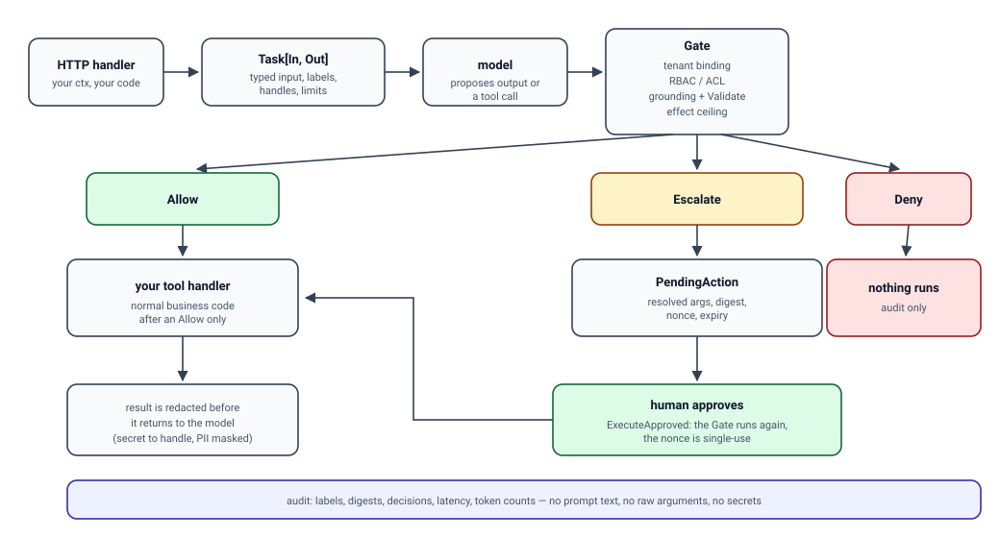
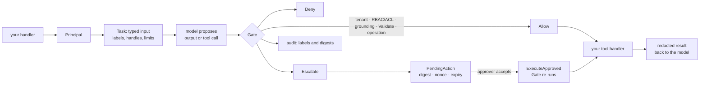

# Gobellim

**[English](README.md) · [Русский](README.ru.md)**


[](LICENSE)


Gobellim is a Go library: the execution and policy layer for one LLM use case inside an existing Go service.

## Install

```sh
go get github.com/KirillYuzh/Gobellim
```

## One handler, made safe

An ordinary HTTP handler calls your LLM client directly:

```go
func (h *Handler) Chat(w http.ResponseWriter, r *http.Request) {
	var req chatRequest
	if err := json.NewDecoder(r.Body).Decode(&req); err != nil {
		http.Error(w, err.Error(), http.StatusBadRequest)
		return
	}
	answer, err := h.llm.Complete(r.Context(), req.Prompt)
	if err != nil {
		http.Error(w, err.Error(), http.StatusBadGateway)
		return
	}
	writeJSON(w, map[string]string{"answer": answer})
}
```

The same handler with Gobellim:

```diff
 func (h *Handler) Chat(w http.ResponseWriter, r *http.Request) {
     var req chatRequest
     if err := json.NewDecoder(r.Body).Decode(&req); err != nil {
         http.Error(w, err.Error(), http.StatusBadRequest)
         return
     }
-    answer, err := h.llm.Complete(r.Context(), req.Prompt)
+    res, err := h.task.Run(r.Context(), h.principal(r), TicketInput{
+        TenantID: principalFromRequest(r).Tenant,
+        TicketID: req.TicketID,
+        Body:     req.Prompt,
+    })
     if err != nil {
         http.Error(w, err.Error(), http.StatusBadGateway)
         return
     }
-    writeJSON(w, map[string]string{"answer": answer})
+    if res.Status == gobellim.TaskApprovalRequired {
+        // res.Pending is the escalated action. Nothing was executed.
+        writeJSON(w, map[string]any{"status": "approval_required", "action": res.Pending.Card})
+        return
+    }
+    writeJSON(w, map[string]string{"answer": res.Output.Reply})
 }
```

The handler keeps its `ctx`, its tooling and its business functions. Gobellim
adds one place where every model-initiated call is decided, and one place where
an approval resumes it.

## What Gobellim adds





| Gate          | Responsibility                                                                                                                                                                                                                                                                      |
| ------------- | ----------------------------------------------------------------------------------------------------------------------------------------------------------------------------------------------------------------------------------------------------------------------------------- |
| Principal     | who calls: user, tenant, roles. It comes from your auth layer, never from model text.                                                                                                                                                                                               |
| Gate          | one function that turns a proposed action into `Allow`, `Deny` or `Escalate`. Unknown tool, invalid arguments, an authorizer error or a tenant mismatch are never `Allow`.                                                                                                          |
| PendingAction | a serializable escalation: resolved arguments, digest, nonce, expiry, and an HMAC that ties it to the engine that issued it. It is the only way to execute what a trusted approver accepted, it is single-use, and an approval endpoint must never accept its fields from a client. |
| Audit         | labels, digests, decisions and counters. No prompt text, no raw arguments, no secrets.                                                                                                                                                                                              |

Each is a gate on the call path, not a hook you can forget.

## Why Gobellim

Gobellim is a library, not a service: you keep your handlers, your concurrency
and your infrastructure. Each claim below is structural, and each one has code
and tests behind it.

- **One call path, no bypass.** Every model-initiated tool call is decided in
  [`gate.go`](./gate.go); the model loop in [`task.go`](./task.go) cannot reach a
  handler without it. [`internal/importrules`](./internal/importrules) is the
  build-time guard on the package graph.
- **The model gets no say in access.** Permissions and operation classes are
  declared on the tool ([`tool.go`](./tool.go)), checked by your `Authorizer`,
  and re-checked when an approved action resumes.
- **Raw secrets stay out of the prompt.** Input fields and tool results are
  masked or replaced with handles ([`handles.go`](./handles.go),
  [`redact.go`](./redact.go)); the model can only reference a handle.
- **An approval is a bound, single-use action.** The digest covers the tool and
  its arguments; the nonce is claimed before the handler runs
  ([`claims.go`](./claims.go), [`flow/`](./flow)); and the engine's HMAC rejects
  an action it did not issue ([`approval.go`](./approval.go)).
- **Audit is not a log of everything.** Events carry labels and digests, not
  values ([`audit.go`](./audit.go)); an unfinished run is audited as a failure,
  never as success.

General-purpose Go LLM frameworks give you adapters. You can wrap one with a
policy and a guard yourself — and then you own that wrapper and its tests.
Gobellim is that wrapper: the Gate, the approvals and the security suites ship
with it.

## Quickstart

The application keeps its handler, its `context.Context` and its business
functions. Gobellim fixes the model loop around them.

```go
type TicketInput struct {
	TenantID string `gobellim:"source=principal,required"`
	TicketID string `gobellim:"source=application,required"`
	Body     string `gobellim:"required,sensitivity=patterns"`
	OrderID  string `gobellim:"sensitivity=secret"`
}

type TriageOutput struct {
	Category string `gobellim:"required,oneof=billing|technical|other"`
	Reply    string `gobellim:"resolve"`
}

type RefundArgs struct {
	OrderID string `gobellim:"required,ground"`
	Cents   int    `gobellim:"min=1,max=5000"`
}

type RefundResult struct {
	RefundID string
	Status   string
}

refund := gobellim.Tool[RefundArgs, RefundResult]{
	Name:       "orders.refund",
	Operation:  gobellim.Write, // required: the zero value is rejected
	Permission: "orders:refund",
	Target: func(p gobellim.Principal, a RefundArgs) gobellim.Resource {
		return gobellim.Resource{Type: "order", ID: a.OrderID, TenantID: p.Tenant}
	},
	Validate: validateRefundAgainstBusinessRules,
	Run: func(ctx context.Context, p gobellim.Principal, a RefundArgs) (RefundResult, error) {
		return orders.Refund(ctx, p.Tenant, a.OrderID, a.Cents)
	},
}

engine, err := gobellim.New(
	gobellim.WithModel(model),               // your adapter; see plugins/gigachat
	gobellim.WithAuthorizer(existing),       // your RBAC/ACL
	gobellim.WithAudit(gobellim.SlogSink{}), // required; or plugins/langfuse
	gobellim.WithLimits(gobellim.Limits{
		MaxInputBytes:  32 << 10,
		MaxOutputBytes: 16 << 10,
		MaxToolCalls:   3,
	}),
)
if err != nil {
	return err
}

task, err := gobellim.NewTask[TicketInput, TriageOutput](engine, gobellim.TaskConfig{
	Name:        "ticket.triage",
	Instruction: "Classify the ticket and propose a reply.",
	Tools:       []gobellim.ToolDef{refund},
})
if err != nil {
	return err
}

res, err := task.Run(ctx, principalFromRequest(r), in)
if err != nil {
	return err
}
if res.Status == gobellim.TaskApprovalRequired {
	// res.Pending is the escalated action. After an approver accepts it:
	//   out, rec, err := task.ExecuteApproved(ctx, requester, approver, res.Pending)
}
```

`gobellim.New` uses functional options. A nil model, authorizer or audit sink is
`ErrInvalidConfig`; there is no permissive default and no silent run without an
audit trail. In a test that ignores audit, pass
`gobellim.SlogSink{Logger: slog.New(slog.DiscardHandler)}`. Budgets can be tightened per
task with `TaskConfig.Limits`; a zero field inherits the engine value.

The snippet above is the body of `Example` in [`example_test.go`](./example_test.go),
which `go test` compiles and runs, so a rename that breaks the quickstart breaks
the build instead of the reader.

## The Gate

Every model-initiated call gets one decision: tenant binding, grounding, RBAC/ACL,
business validation, then the operation ceiling.

| Worst argument integrity | Read, Compute | Write    | Send  | Delete   |
| ------------------------ | ------------- | -------- | ----- | -------- |
| `Trusted`                | allow         | allow    | allow | escalate |
| `Derived`                | allow         | escalate | deny  | deny     |
| `Untrusted` / no labels  | allow         | escalate | deny  | deny     |

- `Operation` has no permissive zero value; `NewTask` rejects `OperationUnknown`.
- `Target` must return a `Resource` with a non-empty `Type`, `ID` and `TenantID`.
  A missing tenant is `Deny`, not a reason to copy the caller's.
- An empty label set is `Untrusted`. An `Authorizer` error, an unknown tool,
  invalid arguments, an ungrounded argument or a failing `Validate` is `Deny`.
- `Resource.TenantID` must equal `Principal.Tenant`.

Trust is only ever a handle minted for an input field marked `source=principal`
or `source=application`. Free model text is `Derived`, and a passing `Validate`
does not change that: it confirms the business meaning, not where the value came
from.

## Schema by tags

| Tag                    | Meaning                                                   |
| ---------------------- | --------------------------------------------------------- |
| `required`             | reject the zero value (not allowed on `bool`)             |
| `source=principal`     | the value must equal the matching field of `Principal`    |
| `source=application`   | the value is application state and becomes trusted        |
| `ref`                  | mint a handle, keep the value public                      |
| `resolve`              | (output only) a handle token becomes its value again      |
| `sensitivity=patterns` | replace checked email/phone/card matches with handles     |
| `sensitivity=secret`   | replace the whole value with one handle                   |
| `sensitivity=internal` | label only; no masking                                    |
| `oneof=a\|b`           | string enum                                               |
| `min`, `max`           | numeric range, or item count for a slice                  |
| `ground`               | the argument must be a handle for the argument's own path |
| `ground=TicketID`      | the argument must be a handle for that input field        |
| `ground=any`           | the argument must be a handle for any input field         |

`source` and `ref` belong on a task input field, `ground` on a tool argument. A
tag on the wrong side is `ErrInvalidConfig` at `NewTask`, not a silent no-op.

Supported field types: `string`, `bool`, numbers, slices of scalars and nested
structs up to two levels. `time.Time`, `[]byte`, maps, pointers and deeper
nesting are rejected on purpose: the JSON Schema sent to the model must not
describe a shape the runtime cannot decode.

The same `sensitivity` tags apply to a tool result before it re-enters the model
context. An unknown tag on a result is an error, not a silent way to turn masking
off.

`sensitivity=patterns` is a regular expression with a checksum behind it, not a
classifier. It does not recognise a passport, an address or a name, and a miss is
silent. It reduces what the model sees; it does not replace a data ACL or a DLP
system.

## Grounding is a handle

A `ground` field accepts only a handle minted for this run, so the model cannot
invent an ID or paste a trusted string it saw elsewhere. Mark the input field
`ref` to make a public value addressable: the model sees a handle, while the
approver card and the audit keep the value. For confidential data use
`sensitivity=secret` instead.

`ref` mints one handle for the whole value, `secret` hides the whole value and
mints the same handle, and `pii` masks only the fragments it detects. Pick by
what the model needs to reference, not by how secret the value feels.

A bare `ground` binds to the argument's own path. `ground=TicketID` names another
input field. `ground=any` is the explicit opt-out.

```go
type TicketInput struct {
	OrderID string `gobellim:"sensitivity=secret,required"`
}
type RefundArgs struct {
	OrderID string `gobellim:"required,ground"`
}
// The model sees {"OrderID":"<h1>"} and may pass "<h1>" to orders.refund.
```

## Approval

A write with model-derived arguments is not executed. `Task.Run` returns
`TaskApprovalRequired` and a `PendingAction` with the resolved arguments, their
digest, a nonce, an expiry and an HMAC from the issuing engine. Keep it on the
server; an approval endpoint must never accept these fields from a client.

The decision comes from outside the model: a person, or your own business logic
acting as an authenticated `Principal`. The Gate checks the same action either
way.

The card the approver sees is masked: a secret argument is a handle, a
`sensitivity=patterns` argument is masked, and `Provenance` says which field is
which. The real values
stay in `PendingAction.Args` on the server.

```go
if res.Status == gobellim.TaskApprovalRequired {
	save(ctx, res.RunID, res.Pending)
}
// later, after an authenticated approver decides:
out, rec, err := task.ExecuteApproved(ctx, requester, approver, pending)
```

`ExecuteApproved` re-runs the Gate: tenant binding, RBAC/ACL, `Validate` and the
digest of the exact arguments that run. The operation ceiling is the only check
an approval replaces. The nonce is claimed before the handler runs, so a second
call is `ErrApprovalReplay`, and a crash in that window loses the approval
instead of executing it twice.

`flow` adds multi-step workflows and approval boundaries:

```go
wf, err := flow.FromEngine[RefundCase](engine, "refund")
wf.Step("propose", proposeRefund).
	ApproveTask("manager", task, flow.ApproveTaskConfig[RefundCase]{
		Pending:          func(s RefundCase) *gobellim.PendingAction { return &s.Pending },
		Permission:       "refund:approve", // what the approver may do
		ActionPermission: "orders:refund",  // re-checked for the requester
		FourEyes:         true,
	}).
	Step("notify", notifyCustomer)

res, _ := wf.Run(ctx, requester, RefundCase{}) // res.Status == flow.Suspended
out, err := wf.Resume(ctx, approver, *res.Suspension, res.State, flow.VerdictApprove)
```

`ApproveTask` takes the card, the digest and the resolved arguments from the
`PendingAction`, and adds the step that calls `ExecuteApproved` with the
authenticated approver. Nothing is copied into the state by hand, so the
approver decides on the action that will run. Use `Approve` plus your own step
when the post-approval work is more than that one call.

`Resume` checks the tenant, expiry, workflow version, step id, the approver's
permission, four-eyes, the requester's action permission, the recomputed digest
and an atomic claim. A rejection claims the nonce too, so a "no" cannot be
replayed as a "yes".

The `Suspension` and the state are yours to store. A suspension built from a
request body is `ErrFlowDrift`, because the issuing flow signs it. Without
`WithStore` the claim store is process-local; between replicas, share a `Store`
and give every engine the same `gobellim.WithApprovalKey`.

Without `WithClaimStore` the store keeps 262,144 nonces, which is about 70
approvals per second at the default one-hour TTL. When it is full the claim fails
closed with `ErrClaimStoreFull`; use `store/sql` above that rate.

### Which path

- **One action, one decision.** `Task.Run` returns a `PendingAction` and
  `ExecuteApproved` executes it. This is the shortest path to production.
- **Several steps, a TTL, or a durable suspension.** `flow` runs one
  `Run`/`Resume` pair per approval boundary and keeps the state in your store.
- **`flow` is the stricter one.** It authorizes the approver through the
  `Authorizer` and re-checks the requester's action permission on resume.
  `ExecuteApproved` trusts the two principals the application passes, so the
  application must authenticate both.

## Observability

`Sink` gets labels, digests, decisions, latency and token counts. Prompt text,
raw arguments and secrets never reach it.

```go
sink, err := langfuse.New(langfuse.Config{
	Host:      "https://cloud.langfuse.com",
	PublicKey: os.Getenv("LANGFUSE_PUBLIC_KEY"),
	SecretKey: os.Getenv("LANGFUSE_SECRET_KEY"),
	OnDrop:    func(e gobellim.Event) { metrics.Inc("audit_dropped", string(e.Kind)) },
})
if err != nil {
	return err
}
defer sink.Close(ctx)

engine, err := gobellim.New(
	gobellim.WithModel(model),
	gobellim.WithAuthorizer(authz),
	gobellim.WithAudit(sink),
)
```

`plugins/gigachat` is a model adapter: freemium OAuth and the
`functions`/`function_call` mapping. Runnable scenarios live in
[`examples/notebooks`](./examples/notebooks/README.md).

## Guarantees and non-goals

Guaranteed when the integration is correct:

- a model tool call cannot reach a handler without the Gate;
- unknown tool, invalid arguments, an authorizer error, a foreign tenant and an
  ungrounded argument never become `Allow`;
- free model text never becomes `Trusted` through a schema, a paraphrase or a
  passing validator;
- an approval is bound to the action it showed, re-checks the Gate, runs once,
  and is rejected when the engine did not issue it;
- the approver sees masked values, and `Out` resolves handles this run minted,
  but only in fields tagged `resolve`; everywhere else the tokens are dropped;
- audit events carry labels and digests, and an unfinished run is `task.failed`,
  never `task.completed`;
- a panic in a tool handler is not turned into `Deny`. It unwinds through the
  runtime, the run is audited as failed, and your server's `recover` decides what
  happens next.

Not guaranteed:

- exactly-once for an external side effect: a shared `Store` gives a single-use
  claim, and idempotency belongs to the provider;
- redaction inside a map or a self-marshalling type in a tool result;
- that the model produces no harmful or false text;
- cross-replica single-use resume without a shared `Store`;
- durable recovery of an arbitrary Go function;
- retrieval/RAG and per-reader data ACL. The application filters documents before
  it calls `Task`; `ReaderSet` does not exist.

## Documentation

`docs/` is plain Markdown and reads directly on GitHub. `site/` renders the same
files with Next.js and Fumadocs:

```sh
cd site && npm install && npm run dev
```

- [`DESIGN.md`](./DESIGN.md) — the specification.
- [`docs/README.md`](./docs/README.md) — the how-to guide.
- [`examples/notebooks`](./examples/notebooks/README.md) — runnable scenarios,
  mocks and real GigaChat free-tier calls.
- [`plugins/langfuse`](./plugins/langfuse) — audit sink.
- [`plugins/gigachat`](./plugins/gigachat) — model adapter.

## Contributing

Gobellim accepts issues, forks and pull requests. Start with
[CONTRIBUTING.md](.github/CONTRIBUTING.md). Security reports go through
[SECURITY.md](SECURITY.md), not the public tracker.

## License

[`MIT`](LICENSE)
