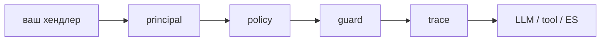

# Gobellim

**[Русский](README.ru.md) · [English](README.md)**


[](LICENSE)


Нативные Go-примитивы для безопасной работы с LLM: поиск, вызов инструментов и
guardrails за одним путём вызова, проверяющим права.


## Посмотреть за 60 секунд

[demo](./demo) — чат-бот поддержки на скелете Clean Architecture с предзаполненной
базой знаний. Первый запуск тянет образы и модель эмбеддера; после этого стек
поднимается примерно за минуту.

```sh
cp demo/.env.example demo/.env                 # добавьте GIGACHAT_CREDENTIALS (пропустите, если файл уже есть)
docker compose --env-file demo/.env \
  -f demo/deploy/docker-compose.yml up -d
```

Бот пишет в лог `knowledge base ready` и `bot listening` на `:8080`. Спросите его
от `root` и от `alice`: `alice` получит отказ на погоду, потому что этот инструмент
вырезается из её схемы до того, как его увидит модель. Ручки и готовый `curl` — в
[demo/README.ru.md](./demo/README.ru.md).

Поиск, типизированный вывод, guardrails и трейсы идут тем же путём вызова, что даёт
библиотека.

## Дельта: один хендлер, сделанный безопасным

Обычный HTTP-хендлер вызывает ваш LLM-клиент напрямую:

```go
func (h *Handler) Chat(w http.ResponseWriter, r *http.Request) {
	var req chatRequest
	if err := json.NewDecoder(r.Body).Decode(&req); err != nil {
		http.Error(w, err.Error(), http.StatusBadRequest)
		return
	}
	answer, err := h.llm.Complete(r.Context(), req.Prompt)
	if err != nil {
		http.Error(w, err.Error(), http.StatusBadGateway)
		return
	}
	writeJSON(w, map[string]string{"answer": answer})
}
```

Тот же хендлер с Gobellim:

```diff
 func (h *Handler) Chat(w http.ResponseWriter, r *http.Request) {
     var req chatRequest
     if err := json.NewDecoder(r.Body).Decode(&req); err != nil {
         http.Error(w, err.Error(), http.StatusBadRequest)
         return
     }
-    answer, err := h.llm.Complete(r.Context(), req.Prompt)
+    ctx := kit.WithPrincipal(r.Context(), kit.Principal{
+        UserID: req.UserID, Roles: req.Roles, Tenant: req.Tenant,
+    })
+    res, err := h.app.Chat(ctx, kit.ChatRequest{
+        Messages: []model.Message{{Role: model.RoleUser, Content: req.Prompt}},
+    })
     if err != nil {
         http.Error(w, err.Error(), http.StatusBadGateway)
         return
     }
-    writeJSON(w, map[string]string{"answer": answer})
+    writeJSON(w, map[string]string{"answer": res.Message.Content})
 }
```

Это всё изменение в хендлере. Приложение собирается один раз на старте (`kit.New`,
ниже). `Chat` проверяет права до любого вызова модели или хранилища, прогоняет
guard по входу, результатам инструментов и выходу, пишет трейс и отдаёт модели
только те инструменты, которые вызывающему разрешены.

## Что добавляет Gobellim

Вы оставляете себе хендлер, `ctx` и клиент Elasticsearch, который у вас уже есть.
Gobellim добавляет четыре гейта:



- **principal** — кто вызывает: пользователь, роли, тенант.
- **policy** — что вызывающему можно; по умолчанию запрещено всё.
- **guard** — детерминированные правила L1 плюс обязательный L2-детектор.
- **trace** — каждый вызов записан, по умолчанию замаскирован и может быть оценён.

Каждый — гейт на пути вызова, а не хук, который можно забыть.

## Почему Gobellim

Gobellim — библиотека, а не сервис: вы сохраняете свои хендлеры, конкурентность и
инфраструктуру. Каждое утверждение ниже — структурное, и за каждым стоят код и
тесты.

- **Один путь вызова, без обхода.** Любая операция идёт через
  [`internal/call`](./internal/call) — авторизация, guard, span, выполнение, — а
  [`internal/importrules`](./internal/importrules) проверяет граф пакетов на этапе
  сборки.
- **Модель не решает про доступ.** Инструменты, недоступные вызывающему, вырезаются
  из схемы до вызова модели и проверяются снова при исполнении
  ([`authz.AllowedTools`](./authz/authz.go), `TestAllowedTools`).
- **Поиск не может расшириться на другой тенант.** Тенант и ACL входят в kNN-фильтр,
  а поиск deny-by-default ([`store/filter.go`](./store/filter.go),
  `filter_test.go`, `filter_fuzz_test.go`).
- **Трейсы по умолчанию несут маскированный текст.** Исходный текст сообщений не
  сохраняется, пока вы явно не включите это ([`trace/policy.go`](./trace/policy.go),
  `pii_test.go`).
- **L2 обязателен намеренно.** Внутренний security review или сертификация обычно
  требуют ML-слой. `guard.L1Only()` существует для явного L1-only и виден в
  `Health()`, а не молчит (`D80`).

Универсальные Go-фреймворки для LLM дают адаптеры. Вы можете обернуть один из них
policy и guard сами — и тогда этот wrapper и его тесты остаются на вас. Gobellim —
это такой wrapper, уже протестированный: hardening-, egress- и concurrency-наборы
идут вместе с ним.

## Установка

```sh
go get github.com/KirillYuzh/Gobellim
```

## Документация

`docs/` — обычный Markdown, он читается прямо на GitHub. `site/` рендерит те же
файлы через Next.js и Fumadocs:

```sh
cd site && npm install && npm run dev
```

Начните с [docs/README.md](./docs/README.md).

## Быстрый старт

```go
app, err := kit.New(ctx, kit.Config{
	ES:      es,     // опционально: ваш клиент store.ES (поиск, память, трейсы)
	LLM:     llm,    // vLLM, Ollama, OpenAI-совместимый API или GigaChat
	Policy:  policy, // authz.Load("policy.yaml")
	GuardL2: guard.L1Only(), // путь для оценки; продакшен: guard/gliner (-tags ort)
})
if err != nil {
	return err
}
if err := app.Setup(ctx); err != nil { // один раз создаёт индексы; без ES — no-op
	return err
}

// Инструмент — типизированная Go-функция: схема и валидация берутся из типа.
if _, err := kit.Tool(app, "get_weather", getWeather, kit.Desc("Текущая погода в городе.")); err != nil {
	return err
}

// У каждого вызова есть личность вызывающего.
ctx = kit.WithPrincipal(ctx, kit.Principal{UserID: "u-1", Roles: []string{"user"}, Tenant: "acme"})

res, err := app.Chat(ctx, kit.ChatRequest{
	System:   "Ты ассистент поддержки. Отвечай кратко.",
	Messages: []model.Message{{Role: model.RoleUser, Content: "Какая погода в Москве?"}},
})
```

`GuardL2: guard.L1Only()` — явный путь для оценки: `New` пишет warning, а `Health()`
показывает `GuardL1Only: true`. В продакшене задайте `GuardL2` поставляемым
ML-детектором, собранным с `-tags ort`; `nil` в `GuardL2` — это
`ErrInvalidConfig` (D80).

`ES` опционален: без него работают chat, инструменты и `Generate`, а для поиска,
ingest, памяти и сохранения трейсов нужен Elasticsearch (или `trace.Sink` для
трейсов).

## Policy на одном экране

Запрещено всё, затем разрешаем ровно то, что нужно роли:

```yaml
version: 1
default: deny

roles:
  user:
    permissions: [chat, search, "tool:kb_search"]
```

Две готовые отправные точки:

```yaml
# Read-only поддержка: только поиск и память, без генерации.
version: 1
default: deny
roles:
  support:
    permissions: [search, memory]
```

```yaml
# Админ: wildcard даёт все права и все инструменты.
version: 1
default: deny
roles:
  admin:
    permissions: ["*"]
```

`tool:<name>` — право на конкретный инструмент; инструмент, который вызывающему
недоступен, вообще не попадает в схему модели.

## Операции

| Операция      | Право         | Заметки                                               |
| ------------- | ------------- | ----------------------------------------------------- |
| `Chat`        | `chat`        | ограниченный цикл инструментов; права на каждый вызов |
| `ChatStream`  | `chat`        | guard'нутый поток по скользящему окну                 |
| `CallTool`    | `tool:<name>` | один инструмент тем же путём                          |
| Память        | `memory`      | история, recall и working                             |
| `Generate[T]` | `generate`    | типизированный вывод, проверка по схеме               |
| `Ingest`      | `ingest`      | чанкинг, эмбеддинги, индексация                       |
| `Search`      | `search`      | BM25 + kNN под ACL вызывающего                        |
| `Delete`      | `delete`      | удалить документ                                      |
| `Prune`       | `prune`       | ретенция по возрасту                                  |
| `Score`       | `trace`       | оценка трейса                                         |

`Ingest`, `Search` и `Delete` требуют непустого `Tenant`: операция не может
расшириться на другие тенанты.

## Guardrails

<!-- derived: BR-26 -->

Guard проходит вход, результаты инструментов и выход. L1 — детерминированные
правила (российские персональные данные и prompt injection) — в ядре и работает
всегда.

L2 — ML-слой, и он обязателен: `Config.GuardL2` должен быть задан, иначе `New`
возвращает `ErrInvalidConfig` (D80).

- **Оценка / первый запуск.** Передайте `guard.L1Only()`: состав ровно `L1`, `New`
  пишет warning, а `Health()` отдаёт `GuardLayers: ["L1"]` и
  `GuardL1Only: true`. Это видимый, явный выбор, а не молчаливое значение по
  умолчанию.
- **Продакшен.** Передайте поставляемый детектор `guard/gliner`, собранный с
  `-tags ort`. Это базовый сценарий проекта; внутренний security review или
  сертификация обычно требуют ML-слой.

Удалённый guard-сервис не реализован (D76).

## Что дальше

- [Документация →](./docs)
- [Руководства (how-to) →](./docs/guides)
- [Запускаемый пример →](./demo)

## Лицензия

[`MIT`](LICENSE)
