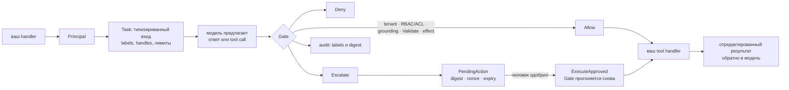

# Gobellim

**[Русский](README.ru.md) · [English](README.md)**


[](LICENSE)


Слой исполнения и политики для одного LLM use-case внутри существующего
Go-сервиса. Gobellim — библиотека, а не платформа: она не поднимает сервер, БД
или брокер, а core-модуль не имеет обязательных зависимостей.


Главный инвариант:

> Модель может предложить текст, аргументы или действие. Она не может выдать
> себе права, изменить policy, зарегистрировать инструмент или выполнить side
> effect в обход Gate.

## Статус

P0 и P1 из [`DESIGN.md`](./DESIGN.md) реализованы: типизированные Task и Tool,
schema по тегам, labels и handles, Gate, привязка к tenant, audit, лимиты,
линейный workflow с approval card, sealed continuation, проверки Resume и
`database/sql` store.

P2 не реализован: replay/diff, детекторы, HTTP approval handlers,
OpenTelemetry, quorum, компенсации и редактирование одобренных аргументов.

Запускаемые ноутбуки — [`examples/notebooks`](./examples/notebooks/README.md).

## Дельта: один хендлер, сделанный безопасным

Обычный HTTP-хендлер вызывает LLM-клиент напрямую:

```go
func (h *Handler) Chat(w http.ResponseWriter, r *http.Request) {
	var req chatRequest
	if err := json.NewDecoder(r.Body).Decode(&req); err != nil {
		http.Error(w, err.Error(), http.StatusBadRequest)
		return
	}
	answer, err := h.llm.Complete(r.Context(), req.Prompt)
	if err != nil {
		http.Error(w, err.Error(), http.StatusBadGateway)
		return
	}
	writeJSON(w, map[string]string{"answer": answer})
}
```

Тот же хендлер с Gobellim:

```diff
 func (h *Handler) Chat(w http.ResponseWriter, r *http.Request) {
     var req chatRequest
     if err := json.NewDecoder(r.Body).Decode(&req); err != nil {
         http.Error(w, err.Error(), http.StatusBadRequest)
         return
     }
-    answer, err := h.llm.Complete(r.Context(), req.Prompt)
+    res, err := h.task.Run(r.Context(), h.principal(r), TicketInput{
+        TenantID: principalFromRequest(r).Tenant,
+        TicketID: req.TicketID,
+        Body:     req.Prompt,
+    })
     if err != nil {
         http.Error(w, err.Error(), http.StatusBadGateway)
         return
     }
-    writeJSON(w, map[string]string{"answer": answer})
+    if res.Status == gobellim.TaskApprovalRequired {
+        // res.Pending — остановленное действие. Ничего не выполнено.
+        writeJSON(w, map[string]any{"status": "approval_required", "action": res.Pending.Card})
+        return
+    }
+    writeJSON(w, map[string]string{"answer": res.Output.Reply})
 }
```

Хендлер сохраняет свой `ctx`, свои инструменты и бизнес-функции. Gobellim
добавляет одно место, где решается судьба каждого модельного вызова, и одно
место, откуда одобренное действие продолжается.

## Что добавляет Gobellim



- **Principal** — кто вызывает: пользователь, tenant, роли. Приходит из вашего
  слоя аутентификации, никогда из текста модели.
- **Gate** — одна функция, превращающая предложенное действие в `Allow`,
  `Deny` или `Escalate`. Неизвестный инструмент, невалидные аргументы, ошибка
  authorizer и чужой tenant никогда не становятся `Allow`.
- **PendingAction** — сериализуемая эскалация: разрезолвленные аргументы,
  digest, nonce, expiry и HMAC, привязывающий объект к выпустившему его engine.
  Это единственный способ исполнить одобренное человеком действие, он
  одноразовый, и endpoint одобрения не должен принимать его поля от клиента.
- **Audit** — labels, digest, решения и счётчики. Без prompt text, сырых
  аргументов и секретов.

Каждый — это гейт на пути вызова, а не хук, который можно забыть.

## Почему Gobellim

Gobellim — библиотека, а не сервис: вы сохраняете свои хендлеры, конкурентность
и инфраструктуру. Каждое утверждение ниже структурно, и за каждым есть код и
тесты.

- **Один путь вызова, без обхода.** Каждый модельный tool call решается в
  [`gate.go`](./gate.go); цикл в [`task.go`](./task.go) не может дойти до
  handler'а мимо него. [`internal/importrules`](./internal/importrules) — это
  build-time проверка графа пакетов.
- **Модель не участвует в доступе.** Permission и эффект объявлены на
  инструменте ([`tool.go`](./tool.go)), проверяются вашим `Authorizer` и
  перепроверяются, когда одобренное действие продолжается.
- **Сырые секреты не попадают в prompt.** Входные поля и результаты
  инструментов маскируются или заменяются handle'ами ([`handles.go`](./handles.go),
  [`redact.go`](./redact.go)); модель может ссылаться только на handle.
- **Одобрение привязано и одноразово.** Digest покрывает инструмент и его
  аргументы; nonce фиксируется до запуска handler'а ([`claims.go`](./claims.go),
  [`flow/`](./flow)); HMAC engine отвергает объект, который он не выпускал
  ([`approval.go`](./approval.go)).
- **Audit — не лог всего.** События несут labels и digest, а не значения
  ([`audit.go`](./audit.go)); незавершённый запуск аудируется как ошибка, а не
  как успех.

Универсальные Go-фреймворки для LLM дают адаптеры. Вы можете обернуть один из
них policy и guard'ом сами — и тогда владеете этой обёрткой и её тестами.
Gobellim — это такая обёртка: Gate, approval и security-наборы идут вместе с
ней.

## Установка

```sh
go get github.com/KirillYuzh/Gobellim
```

## Быстрый старт

Приложение сохраняет свой handler, `context.Context` и бизнес-функции.
Gobellim фиксирует вокруг них модельный цикл.

```go
type TicketInput struct {
	TenantID string `gobellim:"source=principal,required"`
	TicketID string `gobellim:"source=application,required"`
	Body     string `gobellim:"required,sensitivity=pii"`
	OrderID  string `gobellim:"sensitivity=secret"`
}

type TriageOutput struct {
	Category string `gobellim:"required,oneof=billing|technical|other"`
	Reply    string
}

type RefundArgs struct {
	OrderID string `gobellim:"required,ground"`
	Cents   int    `gobellim:"min=1,max=5000"`
}

type RefundResult struct {
	RefundID string
	Status   string
}

refund := gobellim.Tool[RefundArgs, RefundResult]{
	Name:       "orders.refund",
	Effect:     gobellim.Write, // обязателен: zero value отклоняется
	Permission: "orders:refund",
	Resource: func(p gobellim.Principal, a RefundArgs) gobellim.Resource {
		return gobellim.Resource{Type: "order", ID: a.OrderID, TenantID: p.Tenant}
	},
	Validate: validateRefundAgainstBusinessRules,
	Run: func(ctx context.Context, p gobellim.Principal, a RefundArgs) (RefundResult, error) {
		return orders.Refund(ctx, p.Tenant, a.OrderID, a.Cents)
	},
}

engine, err := gobellim.New(
	gobellim.WithModel(model),               // ваш адаптер; см. plugins/gigachat
	gobellim.WithAuthorizer(existing),       // ваш RBAC/ACL
	gobellim.WithAudit(gobellim.SlogSink{}), // или plugins/langfuse
	gobellim.WithLimits(gobellim.Limits{
		MaxInputBytes:  32 << 10,
		MaxOutputBytes: 16 << 10,
		MaxToolCalls:   3,
	}),
)
if err != nil {
	return err
}

task, err := gobellim.NewTask[TicketInput, TriageOutput](engine, gobellim.TaskConfig{
	Name:        "ticket.triage",
	Instruction: "Classify the ticket and propose a reply.",
	Tools:       []gobellim.ToolDef{refund},
})
if err != nil {
	return err
}

res, err := task.Run(ctx, principalFromRequest(r), in)
if err != nil {
	return err
}
if res.Status == gobellim.TaskApprovalRequired {
	// res.Pending — остановленное действие. После реального одобрения:
	//   out, rec, err := task.ExecuteApproved(ctx, requester, approver, res.Pending)
}
```

`gobellim.New` использует functional options. Nil-модель или nil-authorizer —
`ErrInvalidConfig`; разрешающего дефолта нет. Бюджеты можно уточнить на задачу
через `TaskConfig.Limits`; нулевое поле наследует значение `Engine`.

## Gate

Каждый вызов инструмента от модели проходит через Gate: tenant binding,
RBAC/ACL, grounding, бизнес-валидация, потолок эффекта.

| Худшая целостность аргументов | Read  | Write    | Egress | Destructive |
| ----------------------------- | ----- | -------- | ------ | ----------- |
| `Trusted` / `Validated`       | allow | allow    | allow  | escalate    |
| `Derived`                     | allow | escalate | deny   | deny        |
| `Untrusted` / нет меток       | allow | escalate | deny   | deny        |

Дополнительно:

- `Effect` обязателен. Zero value — `EffectUnknown`, `NewTask` его отклоняет:
  мутирующий инструмент не может молча стать `Read`.
- `Resource` обязателен для `Write`, `Egress` и `Destructive`: без цели ACL
  проверялся бы только по RBAC.
- пустой набор меток — `Untrusted`, а не `Trusted`;
- `Resource.TenantID` должен совпадать с `Principal.Tenant` (пустой
  заполняется из принципала);
- ошибка `Authorizer` — `Deny`;
- неизвестный инструмент и невалидные аргументы — `Deny`;
- `ground`-поле принимает только существующий handle; сырая строка — `Deny`;
- ошибка `Validate` — `Deny`;
- заявления модели о правах не учитываются.

**Как аргумент получает `Validated`.** Handle-аргумент, бизнес-смысл которого
подтвердил `Tool.Validate`, становится `Validated`: handle выпущен рантаймом для
этого запуска, правило проверено приложением. Свободный текст модели остаётся
`Derived`. Без `Validate` повышения нет — write по-прежнему требует человека.
Это единственный путь от модельного ввода к `Write`/`Egress` без человека, и он
всё равно требует RBAC/ACL.

## Теги schema

Поддерживается маленькое подмножество; неизвестный тег — ошибка на `NewTask`.

| Тег                    | Смысл                                                        |
| ---------------------- | ------------------------------------------------------------ |
| `required`             | значение не должно быть нулевым (нельзя на `bool`)           |
| `source=principal`     | строка должна совпадать с полем `Principal`                  |
| `source=application`   | значение пришло из состояния приложения и получает `Trusted` |
| `untrusted`            | явно недоверенный вход (дефолт для входного поля)            |
| `sensitivity=pii`      | совпадения e-mail/телефона/карты заменяются на handles       |
| `sensitivity=secret`   | всё значение заменяется одним handle                         |
| `sensitivity=internal` | метка без маскирования                                       |
| `oneof=a\|b`           | строковый enum                                               |
| `min`, `max`           | числовой диапазон или количество элементов среза             |
| `ground`               | аргумент обязан быть существующим handle                     |

`source` и `ground` применимы только к `string`. `sensitivity` — к `string` и
`[]string`. `time.Time`, `[]byte`, `map`, указатели, вложенные структуры глубже
двух уровней и встроенные struct без явного `json`-имени отклоняются на
`NewTask`: лучше fail на старте, чем schema, которая врёт модели.

Те же `sensitivity`-теги применяются к **результату** инструмента перед тем,
как он попадёт обратно в контекст модели: `secret` становится handle, `pii`
маскируется. Результат — обычная Go-структура, поэтому `time.Time` и
`json.Marshaler` передаются как есть. Неизвестный тег на результате — ошибка
`NewTask`, а не молчаливое отключение маскирования.

## Grounding — это handle

`ground`-поле принимает только handle, созданный для этого запуска. Модель не
может выдумать ID или скопировать чужое trusted-значение. Чтобы модель могла
ссылаться на значение, пометьте входное поле `sensitivity=secret` (или
`sensitivity=pii`). `source=application` даёт метку `Trusted`, но само по себе
handle не создаёт.

```go
type TicketInput struct {
	OrderID string `gobellim:"sensitivity=secret,required"`
}
type RefundArgs struct {
	OrderID string `gobellim:"required,ground"`
}
// Модель видит {"OrderID":"<h1>"} и может передать "<h1>" в orders.refund.
```

## Human approval

`flow` — линейный workflow, управляемый кодом. Он не возобновляет стек Go:
останавливается на границе шага, запечатывает минимальное состояние в токен и
продолжает со следующего шага после проверок из `DESIGN.md` §8.6.

```go
sealer, err := flow.NewSealer("v1", key) // AES-GCM; ключ — секрет приложения
store, err := sqlstore.New(db)          // опционально: replay между репликами
if err != nil {
	return err
}
wf, err := flow.New[RefundCase]("refund",
	flow.WithAuthorizer(authz),
	flow.WithSealer(sealer), // обязателен
	flow.WithStore(store),
	flow.WithTTL(24*time.Hour),
)
if err != nil {
	return err
}

wf.Step("propose", proposeRefund).
	ApprovePending("manager", func(s RefundCase) *gobellim.PendingAction {
		return &s.Pending
	}, flow.ApproveConfig[RefundCase]{
		Permission:       "refund:approve",
		ActionPermission: "orders:refund",
		FourEyes:         true,
		Resource:         refundResource,
	}).
	Step("execute", func(ctx context.Context, p gobellim.Principal, s *RefundCase) error {
		// p — requester: после Resume шаги идут от его имени.
		approver, ok := flow.ApproverFrom(ctx)
		if !ok {
			return errors.New("no approver in the context")
		}
		_, _, err := task.ExecuteApproved(ctx, p, approver, &s.Pending)
		return err
	})

res, err := wf.Run(ctx, requester, state)          // res.Status == flow.Suspended
out, err := wf.Resume(ctx, approver, token, flow.Approve)
```

`Resume` проверяет AEAD, tenant, expiry, версию flow, id шага, право апрувера,
Four-Eyes, право requester'а, digest действия и атомарный claim nonce. `Reject`
тоже забирает nonce: сказанное «нет» нельзя позже повторить как «да». Размер
входного токена ограничен `WithMaxTokenBytes` до декодирования.
`DecisionUnknown` (нулевое значение) никогда не считается одобрением. Без
`WithStore` flow использует process-local `MemStore`: повторный resume в том же
процессе невозможен, между репликами нужен общий `Store`. SQL-адаптер также
умеет `Prune` просроченных nonce и принимает `ConflictClause` для MySQL.

`Task.ExecuteApproved` исполняет `PendingAction` после реального одобрения.
Gate заново проверяет tenant, RBAC/ACL, `Validate`, tool/effect и digest ровно
тех аргументов, которые видел человек; апрувер пишется в audit как
`approval.granted`. Nonce фиксируется до запуска handler'а: второй вызов —
`ErrApprovalReplay`, а падение в этом окне теряет одобрение, а не рискует
двойным исполнением.

У `PendingAction` есть HMAC по его полям с ключом engine. Храните его на
сервере: endpoint одобрения, который декодирует `PendingAction` из тела
запроса, отдаёт клиенту аргументы, digest и nonce — engine отвергнет такой
объект как `ErrApprovalDrift`. По умолчанию ключ случайный и живёт в процессе;
`gobellim.WithApprovalKey` задаёт общий 32-байтовый ключ, если эскалация и
исполнение происходят на разных репликах.

## Observability

```go
sink, err := langfuse.New(langfuse.Config{
	Host:      "https://cloud.langfuse.com",
	PublicKey: os.Getenv("LANGFUSE_PUBLIC_KEY"),
	SecretKey: os.Getenv("LANGFUSE_SECRET_KEY"),
	OnDrop:    func(e gobellim.Event) { metrics.Inc("audit_dropped", string(e.Kind)) },
})
if err != nil {
	return err
}
defer sink.Close(ctx)

engine, err := gobellim.New(
	gobellim.WithModel(model),
	gobellim.WithAuthorizer(authz),
	gobellim.WithAudit(sink),
)
```

Sink батчами отправляет `trace-create`, `generation-create` и `span-create`.
Уходят только labels, digest, decision, latency и токены; prompt text, сырые
аргументы и секреты — нет. Для локального просмотра:
`langfuse.Config{DryRun: true, Writer: os.Stdout}`.

Адаптеры моделей — в отдельных пакетах. `plugins/gigachat` реализует freemium
OAuth и маппинг `functions`/`function_call`. Запускаемые сценарии — в notebook'ах.

## Гарантии и non-goals

Гарантируется при корректной интеграции:

- вызов инструмента от модели не доходит до handler без Gate;
- unknown tool, невалидные аргументы, ошибка authorizer и чужой tenant не
  становятся `Allow`;
- пустой набор аргументов не считается доверенным;
- `ground`-аргумент нельзя удовлетворить сырой строкой модели;
- свободный текст модели не становится trusted из-за JSON schema;
- approval привязан к инструменту и аргументам, которые видел человек,
  `ExecuteApproved` прогоняет Gate заново, одобрение одноразово, а объект,
  который engine не выпускал, отклоняется;
- `sensitivity` на результате инструмента не пускает секрет в контекст модели;
- audit содержит labels и digest, а не prompt text и секреты;
- незавершённый запуск аудируется как `task.failed`, никогда как
  `task.completed`.

Не гарантируется:

- exactly-once для внешнего side effect: общий `Store` даёт одноразовый claim,
  идемпотентность — на стороне провайдера;
- редактирование внутри `map` или self-marshalling типа в результате;
- отсутствие вредного или ложного текста модели;
- точный data-flow внутри модели;
- одноразовость Resume между репликами без общего `Store`;
- durable recovery произвольной Go-функции;
- retrieval/RAG и data ACL — это ответственность приложения;
- `ReaderSet` / per-reader ACL не реализованы.

## Документация

`docs/` — обычный Markdown, читается прямо на GitHub. `site/` рендерит те же
файлы через Next.js и Fumadocs:

```sh
cd site && npm install && npm run dev
```

- [`DESIGN.md`](./DESIGN.md) — спецификация.
- [`docs/README.md`](./docs/README.md) — how-to.
- [`examples/notebooks`](./examples/notebooks/README.md) — запускаемые сценарии,
  моки и реальный GigaChat free tier.
- [`plugins/langfuse`](./plugins/langfuse) — audit sink.
- [`plugins/gigachat`](./plugins/gigachat) — model adapter.

## Участие

Gobellim принимает issues, форки и pull requests. Начните с
[CONTRIBUTING.md](.github/CONTRIBUTING.md). Отчёты об уязвимостях — через
[SECURITY.md](SECURITY.md), не в публичный трекер.

## Лицензия

[`MIT`](LICENSE)
