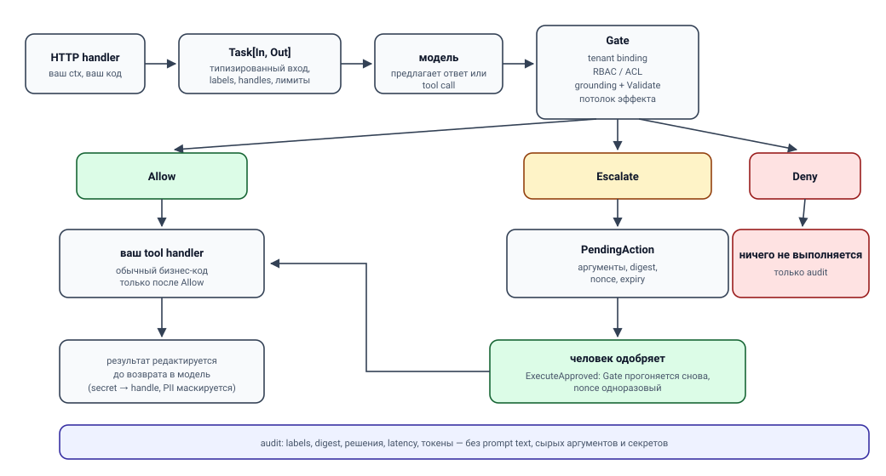
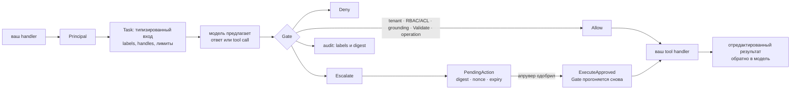

# Gobellim

**[Русский](README.ru.md) · [English](README.md)**


[](LICENSE)


Gobellim — Go-библиотека: слой исполнения и политики для одного LLM use-case
внутри существующего Go-сервиса.

## Установка

```sh
go get github.com/KirillYuzh/Gobellim
```

## Один хендлер, сделанный безопасным

Обычный HTTP-хендлер вызывает LLM-клиент напрямую:

```go
func (h *Handler) Chat(w http.ResponseWriter, r *http.Request) {
	var req chatRequest
	if err := json.NewDecoder(r.Body).Decode(&req); err != nil {
		http.Error(w, err.Error(), http.StatusBadRequest)
		return
	}
	answer, err := h.llm.Complete(r.Context(), req.Prompt)
	if err != nil {
		http.Error(w, err.Error(), http.StatusBadGateway)
		return
	}
	writeJSON(w, map[string]string{"answer": answer})
}
```

Тот же хендлер с Gobellim:

```diff
 func (h *Handler) Chat(w http.ResponseWriter, r *http.Request) {
     var req chatRequest
     if err := json.NewDecoder(r.Body).Decode(&req); err != nil {
         http.Error(w, err.Error(), http.StatusBadRequest)
         return
     }
-    answer, err := h.llm.Complete(r.Context(), req.Prompt)
+    res, err := h.task.Run(r.Context(), h.principal(r), TicketInput{
+        TenantID: principalFromRequest(r).Tenant,
+        TicketID: req.TicketID,
+        Body:     req.Prompt,
+    })
     if err != nil {
         http.Error(w, err.Error(), http.StatusBadGateway)
         return
     }
-    writeJSON(w, map[string]string{"answer": answer})
+    if res.Status == gobellim.TaskApprovalRequired {
+        // res.Pending — остановленное действие. Ничего не выполнено.
+        writeJSON(w, map[string]any{"status": "approval_required", "action": res.Pending.Card})
+        return
+    }
+    writeJSON(w, map[string]string{"answer": res.Output.Reply})
 }
```

Хендлер сохраняет свой `ctx`, свои инструменты и бизнес-функции. Gobellim
добавляет одно место, где решается судьба каждого модельного вызова, и одно
место, откуда одобренное действие продолжается.

## Что добавляет Gobellim





| Гейт          | Ответственность                                                                                                                                                                                                                                                        |
| ------------- | ---------------------------------------------------------------------------------------------------------------------------------------------------------------------------------------------------------------------------------------------------------------------- |
| Principal     | кто вызывает: пользователь, tenant, роли. Приходит из вашего слоя аутентификации, никогда из текста модели.                                                                                                                                                            |
| Gate          | одна функция, превращающая предложенное действие в `Allow`, `Deny` или `Escalate`. Неизвестный инструмент, невалидные аргументы, ошибка authorizer и чужой tenant никогда не становятся `Allow`.                                                                       |
| PendingAction | сериализуемая эскалация: разрезолвленные аргументы, digest, nonce, expiry и HMAC, привязывающий объект к выпустившему его engine. Это единственный способ исполнить одобренное действие, он одноразовый, и endpoint одобрения не должен принимать его поля от клиента. |
| Audit         | labels, digest, решения и счётчики. Без prompt text, сырых аргументов и секретов.                                                                                                                                                                                      |

Каждый — это гейт на пути вызова, а не хук, который можно забыть.

## Почему Gobellim

Gobellim — библиотека, а не сервис: вы сохраняете свои хендлеры, конкурентность
и инфраструктуру. Каждое утверждение ниже структурно, и за каждым есть код и
тесты.

- **Один путь вызова, без обхода.** Каждый модельный tool call решается в
  [`gate.go`](./gate.go); цикл в [`task.go`](./task.go) не может дойти до
  handler'а мимо него. [`internal/importrules`](./internal/importrules) — это
  build-time проверка графа пакетов.
- **Модель не участвует в доступе.** Permission и класс операции объявлены на
  инструменте ([`tool.go`](./tool.go)), проверяются вашим `Authorizer` и
  перепроверяются, когда одобренное действие продолжается.
- **Сырые секреты не попадают в prompt.** Входные поля и результаты
  инструментов маскируются или заменяются handle'ами ([`handles.go`](./handles.go),
  [`redact.go`](./redact.go)); модель может ссылаться только на handle.
- **Одобрение привязано и одноразово.** Digest покрывает инструмент и его
  аргументы; nonce фиксируется до запуска handler'а ([`claims.go`](./claims.go),
  [`flow/`](./flow)); HMAC engine отвергает объект, который он не выпускал
  ([`approval.go`](./approval.go)).
- **Audit — не лог всего.** События несут labels и digest, а не значения
  ([`audit.go`](./audit.go)); незавершённый запуск аудируется как ошибка, а не
  как успех.

Универсальные Go-фреймворки для LLM дают адаптеры. Вы можете обернуть один из
них policy и guard'ом сами — и тогда владеете этой обёрткой и её тестами.
Gobellim — это такая обёртка: Gate, approval и security-наборы идут вместе с
ней.

## Быстрый старт

Приложение сохраняет свой handler, `context.Context` и бизнес-функции.
Gobellim фиксирует вокруг них модельный цикл.

```go
type TicketInput struct {
	TenantID string `gobellim:"source=principal,required"`
	TicketID string `gobellim:"source=application,required"`
	Body     string `gobellim:"required,sensitivity=patterns"`
	OrderID  string `gobellim:"sensitivity=secret"`
}

type TriageOutput struct {
	Category string `gobellim:"required,oneof=billing|technical|other"`
	Reply    string `gobellim:"resolve"`
}

type RefundArgs struct {
	OrderID string `gobellim:"required,ground"`
	Cents   int    `gobellim:"min=1,max=5000"`
}

type RefundResult struct {
	RefundID string
	Status   string
}

refund := gobellim.Tool[RefundArgs, RefundResult]{
	Name:       "orders.refund",
	Operation:  gobellim.Write, // обязателен: zero value отклоняется
	Permission: "orders:refund",
	Target: func(p gobellim.Principal, a RefundArgs) gobellim.Resource {
		return gobellim.Resource{Type: "order", ID: a.OrderID, TenantID: p.Tenant}
	},
	Validate: validateRefundAgainstBusinessRules,
	Run: func(ctx context.Context, p gobellim.Principal, a RefundArgs) (RefundResult, error) {
		return orders.Refund(ctx, p.Tenant, a.OrderID, a.Cents)
	},
}

engine, err := gobellim.New(
	gobellim.WithModel(model),               // ваш адаптер; см. plugins/gigachat
	gobellim.WithAuthorizer(existing),       // ваш RBAC/ACL
	gobellim.WithAudit(gobellim.SlogSink{}), // обязателен; или plugins/langfuse
	gobellim.WithLimits(gobellim.Limits{
		MaxInputBytes:  32 << 10,
		MaxOutputBytes: 16 << 10,
		MaxToolCalls:   3,
	}),
)
if err != nil {
	return err
}

task, err := gobellim.NewTask[TicketInput, TriageOutput](engine, gobellim.TaskConfig{
	Name:        "ticket.triage",
	Instruction: "Classify the ticket and propose a reply.",
	Tools:       []gobellim.ToolDef{refund},
})
if err != nil {
	return err
}

res, err := task.Run(ctx, principalFromRequest(r), in)
if err != nil {
	return err
}
if res.Status == gobellim.TaskApprovalRequired {
	// res.Pending — остановленное действие. После решения апрувера:
	//   out, rec, err := task.ExecuteApproved(ctx, requester, approver, res.Pending)
}
```

`gobellim.New` использует functional options. Nil-модель, nil-authorizer или
nil-audit sink — `ErrInvalidConfig`; разрешающего дефолта нет, и запуска без
audit-следа тоже. В тесте, где audit не проверяется, передайте
`gobellim.SlogSink{Logger: slog.New(slog.DiscardHandler)}`. Бюджеты можно
уточнить на задачу через `TaskConfig.Limits`; нулевое поле наследует значение
`Engine`.

Пример выше — тело `Example` в [`example_test.go`](./example_test.go), которое
`go test` компилирует и запускает. Переименование, ломающее quickstart, ломает
сборку, а не читателя.

## Gate

Каждый модельный вызов получает одно решение: tenant binding, grounding,
RBAC/ACL, бизнес-валидация, затем потолок операции.

| Худшая целостность аргументов | Read, Compute | Write    | Send     | Delete   |
| ----------------------------- | ------------- | -------- | -------- | -------- |
| `Trusted`                     | allow         | allow    | allow    | escalate |
| `Derived`                     | allow         | escalate | escalate | deny     |
| `Untrusted` / нет меток       | allow         | escalate | deny     | deny     |

- у `Operation` нет разрешающего нулевого значения; `NewTask` отклоняет
  `OperationUnknown`;
- `Target` обязан вернуть `Resource` с непустыми `Type`, `ID` и `TenantID`.
  Отсутствующий tenant — это `Deny`, а не повод скопировать tenant вызывающего;
- пустой набор меток — `Untrusted`. Ошибка `Authorizer`, неизвестный инструмент,
  невалидные аргументы, ungrounded-аргумент и упавший `Validate` — это `Deny`;
- `Resource.TenantID` должен совпадать с `Principal.Tenant`.
- `Send` с текстом, который написал модель, уходит в `Escalate`: `Deny` там был
  бы решением, которое не может отменить даже человек, а ответ клиенту —
  обычный случай этой операции.

Доверие даёт только handle, выпущенный для поля входа с `source=principal` или
`source=application`. Свободный текст модели всегда `Derived`, и прошедший
`Validate` этого не меняет: валидатор подтверждает бизнес-смысл, а не
происхождение значения.

## Теги schema

| Тег                    | Смысл                                                              |
| ---------------------- | ------------------------------------------------------------------ |
| `required`             | значение не должно быть нулевым (нельзя на `bool`)                 |
| `source=principal`     | строка должна совпадать с полем `Principal`                        |
| `source=application`   | значение пришло из состояния приложения и получает `Trusted`       |
| `ref`                  | выпустить handle, оставив значение публичным                       |
| `resolve`              | (только выход) handle в строке снова становится значением          |
| `sensitivity=patterns` | проверенные совпадения e-mail/телефона/карты заменяются на handles |
| `sensitivity=secret`   | всё значение заменяется одним handle                               |
| `sensitivity=internal` | метка без маскирования                                             |
| `oneof=a\|b`           | строковый enum                                                     |
| `min`, `max`           | числовой диапазон или количество элементов среза                   |
| `ground`               | аргумент обязан быть handle для своего же пути                     |
| `ground=TicketID`      | аргумент обязан быть handle для этого поля входа                   |
| `ground=any`           | аргумент обязан быть handle для любого поля входа                  |

`source` и `ref` ставятся на входное поле задачи, `ground` — на аргумент
инструмента. Тег не с той стороны — `ErrInvalidConfig` на `NewTask`, а не
молчаливый no-op.

Поддерживаемые типы полей: `string`, `bool`, числа, срезы скаляров и вложенные
структуры до двух уровней. `time.Time`, `[]byte`, `map`, указатели и более
глубокая вложенность отклоняются намеренно: JSON Schema, отправленная модели, не
должна описывать форму, которую рантайм не сможет декодировать.

Те же `sensitivity`-теги применяются к результату инструмента перед тем, как он
вернётся в контекст модели. Неизвестный тег на результате — ошибка, а не
молчаливый способ отключить маскирование.

`sensitivity=patterns` — это регулярное выражение с контрольной суммой, а не
классификатор. Паспорт, адрес или ФИО оно не распознаёт, а промах ничем не
сигнализируется. Оно сокращает то, что видит модель, но не заменяет data ACL и
DLP.

## Grounding — это handle

`ground`-поле принимает только handle, выпущенный для этого запуска. Модель не
может выдумать ID или вставить trusted-строку, которую видела где-то ещё. Пометьте
входное поле `ref`, чтобы публичное значение стало адресуемым: модель увидит
handle, а карточка апрувера и audit сохранят само значение. Для
конфиденциальных данных используйте `sensitivity=secret`.

`ref` выпускает один handle на всё значение, `secret` скрывает всё значение
тем же handle, а `patterns` маскирует только найденные фрагменты. Выбирайте по тому,
на что модель должна ссылаться, а не по тому, насколько значение секретное.

Голый `ground` привязан к пути самого аргумента. `ground=TicketID` указывает
другое поле входа. `ground=any` — явный отказ от привязки.

```go
type TicketInput struct {
	OrderID string `gobellim:"sensitivity=secret,required"`
}
type RefundArgs struct {
	OrderID string `gobellim:"required,ground"`
}
// Модель видит {"OrderID":"<h1>"} и может передать "<h1>" в orders.refund.
```

## Одобрение

Write с аргументами из модели не выполняется. `Task.Run` возвращает
`TaskApprovalRequired` и `PendingAction` с разрезолвленными аргументами, их
digest, nonce, expiry и HMAC от выпустившего engine. Храните объект на сервере;
endpoint одобрения не должен принимать эти поля от клиента.

Решение приходит вне модели: от человека или от вашей же бизнес-логики,
действующей как аутентифицированный `Principal`. Gate проверяет одно и то же
действие в обоих случаях.

Карточка, которую видит апрувер, маскирована: secret-аргумент — это handle,
patterns-аргумент замаскирован, а `Provenance` говорит, что где. Настоящие значения
остаются в `PendingAction.Args` на сервере.

```go
if res.Status == gobellim.TaskApprovalRequired {
	save(ctx, res.RunID, res.Pending)
}
// позже, после решения аутентифицированного апрувера:
out, rec, err := task.ExecuteApproved(ctx, requester, approver, pending)
```

`ExecuteApproved` заново прогоняет Gate: tenant binding, RBAC/ACL, `Validate` и
digest ровно тех аргументов, которые исполняются. Потолок операции — единственная
проверка, которую заменяет одобрение. Nonce фиксируется до запуска handler'а:
второй вызов — `ErrApprovalReplay`, а падение в этом окне теряет одобрение, а не
исполняет его дважды.

`flow` добавляет многошаговые сценарии и границы одобрения:

```go
wf, err := flow.FromEngine[RefundCase](engine, "refund")
wf.Step("propose", proposeRefund).
	ApproveTask("manager", task, flow.ApproveTaskConfig[RefundCase]{
		Pending:          func(s RefundCase) *gobellim.PendingAction { return &s.Pending },
		Permission:       "refund:approve", // что можно апруверу
		ActionPermission: "orders:refund",  // перепроверяется у requester'а
		FourEyes:         true,
	}).
	Step("notify", notifyCustomer)

res, _ := wf.Run(ctx, requester, RefundCase{}) // res.Status == flow.Suspended
out, err := wf.Resume(ctx, approver, *res.Suspension, res.State, flow.VerdictApprove)
```

`ApproveTask` берёт карточку, digest и разрешённые аргументы из
`PendingAction` и сам добавляет шаг с `ExecuteApproved`. Копировать аргументы в
состояние руками не нужно, поэтому апрувер решает ровно про то действие, которое
исполнится. Если после одобрения нужно больше одного вызова, остаётся `Approve`
со своим шагом и `flow.ApproverFrom(ctx)`.

`Resume` проверяет tenant, expiry, версию flow, id шага, право апрувера,
four-eyes, право requester'а, пересчитанный digest и атомарный claim. Отказ тоже
забирает nonce: сказанное «нет» нельзя позже повторить как «да».

`Suspension` и состояние хранит приложение. Suspension, собранный из тела
запроса, — это `ErrFlowDrift`, потому что выпустивший flow его подписывает. Без
`WithStore` claim store живёт в процессе; между репликами нужен общий `Store` и
одинаковый `gobellim.WithApprovalKey` у каждого engine.

Без `WithClaimStore` хранилище держит 262 144 nonce, что при TTL в час — около
70 одобрений в секунду. Когда оно полно, claim падает закрыто с
`ErrClaimStoreFull`; выше этого темпа берите `store/sql`.

### Какой путь выбрать

- **Одно действие, одно решение.** `Task.Run` возвращает `PendingAction`, а
  `ExecuteApproved` его исполняет. Это самый короткий путь до прода.
- **Несколько шагов, TTL или долгая приостановка.** `flow` даёт пару
  `Run`/`Resume` на каждую границу одобрения и хранит состояние в вашем store.
- **`flow` строже.** Он проверяет право апрувера через `Authorizer` и
  перепроверяет право requester'а при resume. `ExecuteApproved` доверяет двум
  принципалам, которых передало приложение, поэтому аутентифицировать их должно
  именно оно.

## Observability

`Sink` получает labels, digest, решения, latency и счётчики токенов. Prompt text,
сырые аргументы и секреты в него не попадают.

```go
sink, err := langfuse.New(langfuse.Config{
	Host:      "https://cloud.langfuse.com",
	PublicKey: os.Getenv("LANGFUSE_PUBLIC_KEY"),
	SecretKey: os.Getenv("LANGFUSE_SECRET_KEY"),
	OnDrop:    func(e gobellim.Event) { metrics.Inc("audit_dropped", string(e.Kind)) },
})
if err != nil {
	return err
}
defer sink.Close(ctx)

engine, err := gobellim.New(
	gobellim.WithModel(model),
	gobellim.WithAuthorizer(authz),
	gobellim.WithAudit(sink),
)
```

`plugins/gigachat` — адаптер модели: freemium OAuth и маппинг
`functions`/`function_call`. Запускаемые сценарии — в
[`examples/notebooks`](./examples/notebooks/README.md).

## Гарантии и non-goals

Гарантируется при корректной интеграции:

- модельный tool call не доходит до handler'а без Gate;
- неизвестный инструмент, невалидные аргументы, ошибка authorizer, чужой tenant
  и ungrounded-аргумент не становятся `Allow`;
- свободный текст модели не становится `Trusted` ни через schema, ни через
  пересказ, ни через прошедший валидатор;
- одобрение привязано к показанному действию, заново прогоняет Gate, исполняется
  один раз и отклоняется, если engine его не выпускал;
- апрувер видит маскированные значения, а `Out` резолвит handle'ы только в полях
  с тегом `resolve` и вычищает токены везде остальном;
- audit несёт labels и digest, а незавершённый запуск — это `task.failed`,
  никогда `task.completed`;
- отказ не валит запуск: он попадает в audit как `gate.denied` и считается в
  `TaskResult.Denied`, включая вызовы, которые не дошли до Gate;
- готовый ответ несёт `TaskResult.Label` — худшую целостность и худшую
  чувствительность всего, что видел модель, — а `TaskConfig.Egress` может
  отказать в ответе до того, как он дойдёт до вызывающего;
- паника в tool handler не превращается в `Deny`. Она разматывается через
  рантайм, запуск аудируется как failed, а дальше решает `recover` вашего
  сервера.

Не гарантируется:

- exactly-once для внешнего side effect: общий `Store` даёт одноразовый claim,
  идемпотентность — на стороне провайдера;
- редактирование внутри `map` или self-marshalling типа в результате;
- отсутствие вредного или ложного текста модели;
- одноразовость Resume между репликами без общего `Store`;
- durable recovery произвольной Go-функции;
- retrieval/RAG и per-reader data ACL. Документы фильтрует приложение до вызова
  `Task`; `ReaderSet` не существует.

## Документация

`docs/` — обычный Markdown, читается прямо на GitHub. `site/` рендерит те же
файлы через Next.js и Fumadocs:

```sh
cd site && npm install && npm run dev
```

- [`DESIGN.md`](./DESIGN.md) — спецификация.
- [`docs/README.md`](./docs/README.md) — how-to.
- [`examples/notebooks`](./examples/notebooks/README.md) — запускаемые сценарии,
  моки и реальный GigaChat free tier.
- [`plugins/langfuse`](./plugins/langfuse) — audit sink.
- [`plugins/gigachat`](./plugins/gigachat) — model adapter.

## Участие

Gobellim принимает issues, форки и pull requests. Начните с
[CONTRIBUTING.md](.github/CONTRIBUTING.md). Отчёты об уязвимостях — через
[SECURITY.md](SECURITY.md), не в публичный трекер.

## Лицензия

[`MIT`](LICENSE)
