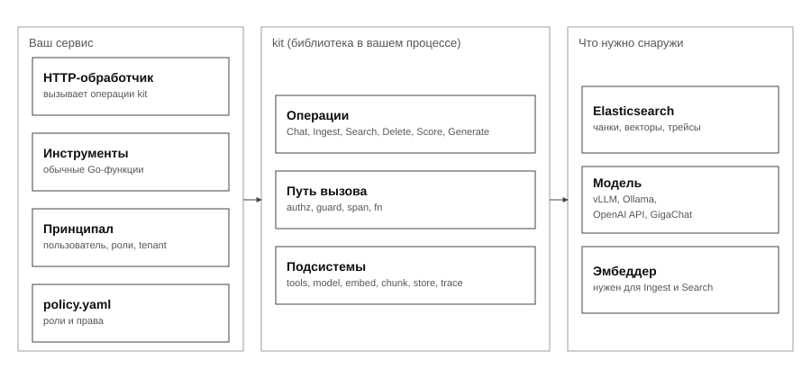

# Gobellim

**[Русский](README.ru.md) · [English](README.md)**


[](LICENSE)

Нативные Go-примитивы для безопасной работы с LLM: поиск, вызов инструментов и
guardrails за одним проверяющим права путём вызова.



## Почему Gobellim

- **Точечное решение, а не платформа.** Кладётся в один хендлер сервиса, который
  у вас уже есть — без рантайма, графового движка и чужого жизненного цикла. Свои
  хендлеры и конкурентность остаются вашими.
- **Работает на вашей инфраструктуре.** Elasticsearch, Postgres или Kafka
  доступны через порт, который реализуете вы. Мы не поставляем, не владеем и не
  копируем ваши данные.
- **Маленькое неизменяемое ядро.** Сборка по умолчанию — чистый Go: без `cgo`,
  нативных библиотек и сети, с бюджетом зависимостей в один взгляд.
- **Всё остальное — плагины.** Хранилища, очереди, кэши и тяжёлый ML-детектор
  опциональны: не импортировали плагин — его зависимостей и старта в вашем
  бинарнике нет.
- **Безопасность, которую нельзя забыть.** Любая операция идёт одними четырьмя
  шагами — авторизация, guard, трейс, выполнение — пропустить проверку нельзя.
- **Модель не решает про доступ.** Инструменты, недоступные вызывающему,
  вырезаются из схемы до модели и проверяются снова при исполнении.

## Установка

```sh
go get github.com/gobellim/kit
```

## Быстрый старт

```go
app, err := kit.New(ctx, kit.Config{
	ES:     es,     // ваш клиент Elasticsearch (store.ES)
	LLM:    llm,    // vLLM, Ollama, OpenAI-совместимый API или GigaChat
	Policy: policy, // authz.Load("policy.yaml")
})
if err != nil {
	return err
}
if err := app.Setup(ctx); err != nil { // один раз создаёт индексы
	return err
}

// Инструмент — типизированная Go-функция: схема и валидация берутся из типа.
if _, err := kit.Tool(app, "get_weather", getWeather, kit.Desc("Текущая погода в городе.")); err != nil {
	return err
}

// У каждого вызова есть личность вызывающего.
ctx = kit.WithPrincipal(ctx, kit.Principal{UserID: "u-1", Roles: []string{"user"}, Tenant: "acme"})

answer, err := app.Chat(ctx, kit.ChatRequest{
	System:   "Ты ассистент поддержки. Отвечай кратко.",
	Messages: []model.Message{{Role: model.RoleUser, Content: "Какая погода в Москве?"}},
})
```

## Операции

| Операция      | Право         | Заметки                                               |
| ------------- | ------------- | ----------------------------------------------------- |
| `Chat`        | `chat`        | ограниченный цикл инструментов; права на каждый вызов |
| `ChatStream`  | `chat`        | guard'нутый поток по скользящему окну                 |
| `CallTool`    | `tool:<name>` | один инструмент тем же путём                          |
| Память        | `memory`      | история, recall и working                             |
| `Generate[T]` | `generate`    | типизированный вывод, проверка по схеме               |
| `Ingest`      | `ingest`      | чанкинг, эмбеддинги, индексация                       |
| `Search`      | `search`      | BM25 + kNN под ACL вызывающего                        |
| `Delete`      | `delete`      | удалить документ                                      |
| `Prune`       | `prune`       | ретенция по возрасту                                  |
| `Score`       | `trace`       | оценка трейса                                         |

`Ingest`, `Search` и `Delete` требуют непустого `Tenant`: операция не может
расшириться на другие тенанты.

## Guardrails

<!-- derived: BR-26 -->

Guard проходит вход, результаты инструментов и выход. L1 — детерминированные
правила (российские персональные данные и prompt injection) — в ядре, из коробки.
L2 — необязательный ML-детектор: `guard-onnx` (локально, сборка с `-tags ort`) или
`guard-remote` (общий сервис). Без L2 kit маскирует и отклоняет только по L1.

## Demo

[demo](./demo) — чат-бот поддержки на скелете Clean Architecture с предзаполненной
базой знаний: поиск, вырезание инструментов по роли, типизированный вывод и
guardrails сразу после `docker compose up -d`.

## Что дальше

- [Документация →](./docs)
- [Руководства (how-to) →](./docs/guides)
- [Запускаемый пример →](./demo)

## Лицензия

[`MIT`](LICENSE)
