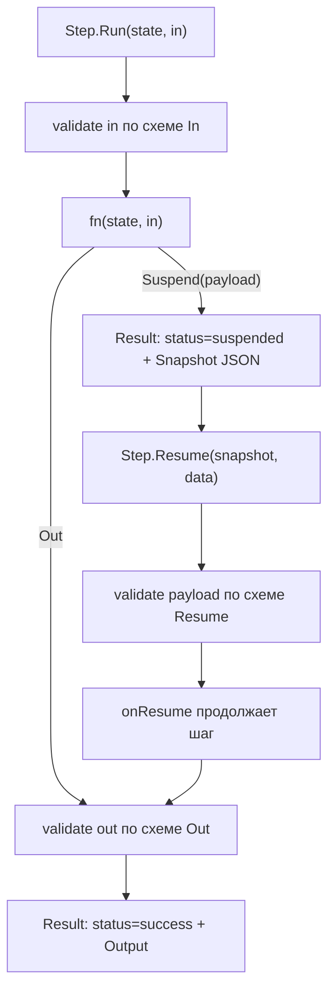

# Пайплайны (flow)

`flow` даёт типизированный **шаг**: функция с объявленными `In`/`Out`, схема
выводится из этих типов и проверяется в рантайме, а приостановку можно снять по
JSON-снимку. Последовательность шагов — это обычные вызовы `Run` друг за другом:
типы связывает компилятор, отдельного объекта-пайплайна нет.

Детерминированный контракт, а не оркестратор LLM: `flow` ничего не знает про
модель, guard и трейсы — это типизированная функция с состоянием и suspend/resume.

## Когда использовать

- Нужен шаг с явным контрактом входа и выхода.
- Нужна приостановка: шаг ждёт внешнего события, а процесс продолжается позже.
- Нужно, чтобы вход, выход и payload продолжения проверялись по схеме.

Для ветвлений, параллельных ветвей и циклов берите обычный Go (`if`, `errgroup`,
`for`): в `flow` их намеренно нет (см. ниже).

## Быстрый старт

```go
type Draft struct {
	Title string `json:"title"`
}
type Review struct {
	Approved bool   `json:"approved"`
	Notes    string `json:"notes"`
}

// Шаг, который только читает вход.
check, err := flow.New("validate-draft", func(ctx context.Context, st flow.State, in Draft) (Draft, error) {
	if in.Title == "" {
		return Draft{}, fmt.Errorf("пустой заголовок")
	}
	st["title"] = in.Title
	return in, nil
})
if err != nil {
	return err
}

// Шаг, который может приостановиться.
review, err := flow.New("review", func(ctx context.Context, st flow.State, in Draft) (Review, error) {
	return Review{}, flow.Suspend(map[string]any{"question": "approve " + in.Title + "?"})
})
if err != nil {
	return err
}

// Последовательность — это просто вызовы Run; State переносит контекст.
checked := check.Run(ctx, nil, Draft{Title: "Черновик"})
if checked.Status != flow.StatusSuccess {
	return checked.Error
}
result := review.Run(ctx, checked.State, checked.Output)
// result.Status == flow.StatusSuspended
// result.Snapshot — единственное, что нужно Resume
```

## Как использовать

### Типизированный контракт

```go
type Step[In, Out any] struct{ /* ... */ }

func New[In, Out any](id string, fn func(ctx context.Context, st State, in In) (Out, error)) (*Step[In, Out], error)
func NewResumable[In, Out, Resume any](
	id string,
	fn func(ctx context.Context, st State, in In) (Out, error),
	onResume func(ctx context.Context, st State, in In, payload Resume) (Out, error),
) (*Step[In, Out], error)
```

Пайплайна как типа нет: `Step` — единственная сущность, а порядок задаётся тем,
что выход одного `Run` становится входом следующего. Компилятор проверяет это на
каждом вызове, поэтому builder-функции (`Then`/`Chain`) не нужны — они были бы
лишней абстракцией над обычным вызовом функции (см.
[Решения](../internals/decisions.md), `D31`, `D47`).

### Схемы из типов

Схема входа, выхода и payload продолжения выводится из Go-типов
(`invopop/jsonschema`, как у `kit.Tool`): без `$ref`, без `$schema`/`$id`, с
`additionalProperties: false` у объектов. Для типизированного шага схема уже
гарантирована компилятором, поэтому проверка — защита в глубину; она окупается на
payload продолжения (он приходит сырым JSON) и на шагах, чьи типы — интерфейсы
(для интерфейсного типа схемы нет, и тогда ничего не проверяется). Несовпадение со
схемой — `ErrInvalidArgs`.

### Запуск и результат

```go
func (s *Step[In, Out]) Run(ctx context.Context, st State, in In) Result[Out]
func (s *Step[In, Out]) Resume(ctx context.Context, snapshot []byte, data any) Result[Out]

type Status string // StatusSuccess | StatusFailed | StatusSuspended

type Result[Out any] struct {
	Status     Status
	Output     Out
	Error      error
	Suspension *Suspension
	Snapshot   []byte // только при приостановке
	State      State
}
```

`State` — JSON-сериализуемый key/value; его читают и меняют шаги, и он переживает
приостановку (передайте `checked.State` в следующий `Run`, если хотите продолжить
контекст). Вход проверяется по схеме `In`, выход — по схеме `Out`.

### Приостановка и возобновление

Шаг приостанавливается, вернув `flow.Suspend(payload)` как ошибку (это
`*Suspension`, реализующий `error`). `Run` возвращает `Result.Status = suspended`
вместе с `Result.Snapshot` — минимальным JSON-артефактом (`state`, `step_input`).
Когда приходит ответ, `Resume` продолжает шаг:

```go
func (s *Step[In, Out]) Resume(ctx context.Context, snapshot []byte, data any) Result[Out]
```

`Resume` разбирает снимок (испорченный — `ErrInvalidArgs`), берёт payload из `data`
и проверяет его по схеме типа `Resume`; затем вызывается `onResume` шага
(`NewResumable`). Если шаг не был resumable, `Resume` даёт `ErrInvalidArgs`.



### Почему нет ни DSL, ни объекта-пайплайна

Строителей branch/parallel/foreach/loop в `flow` **намеренно нет**. И объекта
`Pipeline` тоже нет: в Go типизированная цепочка плюс обычный вызов функции
выражают последовательность с compile-time проверкой, а builder-DSL — ровно та
абстракция, которую эта библиотека отвергает (см.
[Решения](../internals/decisions.md), `D31`, `D47`). `flow` берёт только
durable-часть: типы, schema-контракт и suspend/resume.

## Дальше

| Цель                                    | Куда идти                            |
| --------------------------------------- | ------------------------------------ |
| Понять цикл вызова инструментов моделью | [Chat](./chat.md)                    |
| Дать модели инструмент                  | [Инструменты](./tools.md)            |
| Прочитать журнал решений                | [Решения](../internals/decisions.md) |

## Смотрите также

- [Бизнес-правила](../internals/business-rules.md) — `BR-66`, `BR-67`
- [Пайплайны (`flow`): гид](../guides/pipelines.md) — шаги, `State` и suspend/resume
- [Решения](../internals/decisions.md) — `D31`, `D47`
- [`flow/flow.go`](../../flow/flow.go) — исходный код пакета
