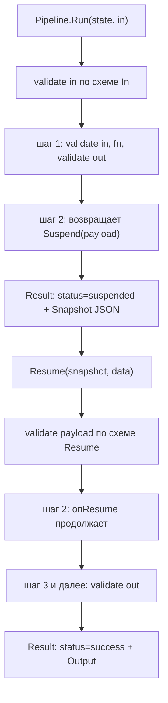

# Пайплайны (flow)

`flow` выполняет типизированные **последовательные** шаги: выход одного шага —
вход следующего, а типы связывает компилятор. Это Go-ответ на durable-часть
workflow-движка: шаг объявляет свои `In`/`Out`, схема выводится из этих типов и
проверяется в рантайме, а приостановку можно снять по JSON-снимку.

Детерминированный контракт, а не оркестратор LLM: `flow` ничего не знает про
модель, guard и трейсы — это просто типизированный конвейер функций.

## Когда использовать

- Нужен многошаговый процесс с явным контрактом между шагами.
- Нужна приостановка: шаг ждёт внешнего события, а процесс продолжается позже.
- Нужно, чтобы входы, выходы и payload продолжения проверялись по схеме.

Для ветвлений, параллельных ветвей и циклов берите обычный Go (`if`, `errgroup`,
`for`): в `flow` их намеренно нет (см. ниже).

## Быстрый старт

```go
type Draft struct {
	Title string `json:"title"`
}
type Review struct {
	Approved bool   `json:"approved"`
	Notes    string `json:"notes"`
}

// Шаг, который только читает вход.
check, err := flow.New("validate-draft", func(ctx context.Context, st flow.State, in Draft) (Draft, error) {
	if in.Title == "" {
		return Draft{}, fmt.Errorf("пустой заголовок")
	}
	return in, nil
})
if err != nil {
	return err
}

// Шаг, который может приостановиться.
review, err := flow.New("review", func(ctx context.Context, st flow.State, in Draft) (Review, error) {
	return Review{}, flow.Suspend(map[string]any{"question": "approve " + in.Title + "?"})
})
if err != nil {
	return err
}

result := flow.Chain(check, review).Run(ctx, Draft{Title: "Черновик"})
// result.Status == flow.StatusSuspended
// result.Snapshot — единственное, что нужно Resume
```

## Как использовать

### Типизированный контракт

```go
type Step[In, Out any] struct{ /* ... */ }

func New[In, Out any](id string, fn func(ctx context.Context, st State, in In) (Out, error)) (*Step[In, Out], error)
func NewResumable[In, Out, Resume any](
	id string,
	fn func(ctx context.Context, st State, in In) (Out, error),
	onResume func(ctx context.Context, st State, in In, payload Resume) (Out, error),
) (*Step[In, Out], error)

func Then[In, Mid, Out any](p *Pipeline[In, Mid], next *Step[Mid, Out]) *Pipeline[In, Out]
func Chain[A, B, C any](first *Step[A, B], second *Step[B, C]) *Pipeline[A, C]
func Chain3[A, B, C, D any](s1 *Step[A, B], s2 *Step[B, C], s3 *Step[C, D]) *Pipeline[A, D]
```

`Then`, `Chain` и `Chain3` — **функции пакета**, а не методы: в Go метод не может
объявить собственные параметры типа, поэтому цепочку продолжают пакетной
generic-функцией. Типы всё равно связывает компилятор — вход добавляемого шага
обязан быть текущим выходом пайплайна. Пайплайн из одного шага даёт
`Step.Pipeline()`; длиннее трёх шагов — `Then`.

### Схемы из типов

Схема входа, выхода каждого шага и payload продолжения выводится из Go-типов
(`invopop/jsonschema`, как у `kit.Tool`): без `$ref`, без `$schema`/`$id`, с
`additionalProperties: false` у объектов. Для типизированной цепочки эти схемы уже
гарантированы компилятором, поэтому проверка — защита в глубину; она окупается на
payload продолжения (он приходит сырым JSON) и на шагах, чьи типы — интерфейсы
(для интерфейсного типа схемы нет, и тогда ничего не проверяется). Несовпадение со
схемой — `ErrInvalidArgs`.

### Запуск и результат

```go
func (p *Pipeline[In, Out]) Run(ctx context.Context, in In) Result[Out]
func (p *Pipeline[In, Out]) RunWithState(ctx context.Context, st State, in In) Result[Out]

type Status string // StatusSuccess | StatusFailed | StatusSuspended

type Result[Out any] struct {
	Status     Status
	Output     Out
	Error      error
	Suspension *Suspension
	Snapshot   []byte // только при приостановке
	State      State
	Steps      []StepResult // что произошло с каждым шагом
}
```

`State` — JSON-сериализуемый key/value на один прогон; его читают и меняют шаги, и
он переживает приостановку. `StepResult{ID, Status, Error}` фиксирует исход каждого
шага. Вход проверяется по схеме `In` при старте, выход — по схеме `Out` в конце.

### Приостановка и возобновление

Шаг приостанавливается, вернув `flow.Suspend(payload)` как ошибку (это
`*Suspension`, реализующий `error`). Пайплайн останавливается на этом шаге и
возвращает `Result.Status = suspended` вместе с `Result.Snapshot` — минимальным
JSON-артефактом (`state`, `step_index`, `step_input`, `steps`). Когда приходит
ответ, `Resume` продолжает ровно с того шага:

```go
func (p *Pipeline[In, Out]) Resume(ctx context.Context, snapshotBytes []byte, data any) Result[Out]
```

`Resume` разбирает снимок (испорченный — `ErrInvalidArgs`), берёт payload из `data`
и проверяет его по схеме типа `Resume`; затем вызывается `onResume` шага
(`NewResumable`). Если шаг не был resumable, `Resume` даёт `ErrInvalidArgs`.



### Почему нет DSL ветвлений, циклов и параллелизма

Строителей branch/parallel/foreach/loop в `flow` **намеренно нет**. В Go
типизированная цепочка плюс обычный вызов функции выражают то же самое с
compile-time проверкой, а builder-DSL — ровно та абстракция, которую этот фреймворк
отвергает (см. [Решения](../internals/decisions.md), `D31`). `flow` берёт только
durable-часть: типы, schema-контракт и suspend/resume.

## Дальше

| Цель                                    | Куда идти                            |
| --------------------------------------- | ------------------------------------ |
| Понять цикл вызова инструментов моделью | [Chat](./chat.md)                    |
| Дать модели инструмент                  | [Инструменты](./tools.md)            |
| Прочитать журнал решений                | [Решения](../internals/decisions.md) |

## Смотрите также

- [Бизнес-правила](../internals/business-rules.md) — `BR-66`, `BR-67`
- [Пайплайны (`flow`): гид](../guides/pipelines.md) — шаги, `State` и suspend/resume
- [Решения](../internals/decisions.md) — `D31`
- [`flow/flow.go`](../../flow/flow.go) — исходный код пакета
