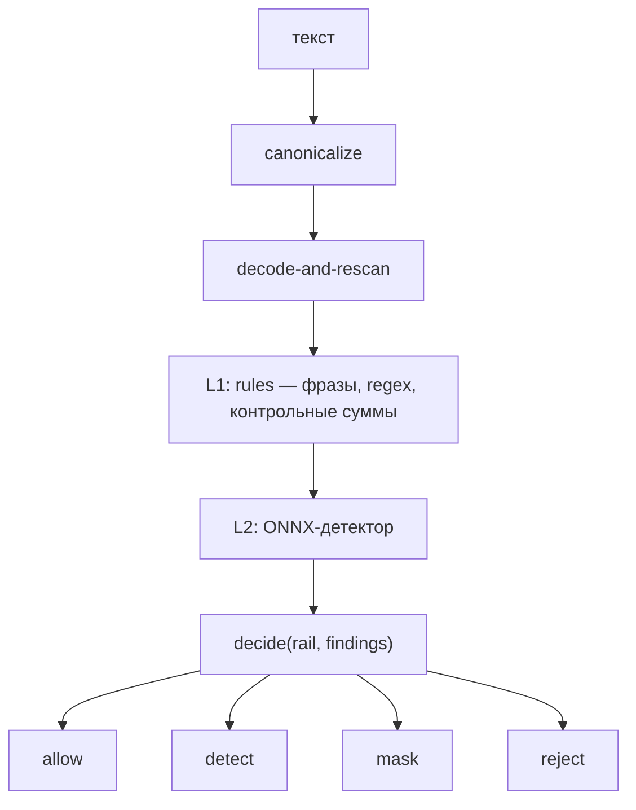
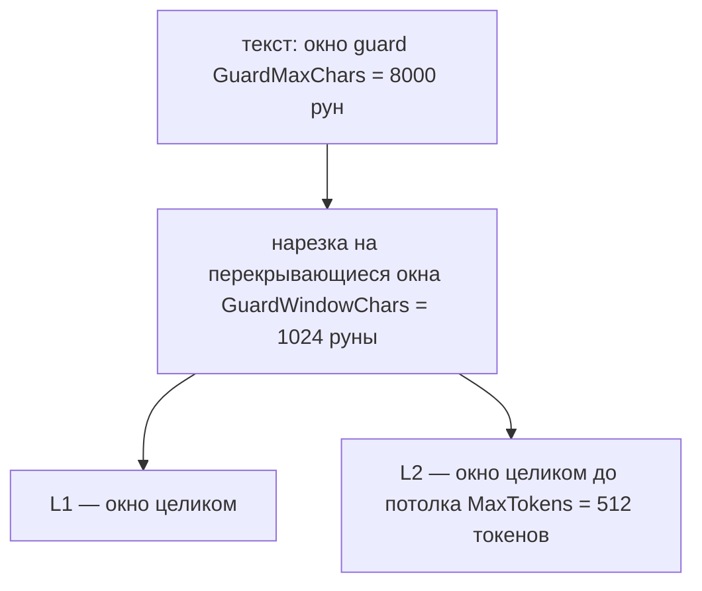

# Guardrails

Guardrail — конвейер проверок текста, который решает, пропустить его, замаскировать найденное, записать находку или отклонить операцию. Каноникализация и декодирование идут раньше детерминированного слоя, детерминированный слой — раньше ML, а на вердикте reject конвейер останавливается сразу.

## Когда использовать

- Модель принимает недоверенный ввод: запрос пользователя, документ, результат инструмента.
- Нужно необратимо маскировать PII и секреты до того, как они попадут в модель.
- Нужно отклонять инъекции и вредный контент до вызова модели или инструмента.

## Быстрый старт

Файл: `demo/internal/adapter/kitengine/engine.go`

```go
app, err := kit.New(ctx, kit.Config{
	ES:      es,
	LLM:     llm,
	Policy:  policy,
	GuardL2: guardL2, // guard.Detector: ML-слой; без него работают только L0/L1
})
if err != nil {
	return err
}
```

Детерминированный слой подключается всегда (`guard/rules`). Поле `GuardL2` добавляет ML-модель за интерфейсом `guard.Detector`.

## Как использовать

### Рельсы

Рельсы — константы пакета `guard`: `RailInput` (`input`), `RailRetrieval` (`retrieval`), `RailExecution` (`execution`), `RailOutput` (`output`), `RailToolResult` (`tool_result`).

### Конвейер

Каноникализация и decode-and-rescan выполняются **до** L1 и L2, поэтому оба слоя видят один и тот же канонический текст (I-03). Детекторы не знают про рельс (I-02): рельс влияет только на таблицу решений `decide`, а находки — чистая функция текста.



Детекция rail-независима, решение — rail-специфично: одна и та же находка даёт `reject` на рельсе `input` и `detect` на рельсе `output`.

### Слои и порядок

- L0 — каноникализация (`Canonicalize`: NFKC, case-fold, удаление zero-width/bidi, фолдинг кириллических гомоглифов, нормализация цифр; результат — фиксированная точка, невалидный UTF-8 санируется до NFKC) и `DecodedVariants` (base64/hex/percent-фрагменты, декодированные и переданные повторно в L1).
- L1 — детерминированный слой `guard/rules`: фразы, regex, контрольные суммы. Подключается всегда.
- L2 — ML-модель за интерфейсом `guard.Detector`. В v1 одна модель: ONNX-экспорт `hivetrace/gliner-guard-omni` (см. ниже). В сборке без тега `ort` ML-слой — заглушка fail-closed.

### Слой L1 (rules)

Кроме фраз и regex инъекций, L1 проверяет структурированные идентификаторы контрольными суммами: российские СНИЛС, ИНН, ОГРН и паспорт, а также `BANK_CARD` (алгоритм Луна), `IBAN` (mod-97), `CVV` и секреты-токены `JWT`, `BEARER`, `GOOGLE_API_KEY`, `SLACK_TOKEN`. L1 отвечает за структурированные ID, L2 — за семантику (`D28`).

### Слой L2 (gliner)

L2 — пакет `guard/gliner` под тегом сборки `ort`: ONNX-модель через ONNX Runtime, без Python в рантайме. Веса и токенайзер лежат в `<models_dir>/hivetrace__gliner-guard-omni/` (`model.onnx`, `tokenizer.json`, `config.json`). Пайплайн: нормализация текста → regex-разбиение на слова → токенизация по словам → тензоры индексов → ONNX → декодирование спанов и классификаций. Спецификация пайплайна и контракта графа — [`tools/gliner/SPEC.md`](../../tools/gliner/SPEC.md). Число меток — статическая размерность графа, поэтому смена схемы — это повторный экспорт. Метки, пороги, `prefix_ids`, позиции маркеров и `category_map` Go читает из `config.json`, а не хардкодит.

**Поставляемый по умолчанию экспорт — компактный:** три метки сущностей (`person`, `email`, `phone`) и одна классификация `safety` (`safe`/`unsafe`), без `category_map`.

**Богатый экспорт — opt-in.** У модели есть полная таксономия, и из неё можно собрать больший граф: **32 метки сущностей** и **5 групп классификации** — `safety` (2), `adversarial` (15, multi-label sigmoid), `harmful` (30, multi-label sigmoid), `intent` (13), `tone` (10) — всего 70 меток классификации. Он собирается локально:

```sh
python3 tools/gliner/export.py --schema full   # артефакт в models/ (gitignored)
```

Пример `config.json` такого экспорта (без весов) лежит в репозитории — [`tools/gliner/config.full.json.example`](../../tools/gliner/config.full.json.example). Go-детектор принимает его без изменений: N групп классификации, у каждой — своё имя `output`, флаги `multi_label` + `activation: sigmoid`, свои `thresholds` (пороги на метку или на группу) и общий `category_map`. Адверсариальные метки при этом дают находки `INJECTION`, которые 3-меточный экспорт произвести не может. Дефолтный экспорт (`export.py` без флагов) **байт-в-байт** совпадает с поставляемым, а `guard/gliner/testdata` не менялся — паритет так и остаётся 12/12. Веса в git не хранятся (`models/` в gitignore), поэтому богатый артефакт нужно перегенерировать локально.

Метки сущностей маппятся в категорию `PII`. Метки классификации маппятся так: явный `category_map` переопределяет всё; значение-категория (`PII`/`SECRET`/`INJECTION`/`UNSAFE`) задаёт категорию; значение **`SAFE`** подавляет находку для этой метки; без маппинга работает эвристика (`unsafe`/`harmful`/… → `UNSAFE`, `inject`/`jailbreak`/`attack`/`override`/`exfiltrat`/`abuse` → `INJECTION`), а встроенный список «безопасных имён» (`safe`, `benign`, `informational`, `conversational`, …) даёт «ничего не сообщать».

**Неизвестная метка всё равно даёт `UNSAFE`**: подавить находку можно только явным решением (запись `SAFE` в `category_map` или вхождение в встроенный список безопасных имён), поэтому незнакомая метка трактуется как проблема, а не молча теряется (I-14).

Находка в `guard.Finding`:

| Что нашла модель                                                       | `Category`                                   | `Label`        | `Start`/`End`          |
| ---------------------------------------------------------------------- | -------------------------------------------- | -------------- | ---------------------- |
| метка сущности (`person`, `email`, …)                                  | `PII`                                        | метка сущности | границы спана          |
| метка классификации                                                    | `UNSAFE`/`INJECTION` (или из `category_map`) | метка          | весь текст (`0`…длина) |
| метка классификации, маппленная на `SAFE` или в списке безопасных имён | —                                            | —              | находки нет            |

`Start`/`End` — смещения в рунах во входной текст детектора. У вердикта классификации спана нет, поэтому он покрывает весь текст. `Score` — вероятность модели, `Layer` — `L2`.

Включение:

```go
l2, err := gliner.New(gliner.Config{Model: "hivetrace__gliner-guard-omni"})
if err != nil {
	return err // fail-closed
}
app, err := kit.New(ctx, kit.Config{ES: es, LLM: llm, Policy: policy, GuardL2: l2})
```

`Config.Dir` по умолчанию берётся из `KIT_MODELS_DIR`, затем `./models`; пул сессий — `Config.Sessions` (по умолчанию 2); ожидание свободной сессии — `Config.Wait` (по умолчанию 2 с); `Config.MaxTokens` ограничивает длину тензорного входа L2 (по умолчанию `DefaultMaxTokens` = 512, дополнительно клампится до `max_sequence_length` модели — у поставляемого экспорта 2048). Любая ошибка модели — нет каталога, не поднялся ORT, плохой тензор, таймаут очереди — возвращается как `ErrGuardUnavailable`: операция отклоняется, а не пропускается (режим `GuardStrict`; в `GuardDegraded` ошибка L2 не отклоняет операцию, см. «Fast-fail и fail-closed»). Пустой текст не даёт ни находок, ни ошибки.

Без тега `ort` тот же пакет собирается как заглушка: `Detect` возвращает `ErrGuardUnavailable` (fail-closed).

### Fast-fail и fail-closed

При reject в L1/L2 дальнейшие слои и целевой вызов не выполняются. Поведение при
недоступности слоя задаёт `Config.GuardMode` (I-16):

| Режим                  | Недоступен L1 (детерминированный) | Недоступен L2 (ML)                                    |
| ---------------------- | --------------------------------- | ----------------------------------------------------- |
| `GuardStrict` (дефолт) | `ErrGuardUnavailable` — отказ     | `ErrGuardUnavailable` — отказ                         |
| `GuardDegraded`        | `ErrGuardUnavailable` — отказ     | L2 пропускается, вердикт от L1, флаг `guard_degraded` |

`GuardDegraded` — осознанный компромисс доступности и полноты: детерминированный
L1 продолжает работать, а факт деградации виден в observation (`guard_degraded`) и
в вердикте. При старте с этим режимом печатается `slog.Warn`. Требовать отклонения
при недоступности ML можно, оставив `GuardStrict` (по умолчанию).

### Действия и категории

Результат проверки — `Verdict` с действием `Allow`, `Detect`, `Mask` или `Reject`. Категории находок: `PII`, `SECRET`, `INJECTION`, `UNSAFE`.

| Действие | Что делает                                                              |
| -------- | ----------------------------------------------------------------------- |
| `Allow`  | находок нет, текст без изменений                                        |
| `Detect` | находка записана, текст не меняется (неблокирующая категория на рельсе) |
| `Mask`   | найденные спаны заменены заглушками, исходные значения стёрты           |
| `Reject` | операция отклонена, в `Verdict.Tripwire` — правило и причина            |

Таблица решений: `INJECTION` и `UNSAFE` дают `Reject`, но на рельсе `output` — `Detect` (ответ модели не калечат молча); `PII` и `SECRET` маскируются всегда.

### Маскирование PII

Маскирование необратимо для модели: она видит заглушки вида `[PII:SNILS]`. Пересекающиеся и смежные спаны PII/SECRET объединяются перед маскированием, поэтому на одну область приходится одна заглушка; PII/SECRET имеет приоритет над INJECTION при наложении. Инструмент, которому реальное значение нужно (например, `send_sms(phone)`), включает `kit.AllowPII(true)`: тогда рантайм подставляет значение в аргументы **только внутри вызова** и **только если** заглушка однозначно соответствует одному значению; иначе аргументы уходят с заглушкой (fail-closed).

### Результаты инструментов

Результат инструмента проверяется как недоверенный ввод на рельсе `tool_result`. При reject результат заменяется на `{"error":"result blocked by guard"}`; на рельсе `output` инъекции и unsafe дают `Detect`, а не `Mask`.

### Помечивание недоверенного контента (spotlighting)

Кроме проверки, результат инструмента **помечается** как данные: после `ModelView`
kit оборачивает текст в `<untrusted-data>…</untrusted-data>` и добавляет в
системный промпт напоминание трактовать этот блок как данные, а не как инструкции
(I-18). Это включено по умолчанию (`Config.Spotlight` = `SpotlightOn`) и работает
для всех инструментов, включая `RetrievalTool`. Пометка не заменяет ни RBAC, ни
guard результата — она снижает шанс, что модель исполнит команду, зашитую в
прочитанном документе.

### Версия и аудит

`guard.Pipeline.Version()` — версия набора слоёв и политики. Она пишется в каждый трейс и observation вместе с версией/hash модели guard и хэшем политики, поэтому вердикт воспроизводим (I-08). `Options.OnViolation` вызывается на каждый вердикт `Detect`, `Mask` и `Reject` и не кэшируется.

### Лимиты и кэш

- `GuardMaxChars` (по умолчанию 8000) — окно guard: предел сканирования, вход обрезается по числу рун.
- `GuardWindowChars` (по умолчанию `guard.DefaultWindowChars` = 1024) — окно детекции: текст внутри окна guard сканируется перекрывающимися окнами этого размера, поэтому L2 проходит весь текст, а не только первые токены.
- `GuardCacheSize` (по умолчанию 4096) — LRU-кэш находок; ключ — канонический текст плюс версия, **не** рельс: одна проверка переиспользуется всеми рельсами (I-02).
- Для локальной разработки и тестов есть детектор `guardtest.AllowAll()` (`guard/guardtest`), который отключает fail-closed. В публичном API выключателей нет (I-15).

### Окно L1 и окно токенов L2

Окно guard (`GuardMaxChars`, по умолчанию 8000 рун), окно детекции (`GuardWindowChars`, 1024 руны) и потолок токенов L2 — это **разные** окна. Внутри `GuardMaxChars` текст режется на перекрывающиеся окна детекции, и каждый слой вызывается на каждом окне: так L2 проходит весь текст, а не только первые `gliner.Config.MaxTokens` токенов (по умолчанию `DefaultMaxTokens` = 512, клампится до `max_sequence_length` модели). Внутри одного окна слова, не влезшие в потолок токенов, отбрасываются целиком — поэтому окно детекции держат не больше реальной ёмкости L2. За `GuardMaxChars` текст не сканируется вовсе.



### Замер латентности L2

Замер на `darwin/arm64, NumCPU=8`, guard-модель fp32, 2 сессии ORT по `NumCPU/2` = 4 `intra_op_threads`, `kitctl verify latency --iterations 100` (кэш вердиктов отключён — каждый тайминговый `Check` строит свежий `Pipeline`):

| Ввод                                            | L1 p50         | L1+L2 p50              | L1+L2 p95              |
| ----------------------------------------------- | -------------- | ---------------------- | ---------------------- |
| 53–98 рун                                       | ≈ 0.04–0.07 мс | ≈ 70–75 мс             | ≈ 76–93 мс             |
| 8000 рун (только L1)                            | ≈ 7.5 мс       | —                      | —                      |
| 8000 / 16000 / 32000 рун до окна детекции (D60) | —              | ≈ 0.57 / 0.62 / 0.58 с | ≈ 0.63 / 0.75 / 0.73 с |

- **L1 дёшев** и почти не зависит от длины, пока щедро помещается в окно guard.
- **В пределах одного окна стоимость L2 плоская**: один полный тензорный вход (512 токенов) — ≈ 0.57 с p50, пиковый RSS ≈ **4.5 GB**, независимо от окна guard. Полная цена `Check` — это число окон × цена окна, поэтому длинный вход (несколько окон) стоит пропорционально длине (D60). До окна детекции сканировалась только голова, и цена была плоской по длине входа.
- **До потолка был дефект** (исправлен): тензорный вход строился из _всех_ слов окна guard, поэтому стоимость росла сверхлинейно — на 8000 рунах одна проверка занимала ≈ **50–71 с**, а пиковый RSS доходил до ≈ **7.3 GB**.
- **Fast-fail работает:** для injection-подобного ввода Δ(L1+L2 − L1) ≈ 0, потому что L1 отклоняет раньше, чем запускается L2.

**Честный вердикт.** SLO (`D53`) измерен **на одно окно детекции**: короткий ввод `p50 ≤ 250 мс` / `p95 ≤ 400 мс`, полный тензорный вход — `p50 ≤ 800 мс` (≈ 70–75 мс и ≈ 0.57 с p50 на референсном хосте, 8 CPU). Окно детекции (D60) не меняет цену окна, но умножает её на число окон — для длинного ввода считайте N × цена окна. Прежняя цель `p50 ≤ 150 мс` / `p95 ≤ 400 мс` на потолке недостижима и пересмотрена: это собственная стоимость forward-pass модели с этими потоками. На 4 vCPU будет медленнее. Ручки: больше сессий/потоков, int8, меньшая guard-модель, меньший `MaxTokens`, большее `GuardWindowChars`.

### Рельсы: что проверяется и действие

| Rail          | Что проверяется                                                                                                  | Действие                                                                                     |
| ------------- | ---------------------------------------------------------------------------------------------------------------- | -------------------------------------------------------------------------------------------- |
| `input`       | L0/L1: фразы, regex, контрольные суммы RU PII и секретов. L2: классификация (`safety`/таксономия) и PII-сущности | атаки и unsafe → reject; PII → mask необратимо; иначе allow                                  |
| `retrieval`   | ACL-фильтр tenant + roles внутри kNN и BM25, deny-by-default; карантин чанков при ingest                         | чанк вне ACL не возвращается; отклонённый чанк — в карантин                                  |
| `execution`   | RBAC, JSON Schema со `additionalProperties: false`, лимиты args, steps, calls, timeout; ML не используется       | нет прав → `ErrUnauthorized`; невалидные args и лимит → результат-ошибка для модели          |
| `output`      | правила маскирования секретов и PII; L2 — та же модель; INJECTION/UNSAFE дают `Detect`                           | найдено → mask; инъекция/unsafe → detect; иначе allow                                        |
| `tool_result` | результаты инструментов проверяются как `input`, fast-fail на инъекциях                                          | reject → результат заменяется на `{"error":"result blocked by guard"}`; PII и секреты → mask |

### Отказ guard и ошибки хода

Отказ guard приходит как `kit.ErrGuardReject` (проверяется через `errors.Is`).
Машиночитаемый разбор несёт `kit.GuardRejectError` (алиас типа из
`internal/call`): он разворачивается в `kit.ErrGuardReject`, поэтому `errors.Is`
продолжает работать, а `errors.As` читает `Rail`, `Tripwire{Reason, RuleID, Metadata}`
и `Version` (версия guard, I-08).

```go
import (
	"encoding/json"
	"errors"
	"net/http"

	"github.com/gobellim/kit/internal/call"
)

func writeError(w http.ResponseWriter, err error) {
	var reject *kit.GuardRejectError
	if errors.As(err, &reject) {
		rule, reason := "", ""
		if reject.Tripwire != nil {
			rule, reason = reject.Tripwire.RuleID, reject.Tripwire.Reason
		}
		w.Header().Set("Content-Type", "application/json")
		w.WriteHeader(http.StatusBadRequest)
		_ = json.NewEncoder(w).Encode(map[string]any{
			"error":  "guard_reject",
			"rail":   string(reject.Rail),
			"rule":   rule,
			"reason": reason,
		})
		return
	}
	// остальные sentinel-ошибки — см. таблицу ниже
	w.WriteHeader(http.StatusBadGateway)
}
```

> [!NOTE]
> `kit.GuardRejectError` — алиас типа из `internal/call`, так что
> `errors.As` доступен и внешним сервисам. Если нужен только факт отказа,
> достаточно `errors.Is(err, kit.ErrGuardReject)`; детали отказа также видны в
> observation (`guard_rail`, `guard_action`, `guard_categories`).

Прочие sentinel-ошибки хода:

| Sentinel              | Когда возвращается                                       |
| --------------------- | -------------------------------------------------------- |
| `ErrTool`             | падение внутри инструмента                               |
| `ErrBudget`           | превышен `MaxTotalTokens` хода                           |
| `ErrRateLimited`      | исчерпан лимит на тенанта (`Config.RateLimit`)           |
| `ErrApprovalRequired` | инструменту нужно подтверждение, а `Approver` его не дал |

## Дальше

| Цель                                  | Куда идти                           |
| ------------------------------------- | ----------------------------------- |
| Понять, где guard вызывается в цикле  | [Chat](./chat.md)                   |
| Прочитать про карантин при индексации | [Поиск](./retrieval.md)             |
| Настроить роли и права                | [Доступ](./access-control.md)       |
| Увидеть срабатывания guard в трейсах  | [Наблюдаемость](./observability.md) |

## Смотрите также

- [Конфигурация](../reference/configuration.md) — `GuardL2`, `GuardMaxChars`, `GuardCacheSize`, `guard.l2.max_tokens`
- [Как настроить guardrails](../guides/guardrails.md) — слои, пороги и бюджет латентности
- [Бизнес-правила](../internals/business-rules.md) — `BR-24`…`BR-33`, `BR-70`…`BR-72`
- [Решения](../internals/decisions.md) — `D28`, `D34`, `D35`
- [Ошибки](../reference/errors.md) — `ErrGuardReject`, `ErrGuardUnavailable`
