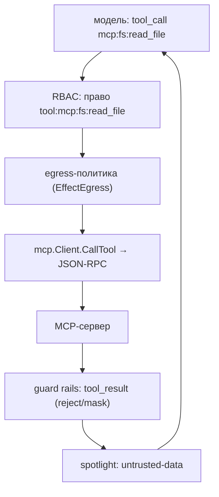

# MCP (Model Context Protocol)

`mcp` — небольшой клиент [Model Context Protocol](https://modelcontextprotocol.io/):
он говорит на JSON-RPC 2.0 поверх stdio (запущенный процесс-сервер) или streamable
HTTP, перечисляет инструменты сервера и вызывает их. `mcp.Register` превращает эти
инструменты в инструменты `kit`, поэтому на них распространяется обычный путь
вызова: RBAC, guard результата, spotlighting и трейсинг.

Тот же пакет содержит и **сервер** (`mcp.NewServer`): он отдаёт ваши инструменты
наружу, а `mcp.FromTool` подключает инструмент `kit` так, что вызов всё равно идёт
через `App.CallTool` — право, guard, egress и трейс не пропускаются.

## Когда использовать

- Инструменты уже реализованы MCP-сервером (файловая система, БД, чужой сервис), и
  переписывать их на Go не нужно.
- Нужен внешний каталог инструментов, которым управляет не ваш код.

Если инструмент — обычная Go-функция в вашем процессе, используйте
[`kit.Tool`](./tools.md): он короче и не тянет внешний процесс.

## Быстрый старт

```go
client, err := mcp.New(mcp.Config{
	Name:    "fs",
	Command: "npx",
	Args:    []string{"-y", "@modelcontextprotocol/server-filesystem", "/data"},
})
if err != nil {
	return err
}
defer client.Close()

if _, err := mcp.Register(ctx, app, client); err != nil {
	return err
}
// Теперь у модели есть mcp:fs:read_file, mcp:fs:list_directory, ...
```

Поток через HTTP — то же, но с `URL` вместо `Command`/`Args`.

## Как это работает

### Транспорты

| Транспорт       | Поле `Config`                   | Что делает                                            |
| --------------- | ------------------------------- | ----------------------------------------------------- |
| stdio           | `Command`, `Args`, `Env`, `Dir` | запускает процесс и общается строками JSON-RPC        |
| streamable HTTP | `URL`, `Headers`, `Client`      | POST JSON-RPC; принимает JSON или `text/event-stream` |

`Close` закрывает stdin и (для stdio) завершает процесс. Сессионный заголовок
`Mcp-Session-Id` запоминается после `initialize` и отправляется дальше.

### Ход рукопожатия

`Initialize` (вызывается лениво из `ListTools`/`CallTool`) шлёт `initialize`,
запоминает `serverInfo` и отправляет `notifications/initialized`. Затем `ListTools`
читает `tools/list` с пагинацией по `cursor`, а `CallTool` — `tools/call`.

### Регистрация в kit

`mcp.Register(ctx, app, client, opts...)` даёт каждому инструменту:

- имя `mcp:<server>:<tool>` и, значит, право `tool:mcp:<server>:<tool>`;
- эффект `Egress` (MCP-сервер — внешняя зависимость, поэтому Rule of Two и
  egress-политика применяются);
- схему входа **дословно от сервера** — через
  [`kit.RawTool`](../reference/kit.md#kitrawtool), потому что вывести её из
  Go-типа нельзя.

Переданные вами `opts` применяются после базовых и перекрывают их: можно сузить
эффект, потребовать approval или заменить описание.

### Ошибки и границы доверия

Ошибка инструмента на сервере (`isError`) становится ошибкой инструмента `kit`, то
есть **данными для модели** (I-11), а не отказом хода. Результат всё равно проходит
guard на рельсе `tool_result` и помечается как недоверенный (`<untrusted-data>`,
I-18) — сервер может быть скомпрометирован, а его вывод недоверенный.



## Сервер

`mcp.NewServer` отдаёт ваши инструменты MCP-клиентам (Claude Desktop, IDE, другому
агенту). Инструмент — это имя, описание, JSON Schema и обработчик:

```go
def, err := kit.Tool(app, "get_weather", getWeather, kit.Desc("Погода в городе."))
if err != nil {
	return err
}
srv, err := mcp.NewServer(mcp.ServerConfig{
	Name:    "kit",
	Version: "1.0.0",
	Tools:   []mcp.ServerTool{mcp.FromTool(app, def)},
})
```

`mcp.FromTool(app, def)` берёт имя, описание и схему из инструмента `kit`, а вызов
проводит через `App.CallTool`: право `tool:<name>`, валидация аргументов, `approval`,
egress-политика, guard `tool_result` и трейс работают как в `Chat` (BR-96). Принципал
берётся из `context.Context` запроса, поэтому положите его в контекст перед вызовом
(в HTTP-обработчике — из аутентификации). Свой обработчик задают напрямую в
`ServerTool.Handler`, если инструмент не из `kit`.

Два транспорта:

| Транспорт       | Как запустить                              | Что делает                   |
| --------------- | ------------------------------------------ | ---------------------------- |
| stdio           | `srv.ServeStdio(ctx, os.Stdin, os.Stdout)` | строка JSON-RPC на сообщение |
| streamable HTTP | `http.ListenAndServe(addr, srv.Handler())` | `POST` JSON-RPC, ответ JSON  |

Методы: `initialize`, `ping`, `tools/list`, `tools/call`. Неизвестный инструмент в
`tools/call` — ошибка JSON-RPC, ошибка обработчика — содержимое с `isError: true`.
Сервер stateless: он не выдаёт `Mcp-Session-Id` и не шлёт серверных уведомлений,
поэтому отвечает только на `POST`. Запрос с заголовком `Origin` отклоняется (403),
пока источник не перечислен в `ServerConfig.AllowedOrigins` — это защита от DNS
rebinding; небраузерные клиенты `Origin` не шлют.

## Ограничения

- Неподдерживаемые MCP-возможности (resources, prompts, sampling) — вне границ;
  клиент покрывает `initialize`, `tools/list`, `tools/call`.
- Сервер stateless: нет `Mcp-Session-Id`, серверных уведомлений и SSE-потока
  (`GET` — 405); он покрывает `initialize`, `ping`, `tools/list`, `tools/call`.
- Схема инструмента приходит от сервера: если её нельзя скомпилировать, регистрация
  падает с `ErrInvalidConfig`, а не пропускает инструмент молча (BR-94).
- Инструмент MCP не дедуплицируется с вашими: имя всегда в пространстве
  `mcp:<server>:`.

## Смотрите также

- [Инструменты](./tools.md) — `kit.Tool`, эффекты, хуки
- [Справочник kit](../reference/kit.md) — `RawTool`, `CallTool`
- [Решения](../internals/decisions.md) — `D51`, `D54`
- [Бизнес-правила](../internals/business-rules.md) — `BR-94`, `BR-95`, `BR-96`, `BR-97`
