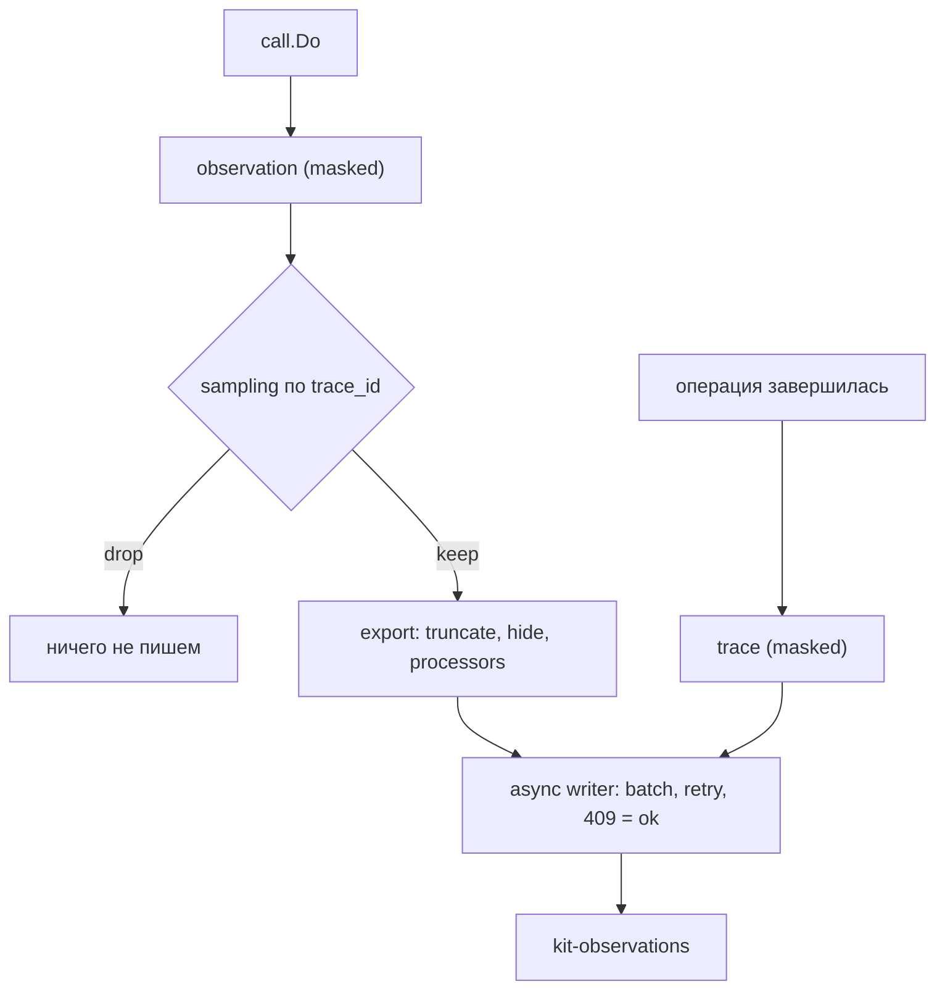

# Наблюдаемость

kit пишет трейсы вызовов в Elasticsearch. Trace создаётся на входе операции, а
каждый внутренний вызов — модели, инструмента, эмбеддера, Elasticsearch, guard —
становится observation. Документ trace записывается в самом конце, когда операция
завершилась.

Модель данных по смыслу совпадает с Langfuse: trace → observations → scores.
Session — это группировка по `session_id`, отдельной сущности нет.

## Когда использовать

- Нужно видеть латентность, стоимость и ошибки по каждому запросу.
- Нужно знать, какие инструменты вызывает модель и где срабатывает guard.
- Нужно считать расход по модели и тенанту.
- Нужно писать eval-проверки по реальным трейсам без сети и без LLM-судьи.

Трейсинг включён всегда: писатель создаётся в `kit.New`, отдельного флага
включения нет.

## Быстрый старт

`main.go`

```go
app, err := kit.New(ctx, kit.Config{ES: es, LLM: llm, Policy: policy})
if err != nil {
	return err
}
if err := app.Setup(ctx); err != nil { // создаёт data stream и ILM-политику
	return err
}

answer, err := app.Chat(ctx, kit.ChatRequest{
	System:   "Ты ассистент поддержки.",
	Messages: []model.Message{{Role: model.RoleUser, Content: "Какая погода?"}},
})
// observations уже ушли в очередь асинхронного писателя

// Перед остановкой сервиса дождаться сброса очереди.
return app.Close(ctx)
```

`terminal`

```sh
curl -s 'http://localhost:9200/kit-traces/_search?size=1&pretty' \
  -H 'Content-Type: application/json' \
  -d '{"query":{"term":{"name":"chat"}}}'
```

## Как использовать

### Поток трейсинга

Observation пишется на каждом `call.Do` (с уже замаскированным текстом), решение о
выгрузке детерминировано по `trace_id`, экспорт-фильтр применяет лимиты и
processors, и только после этого документы попадают в асинхронный писатель.



### Что создаётся

| Сущность    | Когда                                         | Где                |
| ----------- | --------------------------------------------- | ------------------ |
| trace       | вход в `Chat`, `Ingest`, `Search`, `Generate` | `kit-traces`       |
| observation | каждый вызов через `internal/call`            | `kit-observations` |
| score       | вызов `App.Score`                             | `kit-traces`       |

Trace несёт `name` (`chat`, `ingest`, `search`, `generate`), `user_id`, `tenant`,
`session_id`, вход, выход и `usage` с токенами и стоимостью. `Delete` и `Prune`
trace-документа не создают: их работа видна как observations.

Observation несёт `kind` (`SPAN`, `GENERATION`, `EVENT`), `name`, `level`,
`model`, `latency_ms`, токены и `cost`. Проверки guard пишутся как `EVENT` с
именем `guard:<rail>`; отказ добавляет `guard_rail`, `guard_action` и
`guard_categories`. Пустые поля в документ не попадают.

### Модель данных

| Уровень     | Что описывает                                                          |
| ----------- | ---------------------------------------------------------------------- |
| trace       | один запрос целиком, от входа до ответа                                |
| observation | шаг внутри запроса: вызов модели, инструмента, эмбеддера, ES или guard |
| score       | пользовательская оценка trace: имя, число, комментарий                 |

`session_id` группирует трейсы в сессию. Отдельного документа для сессии нет.

Поля и типы документов — [Индексы Elasticsearch](../reference/elasticsearch.md).

### Асинхронная запись

Писатель не блокирует запрос: документы уходят в буфер-канал и отправляются
батчами.

| Параметр               | Значение          |
| ---------------------- | ----------------- |
| очередь                | 4096 документов   |
| размер батча           | 500 документов    |
| интервал сброса        | 2 с               |
| лимит батча по размеру | 5 MB              |
| повторы при ошибке     | 3, backoff 200 мс |

При переполнении очереди новые документы отбрасываются: запрос не ждёт, растёт
счётчик `dropped`, о переполнении пишется `slog.Warn`. Ретрай идемпотентен:
статус элемента `409`/`version_conflict` считается успехом. Запись идёт через
`_bulk` с действием `create` — data streams append-only.

`App.Close(ctx)` закрывает очередь и дописывает остаток, уважая контекст.
Вызывайте его перед остановкой сервиса, иначе последние документы не дойдут до
Elasticsearch.

### Политика текста трейса

По умолчанию в ES попадает только текст, прошедший guard: реальные значения PII и
секретов в трейсы не пишутся. Политика задаётся явно полем `TraceText`:

```go
app, err := kit.New(ctx, kit.Config{
	ES:        es,
	LLM:       llm,
	Policy:    policy,
	TraceText: trace.TextMasked, // по умолчанию; trace.TextFull — явный opt-in
})
```

`trace.TextFull` пишет необработанный текст и требует осознанного opt-in: при
старте с ним выводится `slog.Warn`. Политика записывается в каждый документ
(`text_policy`) для аудита. `HideInput`/`HideOutput` обнуляют соответствующие поля
всех документов.

### Sampling

Сэмплер решает, какие трейсы экспортируются. Решение — чистая функция от
`trace_id`, поэтому оно стабильно между процессами и перезапусками (D24):

```go
app, err := kit.New(ctx, kit.Config{
	ES: es, LLM: llm, Policy: policy,
	Sampler: trace.SamplerRatio(0.1), // SamplerAlways | SamplerNever | SamplerRatio(p)
})
```

Строку удобно разобрать хелпером: `trace.SamplerFromString("always")`,
`"never"` или `"ratio:0.1"`.

### Sinks

Кроме писателя в Elasticsearch документы можно направлять в дополнительные
`trace.Sink`. `trace.NewRecorder()` — потокобезопасный in-memory sink для тестов и
eval.

```go
rec := trace.NewRecorder()

app, err := kit.New(ctx, kit.Config{
	ES: es, LLM: llm, Policy: policy,
	Sinks: []trace.Sink{rec}, // writer добавляется первым, затем эти sinks
})
```

`rec.Snapshot()` возвращает накопленные `Traces`, `Observations`, `Scores`; на нём
строится [eval](./eval.md).

### Метаданные запроса

Метаданные можно приложить к контексту один раз — `kit.WithTraceMetadata`. Они
попадают в `metadata` **каждой** observation этого запроса, поэтому ими удобно
помечать трафик (A/B-плечо, request id, флаг) без протаскивания через каждую
операцию.

```go
ctx = kit.WithTraceMetadata(ctx, map[string]any{"ab_arm": "b", "request_id": rid})
// каждый call.Do внутри этого ctx запишет ab_arm и request_id в observation.metadata
```

Значение, заданное на конкретном вызове (например, `finish_reason`, `status`,
`structuring`), перекрывает одноимённый ключ из контекста; пер-call значение всегда
побеждает. Обратно карту читает `kit.TraceMetadataFrom(ctx)`.

### Лимиты экспорта

Перед записью документ обрезается: `MaxStringLength` (131072), `MaxDepth` (8),
`MaxArrayLength` (50), `MaxObjectKeys` (50). `Options.Processors` — export-фильтр:
processor может скрыть поле, а очистка `Name` удаляет observation целиком.

### Хранение и ретенция

Traces и observations хранятся в data streams `kit-traces` и `kit-observations`.
ILM-политика `kit-traces-30d` делает rollover при 10 GB и удаляет документы через
30 дней. Тот же срок можно применить вручную: `App.Prune(ctx, olderThan)` удаляет
трейсы и observations старше заданного срока и требует право `prune`.

```go
deleted, err := app.Prune(ctx, 30*24*time.Hour)
```

### Дашборды

В `deploy/grafana/` лежат provisioning datasource и дашборд `kit-overview`
(`deploy/grafana/dashboards/kit-overview.json`). Панели читают data streams
напрямую:

| Панель                                    | Источник                                  |
| ----------------------------------------- | ----------------------------------------- |
| латентность LLM p95                       | `kit-observations`, `kind:GENERATION`     |
| ошибки по `kind` (guard, authz, provider) | `kit-observations`, `level:ERROR`         |
| токены по модели                          | `kit-observations`, `kind:GENERATION`     |
| срабатывания guard по rail                | `kit-observations`, `guard_action:reject` |
| топ инструментов                          | `kit-observations`, `kind:SPAN`           |
| стоимость по тенанту                      | `kit-traces`, `usage.cost`                |
| последние trace                           | `kit-traces`                              |

## Дальше

| Цель                           | Куда идти                                              |
| ------------------------------ | ------------------------------------------------------ |
| Ограничить вход и выход модели | [Guardrails](./guardrails.md)                          |
| Проверять ответы по трейсам    | [Eval](./eval.md)                                      |
| Настроить права                | [Доступ](./access-control.md)                          |
| Описать поля документов        | [Индексы Elasticsearch](../reference/elasticsearch.md) |

## Смотрите также

- [Chat](./chat.md) — где создаётся trace запроса
- [Eval](./eval.md) — детерминированные проверки поверх `trace.Recorder`
- [Справочник kit](../reference/kit.md) — `App.Score`, `App.Close`, `App.Prune`
- [Архитектура](../internals/architecture.md) — раздел Observability
- [Бизнес-правила](../internals/business-rules.md) — `BR-40`…`BR-47`
