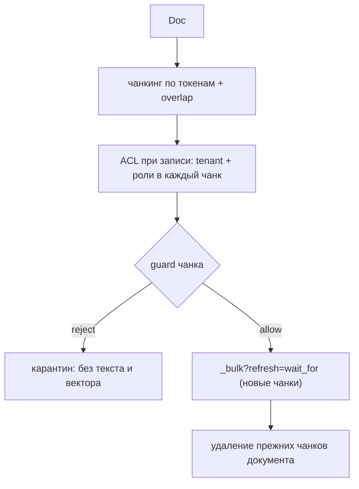
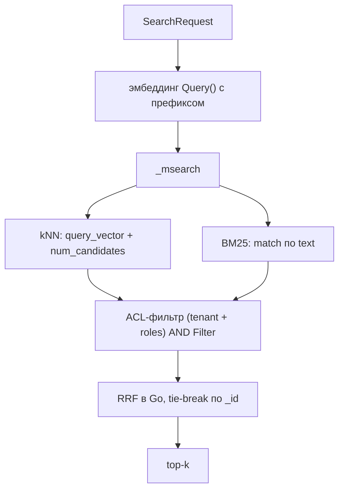

# Поиск

Ingest превращает документ в чанки, считает ACL и пишет их в Elasticsearch. Search ищет по чанкам гибридно — kNN и BM25 — и возвращает только то, что разрешено принципалу.

## Когда использовать

- Ответ нужен по вашим документам, а не по данным модели.
- Доступ к документам различается по ролям и тенанту.
- Нужен контроль над разбиением текста на чанки.
- Модель должна сама доставать фрагменты — тогда вместо ручных вызовов дайте ей `kit.RetrievalTool`.

## Быстрый старт

Файл: `demo/internal/adapter/kitengine/engine.go`

```go
ctx = kit.WithPrincipal(ctx, kit.Principal{
	UserID: "u-1",
	Roles:  []string{"support"},
	Tenant: "acme",
})

if err := app.Ingest(ctx, kit.Doc{
	ID:     "faq-1",
	Text:   "Возврат оформляется в течение 14 дней.",
	ACL:    []string{"support"},
	Source: "faq",
}); err != nil {
	return err
}

hits, err := app.Search(ctx, kit.SearchRequest{Query: "возврат", TopK: 5})
```

`Ingest`, `Search` и `Delete` требуют непустого `Tenant` в принципале: пустой тенант вернул бы `ErrUnauthorized`. `Prune` тенант не требует (это глобальное действие по времени, как ILM) — ему достаточно принципала и права `prune`.

## Как использовать

### Ingest

`func (a *App) Ingest(ctx context.Context, doc Doc) error` требует право `ingest`.



1. Чанкование по единицам токенайзера с overlap. По умолчанию `ChunkSize` — 400, `ChunkOverlap` — 80. Токенайзер задаёт вызывающий (`Config.Tokenizer`); дефолта нет — без него `Ingest` даёт `ErrInvalidConfig` (BR-104). Единица `chunk.WhitespaceTokenizer` — слово, а не токен модели.
2. ACL считается при записи: tenant из принципала и роли из `Doc.ACL` пишутся в каждый чанк.
3. Размерность векторов проверяется; несогласованность с `Embedder.Dim()` — ошибка.
4. Каждый чанк проходит guard. Отклонённый чанк уходит в карантин (`quarantined: true`): он не несёт ни текста, ни вектора и не индексируется.
5. Чанки пишутся в индекс `kit-chunks` через `_bulk?refresh=wait_for`: запись видна поиску сразу после возврата `Ingest`.
6. Прежние версии документа удаляются **после** записи новых: сбой между шагами даёт дубликаты (самоисцеляются следующим `Ingest`), но не потерю (BR-87, D44).

`Doc` требует непустой `ID`, иначе `ErrInvalidConfig`. Для `Ingest` и `Search` в `Config` нужен `Embedder`.

### Search

`func (a *App) Search(ctx context.Context, req SearchRequest) ([]SearchHit, error)` требует право `search`.



1. Запрос эмбеддится через `Query()` с обязательным префиксом.
2. Строятся два запроса — kNN и BM25, каждый с ACL-фильтром принципала (tenant + roles), AND-нутым с `Filter`.
3. Оба выполняются одним `_msearch`. Ошибка любой ветви или `_shards.failed > 0` — ошибка всего вызова.
4. `TopK` клампится до 1000, `num_candidates` — до 10000.
5. Слияние RRF считается в Go с детерминированным tie-break по `_id`; возвращается top-k (`TopK`, по умолчанию 10).

Пустой `Query` даёт `ErrInvalidArgs`.

### Фильтр метаданных

`SearchRequest.Filter` — небольшой язык операторов, который компилируется в ES-query и AND-ится с ACL-фильтром: `$eq $ne $gt $gte $lt $lte $in $nin $exists $and $or $not`. Разрешённые поля: `doc_id`, `source`, `position`, `created_at`, `quarantined`. Голое значение означает `$eq`.

```go
hits, err := app.Search(ctx, kit.SearchRequest{
	Query: "возврат",
	TopK:  5,
	Filter: store.Filter{
		"source":      "faq",
		"position":    map[string]any{"$gte": 2},
		"quarantined": false,
	},
})
```

Неизвестный оператор или поле — ошибка (`ErrInvalidArgs`). Пустой `Filter` не добавляет клаузу.

### Deny-by-default

Чанк без совпадения ACL не возвращается. Пустой список ролей даёт `terms: {"acl": []}`, который не совпадает ни с чем.

### Типы

```go
type Doc struct {
	ID     string
	Text   string
	ACL    []string
	Source string
}

type SearchRequest struct {
	Query  string
	TopK   int
	Filter store.Filter
}

type SearchHit struct {
	ID       string  `json:"-"`
	DocID    string  `json:"doc_id"`
	Text     string  `json:"text"`
	Position int     `json:"position"`
	Score    float64 `json:"-"`
}
```

### Delete

`func (a *App) Delete(ctx context.Context, docID string) error` требует право `delete` и удаляет по `doc_id` плюс tenant принципала (`_delete_by_query`). Ответ проверяется: `failures` в теле — ошибка.

### Ретенция

`func (a *App) Prune(ctx context.Context, olderThan time.Duration) (int, error)` требует право `prune` и удаляет trace/observation старше срока (`_delete_by_query` по `@timestamp`).

```go
deleted, err := app.Prune(ctx, 30*24*time.Hour)
```

### Инструмент поиска

`kit.RetrievalTool(app, name, opts...)` регистрирует поиск как типизированный инструмент: модель достаёт фрагменты вместо догадок. Внутри вызывается тот же `Search`, поэтому право `search` и ACL проверяются повторно. Имя по умолчанию — `search_knowledge`. Найденные фрагменты возвращаются модели уже помеченными как недоверенные данные (spotlighting, I-18): документ может содержать инструкцию, и модель не должна её исполнять.

```go
if _, err := kit.RetrievalTool(app, "search_knowledge"); err != nil {
	return err
}
```

### Эмбеддер

API эмбеддера — `Query()` и `Passages()`, без общего `Embed()`. `Query` и `Passages` разделены, чтобы префиксы нельзя было забыть. Ingest использует `Passages()`, Search — `Query()`.

- e5 (`intfloat/multilingual-e5-*`): mean pooling, префиксы `query: ` / `passage: `, L2-норма.
- bge-m3 (`BAAI/bge-m3`): CLS pooling, без префиксов, L2-норма.

Локальный энкодер (`embed.NewLocal`) требует сборки с тегом `ort` и `libonnxruntime`; веса скачиваются `kitctl model pull`. Неизвестную модель описывают файлом `kit_embedder.json` рядом с весами, иначе `NewLocal` возвращает ошибку. Подробности сборки — [Установка](../getting-started/installation.md).

### Реранкинг

Гибридный поиск (BM25 + kNN + RRF) — это recall: он находит кандидатов. Если нужна
точность, включите реранкинг: `Config.Reranker` (например, `rerank.NewTEI`) плюс
`SearchRequest.Rerank`. kit берёт больше кандидатов (`Config.RerankCandidates`, по
умолчанию `TopK × 4`), прогоняет их через реранкер и усекает `rerank.Reorder` до
`TopK`. Без `Config.Reranker` флаг `Rerank` даёт `ErrInvalidConfig`. Реранкер —
внешний HTTP-сервер (TEI или Cohere-совместимый), и вызов идёт через примитив с
правом `search`.

```go
app, _ := kit.New(ctx, kit.Config{ /* ... */ Reranker: reranker})
hits, _ := app.Search(ctx, kit.SearchRequest{Query: "вопрос", TopK: 5, Rerank: true})
```

## Дальше

| Цель                                        | Куда идти                                      |
| ------------------------------------------- | ---------------------------------------------- |
| Ограничить, что принципал видит в поиске    | [Доступ](./access-control.md)                  |
| Прочитать про карантин при ingest           | [Guardrails](./guardrails.md)                  |
| Схема индекса и запросы `_msearch`          | [Elasticsearch](../reference/elasticsearch.md) |
| Подключить локальный или удалённый эмбеддер | [Провайдеры](../reference/providers.md)        |

## Смотрите также

- [Справочник kit](../reference/kit.md) — `Doc`, `SearchRequest`, `SearchHit`, `RetrievalTool`
- [Как индексировать и искать](../guides/retrieval.md) — шаги, ACL, фильтры и тюнинг
- [Бизнес-правила](../internals/business-rules.md) — `BR-10`…`BR-14`, `BR-34`…`BR-39`
- [Устройство](../internals/architecture.md) — рантайм ORT и эмбеддер
