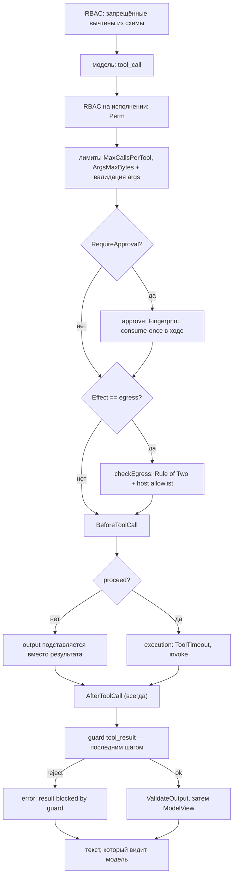

# Инструменты

Инструмент — типизированная Go-функция, которую модель вызывает по имени. kit выводит JSON Schema из типа аргументов, проверяет по ней вызов модели и исполняет функцию только после проверки прав.

## Когда использовать

- Модель должна получать данные, которых нет в промпте: из вашей системы, базы или внешнего API.
- Аргументы вызова нужно проверять по строгой схеме до исполнения.
- Вызов ограничивается правами роли.
- Результат функции — недоверенные данные, которые надо проверить guard'ом.
- Инструмент шлёт данные наружу или меняет состояние — тогда это должно быть объявлено явно.

## Быстрый старт

Файл: `demo/internal/adapter/kitengine/tools.go`

```go
type weatherIn struct {
	City string `json:"city"`
}

type weatherOut struct {
	City         string  `json:"city"`
	TemperatureC float64 `json:"temperature_c"`
	WindKmh      float64 `json:"wind_kmh"`
	Description  string  `json:"description"`
}

func (e *Engine) getWeather(ctx context.Context, in weatherIn) (weatherOut, error) {
	w, err := e.weather.Current(ctx, in.City)
	if err != nil {
		return weatherOut{}, err
	}
	return weatherOut{
		City:         w.City,
		TemperatureC: w.TemperatureC,
		WindKmh:      w.WindKmh,
		Description:  w.Description,
	}, nil
}

func NewEngine(app *kit.App, weather Weather) (*Engine, error) {
	e := &Engine{app: app, weather: weather}
	if _, err := kit.Tool(app, "get_weather", e.getWeather, kit.Desc("Return the current weather for a city.")); err != nil {
		return nil, err
	}
	return e, nil
}
```

## Как использовать

### Путь вызова

Инструмент исполняется не моделью, а рантаймом: RBAC вычитает запрещённые из схемы, затем рантайм повторно проверяет право, проходит approval и egress, вызывает функцию с таймаутом и только потом показывает модели результат.



Порядок важен: guard результата (`tool_result`) — последний шаг перед `ValidateOutput`/`ModelView`, поэтому результат, порождённый хуком, проверяется так же, как результат самого инструмента, и обойти guard нельзя.

### Сигнатура и регистрация

```go
func Tool[In, Out any](app *App, name string, fn func(ctx context.Context, in In) (Out, error), opts ...ToolOption) (*ToolDef, error)
```

- `In` задаёт аргументы, `Out` — результат; результат сериализуется в JSON и уходит модели.
- `Desc("...")` — описание для модели.
- `Perm("...")` — переопределить право; по умолчанию `tool:<name>`.
- `Tool` возвращает `ErrInvalidConfig`, если `app` равен nil, `name` пустое или `fn` равен nil.

### Хуки: `BeforeToolCall` и `AfterToolCall`

Именованные хуки — способ вклиниться в вызов без декораторов: before-хук решает, исполнять ли инструмент, after-хук может переписать результат. Они бывают уровней:

- **на инструменте** — опции `kit.BeforeToolCall(h)` / `kit.AfterToolCall(h)`;
- **на приложении** — поля `Config.BeforeToolCall` / `Config.AfterToolCall`, для всех инструментов сразу.

**Правило разрешения:** хук на инструменте **заменяет** приложенческий для этого инструмента; приложенческий применяется только если у инструмента своего хука нет (хуки **не** складываются).

```go
// Информация о вызове, которую видит хук.
type ToolCallInfo struct {
	UserID      string
	Tenant      string
	Tool        string
	Args        string
	Fingerprint string // хэш tool + канонических аргументов
	Effect      Effect
	CallIndex   int // 1-based счётчик вызовов этого инструмента в ходе
}

type BeforeToolHook func(ctx context.Context, info ToolCallInfo) (proceed bool, output string, err error)
type AfterToolHook  func(ctx context.Context, info ToolCallInfo, result string, err error) (string, error)
```

Порядок в `execTool`:

1. RBAC, лимиты (`MaxCallsPerTool`, `ArgsMaxBytes`), валидация аргументов (один ретрай, BR-23).
2. approval (если `RequireApproval`) и `checkEgress` (если `EffectEgress`).
3. **before-хук** — после валидации и до исполнения. `proceed == false` подставляет `output` вместо результата инструмента и пропускает исполнение; ненулевая ошибка идёт по тому же каналу, что сбой инструмента.
4. исполнение инструмента с `ToolTimeout`.
5. **after-хук** — всегда: и при успехе, и при сбое, и для результата, подставленного before-хуком. Возвращённая ошибка **заменяет** исходную.
6. **guard результата (`tool_result`) — последним**: поэтому результат, порождённый хуком, проверяется так же, как результат самого инструмента, и не может обойти guard. Reject даёт `{"error":"result blocked by guard"}`; маска применяется к тексту.
7. `ValidateOutput` (если включён) и `ModelView`.

Ошибка хука не рушит ход сама по себе: как и ошибка инструмента, она возвращается модели как `{"error": "..."}` (I-11), кроме фатальных случаев (`ErrProvider`, `ErrUnauthorized` — включая отказ Rule of Two или host-allowlist, `context.Canceled`, `context.DeadlineExceeded`).

```go
func auditHook(ctx context.Context, info kit.ToolCallInfo) (bool, string, error) {
	log.Printf("tool %s call #%d effect=%s fp=%s", info.Tool, info.CallIndex, info.Effect, info.Fingerprint)
	return true, "", nil // proceed
}

kit.Tool(app, "close_ticket", closeTicket,
	kit.Effects(kit.EffectWrite),
	kit.BeforeToolCall(auditHook), // только для этого инструмента
)
```

### Эффекты, эгресс и подтверждение

Эффект — свойство инструмента, а не модели: рантайм применяет правила, не спрашивая модель (инвариант I-10).

```go
// Инструмент, который отправляет данные наружу, объявляет это и перечисляет хосты.
if _, err := kit.Tool(app, "send_report", sendReport,
	kit.Desc("Отправить отчёт на внешний webhook."),
	kit.Effects(kit.EffectEgress),        // Read | Write | Egress
	kit.EgressHosts("hooks.example.com"), // allowlist из аргументов; пусто = любой хост
	kit.RequireApproval(true),            // спросить Approver до вызова
	kit.ValidateOutput(true),             // проверить результат по схеме Out
	kit.ModelView(func(s string) string { return "отчёт отправлен" }),
); err != nil {
	return err
}

// Инструмент, меняющий состояние, тоже может требовать подтверждения.
if _, err := kit.Tool(app, "close_ticket", closeTicket,
	kit.Desc("Закрыть тикет поддержки."),
	kit.Effects(kit.EffectWrite),
	kit.RequireApproval(true),
); err != nil {
	return err
}
```

- `Effects(kit.EffectEgress)` — инструмент может вынести данные за границу доверия.
- `EgressHosts(...)` — allowlist хостов из аргументов; пустой список означает «любой хост» и является явным opt-in.
- `RequireApproval(true)` — рантайм вызывает `Config.Approver`. Без `Approver` такой вызов даёт `ErrApprovalRequired`.
- `ValidateOutput(true)` — результат проверяется по JSON Schema типа `Out`; несовпадение логируется, но не фатально.
- `ModelView(fn)` — что видит модель вместо результата; приложению уходит исходная строка.

`Config.Egress` включает правило «Rule of Two»: эффектный эгресс блокируется, если на ходу уже был недоверенный ввод (маска или находка guard на любом рельсе).

```go
app, err := kit.New(ctx, kit.Config{
	ES:     es,
	LLM:    llm,
	Policy: policy,
	Egress: kit.EgressPolicy{RuleOfTwo: true},
	Approver: kit.ApproverFunc(func(ctx context.Context, req kit.ApprovalRequest) (bool, error) {
		// req.Fingerprint привязан к инструменту и каноническим аргументам,
		// поэтому одобрение нельзя переиграть на другой набор аргументов.
		return approve(req), nil
	}),
})
```

Одобрение **расходуется один раз за ход**. `ApprovalRequest.Fingerprint` — хэш имени инструмента и канонических аргументов (порядок ключей JSON не влияет). Рантайм помнит уже использованные fingerprint'ы этого хода: повторное одобрение _того же_ fingerprint возвращает `ErrApprovalRequired`, поэтому сценарий «одобрили один раз, повторили N раз» невозможен. Другой набор аргументов — это другой fingerprint и требует отдельного одобрения; в новом ходе счётчик начинается заново.

Без `Approver` вызов инструмента с `RequireApproval` сразу даёт `ErrApprovalRequired`.

### Эгресс и веб-фетч

`EffectEgress` описывает инструмент, а рантайм применяет два правила: host-allowlist, найденный в аргументах (`EgressHosts`, совпадение по границе домена), и «Rule of Two». Отказ любого из них — `ErrUnauthorized` и прерывание хода.

Встроенный инструмент исходящего HTTP — пакет `webfetch`. Он SSRF-защищён и регистрируется с эффектом egress, поэтому рантаймовые правила применяются к нему так же, как к любому другому egress-инструменту.

```go
import (
	"github.com/gobellim/kit"
	"github.com/gobellim/kit/webfetch"
)

if _, err := webfetch.New(app, "web_fetch", webfetch.Config{
	AllowHosts:   []string{"docs.example.com"}, // пусто = любой хост, прошедший SSRF-проверки
	MaxBytes:     1 << 20,                       // 1 MiB по умолчанию
	Timeout:      15 * time.Second,
	MaxRedirects: 5,
	Headers:      map[string]string{"Accept": "text/plain"},
}); err != nil {
	return err
}
```

- `Config` — `AllowHosts`, `MaxBytes`, `Timeout`, `MaxRedirects`, `Headers`; нулевое значение берёт дефолты, отрицательное — `ErrInvalidConfig`.
- `In` — `{url}`; `Out` — `{status, content_type, text, truncated}`.

Что защищает фетч:

- схема — только `http`/`https`; `file`, `gopher`, `data` и прочие отвергаются (`ErrInvalidArgs`);
- allowlist хостов проверяется и до соединения, и на каждом редиректе, по границе домена: `example.com` разрешает `cdn.example.com`, но не `notexample.com`;
- резолвнутые адреса проверяются **внутри dialer** — loopback, private (RFC 1918 / ULA `fc00::/7`), link-local, unspecified, multicast, CGNAT `100.64.0.0/10` и IPv4-mapped формы этих диапазонов. Проверка идёт после DNS-резолва, а соединение открывается уже по проверенному IP, поэтому редиректы и DNS-rebinding покрыты, а прокси принудительно выключен (`Transport.Proxy = nil`), иначе dialer не увидел бы цель;
- потолок редиректов и потолок тела (`Out.Truncated` при превышении `MaxBytes`);
- не-2xx — это данные (`Out.Status`), а не ошибка; ошибка зарезервирована под отвергнутый URL, транспорт и таймаут.

### Схема из типа аргументов

JSON Schema выводится из `In` через `invopop/jsonschema` (`DoNotReference`, `ExpandedStruct`) при регистрации. Из схемы удаляются `$schema` и `$id`, и принудительно ставится `"additionalProperties": false`, поэтому лишние поля модель передать не может.

### Валидация аргументов

Аргументы модели валидируются по скомпилированной схеме (`santhosh-tekuri/jsonschema/v6`) до вызова функции. Невалидные аргументы — `ErrInvalidArgs`; на первый невалидный вызов даётся один ретрай, модель получает текст ошибки. Размер аргументов ограничен `ArgsMaxBytes` (по умолчанию 32 KB).

### Права и вычитание из схемы

Запрещённые по роли инструменты вычитаются из списка, который видит модель, и перепроверяются при исполнении. Решение принимает рантайм, а не модель: неизвестный инструмент даёт результат-ошибку, а отказ RBAC на исполнении прерывает ход.

### Данные из контекста

Инструмент берёт принципала из контекста. `kit.PrincipalFrom(ctx)` возвращает `(Principal, bool)`. Так `kb_search` в demo узнаёт роль вызывающего, не принимая её аргументом.

```go
func (e *Engine) getUserRole(ctx context.Context, _ userRoleIn) (userRoleOut, error) {
	principal, ok := kit.PrincipalFrom(ctx)
	if !ok {
		return userRoleOut{}, fmt.Errorf("no principal in tool context: %w", domain.ErrUnauthorized)
	}
	return userRoleOut{Role: principal.Roles[0]}, nil
}
```

### Ошибки инструмента — данные для модели

Ошибка инструмента не рушит ход: рантайм возвращает модели результат вида `{"error": "..."}` (инвариант I-11), и модель может среагировать. Так приходят неизвестный инструмент, превышение `MaxCallsPerTool`, слишком большие или невалидные аргументы, отказ guard на результате и ошибка самой функции.

Прерывают ход отказ авторизации (RBAC и эгресс-политика), недоступность модели,
инфраструктурные ошибки, отсутствие требуемого подтверждения (`ErrApprovalRequired`)
и исчерпание одного ретрая на невалидные аргументы (BR-23). На последнем шаге цикла (`MaxSteps - 1`) рантайм выставляет `tool_choice = "none"`, поэтому ход заканчивается финальным ответом, а не ещё одним вызовом.

### Лимиты и guard

- `MaxCallsPerTool` (по умолчанию 3) — на каждый инструмент; превышение даёт результат-ошибку.
- `ToolTimeout` (по умолчанию 30 s) — таймаут вызова.
- Результат проходит guard на рельсе `tool_result` — последним шагом, уже после обоих хуков; поэтому результат, подставленный хуком, тоже проверяется. При reject результат заменяется на `{"error":"result blocked by guard"}`.

### Встроенный поиск

`kit.RetrievalTool(app, name, opts...)` регистрирует типизированный инструмент поверх собственного поиска приложения — модель достаёт фрагменты вместо догадок. Право `tool:<name>` проверяется, и `Search` внутри повторно проверяет право `search` и ACL-фильтр, поэтому ACL применяется дважды.

```go
if _, err := kit.RetrievalTool(app, "search_knowledge"); err != nil {
	return err
}
```

Имя по умолчанию — `search_knowledge` (`kit.DefaultRetrievalToolName`). Инструмент требует `Embedder`; без него регистрация возвращает `ErrInvalidConfig`.

## Дальше

| Цель                                             | Куда идти                             |
| ------------------------------------------------ | ------------------------------------- |
| Понять цикл вызова инструментов моделью          | [Chat](./chat.md)                     |
| Ограничить права роли на инструмент              | [Доступ](./access-control.md)         |
| Прочитать, как проверяется результат инструмента | [Guardrails](./guardrails.md)         |
| Посмотреть все поля `Config` и `ToolOption`      | [Справочник kit](../reference/kit.md) |
| Собрать шаги в пайплайн                          | [Пайплайны (flow)](./flow.md)         |

## Смотрите также

- [Справочник kit](../reference/kit.md) — `kit.Tool`, `Desc`, `Perm`, `Effects`, `BeforeToolCall`, `AfterToolCall`, `RetrievalTool`
- [Бизнес-правила](../internals/business-rules.md) — `BR-15`…`BR-23`, `BR-51`, `BR-53`, `BR-61`, `BR-62`
- [demo](../../demo/README.ru.md) — реальный инструмент погоды
