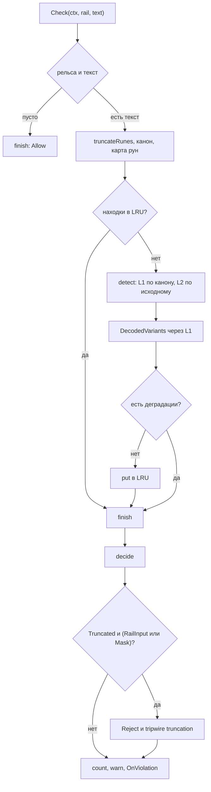

# Как устроен guard

`guard` решает, можно ли пропустить текст дальше. Ответ приходит как `Verdict` с действием, находками и, при маскировании, изменённым текстом.

Детекторы не знают рельсу. Рельса нужна только таблице решений, это разделение задаёт `guard/rails.go`: `Rail` влияет на решение, но не на детекцию.

## Пакеты и границы

| Файл                    | Что делает                                                          |
| ----------------------- | ------------------------------------------------------------------- |
| `guard/guard.go`        | `Pipeline`, `Verdict`, окна, таблица решений, маскирование, LRU-кэш |
| `guard/canonical.go`    | канонизация, карта рун, `DecodedVariants`                           |
| `guard/rules/rules.go`  | L1: выражения, фразы, контрольные суммы                             |
| `guard/ensemble.go`     | сборка слоёв, ансамбли, дедупликация                                |
| `guard/degrade.go`      | опциональные слои и ограничение частоты warn                        |
| `guard/l1only.go`       | явный маркер отказа от ML-слоя                                      |
| `guard/version.go`      | версия конвейера и дайджест артефактов                              |
| `guard/stats.go`        | счётчики и гистограмма задержки                                     |
| `guard/gliner/`         | L2 GLiNER: подготовка, инференс, декодирование, parity              |
| `internal/ort/pool.go`  | пул сессий ONNX Runtime                                             |
| `internal/call/call.go` | порядок `authz → guard → span → fn`                                 |

L2 существует в двух сборках. `gliner.go` собирается без тега и отдаёт заглушку с `ErrGuardUnavailable`. `gliner_ort.go` собирается с `//go:build ort` и требует нативную библиотеку ONNX Runtime.

## Поток проверки



## Ключевые типы

```go
type Verdict struct {
	Action   Action
	Rail     Rail
	Findings []Finding
	Text     string
	Tripwire *Tripwire
	Version  string

	Substitutions []Substitution

	Degraded       bool
	DegradedReason string

	Truncated      bool
	InspectedRunes int
}

type Detector interface {
	Detect(ctx context.Context, text string) ([]Finding, error)
	Name() string
}
```

Опциональный интерфейс `NaturalText` добавляет `UsesNaturalText()`. Он проверяется через `usesNaturalText`, и при `true` детектор получает исходный текст вместо канонического. Так работает L2: модель обучалась на естественном тексте.

## Проверка по шагам

### 1. Канонизация и карта рун

```go
func canonicalizeMap(text string) (string, runeSpans) {
	san, sp1 := sanitizeSpans(text)
	nfc1, sp2 := nfkcSpans(san)
	folded, sp3 := foldSpans(nfc1)
	out, sp4 := nfkcSpans(folded)
	return out, composeSpans(composeSpans(composeSpans(sp4, sp3), sp2), sp1)
}
```

Сначала чинится битый UTF-8, затем идут NFKC, складывание и ещё один NFKC. Каждый шаг возвращает карту, `composeSpans` сшивает их в одну. `remapSpan` переводит найденный диапазон обратно в руны исходного текста.

Полноширинные цифры становятся ASCII, гомоглифы кириллицы и греческого складываются в латиницу, невидимые символы выбрасываются. Для невидимого символа счётчик исходной руны растёт без записи, поэтому позиции после него не сдвигаются. Таблица `confusables` строится симметрично по регистру.

### 2. Окна и L1

Длинный текст режется на окна по `WindowChars`. Перекрытие в одну восьмую не даёт разорвать совпадение на границе. Каждое окно несёт `offset`, чтобы находка вернулась в координаты всего текста. Текст короче окна сканируется одним куском.

L1 это таблица `matcher`: метка, категория, выражение, группа и две необязательные проверки. `validate` считает контрольную сумму, `surroundings` смотрит на контекст.

```go
matchers := []matcher{
	{label: "OPENAI_KEY", category: guard.CatSecret, re: compileRegex(`(?i)sk-[A-Za-z0-9_\-]{16,}`)},
	{label: "AWS_ACCESS_KEY_ID", category: guard.CatSecret, re: compileRegex(`(?i)AKIA[0-9A-Z]{16}`)},
	{label: "PRIVATE_KEY", category: guard.CatSecret, re: compileRegex(`(?i)-----BEGIN [A-Z ]*PRIVATE KEY-----`)},
	{label: "SNILS", category: guard.CatPII, re: compileRegex(`\b\d{3}` + dashClass + `\d{3}` + dashClass + `\d{3}\s\d{2}\b`), validate: func(s string) bool { return validSNILS(digits(s)) }},
}
```

Валидаторы отсекают случайные числа: `validLuhn`, `validIBAN` по mod-97, `validSNILS`, `validINN10`, `validINN12`, `validOGRN`. ИНН из десяти цифр требует метки налогоплательщика рядом, это делает `nearTaxpayerLabel`.

Инъекции ищутся списком фраз и грамматикой из глагола, наполнителя, квалификатора и цели. Паттерны идут через `canonicalRegex`, чтобы совпадать с каноническим текстом. Позиции считаются за один проход по таблице `runeStart`.

### 3. L2, токенайзер и пул

Перед инференсом текст нормализуется: если последний символ не `.`, `!` или `?`, добавляется точка. `nRunes` берётся от нормализованной строки, иначе спаны уедут на единицу.

```go
seq := make([]int64, 0, len(d.cfg.PrefixIDs)+limit)
seq = append(seq, d.cfg.PrefixIDs...)
first := make([]int64, 0, len(words))
kept := 0
for _, w := range words {
	ids, _ := d.tk.Encode(w.token, false)
	if !keepWord(len(seq), len(ids), limit, kept > 0) {
		break
	}
	first = append(first, int64(len(seq)))
	for _, id := range ids {
		seq = append(seq, int64(id))
	}
	kept++
}
```

Слова режет `wordExpr`: ссылки, почта, упоминания, слова с дефисами. Первое слово попадает в тензор всегда, остальные пока хватает `MaxTokens`. Порог спана берётся по метке из `schema.entities.thresholds`, затем общий `decode.default_span_threshold`. Кандидаты сортируются по счёту, пересечения отбрасываются. Порог классификации: метка, группа, `cls_threshold`, затем `0.5`. Категория приходит из `category_map`, метка `SAFE` и безопасные слова отбрасываются.

Пул это буферизованный канал сессий. `Acquire` ждёт не дольше `Wait` и уважает контекст, `Release` закрывает сессию при переполнении канала. Ошибки пула и инференса заворачиваются в `core.ErrGuardUnavailable`.

### 4. Таблица решений и маскирование

```go
func actionFor(rail Rail, cat Category) Action {
	switch cat {
	case CatInjection, CatUnsafe:
		if rail == RailOutput {
			return Detect
		}
		return Reject
	case CatPII, CatSecret:
		return Mask
	default:
		return Allow
	}
}
```

`decide` берёт максимум по действиям, `Reject` прерывает перебор. `Detect` стоит между `Allow` и `Mask`, поэтому PII всё равно даёт `Mask`. Если в окне нашлась инъекция, `detect` выходит сразу: следующие окна и слои не запускаются.

```go
key := string(s.Category) + ":" + s.Label
counters[key]++
placeholder := "[" + key + ":" + strconv.Itoa(counters[key]) + "]"
b.WriteString(placeholder)
if value := string(runes[s.Start:end]); value != "" {
	subs = append(subs, Substitution{Placeholder: placeholder, Category: s.Category, Value: value})
}
prev = end
```

Перед этим пересекающиеся спаны PII и секретов сливаются: категория повышается до `PII`, метки склеиваются через запятую. Плейсхолдер выглядит как `[PII:EMAIL:1]`. `Substitutions` позволяют вернуть исходное значение под `AllowPII`, в `OnViolation` они не уходят.

### 5. Обрезка, кэш и версия

```go
if v.Truncated && (rail == RailInput || v.Action == Mask) {
	v.Action = Reject
	v.Tripwire = &Tripwire{
		Reason: "truncated text, uninspected content may contain PII or injection",
		RuleID: "truncation",
		Metadata: map[string]any{
			"rail":            string(rail),
			"inspected_runes": inspected,
			"total_runes":     total,
		},
	}
}
```

Ключ кэша это sha256 от версии и обрезанного текста, рельса в ключ не входит. Вердикт с деградацией не кэшируется. `get` и `put` копируют срез находок, поэтому мутация одного вердикта не портит следующий. Версия собирается из `Options.Version` или `derived-<hash>` по именам слоёв, `MaxChars` и `WindowChars`. Хеш артефакта добавляется через `/`, если детектор реализует `ArtifactHash`. Приложение передаёт `policyHash + "/" + layerID`.

## Отказы и пределы

Ошибка обязательного слоя возвращается из `Check`. Мягкая деградация возможна только для слоёв из `OptionalByRail` на конкретной рельсе. Приложение строит карту из `Config.GuardFailOpen` и только для ML-слоёв: L1 обязателен всегда. `Config.GuardOnViolation` получает каждый вердикт кроме `Allow`, уже без подстановок.

`guard.L1Only()` это маркер. Приложение выкидывает его в `guardLayers`, поэтому список остаётся `L1`. Если передать маркер как обычный детектор, `Detect` вернёт `ErrGuardUnavailable`.

Деградация не кэшируется, считается в `Stats.Degradations` и пишет warn не чаще `DefaultDegradedWarnInterval` на рельсу. По умолчанию: `MaxChars` 8000, `WindowChars` 1024, `CacheSize` 4096.

Декодированные варианты ограничены 24 вариантами, двумя раундами и 4096 байтами. Их находки получают диапазон на весь текст и слой `L1+decode`: точную позицию внутри кодированной строки не восстановить.

## Тесты

- `guard/guard_test.go`: решения, маскирование, подстановки, кэш, tripwire, деградация.
- `guard/truncated_test.go`: обрезка на входе и превращение `Mask` в `Reject`.
- `guard/window_test.go`: сканирование всего текста и находка из хвоста.
- `guard/canonical_test.go`, `canonical_fuzz_test.go`: гомоглифы, невидимые символы, фиксированная точка.
- `guard/cache_test.go` и `degrade_test.go`: отсутствие алиасинга, опциональные рельсы, копия `Stats`.
- `guard/rules/*_test.go`, `guard/gliner/*_test.go`: обходы, маскирование, декодирование, parity под `ort`.

## Смотрите также

- [Защита](./README.md)
- [Справочник API](../reference/gobellim.md)
- [Ошибки](../reference/errors.md)
- [Как устроена трассировка](../tracing/implementation.md)
