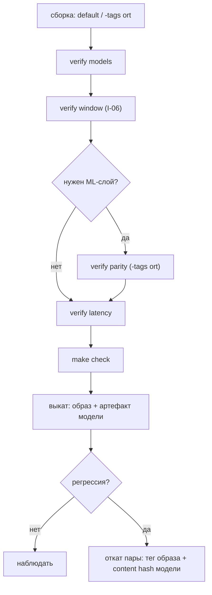

# Деплой: сборка, модели, гейты и откат

Этот гид — про выкат сервиса на `kit`: два режима сборки, fail-closed заглушки,
проводка моделей, bootstrap Elasticsearch, контейнер, **гейты перед продом** и
чек-лист отката. Требования и установка — [Установка](../getting-started/installation.md);
рантайм и память — [Архитектура](../internals/architecture.md).

## Два режима сборки

| Режим        | Команда                                                           | Что даёт                                                   |
| ------------ | ----------------------------------------------------------------- | ---------------------------------------------------------- |
| По умолчанию | `go build ./...`                                                  | чистый Go, нативных библиотек не требует                   |
| ONNX (`ort`) | `CGO_ENABLED=1 CGO_LDFLAGS="-L.ort/lib" go build -tags ort ./...` | локальный guard L2 и локальный эмбеддер (`embed.NewLocal`) |

| Что нужно                    | Когда                 | Где                                        |
| ---------------------------- | --------------------- | ------------------------------------------ |
| `CGO_ENABLED=1`              | только `-tags ort`    | cgo-линковка `onnxruntime_go`/`tokenizers` |
| `libtokenizers.a`            | при **сборке** `ort`  | `CGO_LDFLAGS` (например `.ort/lib`)        |
| `libonnxruntime.dylib`/`.so` | при **запуске** `ort` | `KIT_ORT_LIB` (по умолчанию `.ort/lib/…`)  |

> [!WARNING]
> `libtokenizers.a` нужна на этапе **сборки**, `libonnxruntime` — на этапе
> **запуска**. Это две разные зависимости; образ, собранный с `ort`, но без
> `libonnxruntime` в runtime-слое, упадёт при инициализации guard/эмбеддера.

## Fail-closed контракт тегов сборки

Заглушки — часть контракта, а не случайность. Сборка без `ort` «деградирует
безопасно», но теряет ML-слой:

| Что                  | `!ort` (по умолчанию)                          | `ort`         |
| -------------------- | ---------------------------------------------- | ------------- |
| `guard/gliner`       | `Detect` → `ErrGuardUnavailable` (fail-closed) | ONNX-детектор |
| `gliner.CheckParity` | `ErrGuardUnavailable`                          | parity-гейт   |
| `embed.NewLocal`     | `ErrInvalidConfig`                             | ONNX-энкодер  |

Следствие: **не передавайте `GuardL2` из заглушки.** Если сборка без `ort`, а вы
всё же кладёте detector в `Config.GuardL2`, то слой L2 существует и первая же
проверка даст `ErrGuardUnavailable` — то есть откажет операция. Без `ort`
оставляйте `GuardL2 = nil` (работает только L1) либо собирайте с `ort`.

Заглушка `gliner.New` в сборке без `ort` требует непустой `Dir`, иначе
`ErrInvalidConfig` — но это лишь проверка конфигурации, реальной модели там нет.

## Проводка моделей

```sh
# внешний эмбеддер (e5-small): model.onnx + tokenizer.json + config.json
go run ./cmd/kitctl model pull intfloat/multilingual-e5-small

# guard L2 (если вы публикуете артефакт в свой HF-репозиторий)
go run ./cmd/kitctl model pull hivetrace/gliner-guard-omni
```

| Факт                  | Значение                                                                                                     |
| --------------------- | ------------------------------------------------------------------------------------------------------------ |
| Имя файлов            | `model.onnx`, `tokenizer.json`, `config.json`                                                                |
| Раскладка             | `<models_dir>/<org>__<name>/` (слэш в имени заменяется на `__`)                                              |
| Каталог по умолчанию  | `KIT_MODELS_DIR`, иначе `./models`                                                                           |
| Источник по умолчанию | `https://huggingface.co` (`--base-url` переопределяет)                                                       |
| В git                 | `models/` и `.ort/` игнорируются — веса не коммитятся                                                        |
| Guard-артефакт        | воспроизводится `python3 tools/gliner/export.py`; кладите три файла в `models/hivetrace__gliner-guard-omni/` |

Монтируйте каталог моделей **read-only** в контейнер: `kit` только читает веса.

## Bootstrap Elasticsearch

`App.Setup(ctx)` идемпотентно создаёт:

| Шаг | Запрос                                               |
| --- | ---------------------------------------------------- |
| 1   | `PUT /_ilm/policy/kit-traces-30d`                    |
| 2   | `PUT /_index_template/kit-traces`                    |
| 3   | `PUT /_index_template/kit-observations`              |
| 4   | `PUT /kit-chunks` — только если `Embedder.Dim() > 0` |

| Свойство        | Значение                                                                 |
| --------------- | ------------------------------------------------------------------------ |
| Идемпотентность | `resource_already_exists_exception` / `already_exists_exception` = успех |
| Таймаут шага    | 30 с (`store.EnsureStepTimeout`)                                         |
| Индекс чанков   | `dense_vector` размерности эмбеддера, `acl`/`tenant` — `keyword`         |
| Data stream     | 1 shard, 0 replicas, lifecycle `kit-traces-30d`                          |
| Версия ES       | ≥ 8.14, basic-лицензия (`R`RF считается в Go, лицензия basic)            |

Вызывайте `Setup` один раз при старте сервиса (до первого запроса). Если
`Embedder` не задан, шаг 4 пропускается — индекс чанков не создаётся.

## Контейнер

`demo/deploy/Dockerfile` — две стадии: builder (`golang:1.24-bookworm`) и slim runtime
(`debian:bookworm-slim`). Образ работает от non-root (`kit`, uid 10001), политика
копируется в `/etc/kit/policy.yaml` (`KIT_POLICY`).

```dockerfile
# ORT-вариант: скопировать библиотеку и указать путь
COPY --from=builder /src/libonnxruntime.so /usr/lib/libonnxruntime.so
ENV KIT_ORT_LIB=/usr/lib/libonnxruntime.so
```

`demo/deploy/docker-compose.yml`:

| Сервис          | Детали                                                                   |
| --------------- | ------------------------------------------------------------------------ |
| `elasticsearch` | 8.15.0, single-node, **`xpack.security.enabled=false`**, `-Xms1g -Xmx1g` |
| `grafana`       | 11.2.0, анонимный Viewer, provisioning дашбордов                         |
| `embeddings`    | TEI `cpu-1.8` (amd64; на Apple Silicon — эмуляция)                       |
| `bot`           | ваш образ, `read_only: true`, порт 8080, `depends_on` ES healthcheck     |

> [!WARNING]
> `docker-compose` — **локальный стенд**, а не прод: у ES выключена security,
> Grafana анонимна. В проде включите xpack-security и TLS к ES (`проверьте у себя`).
> Rootfs контейнера `read_only: true`, поэтому `.env` в образ не попадает, а секреты
> идут через `environment`; если используете локальный guard/эмбеддер, каталог
> моделей нужно смонтировать отдельным read-only volume (`проверьте у себя` на
> вашей версии `compose`).

CA-файл провайдера (например, для GigaChat) монтируется в контейнер и передаётся
через `GIGACHAT_CA_FILE`; демо читает PEM в `x509.CertPool` и держит TLS ≥ 1.2.

## Гейты перед деплоем

`kitctl verify` — эксплуатационные гейты (`BR-73`). Флаги принимаются и до, и
после позиционных аргументов.

```sh
# 1. Модели на месте и структурно валидны (guard + embedder)
go run ./cmd/kitctl verify models --dir ./models

# 2. Инвариант I-06: окно guard не шире окна модели (+ политика)
go run ./cmd/kitctl verify window \
  --model-context 32000 --guard-max-chars 8000 --policy ./policy.yaml

# 3. Гейт паритета guard (нужна сборка с -tags ort)
go vet -tags ort ./...
go run -tags ort ./cmd/kitctl verify parity \
  --dir ./models --fixtures guard/gliner/testdata --min-agreement 1.0

# 4. Воспроизводимый отчёт по латентности и RSS
go run -tags ort ./cmd/kitctl verify latency \
  --dir ./models --iterations 200 --warmup 20 --max-chars 8000

# 5. Локальный гейт целиком
make check
```

| Гейт             | Что проверяет                                                           | Нужен `ort`     |
| ---------------- | ----------------------------------------------------------------------- | --------------- |
| `verify window`  | I-06: `GuardMaxChars ≤ ContextTokens`; заодно валидирует `policy.yaml`  | нет             |
| `verify models`  | набор файлов guard (`gliner.VerifyDir`) и эмбеддера (`embed.VerifyDir`) | нет             |
| `verify parity`  | согласие Go/ORT с фикстурами (`--min-agreement`, по умолчанию `1.0`)    | да              |
| `verify latency` | p50/p95/p99 по L1 и L1+L2, RSS после прогрева                           | нет (L1 всегда) |

`make check` гоняет `gofumpt -l`, `go build ./...`, `go vet ./...`,
`go test ./... -count=1`, `go vet -tags ort ./...` (только типы) и
`golangci-lint run`. Та же планка в CI: джобы `build`, `test`, `race`, `ort-vet`,
`lint`, `fumpt`.



## Апгрейд guard-модели — это смена политики

Вердикт guard кэшируется LRU (`GuardCacheSize`, по умолчанию 4096); ключ — версия
guard плюс инспектируемый текст. Версию собирает `kit.New`:

```
guard_version = <policy_hash>/<layer_id>     // например "9f3c…/L1+L2"
```

то есть в строку версии входит **хэш политики и имена слоёв**. Поле `guard_model`
несёт **имя слоя** (`"L2"`), а не id модели, поэтому сам артефакт весов пиньте
отдельно (хэш файла в метаданных деплоя). Отсюда практическое следствие:

> [!WARNING]
> Замена артефакта модели **сама по себе не меняет** `guard_version`, если имя
> слоя и политика те же. Кэш вердиктов живёт в процессе, поэтому после подмены
> весов **перезапустите процесс** (или измените конфигурацию, влияющую на версию),
> иначе часть вердиктов будет отдана из старого кэша.

Процедура:

1. Зафиксируйте артефакт по **content hash** (sha256 весов и `config.json`) — это
   ваш источник истины, а не имя каталога.
2. Прогоните `kitctl verify models` и `kitctl verify parity` (`-tags ort`).
3. Обновите `models/hivetrace__gliner-guard-omni/` и перезапустите процесс.
4. В трейсах нового трафика проверьте `guard_version` (`guard_model` при этом
   покажет имя слоя, `"L2"`).

## Ретенция и объём трейсов

| Механизм                    | Что делает                                                                                             |
| --------------------------- | ------------------------------------------------------------------------------------------------------ |
| ILM `kit-traces-30d`        | rollover при 10 GB, delete через 30 дней                                                               |
| `App.Prune(ctx, olderThan)` | `_delete_by_query` по `@timestamp` в `kit-traces` и `kit-observations`; `refresh=false`; право `prune` |

`Prune` дополняет ILM, а не заменяет её. Объём трейсов режут: `Sampler`
(детерминированный по `trace_id`), `HideInput`/`HideOutput`, экспорт-лимиты
(`MaxStringLength` и др.), а нагрузку на ES — размер батча и очередь писателя.

## Наблюдаемость в проде

| Ручка            | Значение по умолчанию / что делает                                                                                                 |
| ---------------- | ---------------------------------------------------------------------------------------------------------------------------------- |
| `Sampler`        | `always`; `trace.SamplerRatio(0.1)` — доля по `trace_id`                                                                           |
| `Sinks`          | дополнительные приёмники; писатель в ES всегда остаётся первым                                                                     |
| очередь писателя | 4096 документов; batch 500 / 2 с / 5 MB; 3 ретрая, backoff 200 мс                                                                  |
| `dropped`        | счётчик отброшенных при переполнении; `App` его не отдаёт — следите за `slog.Warn` `trace: dropping document` (`проверьте у себя`) |
| Grafana          | `demo/deploy/grafana/` — provisioning datasource и дашборд `kit-overview`                                                               |

`App.Close(ctx)` обязателен при остановке: он сбрасывает остаток очереди.
Дашборды читают data streams напрямую (`kit-observations` по `kind`/`level`,
`kit-traces` по `usage.cost`).

## Масштабирование

- **Один процесс владеет ORT-пулами.** `gliner.Config.Sessions` (guard) и
  `LocalConfig.Sessions` (эмбеддер) считают сессии; `intra_op_threads` =
  `NumCPU / (число сессий всех пулов)`, минимум 1. **Больше сессий — меньше
  потоков каждой**, а не больше суммарной мощности.
- **Одна сессия ORT обрабатывает один batch за раз.** Параллелизм L2/эмбеддера
  ограничен числом сессий; очередь с потолком `Config.Wait`/`ort.DefaultWait`
  (2 с) при переполнении даёт `ErrGuardUnavailable` (guard) или `ErrProvider`
  (эмбеддер).
- **Писатель трейсов не блокирует запрос**; при переполнении он отбрасывает
  документы (растёт `dropped`), но не тормозит ход.
- **`Refresh: wait_for` стоит латентности.** `Ingest` пишет чанки на
  `_bulk?refresh=wait_for`; для массовых загрузок это дорого — наливка больших
  массивов логичнее с `Refresh: false` (управляйте этим в своём коде, а не через
  `App.Ingest`, если вам нужен контроль).
- **`search.top_k`** по умолчанию 10, клампится до 1000; `num_candidates` —
  максимум из `topK*10` и 100, клампится до 10000. Большие значения дороги и в ES,
  и в RRF.

## Чек-лист выката и откат

| Шаг       | Действие                                                                              |
| --------- | ------------------------------------------------------------------------------------- |
| Образ     | Зафиксируйте тег образа (immutable), не `latest`; отметьте `BUILD_TAGS`/`CGO`         |
| Модели    | Зафиксируйте content hash артефактов (guard и эмбеддер) в релиз-ноуте                 |
| Гейты     | `verify models`, `verify window`, `verify parity`, `verify latency`, `make check`     |
| Bootstrap | `App.Setup` при старте (идемпотентно)                                                 |
| Smoke     | Один `Chat` без инструментов и один с `EffectRead`-инструментом; проверьте trace в ES |
| Откат     | Вернуть тег образа **и** артефакт модели к зафиксированным хешам                      |

> [!WARNING]
> Откат только кода при **более новой** guard-модели меняет вердикты: версия guard
> в коде строится из политики и слоёв, а модель вы подменяете отдельно. Храните
> код и артефакт модели как **одну пару**: откатывайте их вместе и после отката
> перезапускайте процесс (кэш вердиктов — в памяти).

## Ограничения

- **По умолчанию нет ML-слоя.** Без `-tags ort` доступны только L1 и внешние
  провайдеры; локальный эмбеддер и guard L2 требуют ORT.
- **`kit` не деплоит ES, Grafana и провайдеров.** `demo/deploy/` — локальный стенд;
  продовые ES/IdP/TLS — ваши (`проверьте у себя`).
- **Нет готового решения для хранения снимков `flow`** и для очереди прогонов —
  это на стороне приложения.
- **Нет API чтения трейсов.** Потребители читают ES (Kibana/Grafana) или CLI-ридер
  `go run ./demo/cmd/traces` (список трейсов и разбор одного по `-trace`);
  JSON-API не реализован ([План](../internals/plan.md)).
- Образцы `verify parity` требуют фикстур (`guard/gliner/testdata`) и ORT-сборки;
  в релизном пайплайне без ORT этот гейт не запустится.

## Смотрите также

- [Установка](../getting-started/installation.md) — требования и ORT-сборка
- [Архитектура](../internals/architecture.md) — рантайм, ORT-сессии, каталог моделей
- [Конфигурация](../reference/configuration.md) — лимиты, переменные окружения
- [Индексы Elasticsearch](../reference/elasticsearch.md) — что создаёт `App.Setup`
- [Наблюдаемость](../concepts/observability.md) — sampling, sinks, writer
- [Производительность](./performance.md) — числа латентности и RSS
- [Безопасность](./security.md) — что не должен увидеть прод
