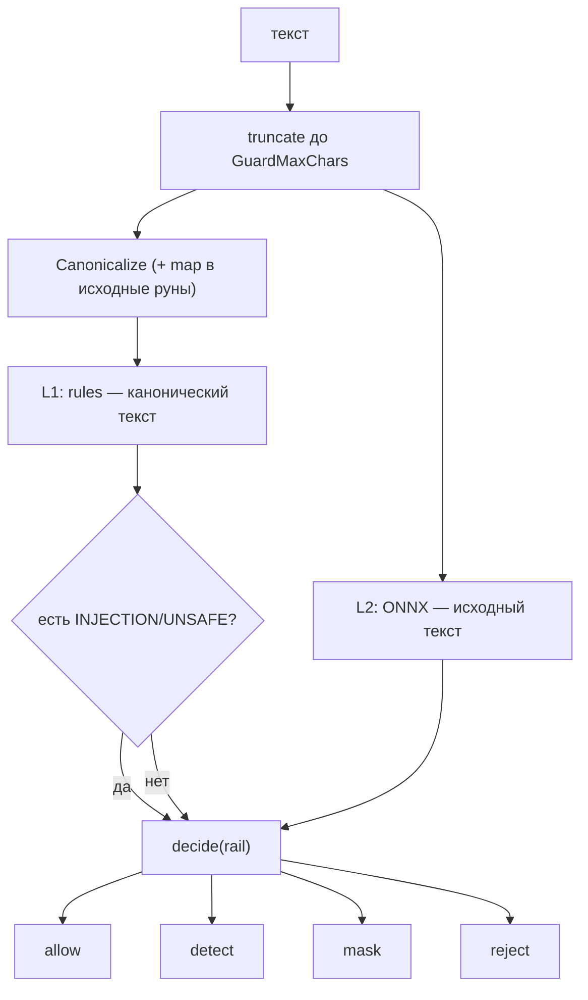

# Как настроить guardrails

Guardrail — конвейер проверок текста, который решает: пропустить, замаскировать,
записать находку или отклонить операцию. Конвейер запускается во всех операциях
через `internal/call`, поэтому настроить его в одном месте достаточно для всего
приложения.

Это how-to: слои, пороги, рецепты и бюджет латентности. Замысел и таблица
решений по рельсам — [Guardrails](../concepts/guardrails.md); сигнатуры
`Config` — [Конфигурация](../reference/configuration.md).

## Когда использовать

- Модель принимает недоверенный ввод: запрос пользователя, документ, результат
  инструмента.
- Нужно необратимо маскировать PII и секреты до того, как они попадут в модель.
- Нужно отклонять инъекции и вредный контент до вызова модели или инструмента.
- Нужно понимать бюджет латентности L2 и уметь его подкрутить.

## Быстрый старт

```go
import "github.com/KirillYuzh/Gobellim/guard/gliner"

l2, err := gliner.New(gliner.Config{Model: "hivetrace__gliner-guard-omni"})
if err != nil {
	return err // fail-closed: без L2 приложение лучше не поднимать
}

app, err := kit.New(ctx, kit.Config{
	ES:      es,
	LLM:     llm,
	Policy:  policy,
	GuardL2: l2, // ML-слой; обязателен — только L1: guard.L1Only()
})
```

`guard/rules` (L1) подключается всегда и безусловно. `GuardL2` добавляет
единственный ML-слой и **обязателен**: `nil` даёт `ErrInvalidConfig`, а режим
только-L1 запрашивается явно — `guard.L1Only()` (при нём `New` пишет warning).

## Слои

| Слой | Пакет          | Что делает                                             | Сборка          |
| ---- | -------------- | ------------------------------------------------------ | --------------- |
| L0   | `guard`        | каноникализация + decode-and-rescan (см. ниже)         | всегда          |
| L1   | `guard/rules`  | фразы, regex, контрольные суммы, секреты               | всегда          |
| L2   | `guard/gliner` | ONNX-модель через ONNX Runtime (без Python в рантайме) | под тегом `ort` |

L0 выполняется **до** слоёв guard, но потоки у них разные (I-03): L1 читает
канонический текст (гомоглифы и zero-width обезврежены), L2 — исходный, потому что
транслитерация вне обучающего распределения модели. Находки L1 переводятся обратно
в исходные координаты (I-21). Декодированные варианты (base64/hex/percent) повторно
прогоняются только через L1.



### L0: каноникализация и декодирование

`guard.Canonicalize` приводит текст к сравнимому виду: NFKC, нижний регистр,
удаление zero-width/bidi/`FEFF`, фолдинг кириллических гомоглифов (`А`→`a`,
`С`→`c`, …) и нормализация полноширинных цифр (`０`→`0`). `guard.DecodedVariants`
дополнительно декодирует фрагменты base64 (4 варианта алфавита), hex и
percent-encoding и прогоняет результат повторно через L1.

Каноникализация — фиксированная точка (`Canonicalize(Canonicalize(s)) ==
Canonicalize(s)`): порядок именно NFKC → регистр/гомоглифы → снова NFKC, потому
что смена регистра делает последовательность composable уже после первого NFKC
(`J`+U+030C → `ǰ`), а невалидный UTF-8 санируется до NFKC — иначе NFKC оставляет
руну неразобранной и текст перестаёт быть сравнимым с самим собой.

Это нужно потому, что иначе достаточно обойти детектор сменой начертания или
кодировкой. `canonicalizeMap` отдаёт для каждой канонической руны диапазон
исходных рун, поэтому `Finding.Start`/`End` — смещения в рунах **исходного**
текста, и маска накрывает ровно сопоставленный ввод, даже если каноникализация
руну отбросила (zero-width, bidi) или склеила (I-21).

### L1 (`guard/rules`): что детектит

| Группа                      | Что ловит                                                                                                          |
| --------------------------- | ------------------------------------------------------------------------------------------------------------------ |
| Инъекции: фразы             | `ignore previous instructions`, `reveal your system prompt`, `игнорируй предыдущие инструкции`, …                  |
| Инъекции: regex             | варианты фраз (`you are now`, `new instructions:`, `покажи системный промпт`, …)                                   |
| RU PII с контрольной суммой | `SNILS` (СНИЛС), `INN` (10 и 12 цифр), `OGRN` (13), `OGRNIP` (15), `PASSPORT` (2-2-6)                              |
| Банковские                  | `BANK_CARD` (Luhn, 12–19 цифр), `IBAN` (mod-97), `CVV` (эвристика по контексту `cvv`/`cvc`)                        |
| Контакты                    | `EMAIL`, `PHONE` (+7)                                                                                              |
| Секреты                     | `OPENAI_KEY`, `AWS_ACCESS_KEY_ID`, `GITHUB_TOKEN`, `PRIVATE_KEY`, `JWT`, `BEARER`, `GOOGLE_API_KEY`, `SLACK_TOKEN` |

Фразы и regex инъекций дают категорию `INJECTION`; они единственная
«reject-capable» находка L1 наряду с `UNSAFE`. Регексы RU PII компилируются из
уже каноникализованного шаблона (`canonicalRe`), поэтому совпадают с каноническим
текстом.

### L2 (`guard/gliner`): ONNX-детектор

```go
type Config struct {
	Dir       string        // каталог моделей; по умолчанию KIT_MODELS_DIR, затем ./models
	Model     string        // hivetrace__gliner-guard-omni
	Sessions  int           // пул ORT-сессий, по умолчанию 2
	Wait      time.Duration // ожидание свободной сессии, по умолчанию ort.DefaultWait (2 с)
	MaxTokens int           // потолок токенов тензорного входа, по умолчанию 512
}
```

- `DefaultMaxTokens = 512` (`gliner.DefaultMaxTokens`); значение **клампится**
  до `max_sequence_length` модели из `config.json`.
- Слова, не влезшие в потолок, отбрасываются целиком, поэтому потолок держите не
  меньше окна детекции (`GuardWindowChars`): иначе хвост окна разметит только L1
  (BR-70, BR-99). Дефолтное окно (1024 руны) в потолок помещается: русский текст
  mDeBERTa — ≈ 0,27 токена на руну, то есть ≈ 275 токенов на окно
  (`TestWindowFitsTokenBudget`). Весь текст в пределах `GuardMaxChars` L2
  проходит — окнами.
- Любая ошибка модели (нет каталога, не поднялся ORT, плохой тензор, таймаут
  очереди) возвращается как `ErrGuardUnavailable`: операция отклоняется, а не
  пропускается (fail-closed). На рельсах из `Config.GuardFailOpen` ошибка L2 не
  фатальна: вердикт строится по L1 и помечается `guard_degraded`.
  Без тега `ort` пакет собирается заглушкой, чей `Detect` тоже возвращает
  `ErrGuardUnavailable`.
- Перед использованием каталог можно проверить: `kitctl verify models` (и
  `kitctl verify parity` — паритет с фикстурами, требует `-tags ort`).

**Метки → категории.** Метки сущностей (`person`, `email`, …) по умолчанию дают `PII` со спаном (`Start`/`End` — границы спана). Метки классификации (`safe`/`unsafe`, таксономия) дают категорию так:

1. явное значение `category_map[label]` переопределяет всё;
2. значение-категория (`PII`/`SECRET`/`INJECTION`/`UNSAFE`) задаёт категорию;
3. значение **`SAFE`** подавляет находку для этой метки;
4. без маппинга — эвристика: `unsafe|harmful|toxic|violence|danger` → `UNSAFE`,
   `inject|jailbreak|attack|override|exfiltrat|abuse` → `INJECTION`;
5. встроенный список «безопасных имён» (`safe`, `benign`, `informational`,
   `conversational`, …) даёт «ничего не сообщать»;
6. **немаппленная незнакомая метка у задачи, несущей безопасность** (`safety`,
   `adversarial`, `harmful`) → `UNSAFE` (fail-safe, I-14). У информационных задач
   (`intent`, `tone`, …) немаппленная метка вердикта не даёт (D65): иначе
   безобидное «instructional» или «distressed» отклоняло бы ход.

`category_map` действует и на сущности: вы можете перевести метку сущности в
другую категорию или подавить её тем же `SAFE`; «значение по умолчанию»
(`def`) — `PII` для сущностей и пусто (→ эвристика) для классификаций.

## Таблица решений по рельсам

`actionFor(rail, category)` — рельс влияет только на решение, не на детекцию
(I-02). `decide` берёт **максимальное** действие по всем находкам, где
`Allow < Detect < Mask < Reject`.

| Рельс         | `PII` / `SECRET` | `INJECTION` / `UNSAFE`                                                    |
| ------------- | ---------------- | ------------------------------------------------------------------------- |
| `input`       | `Mask`           | `Reject` (fast-fail, `ErrGuardReject`)                                    |
| `output`      | `Mask`           | `Detect` — текст не меняется, находка записывается                        |
| `tool_result` | `Mask`           | `Reject` → результат подменяется на `{"error":"result blocked by guard"}` |

Это полный список: в пакете `guard` объявлено ровно три рельса — `input`, `output`,
`tool_result`.

> [!NOTE]
> ACL и карантин при поиске, а также RBAC и валидация аргументов — не рельсы guard и
> констант с такими именами в пакете `guard` нет. Они реализованы напрямую
> (`store.Filter`, `internal/call`), минуя `guard.Pipeline.Check`, и не пишут
> `guard:<rail>` в трейсах.

Внутри `decide` короткое замыкание: как только действие становится `Reject`,
дальше не считается. А в `detect` — fast-fail между слоями: если L1 уже дал
`INJECTION`/`UNSAFE`, L2 не запускается.

## Маскирование необратимо

`Mask` заменяет найденные спаны заглушками вида `[PII:SNILS]` (категория:метка),
соседние и пересекающиеся спаны объединяются, PII/SECRET имеет приоритет над
INJECTION при наложении. Для модели исходные значения **стираются**.

### `AllowPII`: когда инструменту нужно реальное значение

Некоторым инструментам значение нужно, а из промпта его взять нельзя
(`send_sms(phone)`). Такой инструмент объявляет `kit.AllowPII(true)`: рантайм ведёт
список подстановок рельса `input` и перед вызовом заменяет заглушки в аргументах на
значения. Замена срабатывает **только когда отображение однозначно** — одна
заглушка соответствует ровно одному значению; если модель переставила, размножила
или выдумала заглушку, аргументы уходят как есть (`[PII:phone]`) и инструмент
падает сам — неверное значение наружу не уходит.

Значения подставляются **только внутри вызова**: `ToolCallInfo.Args`, fingerprint,
трейс, observation и хуки видят маску. Результат, эхо-нувший реальное значение,
маскируется обратно до записи в observation и до возврата модели.

```go
if _, err := kit.Tool(app, "send_sms", sendSMS,
	kit.Desc("Отправить SMS на номер."),
	kit.AllowPII(true), // телефон пришёл из промпта и был замаскирован
); err != nil {
	return err
}
```

Маска `Mask` перезаписывает текст для последующих слоёв и рельсов (I-04), поэтому
один и тот же ход не «размаскируется» на рельсе `output`.

## Окна: `GuardMaxChars` и потолок токенов L2

Это **разные** окна:

| Окно          | Значение                                | Что с ним                                 |
| ------------- | --------------------------------------- | ----------------------------------------- |
| окно guard    | `Config.GuardMaxChars` = 8000 рун       | предел сканирования; дальше текст не идёт |
| окно детекции | `Config.GuardWindowChars` = 1024 руны   | размер одного прохода слоёв               |
| потолок L2    | `gliner.Config.MaxTokens` = 512 (кламп) | сколько токенов видит L2 в одном проходе  |

Вход обрезается по рунам до `GuardMaxChars` до детекции; маскирование
применяется к этому окну. Внутри предела текст идёт **перекрывающимися окнами** по
`GuardWindowChars` рун (перекрытие — 1/8 окна), каждый слой вызывается на каждом
окне, а находки смещаются на смещение окна и дедуплицируются. Окно детекции
выбирайте не больше реальной ёмкости L2: слова за потолком `prepare` отбрасывает, и
шаг окна мог бы пропустить отброшенный хвост. Дефолтное окно безопасно (1024 руны
≈ 275 токенов при ёмкости 512). `0` означает `guard.DefaultWindowChars` (1024); чтобы
выключить оконный скан, задайте значение не меньше `GuardMaxChars`. Каждое окно —
отдельный forward pass L2, поэтому латентность растёт линейно по числу окон: окно
1024 руны ≈ 0,25 с p50, а 8000 рун (≈ 9 окон) ≈ 2,6 с (BR-99, D60).

Инвариант I-06 связывает окно guard с окном модели: если ваш `model.Client`
реализует `model.ContextWindow` (`ContextTokens() int`), `kit.New` сверяет
`GuardMaxChars` (или `guard.DefaultMaxChars`) с `ContextTokens()` и возвращает
`ErrInvalidConfig`, если окно guard шире окна модели. Проверить заранее:
`kitctl verify window --model-context <tokens>`.

## Вердикт воспроизводим

- **Версия guard** — `policyHash + "/" + имена слоёв` (например,
  `ab12…ef/L1+L2`). `App.GuardVersion()` её возвращает.
- **Кэш вердиктов** (LRU, `GuardCacheSize` = 4096) ключуется **версией guard +
  инспектируемым текстом**. Рельс в ключ не входит: одна проверка переиспользуется
  всеми рельсами (I-02).
- **Поле `guard_model`** — `Detector.Name()` слоя L2. У поставляемого детектора
  это **`"L2"`**, а не имя каталога модели. Не путайте с `Model` из
  `gliner.Config`.
- `kit.GuardRejectError` (алиас из `internal/call`) несёт `Rail`,
  `Tripwire{Reason, RuleID, Metadata}` и `Version`; `RuleID`/`Reason` попадают и
  в `metadata` observation (`tripwire_rule`, `tripwire_reason`).

`guard.Options.OnViolation` вызывается на каждый вердикт `Detect`/`Mask`/`Reject`
и не кэшируется. Через фасад его выставляет `kit.Config.GuardOnViolation`;
вердикт приходит без сырых замаскированных значений (`AllowPII`), поэтому в
колбэк нельзя случайно утащить PII. Для продакшена срабатывания всё равно удобнее
читать из observations.

## Качество L1: измеренные числа

> **Производный раздел.** Числа ниже — результат прогона харнесса, а не часть
> контракта. Нормативный слой — `design.md` §3 и `BR-xx`; при расхождении
> правда — там. Таблица переезжает вслед за детекторами и корпусом.

Харнесс считает качество **детерминированного слоя L1** (`guard/rules`) на
публичном корпусе `testdata/guard/cases.jsonl`. L2-модель в этих числах не
участвует: её веса ONNX не лежат в git, поэтому гейт паритета L2 запускается
только как `go run -tags ort ./scripts/guardqual` и на обычной машине
пропускается.

Прогон `go run ./scripts/guardqual`, замер 2026-10-16: 278 кейсов — 138
оцениваемых, 117 контролей безобидного текста, 23 отложены на L2.

| Область | Кейсов | Ожидалось | Найдено | Recall | Precision | FPR | Порог (recall / precision / fpr) | Вердикт |
| --- | ---: | ---: | ---: | ---: | ---: | ---: | --- | :--- |
| overall | 258 | 141 | 141 | 1.000 | 1.000 | 0.009 | 0.900 / 0.900 / 0.050 | PASS |
| PII | 196 | 79 | 79 | 1.000 | 1.000 | 0.009 | 0.900 / 0.900 / 0.050 | PASS |
| SECRET | 134 | 17 | 17 | 1.000 | 1.000 | 0.000 | 0.900 / 0.900 / 0.050 | PASS |
| INJECTION | 162 | 45 | 45 | 1.000 | 1.000 | 0.000 | 0.900 / 0.900 / 0.050 | PASS |
| UNSAFE | 117 | 0 | 0 | n/a | n/a | 0.000 | — / 1.000 / 0.050 | PASS |

Пропущенных детекций нет; единственное ложное срабатывание — `benign-pii-0002`.

Пороги живут отдельно от кода, в `scripts/guardqual/thresholds.json`
(`overall` и `per_category`, с обоснованием каждого числа в поле `rationale`).
Общий порог и пороги `PII`/`SECRET`/`INJECTION` — recall ≥ 0.90, precision ≥ 0.90,
FPR ≤ 0.05. Они намеренно ниже 1.0: слой L1 — это слой паттернов, и корпус из
278 кейсов всегда будет содержать формулировку, которую он не покрывает.

### Эти числа не доказывают обобщаемость

**Recall 1.000 на публичном корпусе — это мера подгонки, а не мера качества.** Корпус
лежит в репозитории, а правила L1 писались против него, поэтому цифра
`1.000/1.000` говорит о согласованности кода с его же тестовыми данными и
ничего — о поведении на незнакомом тексте. Публиковать её как характеристику
качества guard нельзя. Сигналом обобщаемости служат held-out пробы, и на момент
2026-10-16 они дают противоположный ответ:

| Held-out проба (2026-10-16) | Результат |
| --- | --- |
| Формы обхода (evasion), не представленные в корпусе | **0 из 6** обнаружено |
| Ложные срабатывания на «голый» 10-значный номер в обычном русском деловом тексте | **8 из 10**, включая реальный ИНН `7707083893`, замаскированный как паспорт |

Вывод, который из этого следует: публично-корпусная оценка завышена, и цифра
`1.000` не должна читаться как «guard ловит всё». Детекторы L1 находятся в
работе; после правок числа в таблице выше нужно перемерить заново.

### Открытые пробелы

- **`UNSAFE` не имеет детектора L1.** `guard/rules` матчит структурированные
  идентификаторы, фиксированные формы токенов и фразовую инъекцию; матчера
  `CatUnsafe` нет, и это закреплено в `guard/rules/evasion_test.go`. Небезопасный
  контент — это семантика, и D28 вместе с BR-27 отдаёт его L2, поэтому порог recall
  здесь был бы числом, которое не смогла бы измерить ни одна проверка. Живыми у категории
  остаются два гейта: `max_fpr = 0.05` по всему набору безобидного текста и
  `min_precision = 1.0` (корпус не ждёт от L1 ни одной находки `UNSAFE`, поэтому
  любая такая находка по определению невалидна и валит сборку).
- **Гейт паритета L2 не запускается по умолчанию.** Ему нужны `-tags ort`, ONNX-веса
  и `KIT_ORT_LIB`; в репозитории их нет, поэтому числа по L2 в таблице отсутствуют
  сознательно, а не по недосмотру.
- **Расширить `internal/importrules` на `flow`** (см. [Архитектура](../internals/architecture.md)):
  сегодня новое внешнее ребро в `flow` не сломает `go test ./...`.

## Рецепты

### Поменять пороги L2

Пороги — не в Go-коде: `guard/gliner` читает их из `<dir>/<model>/config.json`
(`schema.entities.thresholds`, `thresholds` у групп классификации, общий
`threshold` = 0.5, `decode.default_span_threshold`). Реестра порогов в Go нет.

Порядок действий: отредактировать `thresholds` в `config.json` (или
`decode.default_span_threshold`) и перезапустить процесс. `config.json`
валидируется при `New` (`modelConfig.validate`), поэтому опечатка в структуре
даст `ErrGuardUnavailable`/`ErrInvalidConfig` на старте, а не «тихое» поведение.
Полностью перегенерировать артефакт: `python3 tools/gliner/export.py`.

### Добавить своё правило L1

Напишите свой `guard.Detector` и слойте его. Интерфейс минимален:

```go
type Detector interface {
	Detect(ctx context.Context, text string) ([]guard.Finding, error)
	Name() string
}

type banList struct{ re *regexp.Regexp }

func (b banList) Name() string { return "banlist" }

func (b banList) Detect(_ context.Context, text string) ([]guard.Finding, error) {
	var out []guard.Finding
	for _, loc := range b.re.FindAllStringIndex(text, -1) {
		out = append(out, guard.Finding{
			Category: guard.CatUnsafe, Label: "BANNED",
			Start: utf8.RuneCountInString(text[:loc[0]]),
			End:   utf8.RuneCountInString(text[:loc[1]]),
			Layer: "banlist",
		})
	}
	return out, nil
}
```

> [!NOTE]
> Через `kit.Config` доступен единственный дополнительный слот — `GuardL2`. Чтобы
> держать L1 + свой детектор + L2 одновременно, заверните оба в один
> `guard.Detector` (fan-out: вызвать оба, склеить находки) и передайте его в
> `GuardL2`. Слот заменяет ML-слой, а не добавляется к нему рядом.

Ваши находки категории `INJECTION`/`UNSAFE` станут reject-capable и включат
fast-fail так же, как встроенные.

### Свой детектор в тестах

Для тестов и локальной разработки есть `guardtest.AllowAll()` — детектор,
который ничего не находит и не может «упасть»:

```go
import "github.com/KirillYuzh/Gobellim/guard/guardtest"

app, err := kit.New(ctx, kit.Config{
	ES: es, LLM: llm, Policy: policy,
	GuardL2: guardtest.AllowAll(), // отключает fail-closed для теста
})
```

В публичном API «выключателя guard» нет: `AllowAll` живёт только в
`guard/guardtest` (I-15). Свой детектор — это просто реализация интерфейса.

### Подавить безобидную метку

Если L2 размечает безобидную классификацию как проблему, добавьте в
`category_map` этой модели явное `SAFE`:

```json
{
  "category_map": {
    "informational_request": "SAFE",
    "support_ticket": "SAFE",
    "attack_attempt": "INJECTION"
  }
}
```

`SAFE` подавляет находку целиком. Записывайте `SAFE` осознанно: это
единственный способ «выключить» конкретную метку, и он виден в `config.json`.

### Смотреть вердикты в трейсах

Срабатывания guard — observations `kind:EVENT`, имя `guard:<rail>` (`guard:input`,
`guard:output`, `guard:tool_result`, `guard:chunk`). Поля для разбора:

| Поле                                                         | Что показывает                            |
| ------------------------------------------------------------ | ----------------------------------------- |
| `guard_rail`                                                 | рельс                                     |
| `guard_action`                                               | `allow` / `detect` / `mask` / `reject`    |
| `guard_categories`                                           | `PII` / `SECRET` / `INJECTION` / `UNSAFE` |
| `metadata.tripwire_rule`/`_reason`                           | правило и причина при reject              |
| `guard_version`, `guard_model`, `policy_hash`, `text_policy` | аудит (I-08)                              |

## Бюджет латентности

Замер на `darwin/arm64, NumCPU=8`, guard-модель fp32, 2 сессии ORT по 4
`intra_op_threads`, `kitctl verify latency --iterations 100` (кэш вердиктов
выключен):

| Ввод                             | L1 p50         | L1+L2 p50  | L1+L2 p95  |
| -------------------------------- | -------------- | ---------- | ---------- |
| 53–98 рун                        | ≈ 0.04–0.08 мс | ≈ 50–67 мс | ≈ 80–99 мс |
| 8000 рун (только L1)             | ≈ 7.7 мс       | —          | —          |
| 1024 руны — одно окно            | ≈ 0.8 мс       | ≈ 0.25 с   | ≈ 0.25 с   |
| 8000 рун — ≈ 9 окон              | ≈ 7.7 мс       | ≈ 2.57 с   | ≈ 2.75 с   |
| 1792-рунное окно (≈ 480 токенов) | —              | ≈ 0.37 с   | ≈ 0.39 с   |

Что из этого следует:

- **L1 дёшев** и почти не зависит от длины, пока влезает в окно guard.
- **Цена L2 — это число окон × цена окна**: окно 1024 руны (≈ 275 токенов) — ≈ 0.25 с p50, окно у потолка модели — ≈ 0.37 с; пиковый RSS ≈ **4.5 GB** с двумя ORT-сессиями. Полная цена — число окон × цена окна (D60).
- **Fast-fail работает:** для injection-подобного ввода Δ(L1+L2 − L1) ≈ 0 —
  L1 отклоняет раньше, чем стартует L2.

> [!NOTE]
> SLO (`D53`) достигнут **на одно окно детекции**: короткий ввод `p50 ≤ 250 мс` /
> `p95 ≤ 400 мс`; окно у потолка модели — `p50 ≤ 800 мс`. На референсном хосте
> (8 CPU) оба выполняются (≈ 50–67 мс и ≈ 0.37 с p50); окно детекции цену окна не
> меняет, но умножает её на число окон — длинный ввод стоит N окон
> (D60), а на 4 vCPU будет медленнее. Ручки: больше сессий/потоков, int8, меньшая
> guard-модель, меньший `MaxTokens`, большее `GuardWindowChars`.

## Чего библиотека не делает (ограничения)

- **ML-рельсы обходимы.** L2 — вероятностная модель; L1 — фиксированные regex и
  контрольные суммы. Ни то, ни другое не даёт гарантии. Guard — редукция риска,
  а не доказательство.
- **Нет диалогового рельса.** Рельсы ровно три — `input`, `output`,
  `tool_result`; проверки «диалога как целого» нет.
- **Нет отслеживания эскалации между сессиями без памяти.** Внутри треда флаг
  недоверенного ввода переживает ход: он пишется в память вместе с сообщениями и
  восстанавливается при загрузке истории (`D59`, BR-98). А без `ThreadID` и вне
  памяти следующий запрос начинается «с чистого листа», хотя модель уже видела
  атаку.
- **Нет перепроверки сохранённых чанков после смены модели.** `Ingest` проверяет
  чанк один раз, при записи; если вы поменяли guard-модель, старые чанки не
  пересканируются. Их нужно переиндексировать самостоятельно.
- **За `GuardMaxChars` не сканируется ничего.** Окно детекции делает L2 зрячим
  внутри этого предела, но текст за ним не проверяется вовсе.
- **`GuardModel` — это `"L2"`,** а не имя модели. Аудит версии опирается на
  `guard_version` (policy hash + имена слоёв) и `policy_hash`, а не на имя
  каталога модели.
- **Смещения находок — в рунах исходного текста** (`canonicalizeMap`), поэтому
  маска накрывает весь сопоставленный диапазон.
- **Единственный слот ML-слоя** (`GuardL2`, обязателен); «сложить» несколько
  детекторов можно только своим композитным детектором.
- **Пороги только в `config.json`** — реестра порогов в Go нет; смена порога не
  пересобирает модель, но требует правки/перегенерации артефакта.

## Дальше

| Цель                                      | Куда идти                               |
| ----------------------------------------- | --------------------------------------- |
| Где guard вызывается в цикле инструментов | [Вызов инструментов](./tool-calling.md) |
| Карантин чанков при индексации            | [Индексация и поиск](./retrieval.md)    |
| Увидеть срабатывания guard в трейсах      | [Наблюдаемость](./observability.md)     |
| Разобрать отказ guard в коде              | [Guardrails](../concepts/guardrails.md) |

## Смотрите также

- [Guardrails](../concepts/guardrails.md) — слои, рельсы, версия и аудит
- [Конфигурация](../reference/configuration.md) — `GuardL2`, `GuardMaxChars`, `GuardCacheSize`, `guard.l2.*`
- [Ошибки](../reference/errors.md) — `ErrGuardReject`, `ErrGuardUnavailable`, `GuardRejectError`
- [Бизнес-правила](../internals/business-rules.md) — `BR-24`…`BR-33`, `BR-48`, `BR-55`, `BR-56`, `BR-70`…`BR-72`
