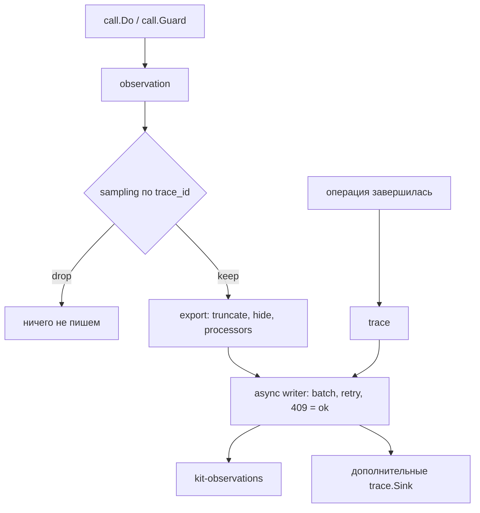

# Как смотреть трейсы, метрики и стоимость

kit пишет трейсы вызовов в Elasticsearch сам: trace создаётся на входе операции,
каждый внутренний вызов (модель, инструмент, эмбеддер, Elasticsearch, guard)
становится observation, а запись идёт асинхронно и не блокирует запрос.

Это how-to: что пишется и когда, политика текста, сэмплирование, sink'и,
ретенция, дашборды и — отдельным разделом — почему **деньги считаете вы, а не
библиотека**. Замысел — [Наблюдаемость](../concepts/observability.md); поля
документов — [Индексы Elasticsearch](../reference/elasticsearch.md).

## Когда использовать

- Нужно видеть латентность, ошибки и вызовы по каждому запросу.
- Нужно знать, какие инструменты вызывает модель и где срабатывает guard.
- Нужно маркировать трафик (A/B, request id) без протаскивания через операции.
- Нужно писать eval-проверки по реальным трейсам без сети и LLM-судьи.

Трейсинг включён всегда: писатель создаётся в `kit.New`, отдельного флага
включения нет.

## Быстрый старт

```go
app, err := kit.New(ctx, kit.Config{ES: es, LLM: llm, Policy: policy})
if err != nil {
	return err
}
if err := app.Setup(ctx); err != nil { // создаёт data streams и ILM
	return err
}

answer, err := app.Chat(ctx, kit.ChatRequest{
	System:   "Ты ассистент поддержки.",
	Messages: []model.Message{{Role: model.RoleUser, Content: "Какая погода?"}},
})
// observations уже ушли в очередь асинхронного писателя

return app.Close(ctx) // перед остановкой сервиса: дописать остаток
```

```sh
curl -s 'http://localhost:9200/kit-traces/_search?size=1&pretty' \
  -H 'Content-Type: application/json' \
  -d '{"query":{"term":{"name":"chat"}}}'
```

## Что создаётся и когда

| Сущность    | Когда                                         | Куда               |
| ----------- | --------------------------------------------- | ------------------ |
| trace       | вход в `Chat`, `Ingest`, `Search`, `Generate` | `kit-traces`       |
| observation | каждый вызов через `internal/call`            | `kit-observations` |
| score       | вызов `App.Score` (`kind: SCORE`)             | `kit-traces`       |

- `Delete` и `Prune` trace-документа **не** создают — их работа видна только как
  observations (вызовы ES).
- Observation несёт `kind` (`SPAN` по умолчанию, `GENERATION` для вызовов модели,
  `EVENT` для проверок guard), `name`, `level`, `model`, `latency_ms`, токены.
- Проверки guard пишутся как `EVENT` с именем `guard:<rail>`: `guard:input`,
  `guard:output`, `guard:tool_result`, `guard:chunk`. Отказ добавляет
  `guard_rail`, `guard_action`, `guard_categories`.
- Пустые поля в документ не попадают.



## Политика текста трейса

По умолчанию в ES попадает только текст, прошедший guard.

```go
app, err := kit.New(ctx, kit.Config{
	ES: es, LLM: llm, Policy: policy,
	TraceText: trace.TextMasked, // по умолчанию; trace.TextFull — явный opt-in
})
```

| Значение           | Что попадает в ES                           | Что с `input` при raw-политике        |
| ------------------ | ------------------------------------------- | ------------------------------------- |
| `trace.TextMasked` | только текст, прошедший guard (I-07)        | —                                     |
| `trace.TextFull`   | необработанный текст; `slog.Warn` при `New` | `obsInput` отдаёт исходный `req.Text` |

Ключевое: `Observation.Input` при `masked` — это **guarded-текст**
(`v.Text` после guard), поэтому реальные PII/секреты в ES не пишутся. `Trace.Input`
для `Chat` — последнее санитизированное сообщение после guard; для `Generate` —
guarded-промпт.

`Config.HideInput` / `Config.HideOutput` обнуляют соответствующие поля во **всех**
документах. `text_policy` пишется в каждый документ для аудита.

> [!WARNING]
> `trace.TextFull` — осознанный отказ от маскирования. Он удобен на стенде и
> опасен в проде: в ES уйдут сырые PII и секреты. Библиотека предупредит один раз
> `slog.Warn` при `kit.New`, и всё.

## Сэмплирование

Сэмплер решает, какие трейсы экспортируются. Решение — чистая функция от
`trace_id`, поэтому стабильно между процессами и перезапусками (D24):

```go
app, err := kit.New(ctx, kit.Config{
	ES: es, LLM: llm, Policy: policy,
	Sampler: trace.SamplerRatio(0.1),
})
```

| Значение                                   | Смысл                                    |
| ------------------------------------------ | ---------------------------------------- |
| `trace.SamplerAlways`                      | писать все (по умолчанию при `nil`)      |
| `trace.SamplerNever`                       | не писать ничего                         |
| `trace.SamplerRatio(p)`                    | детерминированная доля `p` по `trace_id` |
| `"always"` / `"never"` / `"ratio:<float>"` | `trace.SamplerFromString`                |

`trace_id` — 32 hex-символа (`id.New()`); доля считается по первым 4 байтам как
BigEndian-uint32, делённым на `2^32`, поэтому один и тот же trace сэмплируется
одинаково везде. Trace и его observations сэмплируются вместе.

> [!NOTE]
> Детерминированность сэмплирования — не украшение. На ней стоит воспроизводимость
> eval: прогон на `ratio:0.1` даст те же трейсы в CI и на вашей машине, а `10%`
> из миллиона запросов — статистически осмысленный срез, а не случайная выборка
> «на глаз».

## Маркировка: `Tags` и `Metadata`

| Механизм                                    | Где живёт                                                         | Область                  |
| ------------------------------------------- | ----------------------------------------------------------------- | ------------------------ |
| `ChatRequest.Tags` / `GenerateRequest.Tags` | `tags` в trace и в observation                                    | метки конкретного вызова |
| Тэги инструмента                            | `tags` в observation инструмента (`effect:read`/`write`/`egress`) | автоматически            |
| `kit.WithTraceMetadata`                     | `metadata` **каждой** observation                                 | весь запрос              |

```go
ctx = kit.WithTraceMetadata(ctx, map[string]any{"ab_arm": "b", "request_id": rid})
// каждый call.Do внутри этого ctx добавит ab_arm и request_id в observation.metadata
```

Значение, заданное на конкретном вызове (например, `finish_reason`, `status`,
`structuring`), **перекрывает** одноимённый ключ из контекста: per-call значение
всегда побеждает. Обратно карту читает `kit.TraceMetadataFrom(ctx)`.

## Лимиты экспорта

Перед записью документ обрезается `exportConfig`:

| Лимит             | Значение                                  |
| ----------------- | ----------------------------------------- |
| `MaxStringLength` | `131072` (`trace.DefaultMaxStringLength`) |
| `MaxDepth`        | `8` (`trace.DefaultMaxDepth`)             |
| `MaxArrayLength`  | `50` (`trace.DefaultMaxArrayLength`)      |
| `MaxObjectKeys`   | `50` (`trace.DefaultMaxObjectKeys`)       |

`clip` режет строку по границе UTF-8. `Options.Processors` — export-фильтр,
который может скрыть поле или (очисткой `Name`) удалить observation целиком, но
`kit.New` их не выставляет.

## Писатель: как он себя ведёт

Писатель не блокирует запрос: документы уходят в буфер-канал и отправляются
батчами.

| Параметр               | Значение                                         |
| ---------------------- | ------------------------------------------------ |
| очередь                | `4096` (`trace.DefaultQueueSize`)                |
| размер батча           | `500` (`trace.DefaultBatchSize`)                 |
| интервал сброса        | `2s` (`trace.DefaultFlushInterval`)              |
| лимит батча по размеру | `5 MB` (`trace.DefaultMaxBatchBytes`)            |
| повторы при ошибке     | `3` (`trace.DefaultMaxRetries`), backoff `200ms` |

- **Переполнение очереди** — не блокировка: документ отбрасывается, растёт
  счётчик `dropped`, пишется `slog.Warn` (на 1-м и каждом 100-м дропе).
- **Ретрай идемпотентен**: элемент со статусом `409` / `version_conflict`
  считается успехом (data stream append-only, действие `create`).
- **Запись** идёт через `_bulk` с действием `create` — по одному bulk на поток.
- `App.Close(ctx)` закрывает очередь и дописывает остаток, уважая контекст.
  Вызывайте его перед остановкой сервиса, иначе последние документы не дойдут.

> [!NOTE]
> `dropped` — счётчик в процессе (`Writer.Dropped()`). Через `App` он **не
> доступен**: фасад не отдаёт writer. Единственный видимый признак — `slog.Warn`
> «trace: dropping document». Если потеря трейсов критична, следите за логами.

## Sink'и

Помимо писателя в Elasticsearch документы можно направлять в дополнительные
`trace.Sink`. `trace.NewRecorder()` — потокобезопасный in-memory sink для тестов и
eval; `trace.Fanout` — композиция нескольких sink'ов; `trace.NewOTLP` — отправка
документов OTLP/HTTP JSON (stdlib, без внешних зависимостей, атрибуты `gen_ai.*` и
`kit.*`).

```go
rec := trace.NewRecorder()

app, err := kit.New(ctx, kit.Config{
	ES: es, LLM: llm, Policy: policy,
	Sinks: []trace.Sink{rec}, // писатель в ES работает всегда; sink'и — дополнительно
})

// ... операции ...

snap := rec.Snapshot() // Traces, Observations, Scores
for _, o := range snap.Observations {
	// latency_ms считается из StartTime/EndTime в документе, в структуре его нет
	fmt.Println(o.Kind, o.Name, o.EndTime.Sub(o.StartTime))
}
```

Sink получает **те же** документы, но уже после того, как ES-документ собран и
поставлен в очередь. Поэтому sink'ом нельзя «поправить» то, что ушло в ES, —
только отправить данные дальше (аналитика, тесты, свой стор).

## Обработчики наблюдений: `TraceProcessors`

`Config.TraceProcessors` — срез `func(*trace.Observation)`, которые правят
observation **до** сборки ES-документа и до sink'ов. Так можно доредактировать
(`Metadata`, `Tags`, текст) или отбросить документ целиком, очистив `Name`:

```go
kit.Config{
	TraceProcessors: []func(*trace.Observation){
		func(o *trace.Observation) {
			if o.GuardAction == "reject" {
				o.Tags = append(o.Tags, "alert")
			}
		},
	},
}
```

В отличие от sink'а обработчик работает до сериализации, поэтому его правки
попадают и в ES, и в sink'и. Сэмплирование (`Sampler`) идёт раньше: до
отброшенного сэмплером документа обработчик не доходит.

## Ретенция: ILM и `Prune`

Traces и observations живут в data streams `kit-traces` и `kit-observations`.
ILM-политика `kit-traces-30d` делает rollover при 10 GB и удаляет документы через
30 дней. Тот же срок можно применить вручную:

```go
deleted, err := app.Prune(ctx, 30*24*time.Hour)
```

`App.Prune` требует только принципала и права `prune` — **тенант не нужен**: это
глобальное действие эксплуатации по времени (как ILM). Оно удаляет из **обоих**
потоков по `@timestamp < now - olderThan`.

> [!WARNING]
> `Prune` не знает про тенанта и не учитывает сэмплирование: он удаляет
> документы всех арендаторов старше срока. Если у вас ILM уже удаляет по 30
> дням, ручной `Prune` — для разовых чисток и для стенда; держите его срок не
> короче ILM, иначе будете удалять данные, которые ILM сохранила бы.

## Дашборды

В `demo/deploy/grafana/` лежат provisioning datasource и дашборд `kit-overview`
(`uid: kit-overview`). Панели читают data streams напрямую:

| Панель                 | Поток (datasource uid) | Запрос / метрика                                |
| ---------------------- | ---------------------- | ----------------------------------------------- |
| LLM latency p95 (ms)   | `kit-observations`     | `kind:GENERATION`, percentiles `latency_ms` p95 |
| Errors by kind         | `kit-observations`     | `level:ERROR`                                   |
| Tokens by model        | `kit-observations`     | `kind:GENERATION`                               |
| Guard triggers by rail | `kit-observations`     | `guard_action:reject`                           |
| Top tools              | `kit-observations`     | `kind:SPAN`                                     |
| Cost by tenant         | `kit-traces`           | sum `usage.cost`, bucket by `tenant`            |
| Recent traces          | `kit-traces`           | `*`                                             |

> [!NOTE]
> Панель **Cost by tenant** суммирует `usage.cost`, который библиотека
> заполняет по `Config.Pricing` (BR-77). Пока цена не задана, значение — `0` и
> панель показывает нули.

## Стоимость: `Config.Pricing`

Библиотека считает стоимость сам, если задан `Config.Pricing`
(`model.Pricing{InputPerMTok, OutputPerMTok}`): `usage.cost` в trace (сумма хода) и
`cost` в generation-observation заполняются по токенам (BR-77). Нулевая цена
(значение по умолчанию) означает «цена неизвестна» и даёт `0`.

```go
app, _ := kit.New(ctx, kit.Config{
	// ...
	Pricing: model.Pricing{InputPerMTok: 3, OutputPerMTok: 15},
})
```

Если нужна другая логика (скидки, посессионная тарификация, метрика в своём сторе),
цену по-прежнему можно посчитать на своей стороне: sink получает наблюдения с
токенами, а несколько `trace.Sink` композится через `trace.Fanout`. Учтите: tenant
есть только у trace, observation несёт `trace_id`, поэтому распределение по
арендаторам склеивается по `trace_id`.

## Health-эндпоинт: `App.Health`

Для проб и алертов есть `App.Health()`: снимок очереди trace-писателя
(`TraceQueue`/`TraceQueueCap`/`TraceDropped`), режима и версии guard и каждого
компонента, реализующего `HealthChecker` (`guard_l2`, `embedder`, `es`, `llm`).
`Healthy` ложен, если хоть один компонент вернул `OK=false`; у компонентов с пулом
(ORT) видны `InUse`/`Capacity`.

```go
h := app.Health()
writeJSON(w, map[string]any{"ok": h.Healthy, "degraded": h.Degraded, "checks": h.Components})
```

Для счётчиков есть `App.Metrics()`: вердикты guard (`Scans`, `Blocked`,
`Truncated`, `Degradations`, гистограмма латентности `Latency`), глубина очереди
trace-писателя и `TraceDropped`. Ядро не тянет библиотеку метрик: снимок
отправляйте туда, где уже собираются метрики.

```go
m := app.Metrics()
writeJSON(w, map[string]any{"guard_scans": m.Guard.Scans, "guard_blocked": m.Guard.Blocked, "trace_dropped": m.TraceDropped})
```

## Рецепты

### Второй sink — в аналитику заказчика

```go
app, err := kit.New(ctx, kit.Config{
	ES: es, LLM: llm, Policy: policy,
	Sinks: []trace.Sink{
		myRecorder,          // например, in-memory для eval
		customerAnalytics,   // ваш Sink, пишет в чужую систему
	},
})
```

`sink` получает `Trace`, `Observation` и `Score`; пишите что нужно, но помните,
что текст уже masked, а ES-документ sink не изменит.

### Сэмплить 10% в проде, но 100% для одного тенанта

Сэмплер имеет сигнатуру `func(traceID string) bool` и **не видит тенанта**,
поэтому «сэмплировать по тенанту» одним сэмплером нельзя. Варианты:

- **Роутинг по приложению.** Сэмплер задаётся на `App`, значит можно поднять два
  `App` с общим ES/LLM: один с `SamplerRatio(0.1)`, второй — `SamplerAlways` — и
  направлять в них трафик по тенанту.
- **Свой sink для VIP.** Пусть ES сэмплируется на 10%, а Sink сохраняет полный
  трейс VIP-тенанта в ваш стор (`if t.Tenant == "vip" { persist(t) }`).

### Алертить на всплеск `guard_action:reject` и на `dropped > 0`

- **Reject-всплеск.** В `kit-observations`: `guard_action:reject`, группировка по
  `guard_rail` и `name`, порог по count. Так видно, что именно режет guard —
  рельс и правило (`metadata.tripwire_rule`).
- **Потери трейсов.** Через ES не видно: `dropped` живёт в процессе. Алертите по
  логам (`slog.Warn` «trace: dropping document, reason=queue full») или
  добавьте свой счётчик, если обрабатываете логи централизованно.

### Найти самый медленный инструмент

Инструменты — единственные observation-ы с тегом `effect:*` (значение тега —
`read`/`write`/`egress`), и их `kind` — `SPAN`. Поэтому:

```
kind:SPAN AND tags:effect:*   → group by name → p95(latency_ms)
```

Так вы отсечёте вызовы ES (`kit-chunks`) и эмбеддера, которые тоже `SPAN`.

## Чего библиотека не делает (ограничения)

- **Нет UI.** `kit-overview` — только провижененный Grafana-дашборд; своего
  интерфейса нет.
- **Нет trace read API.** JSON read API трейсов не реализован: читать можно сам ES
  (Kibana/Grafana) или CLI-ридер `go run ./demo/cmd/traces` (`-limit`, `-name`,
  `-tenant`, `-trace <id>`). Приложение не может «достать трейс» через kit.
- **Стоимость считается только при заданном `Config.Pricing`.** Без цены
  `usage.cost`/`cost` равны `0`; токены структурирующего вызова не входят в итог
  хода.
- **Трейсы не изолированы по тенантам.** `kit-traces`/`kit-observations` — общие
  data streams без ACL: любой, у кого есть доступ к индексу, видит документы всех
  арендаторов. Изоляция — на стороне ES (роли, фильтры, отдельные кластеры).
- **Сэмплирование означает отсутствие части трейсов by design.** При `ratio:0.1`
  90% запросов не имеют trace; «пропавший» запрос — это ожидаемо, а не баг.
- **`dropped` не экспортируется** — потеря документов видна только в логах.
- **Sink'и не правят ES-документ** — они получают копию после сборки.
- **Observation не несёт tenant** — атрибуция по арендатору требует join с trace
  по `trace_id`.
- **`Delete`/`Prune` не создают trace** — только observations.
- **Нет процессоров через `kit.Config`** — `Options.Processors` доступны лишь
  при ручной сборке писателя.

## Дальше

| Цель                                   | Куда идти                                              |
| -------------------------------------- | ------------------------------------------------------ |
| Проверять ответы по трейсам            | [Eval](../concepts/eval.md)                            |
| Настроить guardrails                   | [Настройка guardrails](./guardrails.md)                |
| Понять ретенцию поиска                 | [Индексация и поиск](./retrieval.md)                   |
| Поля документов трейсов и observations | [Индексы Elasticsearch](../reference/elasticsearch.md) |

## Смотрите также

- [Наблюдаемость](../concepts/observability.md) — модель данных, sink'и, sampling
- [Конфигурация](../reference/configuration.md) — `TraceText`, `Sampler`, `Sinks`, лимиты
- [Eval](../concepts/eval.md) — `trace.Recorder` и детерминированные проверки
- [Бизнес-правила](../internals/business-rules.md) — `BR-40`…`BR-48`, `BR-54`, `BR-58`
