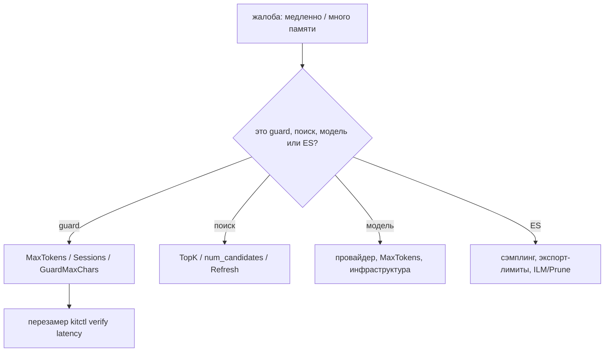

# Производительность: латентность, память и ручки

Этот гид — про то, как рассуждать о стоимости `kit` и что крутить. Все числа ниже
**измерены** и воспроизводимы через `kitctl verify latency`. Сначала — как
повторить замер, затем ручки и разбор «что тормозит».

## Как это измерено

```sh
go run -tags ort ./cmd/kitctl verify latency --dir ./models \
  --iterations 20 --warmup 2 --max-chars 8000 --window 1024
```

| Параметр              | Значение                                                                                                            |
| --------------------- | ------------------------------------------------------------------------------------------------------------------- |
| Инструмент            | `kitctl verify latency` (`L1` и `L1+L2`, плюс RSS)                                                                  |
| Итерации / прогрев    | `--iterations` (по умолчанию 20), `--warmup` (по умолчанию 2)                                                       |
| Кэш вердиктов         | **нейтрализован**: каждый тайминговый `Check` строит свежий `guard.New` (`CacheSize: 1`)                            |
| Хост committed-замера | `darwin/arm64`, `NumCPU=8`, fp32, 2 сессии ORT × `NumCPU/2` = 4 `intra_op_threads`                                  |
| RSS                   | `ps -o rss=`, иначе `getrusage` (`ru_maxrss`, пик), иначе `MemStats.Sys`                                            |
| SLO `D53`             | короткий ввод `p50 ≤ 250 мс`, `p95 ≤ 400 мс`; полный тензорный вход — `p50 ≤ 800 мс` (за одно окно детекции, `D60`) |

Инструмент печатает в шапке, что кэш выключен (`fresh pipeline per timed Check:
no cache hits`) и сколько CPU на машине, — чтобы отчёт нельзя было принять за
чужой.

> [!WARNING]
> Это **не** 4-vCPU числа. Хост — 8 CPU; на 4 vCPU будет медленнее. Замерьте
> `kitctl verify latency` на своём железе, прежде чем закладывать SLA.

## Измеренные числа

Компактная модель, окно детекции 1024 руны (≈ 275 токенов — токенайзер mDeBERTa
даёт ≈ 0,27 токена на руну русского текста, проверяется `TestWindowFitsTokenBudget`).

| Ввод                             | L1 p50         | L1+L2 p50  | L1+L2 p95  |
| -------------------------------- | -------------- | ---------- | ---------- |
| 53–98 рун                        | ≈ 0,04–0,08 мс | ≈ 50–67 мс | ≈ 80–99 мс |
| 8000 рун (только L1)             | ≈ 7,7 мс       | —          | —          |
| 1024 руны — одно окно            | ≈ 0,8 мс       | ≈ 0,25 с   | ≈ 0,25 с   |
| 8000 рун — ≈ 9 окон              | ≈ 7,7 мс       | ≈ 2,57 с   | ≈ 2,75 с   |
| 1792-рунное окно (≈ 480 токенов) | —              | ≈ 0,37 с   | ≈ 0,39 с   |

- **L1 дёшев** и растёт линейно с длиной (≈ 7,7 мс на 8000 рун).
- **Стоимость L2 — это число окон × цена окна.** Окно 1024 руны стоит ≈ 0,25 с,
  окно у потолка модели (≈ 480 токенов) — ≈ 0,37 с. Длинный вход поэтому стоит
  пропорционально длине (`D60`), а не плоско: 8000 рун — ≈ 2,6 с.
- **Окно помещается в потолок L2:** 1024 руны ≈ 275 токенов при ёмкости 512, так
  что `prepare` ничего не отбрасывает и шаг окна нигде не пропускает текст.
- **Провал до потолка** (исправлен `D34`): тензорный вход строился из всех слов
  окна, стоимость росла сверхлинейно — на 8000 рунах одна проверка занимала
  ≈ **50–71 с**, RSS доходил до ≈ **7,3 GB**.
- **Fast-fail работает:** на injection-подобном входе Δ(L1+L2 − L1) ≈ 0, потому
  что L1 отклоняет раньше, чем стартует L2.
- RSS: ≈ 2,0 GB после прогрева, пик в замерах — до ≈ 4,5 GB (растёт с числом сессий).

### Честный вердикт по цели

SLO (`D53`: короткий ввод `p50 ≤ 250 мс` / `p95 ≤ 400 мс`, полный тензорный вход —
`p50 ≤ 800 мс`) **достигнут** на референсном хосте: короткий ввод p50 ≈ 50–67 мс /
p95 ≈ 80–99 мс, окно у потолка модели — ≈ 0,37 с p50 (запас ≈ 2×). Полная проверка
длинного ввода — N окон, поэтому длинный вход стоит ≈ `N × 0,25 с` (`D60`).
Прежняя цель `A2` (`p50 ≤ 150 мс` / `p95 ≤ 400 мс` на потолке) была недостижима и
пересмотрена ([План](../internals/plan.md), `D53`): это собственная стоимость
forward-pass модели с этими потоками, а не накладные расходы обвязки.

### Ядро без L2 (overhead на шаг)

<!-- derived: BR-26 -->

Числа — darwin/arm64 (Apple M3), Go 1.24, воспроизводится `make perf`:

| Что                              | ns/op   | allocs/op | B/op  |
| -------------------------------- | ------- | --------- | ----- |
| L1-проверка, кэш-хит (fast path) | ≈12 µs  | 70        | ≈12 KB |
| L1-проверка, новый текст         | ≈175 µs | 89        | ≈22 KB |

Читать так: это **не** «ноль аллокаций». Даже кэш-хит тратит ≈12 µs и 70 аллокаций,
потому что ключ вердикта считается по канонизированному тексту (NFKC-нормализация —
самая дорогая часть). Ноль аллокаций на fast path — **цель, а не текущее
состояние**; [safety и измеримость важнее микросекунд](#бюджет-и-гейты), поэтому
такая работа начинается с профиля (`go test -bench . -benchmem -cpuprofile`), а не
по интуиции.

## Бюджет и гейты

| Гейт                      | Что проверяет                                            | Где                                           |
| ------------------------- | -------------------------------------------------------- | --------------------------------------------- |
| Аллокации fast path       | L1-проверка ≤ 100 allocs/op (`fastPathAllocBudget`)      | `perf_gate_test.go` (в обычном `go test`)     |
| Прямые зависимости        | ≤ 6 (4 сборки по умолчанию + 2 под `-tags ort`)          | `scripts/perfbudget`                          |
| Размер `go.sum`           | ≤ 4096 байт                                              | `scripts/perfbudget`                          |
| Модули сборки по умолчанию | ≤ 8                                                     | `scripts/perfbudget`                          |
| Бенчмарки                 | публикуются артефактом для `benchstat`, **не** гейтятся | CI-джоб `perf`                                |

Логика раздела: `ns/op` зависит от раннера, поэтому он **не** гейтится — числа
публикуются, а жёсткие гейты стоят на детерминированном (аллокации) и статическом
(зависимости). Сравнение с базовой линией:

```sh
go test -run '^$' -bench . -benchmem ./... > new.txt
benchstat old.txt new.txt   # old.txt — артефакт `bench` предыдущего прогона
```

## Ручки: что покупают и что стоят

### `gliner.Config`: `MaxTokens`, `Sessions`, `Wait` и `ort.Threads`

| Ручка                                                        | Что покупает                                                              | Чем платите                                                                         |
| ------------------------------------------------------------ | ------------------------------------------------------------------------- | ----------------------------------------------------------------------------------- |
| `MaxTokens` (512, клампится до `max_sequence_length` = 2048) | меньший тензор → быстрее и меньше памяти; стоимость L2 становится плоской | окно шире ёмкости → хвост внутри одного окна детекции размечает только L1 (`BR-99`) |
| `Sessions` (2)                                               | больше параллельных проверок L2                                           | делённые `intra_op_threads`, больше RSS                                             |
| `Wait` (2 с)                                                 | терпение очереди сессий                                                   | дольше держит запрос; таймаут → `ErrGuardUnavailable`                               |
| `ort.Threads(num)` = `NumCPU / (число сессий)`               | раскладывает ядра между сессиями                                          | больше сессий → меньше потоков каждой                                               |

**Больше сессий ≠ больше мощности.** `Threads` считает потоки от `NumCPU` и числа
сессий: суммарно потоков примерно `NumCPU`, а память растёт с числом сессий.

### `GuardMaxChars`, окно детекции и потолок токенов L2

Три **разных** окна:

- **окно guard** — `GuardMaxChars` (по умолчанию 8000 рун): предел сканирования.
  Стоимость L1 растёт с длиной (≈ 7,5 мс на 8000 рун).
- **окно детекции** — `GuardWindowChars` (`guard.DefaultWindowChars` = 1024): текст
  внутри окна guard режется на перекрывающиеся окна этого размера, и каждый слой
  проходит каждое окно. Число окон задаёт стоимость L2 (≈ 0,25 с p50 за окно).
- **потолок L2** — `MaxTokens` (512 токенов): сколько токенов видит L2 за один
  проход; окно детекции держите не больше этой ёмкости. 1024 руны ≈ 275 токенов
  (русский, mDeBERTa), поэтому дефолтное окно в потолок помещается. Окно шире
  ёмкости заставило бы `prepare` отбросить хвост, а шаг окна мог бы его пропустить
  (`BR-70`).

Уменьшение `GuardMaxChars` сужает предел сканирования; уменьшение
`GuardWindowChars` добавляет проходы L2 (дороже), увеличение — дешевле, но хвост
окна снова разметит только L1.

### Включать / выключать L2

| Конфигурация          | Что получаете                        | Риск                                                             |
| --------------------- | ------------------------------------ | ---------------------------------------------------------------- |
| `GuardL2 = nil`       | только L1: ≈ 0,04–7,5 мс, без модели | нет ML-семантики; PII/инъекции ловит только L1 (`BR-70`)         |
| `GuardL2` задан       | L2-разметка                          | ≈ 50 мс+ на коротком, ≈ 0,37 с на окне у потолка; +≈2–4,5 GB RSS |
| `GuardL2` из заглушки | —                                    | fail-closed: первая же операция отклоняется                      |

Выключение L2 — легитимный режим (только детерминированный слой), но это смена
**политики безопасности**, а не только производительности.

### Кэш вердиктов

LRU на `GuardCacheSize` (4096); ключ — версия guard + **инспектируемый текст**, без
рельса (`I-02`), поэтому одна проверка переиспользуется всеми рельсами. Ключ именно
по исходному тексту, а не по каноническому: находки несут смещения в исходном
тексте, и два текста с одной канонической формой, но разной раскладкой рун
(zero-width, комбинирующая последовательность) не должны делить вердикт (`BR-55`,
`D66`).

| Что даёт                                       | Ограничение                                                               |
| ---------------------------------------------- | ------------------------------------------------------------------------- |
| Дорогие повторы (одни и те же тексты) дешевеют | ключ включает версию: смена политики/слоёв сбрасывает кэш                 |
| Смягчает болтливость и повторы в диалоге       | модель под одним и тем же слоем версию не меняет — перезапускайте процесс |

### Чанкинг: размер и overlap

`ChunkSize` 400 / `ChunkOverlap` 80. Токенайзер задаёт вызывающий
(`Config.Tokenizer`, BR-104); с `chunk.WhitespaceTokenizer` «токены» чанкера —
это слова, а не токены модели, поэтому чанк в 400 «токенов» — это ≈ 400 слов,
что для реального токенайзера может быть заметно больше. Это влияет и на размер
эмбеддинг-батчей, и на попадание чанков в окно модели.

### Батчинг эмбеддингов

| Где                                | Поведение                                                                      |
| ---------------------------------- | ------------------------------------------------------------------------------ |
| Локально (`embed.NewLocal`)        | обрезка по `max_len` (512), **сортировка по длине** для эффективности, батч 32 |
| Удалённо (`embed.NewOpenAI` и др.) | зависит от провайдера; `Ingest` шлёт `Passages()`, `Search` — `Query()`        |

`Search` эмбеддит один запрос; `Ingest` — пачку чанков сразу, поэтому массовые
заливки эффективнее одиночных.

### Поиск: `TopK`, `num_candidates` и RRF

| Ручка            | Значение / стоимость                                               |
| ---------------- | ------------------------------------------------------------------ |
| `TopK` (10)      | меньше = дешевле и в ES, и в RRF                                   |
| `num_candidates` | максимум из `topK*10` и 100; клампится до 10000 — большие дороги   |
| RRF              | считается в Go по `_msearch` (лицензия basic), `rankConstant` = 60 |

Большие `TopK` бьют и по ES (больше `knn`-кандидатов), и по Go (слияние), и по
контексту модели (больше текста в промпте).

### ES: `Refresh` и bulk

| Операция                              | Refresh                          | Стоимость                                    |
| ------------------------------------- | -------------------------------- | -------------------------------------------- |
| `Ingest` (запись чанков)              | `wait_for`                       | ждёт видимости — дорого на массовых заливках |
| `Ingest` (удаление старых) / `Delete` | `true`                           | немедленно видно                             |
| `Prune`                               | `false`                          | дешевле всего                                |
| трейсы/observations                   | `_bulk` (batch 500 / 2 с / 5 MB) | асинхронно, не блокирует запрос              |

Массовые загрузки выгодно делать с `Refresh: false` (в своём коде через `store`,
а не через `App.Ingest`), а трейсы разгружать сэмплером и экспорт-лимитами.

### Лимиты как защита от стоимости

| Лимит                  | Против чего                                                  |
| ---------------------- | ------------------------------------------------------------ |
| `MaxTotalTokens`       | runaway-ходов по токенам → `ErrBudget`                       |
| `MaxSteps` (8)         | бесконечного цикла «модель → tools → модель» → `ErrMaxSteps` |
| `MaxCallsPerTool` (3)  | долбёжки одного инструмента                                  |
| `ToolTimeout` (30 с)   | зависшего инструмента                                        |
| `ArgsMaxBytes` (32 KB) | гигантских аргументов                                        |
| `Sampler` + очередь    | нагрузки на ES от трейсов                                    |

## Что тормозит и что с этим делать

| Симптом                           | Причина                                                   | Действие                                                                         |
| --------------------------------- | --------------------------------------------------------- | -------------------------------------------------------------------------------- |
| L2 медленный на всём вводе        | собственная стоимость forward-pass модели                 | меньше `MaxTokens`, int8, меньшая guard-модель, больше потоков на сессию         |
| L1 подрос на длинном тексте       | стоимость растёт с окном guard                            | уменьшить `GuardMaxChars` (осознанно)                                            |
| Один запрос «съел» десятки секунд | сборка до исправления `D34` или `MaxTokens` не применился | обновить код, убедиться, что `MaxTokens` > 0 и клампится к `max_sequence_length` |
| Ход долгий, много вызовов         | `max_steps` × латентность инструментов                    | `MaxSteps`/`MaxCallsPerTool`, чётче промпт, кэш дорогих tool-ответов             |
| Поиск медленный                   | большой `TopK`/`num_candidates`, `refresh`                | уменьшить `TopK`, для заливок — `Refresh: false`                                 |
| Медленна сама модель              | провайдер/сервер                                          | тюнинг `vLLM`/Ollama, `MaxTokens`, отдельный инференс-хост                       |
| Высокий RSS                       | число ORT-сессий и окно L2                                | меньше `Sessions`, меньше `MaxTokens`/`GuardMaxChars`                            |
| ES перегружен трейсами            | объём traces/observations                                 | `SamplerRatio`, `HideInput`/`HideOutput`, ILM/`Prune`                            |



## Планирование ёмкости

- **RSS на процесс.** С загруженным guard L2 процесс держал пик ≈ **4,5 GB** (8 CPU,
  fp32, 2 сессии). Планируйте по **замеру на целевой машине**, а не по размеру
  файла весов.
- **Один ORT-пул на процесс.** `gliner.New` и `embed.NewLocal` создают свои пулы;
  несколько `App` в одном процессе = несколько пулов = больше памяти. Разносите
  нагрузку по процессам.
- **`Sessions` × потоки против vCPU.** Суммарные потоки ≈ `NumCPU` независимо от
  числа сессий; выбор — между параллелизмом (больше сессий) и потоками на запрос
  (меньше сессий).
- **Очередь ORT — 2 с** (`Wait`), после чего отказ (`ErrGuardUnavailable` /
  `ErrProvider`). Под нагрузкой держите запас по сессиям.
- **Сэмплинг — главный рычаг по ES**, а не по латентности: запрос никогда не
  блокируется трейсингом.

## Ограничения

- Числа выше — с **одного** хоста (8 CPU, darwin/arm64, fp32); на 4 vCPU и на
  другом железе они будут другими. SLO `D53` измерен только на этом хосте; на
  4 vCPU замер не проводился.
- Замер берёт **чейн L1+L2**, а не полный `Chat` с ES и сетью: это стоимость
  guard-конвейера, а не сквозная латентность запроса.
- Кэш вердиктов в замере **выключен**, поэтому числа — «худший случай повтора»;
  в проде повторы дешевле (но зависят от попаданий в LRU).
- `kit` не даёт профилировщика и метрик в процессе: RSS — через `ps`/`getrusage`,
  а панели — из ES.
- Токенайзер чанкера задаёт вызывающий (`Config.Tokenizer`); `WhitespaceTokenizer`
  считает слова, а не токены модели, поэтому «токенные» размеры чанков — оценка
  сверху.

## Смотрите также

- [Guardrails](../concepts/guardrails.md) — таблица замеров и окна L1/L2
- [Деплой](./deployment.md) — гейты `verify latency` и масштабирование
- [Конфигурация](../reference/configuration.md) — все лимиты и значения по умолчанию
- [Наблюдаемость](../concepts/observability.md) — sampling и писатель трейсов
- [Архитектура](../internals/architecture.md) — ORT-пулы, память, `intra_op_threads`
- [План](../internals/plan.md) — `A2`, риски и результат замера
