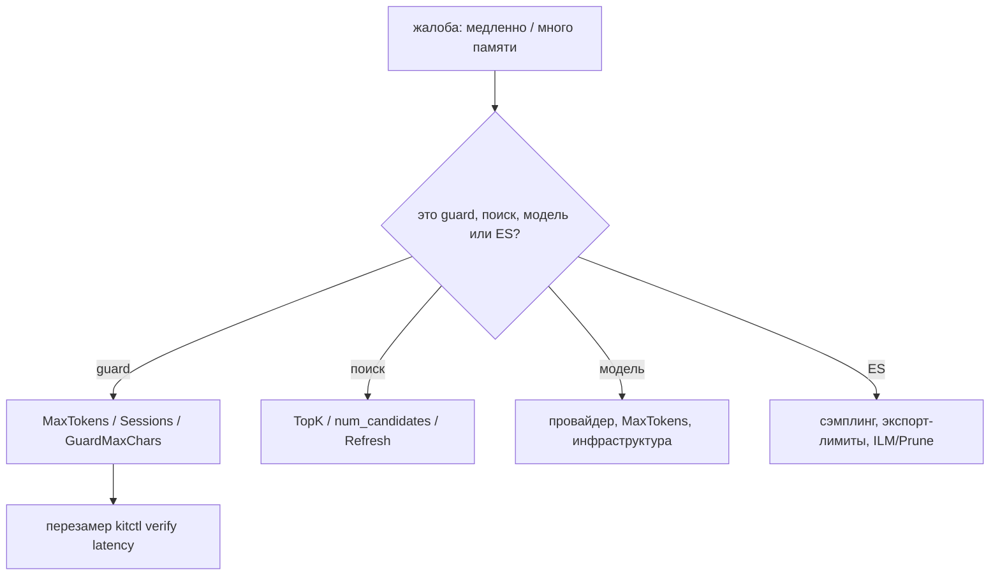

# Производительность: латентность, память и ручки

Этот гид — про то, как рассуждать о стоимости `kit` и что крутить. Все числа ниже
**измерены** и воспроизводимы через `kitctl verify latency`. Сначала — как
повторить замер, затем ручки и разбор «что тормозит».

## Как это измерено

```sh
go run -tags ort ./cmd/kitctl verify latency --dir ./models \
  --iterations 100 --warmup 20 --max-chars 8000
```

| Параметр              | Значение                                                                                   |
| --------------------- | ------------------------------------------------------------------------------------------ |
| Инструмент            | `kitctl verify latency` (`L1` и `L1+L2`, плюс RSS)                                         |
| Итерации / прогрев    | `--iterations` (по умолчанию 200), `--warmup` (по умолчанию 20)                            |
| Кэш вердиктов         | **нейтрализован**: каждый тайминговый `Check` строит свежий `guard.New` (`CacheSize: 1`)   |
| Хост committed-замера | `darwin/arm64`, `NumCPU=8`, fp32, 2 сессии ORT × `NumCPU/2` = 4 `intra_op_threads`         |
| RSS                   | `ps -o rss=`, иначе `getrusage` (`ru_maxrss`, пик), иначе `MemStats.Sys`                   |
| SLO `D53`             | короткий ввод `p50 ≤ 250 мс`, `p95 ≤ 400 мс`; потолок 512 токенов — плоский `p50 ≤ 800 мс` |

Инструмент печатает в шапке, что кэш выключен (`fresh pipeline per timed Check:
no cache hits`) и сколько CPU на машине, — чтобы отчёт нельзя было принять за
чужой.

> [!WARNING]
> Это **не** 4-vCPU числа. Хост — 8 CPU; на 4 vCPU будет медленнее. Замерьте
> `kitctl verify latency` на своём железе, прежде чем закладывать SLA.

## Измеренные числа

| Ввод                     | L1 p50         | L1+L2 p50              | L1+L2 p95              |
| ------------------------ | -------------- | ---------------------- | ---------------------- |
| 53–98 рун                | ≈ 0,04–0,07 мс | ≈ 70–75 мс             | ≈ 76–93 мс             |
| 8000 рун (только L1)     | ≈ 7,5 мс       | —                      | —                      |
| 8000 / 16000 / 32000 рун | —              | ≈ 0,57 / 0,62 / 0,58 с | ≈ 0,63 / 0,75 / 0,73 с |

- **L1 дёшев** и почти не зависит от длины, пока вход помещается в окно guard.
- **L2 с потолком токенов — плоский** по длине: 8000/16000/32000 рун стоят
  примерно одинаково (≈ 0,57–0,62 с p50, без роста с длиной), пиковый RSS
  ≈ **4,5 GB**, независимо от окна.
- **Провал до потолка** (исправлен `D34`): тензорный вход строился из всех слов
  окна, стоимость росла сверхлинейно — на 8000 рунах одна проверка занимала
  ≈ **50–71 с**, RSS доходил до ≈ **7,3 GB**.
- **Fast-fail работает:** на injection-подобном входе Δ(L1+L2 − L1) ≈ 0, потому
  что L1 отклоняет раньше, чем стартует L2.

### Честный вердикт по цели

SLO (`D53`: короткий ввод `p50 ≤ 250 мс` / `p95 ≤ 400 мс`, потолок 512 токенов —
плоский `p50 ≤ 800 мс`) **достигнут** на референсном хосте: короткий ввод
p50 ≈ 70–75 мс / p95 ≈ 76–93 мс, потолок — ≈ 0,57 с p50 без роста с длиной.
Прежняя цель `A2` (`p50 ≤ 150 мс` / `p95 ≤ 400 мс` на потолке) была недостижима и
пересмотрена ([План](../internals/plan.md), `D53`): это собственная стоимость
forward-pass модели с этими потоками, а не накладные расходы обвязки.

## Ручки: что покупают и что стоят

### `gliner.Config`: `MaxTokens`, `Sessions`, `Wait` и `ort.Threads`

| Ручка                                                        | Что покупает                                                              | Чем платите                                           |
| ------------------------------------------------------------ | ------------------------------------------------------------------------- | ----------------------------------------------------- |
| `MaxTokens` (512, клампится до `max_sequence_length` = 2048) | меньший тензор → быстрее и меньше памяти; стоимость L2 становится плоской | хвост длинного ввода размечает только L1 (`BR-70`)    |
| `Sessions` (2)                                               | больше параллельных проверок L2                                           | делённые `intra_op_threads`, больше RSS               |
| `Wait` (2 с)                                                 | терпение очереди сессий                                                   | дольше держит запрос; таймаут → `ErrGuardUnavailable` |
| `ort.Threads(num)` = `NumCPU / (число сессий)`               | раскладывает ядра между сессиями                                          | больше сессий → меньше потоков каждой                 |

**Больше сессий ≠ больше мощности.** `Threads` считает потоки от `NumCPU` и числа
сессий: суммарно потоков примерно `NumCPU`, а память растёт с числом сессий.

### `GuardMaxChars` (L1) против окна токенов L2

Два **разных** окна:

- **L1** видит весь текст в пределах `GuardMaxChars` (по умолчанию 8000 рун);
  стоимость L1 растёт с длиной окна (≈ 7,5 мс на 8000 рун) — это единственное
  место, где длина входа влияет на цену.
- **L2** видит только первые `MaxTokens` токенов; слова за потолком отбрасываются
  целиком.

Уменьшение `GuardMaxChars` ускоряет L1 и сужает размечаемое окно; оно не помогает
L2 (та плоская). Потолок L2 уменьшать есть смысл, только если вас устраивает, что
хвост размечает лишь L1.

### Включать / выключать L2

| Конфигурация          | Что получаете                        | Риск                                                     |
| --------------------- | ------------------------------------ | -------------------------------------------------------- |
| `GuardL2 = nil`       | только L1: ≈ 0,04–7,5 мс, без модели | нет ML-семантики; PII/инъекции ловит только L1 (`BR-70`) |
| `GuardL2` задан       | L2-разметка                          | ≈ 70 мс+ на коротком, ≈ 0,57 с на потолке; +≈4,5 GB RSS  |
| `GuardL2` из заглушки | —                                    | fail-closed: первая же операция отклоняется              |

Выключение L2 — легитимный режим (только детерминированный слой), но это смена
**политики безопасности**, а не только производительности.

### Кэш вердиктов

LRU на `GuardCacheSize` (4096); ключ — версия guard + канонический текст, **без
рельса** (`I-02`), поэтому одна проверка переиспользуется всеми рельсами.

| Что даёт                                       | Ограничение                                                               |
| ---------------------------------------------- | ------------------------------------------------------------------------- |
| Дорогие повторы (одни и те же тексты) дешевеют | ключ включает версию: смена политики/слоёв сбрасывает кэш                 |
| Смягчает болтливость и повторы в диалоге       | модель под одним и тем же слоем версию не меняет — перезапускайте процесс |

### Чанкинг: размер и overlap

`ChunkSize` 400 / `ChunkOverlap` 80, токенайзер — `WhitespaceTokenizer`.
**Важная оговорка:** «токены» чанкера — это слова, а не токены модели, поэтому
чанк в 400 «токенов» — это ≈ 400 слов, что для реального токенайзера может быть
заметно больше. Это влияет и на размер эмбеддинг-батчей, и на попадание чанков в
окно модели.

### Батчинг эмбеддингов

| Где                                | Поведение                                                                      |
| ---------------------------------- | ------------------------------------------------------------------------------ |
| Локально (`embed.NewLocal`)        | обрезка по `max_len` (512), **сортировка по длине** для эффективности, батч 32 |
| Удалённо (`embed.NewOpenAI` и др.) | зависит от провайдера; `Ingest` шлёт `Passages()`, `Search` — `Query()`        |

`Search` эмбеддит один запрос; `Ingest` — пачку чанков сразу, поэтому массовые
заливки эффективнее одиночных.

### Поиск: `TopK`, `num_candidates` и RRF

| Ручка            | Значение / стоимость                                               |
| ---------------- | ------------------------------------------------------------------ |
| `TopK` (10)      | меньше = дешевле и в ES, и в RRF                                   |
| `num_candidates` | максимум из `topK*10` и 100; клампится до 10000 — большие дороги   |
| RRF              | считается в Go по `_msearch` (лицензия basic), `rankConstant` = 60 |

Большие `TopK` бьют и по ES (больше `knn`-кандидатов), и по Go (слияние), и по
контексту модели (больше текста в промпте).

### ES: `Refresh` и bulk

| Операция                              | Refresh                          | Стоимость                                    |
| ------------------------------------- | -------------------------------- | -------------------------------------------- |
| `Ingest` (запись чанков)              | `wait_for`                       | ждёт видимости — дорого на массовых заливках |
| `Ingest` (удаление старых) / `Delete` | `true`                           | немедленно видно                             |
| `Prune`                               | `false`                          | дешевле всего                                |
| трейсы/observations                   | `_bulk` (batch 500 / 2 с / 5 MB) | асинхронно, не блокирует запрос              |

Массовые загрузки выгодно делать с `Refresh: false` (в своём коде через `store`,
а не через `App.Ingest`), а трейсы разгружать сэмплером и экспорт-лимитами.

### Лимиты как защита от стоимости

| Лимит                  | Против чего                                                  |
| ---------------------- | ------------------------------------------------------------ |
| `MaxTotalTokens`       | runaway-ходов по токенам → `ErrBudget`                       |
| `MaxSteps` (8)         | бесконечного цикла «модель → tools → модель» → `ErrMaxSteps` |
| `MaxCallsPerTool` (3)  | долбёжки одного инструмента                                  |
| `ToolTimeout` (30 с)   | зависшего инструмента                                        |
| `ArgsMaxBytes` (32 KB) | гигантских аргументов                                        |
| `Sampler` + очередь    | нагрузки на ES от трейсов                                    |

## Что тормозит и что с этим делать

| Симптом                           | Причина                                                   | Действие                                                                         |
| --------------------------------- | --------------------------------------------------------- | -------------------------------------------------------------------------------- |
| L2 медленный на всём вводе        | собственная стоимость forward-pass модели                 | меньше `MaxTokens`, int8, меньшая guard-модель, больше потоков на сессию         |
| L1 подрос на длинном тексте       | стоимость растёт с окном guard                            | уменьшить `GuardMaxChars` (осознанно)                                            |
| Один запрос «съел» десятки секунд | сборка до исправления `D34` или `MaxTokens` не применился | обновить код, убедиться, что `MaxTokens` > 0 и клампится к `max_sequence_length` |
| Ход долгий, много вызовов         | `max_steps` × латентность инструментов                    | `MaxSteps`/`MaxCallsPerTool`, чётче промпт, кэш дорогих tool-ответов             |
| Поиск медленный                   | большой `TopK`/`num_candidates`, `refresh`                | уменьшить `TopK`, для заливок — `Refresh: false`                                 |
| Медленна сама модель              | провайдер/сервер                                          | тюнинг `vLLM`/Ollama, `MaxTokens`, отдельный инференс-хост                       |
| Высокий RSS                       | число ORT-сессий и окно L2                                | меньше `Sessions`, меньше `MaxTokens`/`GuardMaxChars`                            |
| ES перегружен трейсами            | объём traces/observations                                 | `SamplerRatio`, `HideInput`/`HideOutput`, ILM/`Prune`                            |



## Планирование ёмкости

- **RSS на процесс.** С загруженным guard L2 процесс держал пик ≈ **4,5 GB** (8 CPU,
  fp32, 2 сессии). Планируйте по **замеру на целевой машине**, а не по размеру
  файла весов.
- **Один ORT-пул на процесс.** `gliner.New` и `embed.NewLocal` создают свои пулы;
  несколько `App` в одном процессе = несколько пулов = больше памяти. Разносите
  нагрузку по процессам.
- **`Sessions` × потоки против vCPU.** Суммарные потоки ≈ `NumCPU` независимо от
  числа сессий; выбор — между параллелизмом (больше сессий) и потоками на запрос
  (меньше сессий).
- **Очередь ORT — 2 с** (`Wait`), после чего отказ (`ErrGuardUnavailable` /
  `ErrProvider`). Под нагрузкой держите запас по сессиям.
- **Сэмплинг — главный рычаг по ES**, а не по латентности: запрос никогда не
  блокируется трейсингом.

## Ограничения

- Числа выше — с **одного** хоста (8 CPU, darwin/arm64, fp32); на 4 vCPU и на
  другом железе они будут другими. SLO `D53` измерен только на этом хосте; на
  4 vCPU замер не проводился.
- Замер берёт **чейн L1+L2**, а не полный `Chat` с ES и сетью: это стоимость
  guard-конвейера, а не сквозная латентность запроса.
- Кэш вердиктов в замере **выключен**, поэтому числа — «худший случай повтора»;
  в проде повторы дешевле (но зависят от попаданий в LRU).
- `kit` не даёт профилировщика и метрик в процессе: RSS — через `ps`/`getrusage`,
  а панели — из ES.
- Токенайзер чанкера (`WhitespaceTokenizer`) считает слова, а не токены модели,
  поэтому «токенные» размеры чанков — оценка сверху.

## Смотрите также

- [Guardrails](../concepts/guardrails.md) — таблица замеров и окна L1/L2
- [Деплой](./deployment.md) — гейты `verify latency` и масштабирование
- [Конфигурация](../reference/configuration.md) — все лимиты и значения по умолчанию
- [Наблюдаемость](../concepts/observability.md) — sampling и писатель трейсов
- [Архитектура](../internals/architecture.md) — ORT-пулы, память, `intra_op_threads`
- [План](../internals/plan.md) — `A2`, риски и результат замера
