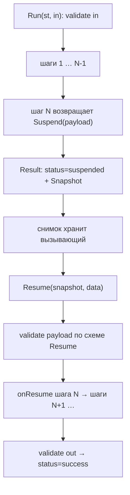

# Пайплайны (`flow`): шаги, контракт и приостановки

Этот гид — про эксплуатацию `flow`: как собрать последовательность типизированных
шагов, провести через неё `State`, приостановиться на человеке и продолжить по
JSON-снимку. «Зачем» и модель данных — [Концепции: Пайплайны](../concepts/flow.md);
здесь — решения, рецепты и грабли.

## Когда `flow`, а когда — обычная функция

`flow` берёт у workflow-движка только **durable-часть**: типизированный контракт
между шагами плюс suspend/resume. Он ничего не знает про модель, guard и трейсы.

| Ситуация                                                         | Берите            |
| ---------------------------------------------------------------- | ----------------- |
| Линейная цепочка шагов с явным `In`/`Out` и проверкой схемы      | `flow`            |
| Нужна приостановка на внешнем событии (approval, ответ человека) | `flow`            |
| Ветвление, `errgroup`, `for`, fan-out                            | обычный Go        |
| Один вызов без приостановок                                      | обычная функция   |
| Прогон, который знает про модель и guard                         | `kit` (Chat/Tool) |

> [!WARNING]
> В `flow` **намеренно нет** branch/parallel/foreach/loop DSL (`D31`,
> [Решения](../internals/decisions.md)). Типизированная цепочка плюс обычный вызов
> функции выражают то же самое с проверкой компилятором; builder-DSL — ровно та
> абстракция, которую этот фреймворк отвергает.

## Шаги и типизированная цепочка

```go
func New[In, Out any](id string, fn func(ctx context.Context, st State, in In) (Out, error)) (*Step[In, Out], error)
func NewResumable[In, Out, Resume any](
	id string,
	fn func(ctx context.Context, st State, in In) (Out, error),
	onResume func(ctx context.Context, st State, in In, payload Resume) (Out, error),
) (*Step[In, Out], error)

func Then[In, Mid, Out any](p *Pipeline[In, Mid], next *Step[Mid, Out]) *Pipeline[In, Out]
func Chain[A, B, C any](first *Step[A, B], second *Step[B, C]) *Pipeline[A, C]
func Chain3[A, B, C, D any](s1 *Step[A, B], s2 *Step[B, C], s3 *Step[C, D]) *Pipeline[A, D]
```

`Then`, `Chain` и `Chain3` — **функции пакета, а не методы**: в Go метод не может
объявить собственные параметры типа, поэтому цепочку продолжают пакетной
generic-функцией. Типы всё равно связывает компилятор: вход добавляемого шага
обязан быть текущим выходом пайплайна.

| Что нужно                              | Чем                           |
| -------------------------------------- | ----------------------------- |
| Пайплайн из одного шага                | `step.Pipeline()`             |
| Ровно два шага                         | `flow.Chain(s1, s2)`          |
| Ровно три                              | `flow.Chain3(s1, s2, s3)`     |
| Четыре и больше                        | `flow.Then(flow.Then(…), sN)` |
| Добавить шаг к существующему контракту | `flow.Then(pipeline, next)`   |

`New` требует непустой `id` и непустую функцию; иначе — `core.ErrInvalidConfig`.
`NewResumable` дополнительно требует `onResume`, а схемы выводит для `In`, `Out`
и `Resume`.

## Схемы из типов

Схемы входа, выхода каждого шага и payload продолжения выводятся из Go-типов
(через `invopop/jsonschema`, как у `kit.Tool`): без `$ref`, без `$schema`/`$id`,
с `additionalProperties: false` у объектов.

| Точка               | Когда проверяется                      | Ошибка           |
| ------------------- | -------------------------------------- | ---------------- |
| вход пайплайна      | при `from == 0` в `runFrom`            | `ErrInvalidArgs` |
| вход каждого шага   | в `runner.run` перед вызовом `fn`      | `ErrInvalidArgs` |
| выход каждого шага  | в `encodeOut` после `fn`               | `ErrInvalidArgs` |
| payload продолжения | в `runner.resume` по схеме `Resume`    | `ErrInvalidArgs` |
| выход пайплайна     | в конце `runFrom` перед декодированием | `ErrInvalidArgs` |

Особые случаи:

- **Интерфейсный тип — схемы нет.** `schemaFor[In]` для `any`/интерфейса даёт
  `nil`, и проверка для этой точки пропускается. Это и оговорка `BR-66`: там, где
  тип не описуем, контракта нет.
- **`nil`-указатель** в позиции типа разворачивается в новый `Elem`, поэтому
  `*In` даёт схему `In`.
- **Для типизированной цепочки проверка — защита в глубину**: компилятор уже
  гарантировал типы. Она окупается на payload продолжения (приходит сырым JSON) и
  на шагах с интерфейсными типами.

## Запуск: `Run`, `RunWithState`, `Result`

```go
func (p *Pipeline[In, Out]) Run(ctx context.Context, in In) Result[Out]
func (p *Pipeline[In, Out]) RunWithState(ctx context.Context, st State, in In) Result[Out]

type Result[Out any] struct {
	Status     Status   // StatusSuccess | StatusFailed | StatusSuspended
	Output     Out
	Error      error
	Suspension *Suspension
	Snapshot   []byte       // только при приостановке
	State      State
	Steps      []StepResult // ID, Status, Error по каждому шагу
}
```

- `Run` — это `RunWithState(ctx, nil, in)`.
- `ctx` проверяется перед первым шагом: отменённый контекст даёт
  `StatusFailed` с `Error == ctx.Err()`.
- `Steps` — то, по чему видно, **где** всё встало: у упавшего шага
  `StepResult{ID, Status: failed, Error}`, у приостановленного — `suspended`.
- `StatusSuspended` — **не** ошибка: шаг вернул `*Suspension`, и это штатный
  исход. Не путайте с `StatusFailed`.

## Приостановка и возобновление

Шаг останавливается, вернув `flow.Suspend(payload)` как ошибку — это
`*Suspension`, реализующий `error`. Пайплайн останавливается на этом шаге и
возвращает `Result.Snapshot` — минимальный JSON:

```json
{
  "state": {},
  "step_index": 1,
  "step_input": { "title": "Черновик" },
  "steps": [{ "id": "validate-draft", "status": "success" }]
}
```

`Resume` разбирает снимок, проверяет payload по схеме `Resume` и вызывает
`onResume` того же шага:

```go
func (p *Pipeline[In, Out]) Resume(ctx context.Context, snapshotBytes []byte, data any) Result[Out]
```



Ошибки `Resume`: испорченный снимок, `step_index` вне диапазона, несовпадение
payload со схемой — всё это `core.ErrInvalidArgs`. Если шаг не был resumable
(`New`, а не `NewResumable`), `Resume` даёт `ErrInvalidArgs` с текстом
`step … is not resumable`.

## `State`: JSON-round-trip и его следствие

`State` — это `map[string]any`, который сериализуется в снимок и разбирается
обратно. Отсюда главная грабля: **после `Resume` все числа в `State` — `float64`**,
потому что так устроен `encoding/json`. Если шаг-аккумулятор писал `int`, то на
resume он прочитает `float64` и паника `interface conversion: interface {} is
float64, not int` — ваша, а не фреймворка.

```go
// Плохо: после Resume в st["count"] будет float64.
n := st["count"].(int)

// Надёжно: храните числа как понятный тип или приводите явно.
n, _ := st["count"].(float64)
```

Сохраняйте в `State` только то, что переживёт JSON: строки, числа, `bool`, срезы
и карты из этих типов. Указатели, каналы и функции туда класть нельзя.

## Рецепты

### Шаг-approval: приостановиться и продолжить позже

```go
type Draft struct {
	Title string `json:"title"`
}

type Review struct {
	Approved bool   `json:"approved"`
	Notes    string `json:"notes"`
}

check, _ := flow.New("validate-draft", func(_ context.Context, _ flow.State, in Draft) (Draft, error) {
	if in.Title == "" {
		return Draft{}, fmt.Errorf("пустой заголовок")
	}
	return in, nil
})

review, _ := flow.NewResumable(
	"review",
	func(_ context.Context, _ flow.State, in Draft) (Review, error) {
		return Review{}, flow.Suspend(map[string]any{"question": "approve " + in.Title + "?"})
	},
	func(_ context.Context, _ flow.State, in Draft, payload Review) (Review, error) {
		return payload, nil // payload пришёл из Resume
	},
)

// Первый прогон: остановится на review.
res := flow.Chain(check, review).Run(ctx, Draft{Title: "Черновик"})
if res.Status != flow.StatusSuspended {
	return fmt.Errorf("ожидали приостановку, получили %s", res.Status)
}

// Снимок — единственное, что нужно, чтобы продолжить. Сохраните его.
if err := store.Save(ctx, requestID, res.Snapshot); err != nil {
	return err
}

// ... позже, когда пришёл ответ человека:
snap, _ := store.Load(ctx, requestID)
final := flow.Chain(check, review).Resume(ctx, snap, Review{Approved: true, Notes: "ок"})
```

`Snapshot` не привязан к процессу: сохраните его в БД, в очередь, в файл — что
удобно. Приложение обязано владеть и «входом» шага (`step_input` уже внутри
снимка), и самим снимком.

### Enrichment-пайплайн с аккумулятором в `State`

```go
fetch, _ := flow.New("fetch", func(_ context.Context, _ flow.State, in ID) (Raw, error) {
	return loadRaw(ctx, in)
})

normalize, _ := flow.New("normalize", func(_ context.Context, st flow.State, in Raw) (Norm, error) {
	n := normalizeRaw(in)
	st["warnings"] = len(n.Warnings) // State живёт весь прогон
	return n, nil
})

index, _ := flow.New("index", func(_ context.Context, st flow.State, in Norm) (Done, error) {
	return indexNorm(ctx, in, warningsOf(st))
})

res := flow.Chain3(fetch, normalize, index).RunWithState(ctx, flow.State{}, id)
// res.State["warnings"] доступен и после прогона; res.Output — Done
```

`State` — на один прогон: он не шарится между вызовами, но переживает
приостановку.

### Возобновление после перезапуска процесса

Ничего специального делать не нужно: снимок — это просто байты. Единственное
условие — **тот же самый** пайплайн (тот же порядок шагов и те же типы) должен
существовать к моменту `Resume`. Собирайте `Pipeline` детерминированно (одна
функция-конструктор), тогда `step_index` из снимка укажет на нужный шаг.

> [!WARNING]
> Снимки **не durable сами по себе**. `flow` не пишет их на диск и не хранит
> очередь приостановленных прогонов — это делаете вы. `Snapshot` — это контракт
> данных, а не хранилище.

### Шаг, который валидирует собственный выход

Тип `Out` уже даёт схему, и `encodeOut` проверит результат — если `Out` это
структура. Если вы хотите проверить **семантику** (не только форму), верните
ошибку из `fn`:

```go
validate, _ := flow.New("validate", func(_ context.Context, _ flow.State, in Report) (Report, error) {
	if in.Total != in.Passed+in.Failed {
		return Report{}, fmt.Errorf("total != passed+failed: %w", core.ErrInvalidArgs)
	}
	return in, nil
})
```

Возврат ошибки из шага даёт `StatusFailed` и запись в `Steps`. Оборачивайте в
`core.ErrInvalidArgs`, если это «некорректный вход/данные», — тогда вызывающий
различит это от прочих сбоев.

### `flow` изнутри `kit`-инструмента

`flow` — обычный Go-пакет, поэтому многошаговое backend-действие удобно оформить
инструментом:

```go
type RefundIn struct {
	OrderID string `json:"order_id"`
	Reason  string `json:"reason"`
}

kit.Tool(app, "refund_order", func(ctx context.Context, in RefundIn) (flowDone, error) {
	res := refundPipeline().Run(ctx, in)
	if res.Status != flow.StatusSuccess {
		return flowDone{}, fmt.Errorf("refund: %w", res.Error)
	}
	return toDone(res.Output), nil
}, kit.Desc("Refund an order by id."), kit.Effects(kit.EffectWrite))
```

Ходовая обвязка при этом остаётся ходовой: права на инструмент, guard
`tool_result`, лимиты и трейсы применяются потому, что это `kit.Tool`, а не
`flow`. Сам `flow` про `kit` не знает (и наоборот).

## Частые ошибки

- **Схема `State` и `float64`.** См. раздел выше: числа после `Resume` приходят
  как `float64`.
- **Смена формы `Resume`/`In`/`Out` ломает старые снимки.** Payload продолжения
  валидируется по текущей схеме `Resume`: если вы переименовали поле, старые
  снимки перестанут возобновляться (`ErrInvalidArgs`). Версионируйте типы, если
  снимки живут долго, — отдельного поля версии в снимке нет.
- **Нарушение схемы — `core.ErrInvalidArgs`.** Смотрите `Result.Steps`: там имя
  упавшего шага и исходная ошибка (этап `input`/`output`/`resume` указан в тексте).
- **`Suspend` — не ошибка.** Обрабатывайте `StatusSuspended` отдельно; не
  сваливайте его в общую ветку `err != nil`.
- **`ctx` отменён до старта** → сразу `StatusFailed` с `ctx.Err()`, шагов нет.

## Ограничения

- **Нет ветвлений, параллелизма, `foreach` и циклов** — это решение (`D31`), а не
  пробел. Динамический граф собирайте обычным Go.
- **Нет хранилища снимков.** Durable-часть — ваша: `flow` отдаёт и принимает
  байты.
- **Схемы зависят от двух внешних библиотек** (`invopop/jsonschema`,
  `santhosh-tekuri/jsonschema/v6`), как и `kit.Tool`. `flow` не stdlib-only.
- **Схемы для интерфейсных типов нет** — там проверка пропускается (`BR-66`).
- **Нет политики и guard.** `flow` не проходит через `internal/call`: права,
  guard и трейсы появляются только когда вы оборачиваете шаг в `kit.Tool` или
  вызываете `flow` из операции `kit`.

## Смотрите также

- [Концепции: Пайплайны](../concepts/flow.md) — модель данных и примеры
- [Chat](../concepts/chat.md) — когда сценарий фиксирован, а когда — открыт
- [Инструменты](../concepts/tools.md) — обернуть пайплайн в tool
- [Справочник kit](../reference/kit.md) — `kit.Tool`, `Effects`
- [Бизнес-правила](../internals/business-rules.md) — `BR-66`, `BR-67`
- [Решения](../internals/decisions.md) — `D31`
- [`flow/flow.go`](../../flow/flow.go) — исходный код пакета
