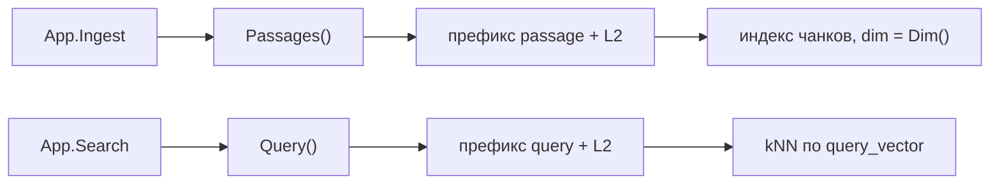

# Эмбеддеры

Эмбеддер нужен только операциям `Ingest` и `Search`. Чат-приложению он не нужен:
`kit.New` принимает `Embedder: nil`, и `App.Setup` в этом случае просто пропускает
создание индекса чанков.

У `embed.Embedder` нет общего метода `Embed()`. Есть `Query()` и `Passages()`, и
это не косметика: у e5 префиксы запроса и пассажа разные, и перепутать их нельзя
(D9 в [Решениях](../../internals/decisions.md)).

## Предпосылки

- Решите, где считаются векторы: на вашем сервере (remote) или в процессе (local).
- Для локального энкодера нужна сборка с тегом `ort` и скачанные веса — см.
  [Установку](../../getting-started/installation.md).
- Точные поля и пресеты — в [справочнике провайдеров](../../reference/providers.md).

## Как выбрать

| Вариант                                                    | Когда подходит                                                       |
| ---------------------------------------------------------- | ------------------------------------------------------------------- |
| `embed.NewOpenAI` — remote `/v1/embeddings`                | OpenAI-совместимый сервер эмбеддингов (в demo — TEI)                 |
| `embed.NewGigaChat` — OAuth + remote `/v1/embeddings`       | тот же OAuth и CA, что у чата GigaChat                              |
| `embed.NewLocal` — локальный ONNX-энкодер (`-tags ort`)     | энкодерные модели в процессе, без внешнего сервиса                   |

Декодерные эмбеддеры (например, Qwen3-Embedding) подключайте как remote через
`embed.NewOpenAI`: граница поддержки локального энкодера — только ONNX-энкодеры (D8).

## Remote: `embed.NewOpenAI`

```go
emb, err := embed.NewOpenAI(embed.OpenAIConfig{
	BaseURL: "http://localhost:8088/v1", // с /v1: клиент допишет /embeddings
	Model:   "intfloat/multilingual-e5-small",
	Dim:     384,                        // задайте заранее — см. предупреждение
})
if err != nil {
	return err
}
app, err := kit.New(ctx, kit.Config{ES: es, LLM: llm, Policy: policy, Embedder: emb})
```

- `BaseURL` и `Model` обязательны, иначе `ErrInvalidConfig`.
- `APIKey` необязателен: заголовок `Authorization: Bearer` добавляется, только если
  он непустой.
- `Preset *Preset` — явный пресет; иначе он выводится из имени модели (см. ниже).
- Полный путь: `<BaseURL>/embeddings` (при `BaseURL = …/v1` это `…/v1/embeddings`).

> [!WARNING]
> Задавайте `Dim` явно для remote-эмбеддера. `Dim()` возвращает 0, пока не
> произошёл ни один вызов и `Dim` не сконфигурирован. А `App.Setup` создаёт индекс
> чанков, только если `Dim() > 0`. Пустой `Dim` без «прогрева» → индекс не создан →
> `Ingest` падает на отсутствующем индексе.

## GigaChat: `embed.NewGigaChat`

Тот же OAuth-обмен и тот же `*http.Client` с корневым CA, что и у чата
([GigaChat](./gigachat.md)):

```go
emb, err := embed.NewGigaChat(embed.GigaChatConfig{
	Credentials: creds,
	HTTPClient:  client, // модель по умолчанию — "Embeddings"
	Dim:         1024,
})
```

Путь — `<BaseURL>/v1/embeddings`, где `BaseURL` по умолчанию `https://api.giga.chat`
(то есть `/v1` в `BaseURL` включать не нужно — в отличие от `embed.NewOpenAI`).

## Local: `embed.NewLocal`

```go
emb, err := embed.NewLocal(embed.LocalConfig{
	Dir:      "models", // корень весов; иначе KIT_MODELS_DIR или ./models
	Model:    "intfloat/multilingual-e5-small",
	Sessions: 2,        // размер пула ORT-сессий, по умолчанию 2
})
if err != nil {
	return err // без -tags ort — ErrInvalidConfig
}
```

Размерность берётся из графа ONNX, вход обрезается по `max_len` пресета, батч
**≤ 32** и сортируется по длине (короткие тексты обрабатываются вместе, чтобы не
тратить compute). `LocalConfig.Sessions` задаёт пул сессий ORT.

## Разделение `Query()` и `Passages()`



| Метод             | Префикс пресета   | Кто вызывает     |
| ----------------- | ----------------- | ---------------- |
| `Query(texts)`    | `QueryPrefix`     | `Search`         |
| `Passages(texts)` | `PassagePrefix`   | `Ingest`         |

Префиксы берутся из пресета и **дописываются к каждому тексту** перед отправкой.

> [!WARNING]
> Для e5-семейства (`multilingual-e5-*`) префиксы — `query: ` и `passage: `. Если
> эмбеддер выбран без пресета (неизвестное имя модели и нет `kit_embedder.json`),
> префиксы не добавятся, и качество поиска **тихо упадёт** — ошибки не будет.

## Пресеты и `kit_embedder.json`

`embed.PresetFor(model)` сопоставляет модель по подстроке имени (без учёта регистра):

| Семейство          | `pooling` | `query_prefix` | `passage_prefix` | `normalize` | `max_len` |
| ------------------ | --------- | -------------- | ---------------- | ----------- | --------- |
| `multilingual-e5*` | `mean`    | `query: `      | `passage: `      | `true`      | `512`     |
| `bge-m3`           | `cls`     | —              | —                | `true`      | `8192`    |

Неизвестная модель получает пустой пресет. Для локальной модели её описывают файлом
`kit_embedder.json` рядом с весами:

```json
{
  "pooling": "mean",
  "query_prefix": "query: ",
  "passage_prefix": "passage: ",
  "normalize": true,
  "max_len": 512
}
```

`embed.LoadFileConfig(path)` читает файл строго (`DisallowUnknownFields`).
`pooling` по умолчанию `mean`, `max_len` — `512`. Неизвестный `pooling`, неизвестное
поле или ошибка разбора дают `ErrInvalidConfig`. Если `NewLocal` не находит ни
пресет, ни `kit_embedder.json` — тоже `ErrInvalidConfig`.

> [!NOTE]
> `Preset.MaxLen` применяется **только локальным** энкодером. Для remote-эмбеддера
> обрезку входа делает сервер, и `max_len` из пресета игнорируется.

## `Dim()` и переиндексация

Индекс чанков создаётся с размерностью эмбеддера:

- `App.Setup` → `store.EnsureSchema(ctx, es, Embedder.Dim())`;
- при `dims > 0` создаётся индекс `kit-chunks` с полем
  `dense_vector { dims: <Dim()>, similarity: cosine }`.

`EnsureSchema` идемпотентен: если индекс уже существует
(`resource_already_exists_exception`), он **не пересоздаётся и не сверяется** с новой
размерностью.

> [!WARNING]
> **Смена эмбеддера с другой размерностью требует переиндексации.** Если вы
> сменили модель (например, 384 → 1024), старый `kit-chunks` с `dims: 384` останется
> как есть. `Setup` не пересоздаст его, а `Ingest` вернёт `ErrInvalidArgs` из
> `store.ValidateChunk` («vector has N dims, want M»). Удалите индекс чанков и
> проиндексируйте документы заново, либо заведите индекс с другим именем.

Так же и `Dim`: она фиксируется в индексе при создании, а не на каждый запрос.

## How-to: собрать эмбеддер из окружения

```go
func newEmbedder(cfg Config, client *http.Client) (embed.Embedder, error) {
	switch cfg.EmbedBackend {
	case "gigachat":
		return embed.NewGigaChat(embed.GigaChatConfig{
			Credentials: cfg.Credentials,
			HTTPClient:  client,
			Dim:         cfg.EmbedDim,
		})
	case "local":
		return embed.NewLocal(embed.LocalConfig{Dir: cfg.ModelsDir, Model: cfg.EmbedModel})
	default: // openai-compatible/TEI
		return embed.NewOpenAI(embed.OpenAIConfig{
			BaseURL:    cfg.EmbedBaseURL,
			Model:      cfg.EmbedModel,
			Dim:        cfg.EmbedDim,
			HTTPClient: client,
		})
	}
}
```

Так устроен `newEmbedder` в demo: `EMBED_BASE_URL` (по умолчанию
`http://localhost:8088/v1`), `EMBED_MODEL` (по умолчанию
`intfloat/multilingual-e5-small`), `EMBED_DIM` (`384`), `EMBED_LOCAL` и
`KIT_MODELS_DIR`.

## Troubleshooting

| Симптом                                             | Причина                                                          | Что делать                                                                       |
| --------------------------------------------------- | ---------------------------------------------------------------- | -------------------------------------------------------------------------------- |
| `ErrInvalidArgs`: «vector has N dims, want M»       | индекс создан под другую размерность                             | переиндексация: удалите `kit-chunks` и выполните `Ingest` заново                  |
| `Setup` прошёл, а `Ingest` не работает               | `Dim()` был 0 на момент `Setup`, индекс не создан                | задайте `Dim` в конфиге эмбеддера или сделайте один прогрев до `Setup`            |
| Поиск «тупой», ошибок нет                           | модель без пресета → префиксы не добавлены                       | назовите модель так, чтобы сработал `PresetFor`, или задайте `Preset` явно        |
| Слишком длинные документы теряют хвост               | `max_len` локального пресета (512 для e5) обрезает вход           | поднимите `max_len` в `kit_embedder.json` или чанкуйте мельче                     |
| `404` на эмбеддингах                                | неверный путь: нет `/v1`, или наоборот добавлен для GigaChat      | для `NewOpenAI` — `…/v1`; для `NewGigaChat` — корень хоста                        |
| Сервер вернул не столько векторов, сколько входов    | сбой сервера                                                     | клиент вернёт `ErrProvider` («got N vectors for M inputs»)                        |
| Локальный эмбеддер не собирается/не стартует        | нет `-tags ort`, нет весов, нет `libonnxruntime`                  | см. [Установку](../../getting-started/installation.md) и `KIT_ORT_LIB`             |

### Проверка окружения

```sh
go -C cmd run ./kitctl verify models --dir models --embed-model intfloat/multilingual-e5-small
```

`embed.VerifyDir(dir, model)` проверяет наличие `model.onnx`, `tokenizer.json`,
`config.json`, наличие пресета или `kit_embedder.json` и валидность пресета.
В сборке с `-tags ort` он дополнительно поднимает энкодер и закрывает его; без тега —
только файлы и пресет.

## Чего библиотека не делает

- Не выбирает модель и не считает качество: `Query`/`Passages` — единственный
  контракт.
- Не батчит remote-запросы: `postEmbeddings` отправляет вход одним запросом, размер
  контролируете вы (локальный энкодер батчит сам, ≤ 32).
- Не применяет `max_len` к remote-эмбеддерам — это делает сервер.
- Не пересоздаёт индекс при смене размерности: переиндексация — ваша задача.
- Не угадывает префиксы: неизвестная модель молча остаётся без них.

## Смотрите также

- [Поиск](../../concepts/retrieval.md) — как `Query`/`Passages` используются в ingest и search
- [GigaChat](./gigachat.md) — общий OAuth и CA
- [Провайдеры: обзор](./overview.md) — матрица и `kit.Config`
- [Провайдеры (справочник)](../../reference/providers.md) — пресеты, `kit_embedder.json`, каталог весов
- [Установка](../../getting-started/installation.md) — сборка с `-tags ort` и `KIT_MODELS_DIR`
