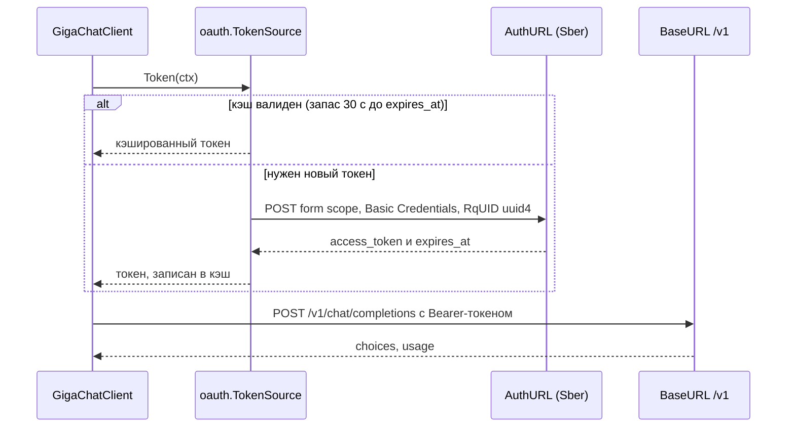

# GigaChat

GigaChat — самый «своенравный» провайдер в kit. Вместо API-ключа здесь OAuth-обмен,
вместо `tools`/`tool_choice` — `functions`/`function_call`, а structured output
эмулируется принудительным вызовом функции. Плюс корпоративный шлюз Сбера нередко
предъявляет самоподписанный корневой сертификат, поэтому почти всегда нужен свой
`*http.Client`.

## Предпосылки

- `clientID` и `clientSecret` из личного кабинета GigaChat.
- `Credentials` = **base64 от `clientID:clientSecret`** (одна строка).
- PEM-файл с корневым CA Сбера, если ваш шлюз не в системном хранилище.
- Точные поля конфига — в [справочнике провайдеров](../../reference/providers.md).

`Credentials` можно собрать в Go (переносимо, без различий `base64` между macOS и Linux):

```go
creds := base64.StdEncoding.EncodeToString([]byte(clientID + ":" + clientSecret))
```

## Быстрый старт

```go
creds := base64.StdEncoding.EncodeToString([]byte(os.Getenv("GIGACHAT_CLIENT_ID") + ":" + os.Getenv("GIGACHAT_CLIENT_SECRET")))

client, err := newHTTPClient(os.Getenv("GIGACHAT_CA_FILE"))
if err != nil {
	return err
}

llm, err := model.GigaChat(model.GigaChatConfig{
	Credentials: creds,
	Model:       "GigaChat-2",
	HTTPClient:  client,
})
if err != nil {
	return err
}
app, err := kit.New(ctx, kit.Config{ES: es, LLM: llm, Policy: policy})
```

`BaseURL`, `AuthURL`, `Scope` и `Model` подставляются по умолчанию:
`https://api.giga.chat`, `https://ngw.devices.sberbank.ru:9443/api/v2/oauth`,
`GIGACHAT_API_PERS`, `GigaChat-2`. Обязателен только `Credentials`.

> [!WARNING]
> В отличие от OpenAI-совместимых провайдеров, `GigaChatConfig.BaseURL` — это
> **корень хоста**, без `/v1`. Пути `/v1/chat/completions` и `/v1/embeddings`
> дописывает клиент. `https://api.giga.chat/v1` в `BaseURL` даст
> `…/v1/v1/chat/completions` и `404`.

## OAuth-обмен

Токен запрашивается отдельным POST и кэшируется; повторно он не запрашивается,
пока не приблизился срок истечения.



Детали, которые важно знать:

- **Заголовок `RqUID` обязателен.** Это UUIDv4; шлюз отвечает `400` без него.
  Клиент ставит его сам.
- Тело — `application/x-www-form-urlencoded` с `scope=<Scope>`, авторизация —
  `Authorization: Basic <Credentials>`.
- Токен обновляется **за 30 секунд** до `expires_at`. Если поле `expires_at` не
  пришло, срок жизни считается равным **25 минутам**.

Токен общий с эмбеддером: если вы используете и чат, и эмбеддинги GigaChat, каждый
клиент держит свой `oauth.TokenSource` и получает свой токен.

## Свой корневой CA

Корпоративный шлюз Сбера часто предъявляет сертификат, которого нет в системном
хранилище. Соберите `*http.Client` с пулом `x509` и отдайте его и чату, и эмбеддеру
(так же устроен `newHTTPClient` в demo):

```go
func newHTTPClient(caFile string) (*http.Client, error) {
	transport := http.DefaultTransport.(*http.Transport).Clone()
	if caFile != "" {
		pem, err := os.ReadFile(caFile)
		if err != nil {
			return nil, fmt.Errorf("read CA file: %w", err)
		}
		pool, err := x509.SystemCertPool()
		if err != nil {
			pool = x509.NewCertPool()
		}
		if !pool.AppendCertsFromPEM(pem) {
			return nil, fmt.Errorf("CA file %s holds no PEM certificates", caFile)
		}
		transport.TLSClientConfig = &tls.Config{RootCAs: pool, MinVersion: tls.VersionTLS12}
	}
	return &http.Client{Timeout: 60 * time.Second, Transport: transport}, nil
}
```

> [!NOTE]
> `MinVersion: tls.VersionTLS12` — минимальное требование; не понижайте его.
> Транспорт клонируется из `http.DefaultTransport`, поэтому прокси-настройки
> окружения (`HTTP_PROXY`/`HTTPS_PROXY`) сохраняются.

## Инструменты: `functions` и `function_call`

GigaChat не понимает `tools`/`tool_choice`. Адаптер переводит:

| `model.Request`        | Тело GigaChat                                        |
| ---------------------- | ---------------------------------------------------- |
| `Tools`                | `functions` (`{name, description, parameters}`)      |
| `ToolChoice == "none"` | `functions` и `function_call` **не отправляются**    |
| иное `ToolChoice`      | `function_call: "auto"`                              |
| роль `tool` в истории  | роль **`function`**                                  |

Отдельного «вызови именно этот инструмент» нет, а `"required"` не действует —
поведение сводится к `auto`.

> [!WARNING]
> За ход читается **только первый** tool call. Ответ GigaChat несёт одно поле
> `function_call` (не массив), а при отправке истории из сообщения ассистента
> сериализуется `ToolCalls[0]`. Если модель «попросила» несколько инструментов,
> остальные будут проигнорированы. Планируйте сценарии так, чтобы за шаг
> вызывалось не больше одного инструмента.

Синтезированный `id` вызова — `gc-<имя функции>` (`model.ToolCall.ID`).

```go
resp, err := llm.Chat(ctx, model.Request{
	Messages: []model.Message{{Role: model.RoleUser, Content: "Погода в Москве?"}},
	Tools: []model.ToolSpec{{
		Name:        "get_weather",
		Description: "Текущая погода в городе.",
		Schema:      json.RawMessage(`{"type":"object","properties":{"city":{"type":"string"}},"required":["city"]}`),
	}},
})
```

## Structured output: принудительная функция

`model.SupportsNativeSchema(*model.GigaChatClient)` → **`false`**. Это не значит,
что structured output недоступен — он эмулируется.

Если вызвать `Chat` **напрямую** с `SchemaMode: model.SchemaNative` и `JSONSchema`,
клиент добавит функцию с именем `structured_output` и `function_call`, указывающий
на неё; ответ этой функции разворачивается обратно в `Message.Content`:

```go
schema := json.RawMessage(`{"type":"object","properties":{"approved":{"type":"boolean"}},"required":["approved"]}`)

resp, err := llm.Chat(ctx, model.Request{
	Messages:   []model.Message{{Role: model.RoleUser, Content: "Одобри заявку: …"}},
	JSONSchema: schema,
	SchemaMode: model.SchemaNative, // → forced function structured_output
})
// resp.Message.Content — JSON по схеме, resp.Message.ToolCalls пуст
```

> [!IMPORTANT]
> Через фасад (`kit.Generate`, `model.Structurer`) этот путь **не используется**:
> при `SchemaMode == SchemaNative` и `SupportsNativeSchema() == false` ядро
> автоматически переключается на `SchemaInline` (D29) и дописывает схему
> инструкцией в сообщение. Это ожидаемое поведение: GigaChat не поддерживает
> нативный `response_format`, а инлайн-инструкция работает на всех моделях.
>
> Что это значит на практике: в `Generate` вы получите ответ, который **надо
> декодировать и валидировать самим** — серверной гарантии соответствия схеме нет.
> Если вам нужен именно forced-function, вызывайте `llm.Chat` напрямую.

Ещё одна тонкость: для GigaChat `finish_reason` вызова функции (`function_call`)
не входит в таблицу нормализации и превращается в `FinishOther`. Не полагайтесь на
`FinishReason`, чтобы отличить structured output от обычного ответа, — смотрите
`Message.Content`.

## Эмбеддинги через тот же OAuth

Эмбеддер GigaChat использует тот же OAuth-обмен (тот же `Credentials`, тот же
`RqUID`), поэтому ему нужен тот же `*http.Client` с CA:

```go
emb, err := embed.NewGigaChat(embed.GigaChatConfig{
	Credentials: creds,
	HTTPClient:  client, // модель по умолчанию — "Embeddings"
})
if err != nil {
	return err
}
app, err := kit.New(ctx, kit.Config{ES: es, LLM: llm, Policy: policy, Embedder: emb})
```

## Troubleshooting

| Симптом                                              | Причина                                                              | Что делать                                                                       |
| ---------------------------------------------------- | -------------------------------------------------------------------- | -------------------------------------------------------------------------------- |
| `400` с упоминанием `RqUID`/обязательного заголовка  | заголовок срезан прокси или OAuth-запрос написан вручную             | адаптер ставит `RqUID` сам; проверьте промежуточный прокси                       |
| `x509: certificate signed by unknown authority`      | корневой CA Сбера не в системном хранилище                          | передайте `HTTPClient` с `RootCAs` (см. выше)                                     |
| `401`/`403` сразу после выдачи токена                 | неверный `Scope`                                                     | для физлиц — `GIGACHAT_API_PERS`; для бизнес-доступа нужен свой скоуп — сверьтесь с вашим кабинетом |
| `401` через некоторое время работы                   | истёк токен, а обновление не сработало (часы/прокси-кэш)             | проверьте синхронизацию времени; помните про запас 30 c и фолбэк 25 минут         |
| Модель игнорирует `functions`                        | конкретная модель/сборка не умеет function calling                   | сверьте возможности модели в вашей версии; проверьте `FinishReason`               |
| Модель вернула текст вместо вызова инструмента       | `function_call` отработал как `auto`, но модель выбрала ответ        | усилите `Description` у инструмента; это нормальное поведение `auto`              |
| Structured output не соответствует схеме              | через фасад схема уходит инлайном, без серверной гарантии            | валидируйте ответ сами; для forced-function вызывайте `llm.Chat` с `SchemaNative` |

## Чего библиотека не делает

- Не управляет `clientID`/`clientSecret`: `Credentials` вы собираете сами.
- Не обновляет токен по расписанию, а только лениво — при вызове на границе 30 секунд.
- Не поддерживает больше одного tool call за ход (ограничение формата `function_call`).
- Не даёт `tool_choice` в смысле OpenAI: только «нет инструментов» или `auto`.
- Не гарантирует соответствие схеме при structured output через фасад.
- Не стримит.

## Смотрите также

- [Эмбеддеры](./embeddings.md) — `embed.NewGigaChat` и пресеты
- [Провайдеры: обзор](./overview.md) — матрица возможностей
- [Провайдеры (справочник)](../../reference/providers.md) — `GigaChatConfig`, OAuth-предупреждение
- [Конфигурация](../../reference/configuration.md) — переменные `GIGACHAT_*` примера `demo`
