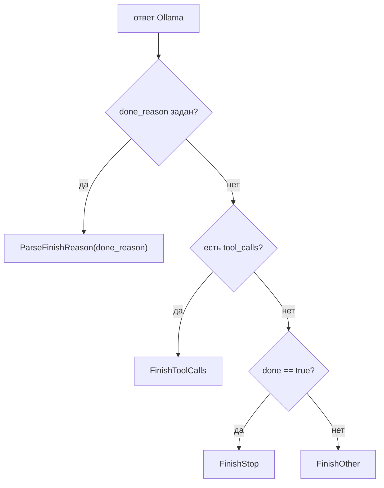

# Ollama

Ollama — локальный сервер моделей с нативным API `/api/chat`. Адаптер kit говорит
именно на этом протоколе, поэтому `Temperature`, `MaxTokens`, `Seed` и `Stop`
уезжают не в поля верхнего уровня, а в объект `options`, а structured output
задаётся полем `format`, а не `response_format`.

## Предпосылки

- Ollama установлена и запущена, модель скачана. Установка и `ollama pull` — вне
  зоны ответственности kit: см. документацию Ollama.

  ```sh
  ollama pull llama3.2        # имя и тег проверьте в вашей версии Ollama
  ```

- Сервер слушает `http://localhost:11434` (значение по умолчанию).

## Быстрый старт

```go
llm, err := model.Ollama("http://localhost:11434", "llama3.2")
if err != nil {
	return err
}
app, err := kit.New(ctx, kit.Config{ES: es, LLM: llm, Policy: policy})
```

`model.Ollama(baseURL, model)` — обёртка над `model.NewOllama`:

- `BaseURL` по умолчанию `http://localhost:11434` — можно передать пустую строку;
- `Model` обязателен, иначе `ErrInvalidConfig`.

Клиент шлёт `POST <BaseURL>/api/chat` с `stream: false`.

```go
// эквивалент через общий конструктор
llm, err := model.NewOllama(model.OllamaConfig{
	BaseURL:    "http://ollama.internal:11434",
	Model:      "qwen2.5:7b",
	HTTPClient: &http.Client{Timeout: 5 * time.Minute},
})
```

## Маппинг параметров в `options`

| `model.Request` | Тело Ollama           | Условие   |
| --------------- | --------------------- | --------- |
| `Temperature`   | `options.temperature` | `!= nil`  |
| `MaxTokens`     | `options.num_predict` | `> 0`     |
| `Seed`          | `options.seed`        | `!= nil`  |
| `Stop`          | `options.stop`        | `len > 0` |

Объект `options` появляется в теле, только если хотя бы одно из полей задано.

## Инструменты: `tools` без `tool_choice`

Инструменты уходят в поле `tools` в **той же форме, что у OpenAI**
(`{type:"function", function:{name, description, parameters}}`). А вот поля
`tool_choice` в нативном API Ollama нет, поэтому:

| `Request.ToolChoice`                          | Что отправляет клиент                                 |
| --------------------------------------------- | ----------------------------------------------------- |
| `"none"`                                      | `tools` **не отправляется** (эмуляция запрета вызова) |
| `""`, `"auto"`, `"required"`, имя инструмента | `tools` отправляется; сам `tool_choice` игнорируется  |

> [!WARNING]
> `"required"` и «вызови именно этот инструмент» на Ollama **не действуют**:
> значение лишь не мешает отправке `tools`. Ядро kit на последнем шаге цикла
> выставляет `tool_choice: "none"` — и это на Ollama работает именно так, как
> задумано (список инструментов пропадает), но принудительный выбор инструмента
> задать нельзя.

Ответ приходит так же, как уходит: аргументы — **JSON-объект** (а не строка, как у
OpenAI). Клиент сериализует их обратно в строку, чтобы выдать единый
`model.ToolCall`, а `id` синтезирует как **`«имя»-«индекс»`** (например,
`get_weather-0`), поскольку Ollama его не возвращает.

```go
resp, err := llm.Chat(ctx, model.Request{
	Messages: []model.Message{{Role: model.RoleUser, Content: "Погода в Москве?"}},
	Tools: []model.ToolSpec{{
		Name:        "get_weather",
		Description: "Текущая погода в городе.",
		Schema:      json.RawMessage(`{"type":"object","properties":{"city":{"type":"string"}},"required":["city"]}`),
	}},
})
// resp.Message.ToolCalls[0].ID   == "get_weather-0"
// resp.Message.ToolCalls[0].Args == `{"city":"Москва"}`
```

## Structured output: поле `format`

Нативной схемы `response_format` у Ollama нет. Когда `SchemaMode == SchemaNative`
(по умолчанию) и задан `Request.JSONSchema`, клиент кладёт **сырую JSON Schema** в
поле `format`:

```json
{ "model": "llama3.2", "messages": [ … ], "format": { "type": "object", "…": "…" }, "stream": false }
```

`model.SupportsNativeSchema(*model.OllamaClient)` → `true`. Режимы `SchemaInline`
и `SchemaSystem` вместо `format` дописывают схему-инструкцию в сообщение.

> [!NOTE]
> `format` — это именно объект JSON Schema, а не строка `"json"`. Если модель не
> умеет constrained decoding, Ollama может вернуть пустой `content` — тогда
> проверяйте `format` и версию Ollama.

## `FinishReason` и `done_reason`

Ollama возвращает `done_reason`; если поле пустое, причина выводится так:



Это важно, потому что `done_reason` у Ollama может отсутствовать, и тогда
наличие `tool_calls` — единственный признак, что модель просит инструмент.

## Окно контекста и `num_ctx`

Клиент **не задаёт `num_ctx`**. Ollama берёт своё значение по умолчанию для модели,
и если промпт длиннее, он может быть **молча обрезан** — ответ будет странным без
явной ошибки.

Задайте окно через `ProviderOptions`:

```go
resp, err := llm.Chat(ctx, model.Request{
	Messages: []model.Message{{Role: model.RoleUser, Content: longPrompt}},
	ProviderOptions: map[string]any{
		"options": map[string]any{
			"num_ctx":     8192,
			"temperature": 0.2,
		},
	},
})
```

> [!WARNING]
> `ProviderOptions` сливается на **верхнем уровне** тела запроса. Ключ `options`
> заменяется целиком, а не сливается по полям. Поэтому если вы кладёте `num_ctx`
> через `ProviderOptions`, задайте там же `temperature`/`num_predict`/`seed`/`stop` —
> значения из `Request.Temperature` и других полей будут **потеряны**.

Окно контекста должно согласовываться с окном guard (инвариант I-06): guard
ограничивает вход `GuardMaxChars` (по умолчанию `8000`), а модель — своим
`num_ctx`. Встроенный Ollama-клиент `model.ContextWindow` **не реализует**, поэтому
автопроверки `kit.New` для него нет. Если нужно, оберните клиент:

```go
type ollamaWindow struct {
	model.Client
	tokens int
}

func (w ollamaWindow) ContextTokens() int { return w.tokens }

llm, _ := model.Ollama("", "llama3.2")
wrapped := ollamaWindow{Client: llm, tokens: 8192} // I-06 начнёт проверяться
```

## Troubleshooting

| Симптом                                         | Причина                                                        | Что делать                                                                |
| ----------------------------------------------- | -------------------------------------------------------------- | ------------------------------------------------------------------------- |
| `model not found` / `404`                       | модель не скачана или имя/тег не совпадают                     | `ollama list`, затем `ollama pull <name:tag>`; имя сверьте в вашей версии |
| Пустой `message.content` при вызове инструмента | модель вернула только `tool_calls`, текста нет                 | это нормально: смотрите `resp.Message.ToolCalls`, а не `Content`          |
| Модель «не видит» инструкцию в конце промпта    | промпт обрезан по `num_ctx`                                    | поднимите `num_ctx` (см. выше) или сократите контекст                     |
| `FinishReason == FinishOther`                   | `done_reason` пуст и `done == false`                           | проверьте, не оборвался ли стрим/соединение; посмотрите тело ответа       |
| Модель «забывает» инструменты                   | список `tools` не отправлен, потому что `ToolChoice == "none"` | не выставляйте `"none"`, если вызовы нужны                                |
| Первый запрос долгий, потом быстрый             | модель выгружается из памяти                                   | держите её тёплой через `ProviderOptions{"keep_alive": "30m"}`            |
| Таймаут на длинной генерации                    | действует таймаут `HTTPClient` (60 c, если клиент не передан)  | передайте свой `*http.Client` с большим `Timeout`                         |

## Чего фреймворк не делает

- Не управляет Ollama: не запускает сервер, не качает модели, не следит за версией.
- Не поддерживает `tool_choice` (ограничение нативного API).
- Не задаёт `num_ctx`, `keep_alive` и прочие серверные настройки — только через
  `ProviderOptions`, и помните про замену объекта `options` целиком.
- Не стримит: `OllamaClient` не реализует `model.Streamer`, поэтому `ChatStream`
  откатывается на буферизованный `Chat` (один чанк `Text` + `Done`).
- Не эмулирует `response_format`: единственный механизм — `format`.

## Смотрите также

- [OpenAI-совместимые](./openai-compatible.md) — если нужен `tool_choice`
- [Провайдеры: обзор](./overview.md) — матрица возможностей
- [Провайдеры (справочник)](../../reference/providers.md) — `OllamaConfig`
- [Guardrails](../../concepts/guardrails.md) — окно guard и I-06
