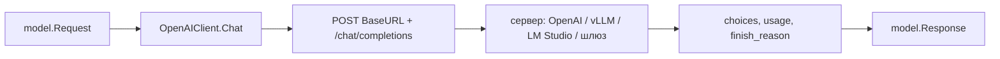

# OpenAI-совместимые провайдеры

Один адаптер закрывает всё, что говорит на OpenAI Chat Completions: сам OpenAI,
vLLM, LM Studio, Ollama в OpenAI-режиме, TEI-подобные шлюзы и корпоративные
прокси. Отличаются они только базовым URL, заголовками авторизации и тем, какие
поля они действительно поддерживают.

## Предпосылки

- У вас есть URL API-корня и имя модели.
- Для внешнего OpenAI — ключ (`sk-…`). Для локального сервера ключ обычно не нужен.
- Точные таблицы полей — в [справочнике провайдеров](../../reference/providers.md).

## Выбор конструктора

| Конструктор                       | Ключ                                 | Base URL                            |
| --------------------------------- | ------------------------------------ | ----------------------------------- |
| `model.OpenAI(apiKey, modelName)` | обязателен (может быть пустым)       | жёстко `https://api.openai.com/v1`  |
| `model.NewOpenAI(cfg)`            | `OpenAIConfig.APIKey` (необязателен) | `OpenAIConfig.BaseURL` (обязателен) |
| `model.VLLM(baseURL, modelName)`  | нет                                  | `baseURL` (обязателен)              |

`model.VLLM` — тонкая обёртка: `NewOpenAI(OpenAIConfig{BaseURL: baseURL, Model: modelName})`.

```go
// OpenAI
llm, err := model.OpenAI(os.Getenv("OPENAI_API_KEY"), "gpt-4o-mini")

// Свой OpenAI-совместимый шлюз
llm, err := model.NewOpenAI(model.OpenAIConfig{
	BaseURL: "https://gw.internal.example/v1",
	APIKey:  os.Getenv("GW_TOKEN"),
	Model:   "gpt-4o-mini",
})

// vLLM
llm, err := model.VLLM("http://vllm:8000/v1", "Qwen/Qwen3-8B")
```

`BaseURL` и `Model` обязательны: пустые дают `ErrInvalidConfig`. Ключ необязателен —
заголовок `Authorization` добавляется, только если `APIKey != ""`.

## Правило base URL

`BaseURL` — это **корень API**, к которому клиент дописывает `/chat/completions`.
Слэш в конце отбрасывается, путь — нет.

```text
BaseURL                              → отправляется на
https://api.openai.com/v1            → https://api.openai.com/v1/chat/completions   ✓
http://localhost:8000/v1             → http://localhost:8000/v1/chat/completions    ✓
http://localhost:8000/v1/            → http://localhost:8000/v1/chat/completions    ✓
http://localhost:8000                → http://localhost:8000/chat/completions       ✗ 404
http://localhost:8000/v1/v1          → http://localhost:8000/v1/v1/chat/completions ✗ 404
```



> [!WARNING]
> Не дописывайте `/chat/completions` в `BaseURL` — путь добавит клиент. И не
> опускайте `/v1`, если сервер его требует: получите `404`, а не понятную ошибку.

## Ключ против `Headers`

`OpenAIConfig.Headers` — это `map[string]string`, который примешивается к каждому
запросу. Порядок такой: сначала ставится `Authorization: Bearer <APIKey>`, затем
применяются `Headers`, поэтому **`Headers` перекрывают** `Authorization`.

Заголовок `api-key` вместо `Authorization` (стиль Azure и корпоративных прокси):

```go
llm, err := model.NewOpenAI(model.OpenAIConfig{
	BaseURL: "https://gw.internal.example/v1",
	Model:   "gpt-4o",
	Headers: map[string]string{"api-key": os.Getenv("GW_KEY")},
})
```

> [!WARNING]
> kit не добавляет query-параметры к URL: он лишь дописывает `/chat/completions`.
> «Чистый» Azure OpenAI требует `?api-version=…` в каждом запросе, поэтому
> напрямую он **не подключится**. Поставьте перед ним шлюз, который принимает
> OpenAI-совместимый путь и сам подставляет `api-version`, либо используйте прокси,
> добавляющий параметр.

Пользовательская авторизация и заголовки тенанта:

```go
llm, err := model.NewOpenAI(model.OpenAIConfig{
	BaseURL: "https://gw.internal.example/v1",
	Model:   "corp-model",
	Headers: map[string]string{
		"Authorization": "Bearer " + token, // перекрывает APIKey
		"X-Tenant":      "acme",
	},
})
```

> [!NOTE]
> `Model` в теле запроса берётся из `OpenAIConfig.Model`, а не из `Headers`. Меняйте
> конфиг на старте, а не заголовком на каждый вызов.

## Structured output: `response_format`

Когда `Request.JSONSchema` задан, а `SchemaMode` — `SchemaNative` (значение по
умолчанию), клиент добавляет:

```json
{
  "response_format": {
    "type": "json_schema",
    "json_schema": { "name": "output", "schema": { "…": "…" } }
  }
}
```

- Имя схемы **всегда** `output` — его задаёт адаптер.
- `SchemaInline` и `SchemaSystem` — вместо `response_format` схема-инструкция
  дописывается в последнее `user`- или в системное сообщение. Это нужно, когда
  сервер отвергает `response_format`.
- `model.SupportsNativeSchema(*model.OpenAIClient)` → `true`.

Что происходит, если сервер **не** поддерживает `json_schema`:

1. Клиент всё равно отправит `response_format` — на уровне клиента автоотката нет.
2. Сервер ответит `400`/`422`, либо молча проигнорирует поле (тогда ответ может не
   соответствовать схеме).
3. Если схему нельзя отправлять нативно, запросите инлайн явно:

```go
resp, err := llm.Chat(ctx, model.Request{
	Messages:    msgs,
	JSONSchema:  schema,
	SchemaMode:  model.SchemaInline, // схема уедет текстом в сообщение
})
```

Для `kit.Generate` то же самое делается полем `GenerateRequest.SchemaMode`:

```go
g, err := kit.Generate[Review](ctx, app, kit.GenerateRequest[Review]{
	Prompt:     "Проверь заявку",
	SchemaMode: model.SchemaInline, // для шлюзов без json_schema
})
```

Автоинлайн срабатывает только в одном направлении: если `SchemaMode == SchemaNative`,
а `model.SupportsNativeSchema` для клиента вернул `false`, ядро переключится на
`SchemaInline` само (D29). Для OpenAI-клиента `SupportsNativeSchema()` — `true`,
поэтому автоотката не будет: инлайн задаётся вручную.

## `tool_choice`

`Request.ToolChoice` передаётся по-разному в зависимости от значения:

| `ToolChoice`                     | Уходит в `tool_choice`                                        |
| -------------------------------- | ------------------------------------------------------------- |
| `""`                             | поле отсутствует                                              |
| `"auto"`, `"none"`, `"required"` | строка `"auto"` / `"none"` / `"required"`                     |
| любое другое значение            | объект `{"type":"function","function":{"name":"<значение>"}}` |

```go
resp, err := llm.Chat(ctx, model.Request{
	Messages:   []model.Message{{Role: model.RoleUser, Content: "Погода в Москве?"}},
	Tools:      []model.ToolSpec{{Name: "get_weather", Description: "Погода", Schema: params}},
	ToolChoice: "required", // сервер обязан вернуть вызов инструмента
})
```

## `seed` и `stop`

- `Seed *int` → `seed` (для воспроизводимости; поддержка на стороне модели не гарантирована).
- `Stop []string` → `stop`.

```go
seed := 42
resp, err := llm.Chat(ctx, model.Request{
	Messages: []model.Message{{Role: model.RoleUser, Content: "Придумай имя"}},
	Seed:     &seed,
	Stop:     []string{"\n\n"},
})
```

## `ProviderOptions` и защищённые ключи

`ProviderOptions map[string]any` вливается в тело запроса как есть — это escape
hatch для полей, которых нет в `model.Request`.

```go
resp, err := llm.Chat(ctx, model.Request{
	Messages: []model.Message{{Role: model.RoleUser, Content: "…"}},
	ProviderOptions: map[string]any{
		"top_p":                0.9,
		"presence_penalty":     0.2,
		"parallel_tool_calls":  false,
	},
})
```

Ключи `model`, `messages` и `stream` **защищены**: после слияния клиент
переустанавливает их из собственного тела. Переопределить их через
`ProviderOptions` нельзя; `stream` переключает только операция `ChatStream`.

## Troubleshooting

| Симптом                             | Причина                                              | Что делать                                             |
| ----------------------------------- | ---------------------------------------------------- | ------------------------------------------------------ |
| `404` на `/chat/completions`        | в `BaseURL` нет `/v1` или он удвоен (`/v1/v1`)       | приведите `BaseURL` к корню API, путь добавит клиент   |
| `401`/`403`                         | пустой или неверный ключ; для Azure нужен `api-key`  | задайте `APIKey` или `Headers`                         |
| «empty choices» (`ErrProvider`)     | сервер вернул `choices: []`                          | проверьте имя модели, фильтры контента, лимиты сервера |
| Ошибка декодирования ответа         | сервер вернул не-OpenAI JSON (например, HTML прокси) | проверьте `BaseURL` и промежуточный прокси             |
| Странный `FinishReason`             | провайдер вернул значение вне таблицы нормализации   | см. ниже                                               |
| Запрос висит/обрывается по таймауту | не задан `HTTPClient`, действует дефолт 60 c         | передайте свой `*http.Client` с нужным `Timeout`       |

Нормализация `finish_reason` (`model.ParseFinishReason`):

| Ответ провайдера                               | `model.FinishReason`  |
| ---------------------------------------------- | --------------------- |
| `stop`                                         | `FinishStop`          |
| `tool_calls`                                   | `FinishToolCalls`     |
| `length`                                       | `FinishLength`        |
| `content_filter`                               | `FinishContentFilter` |
| пусто / что-то другое (в т.ч. `function_call`) | `FinishOther`         |

### Таймауты и повторы

- Если `HTTPClient` не передан, клиент создаётся с таймаутом **60 секунд**
  (`internal/httpjson.DefaultTimeout`) и без повторов на уровне транспорта.
- Если вы передали свой `*http.Client`, действуют его `Timeout` и `Transport`.
- Повторы транспорта (`internal/httpjson.Config`/`NewClient`, `Retry-After`)
  включаются только для клиента, собранного этим конструктором; пакет внутренний,
  извне модуля его не импортировать. Поэтому **пользовательский механизм повторов —
  `model.Chain`**: он ретраит звено при retryable-ошибке и уважает `Retry-After`.
- Классифицировать ошибку самому помогут `model.Retryable(err)` и
  `model.RetryAfter(err)` — они экспортированы.

```go
base, err := model.NewOpenAI(model.OpenAIConfig{
	BaseURL:    "https://gw.internal.example/v1",
	Model:      "corp-model",
	HTTPClient: &http.Client{Timeout: 3 * time.Minute}, // долгие генерации
})
```

## Чего фреймворк не делает

- Не нормализует различия серверов: если шлюз не понимает `response_format`,
  `tools` или `seed`, ошибка/игнор вернётся как есть.
- Не подставляет `/v1` за вас и не «угадывает» корень API.
- Стриминг — отдельной операцией `ChatStream` (SSE); включить `stream` через
  `ProviderOptions` всё равно нельзя.
- Не проверяет имя модели и не ротирует ключи.

## Смотрите также

- [vLLM](./vllm.md) — серверная сторона OpenAI-совместимого endpoint
- [Ollama](./ollama.md) — если модель поднята через Ollama
- [Провайдеры: обзор](./overview.md) — матрица возможностей и `kit.Config`
- [Провайдеры (справочник)](../../reference/providers.md) — `OpenAIConfig` и таблицы
- [Ошибки](../../reference/errors.md) — `ErrProvider`, `ErrInvalidConfig`
