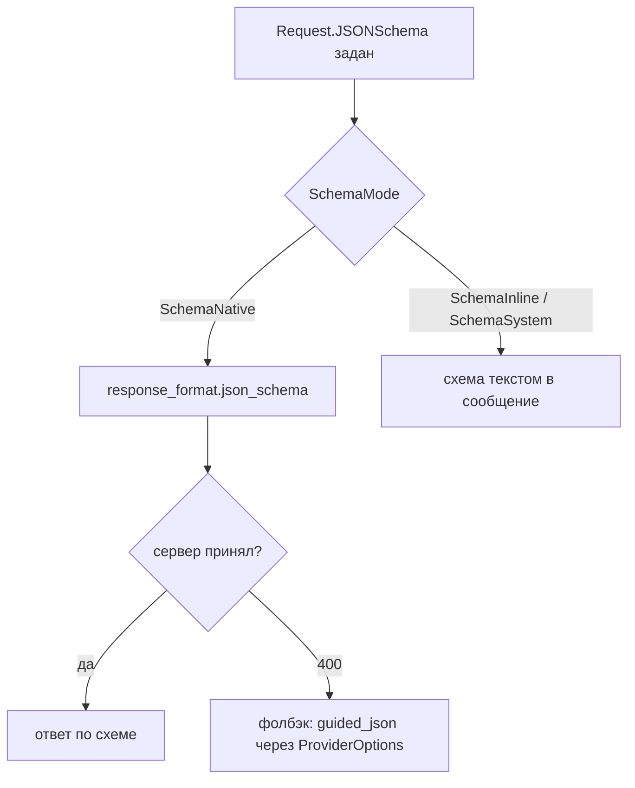

# vLLM

vLLM поднимает OpenAI-совместимый endpoint поверх вашей модели. Со стороны kit это
тот же клиент, что и OpenAI (`*model.OpenAIClient`), но без API-ключа и с вашим
базовым URL. Основная работа — на стороне сервера: включить tool calling и guided
decoding флагами запуска.

## Предпосылки

- vLLM запущен и слушает, например, `http://vllm:8000`.
- В `BaseURL` включён `/v1`: `http://vllm:8000/v1`.
- Имя модели (`Model`) совпадает с тем, под которым сервер её отдаёт (см.
  troubleshooting).

Точные флаги и поведение зависят от версии vLLM — **проверьте в вашей версии** по
её документации. Ниже — типичная картина, а не гарантия.

## Быстрый старт

```go
llm, err := model.VLLM("http://vllm:8000/v1", "Qwen/Qwen3-8B")
if err != nil {
	return err
}
app, err := kit.New(ctx, kit.Config{ES: es, LLM: llm, Policy: policy})
```

`model.VLLM(baseURL, modelName)` = `NewOpenAI(OpenAIConfig{BaseURL: baseURL, Model: modelName})`.
Оба аргумента обязательны: пустой `BaseURL` даёт `ErrInvalidConfig`. Если ваш vLLM
защищён прокси с авторизацией, используйте общий конструктор:

```go
llm, err := model.NewOpenAI(model.OpenAIConfig{
	BaseURL: "https://vllm-gw.internal/v1",
	APIKey:  os.Getenv("VLLM_GATEWAY_TOKEN"),
	Model:   "Qwen/Qwen3-8B",
})
```

## Что отправляет фреймворк

Для каждого `Chat` клиент делает `POST <BaseURL>/chat/completions` и кладёт:

- `messages`, `model`, `temperature`, `max_tokens`, `seed`, `stop`;
- `tools` (`[{type:function, function:{name, description, parameters}}]`) и
  `tool_choice`, если инструменты переданы и `ToolChoice != ""`;
- `response_format: {type:json_schema, json_schema:{name:"output", schema:…}}`, если
  задана JSON Schema и режим нативный;
- `stream: false` (обычный `Chat`); `ChatStream` запрашивает `stream: true` с
  `stream_options.include_usage` и собирает SSE-дельты.

Именно этот набор должен принимать ваш сервер. Всё остальное — вопрос флагов vLLM.

## Tool calling на стороне сервера

Чтобы модель могла возвращать `tool_calls`, а не текст, vLLM нужно запустить с
включённым авто-tool-choice и парсером под конкретное семейство моделей. Типичный
запуск выглядит так (флаги и их имена **проверьте в вашей версии vLLM**):

```sh
vllm serve Qwen/Qwen3-8B \
  --served-model-name Qwen/Qwen3-8B \
  --max-model-len 32768 \
  --enable-auto-tool-choice \
  --tool-call-parser hermes
```

- `--enable-auto-tool-choice` — разрешает серверу решать, вызывать инструмент или
  отвечать.
- `--tool-call-parser <имя>` — парсер формата tool-вызова конкретной модели
  (например, `hermes`, `mistral`, `llama3_json`). Неверный парсер — типичная причина
  «tool calls приходят текстом».
- `--served-model-name` — имя, под которым модель регистрируется; его же нужно
  передать в `model.VLLM(..., <имя>)`.

> [!WARNING]
> Без `--enable-auto-tool-choice` сервер может отвергнуть запрос с `tools`/`tool_choice`
> (`400`) или проигнорировать их. Без подходящего `--tool-call-parser` вызов приедет
> обычным текстом в `content`, и kit честно вернёт его как текст — это не ошибка
> фреймворка, а отсутствие парсера.

## Guided decoding против `response_format`

kit по умолчанию просит structured output через `response_format.json_schema` — это
стандартный OpenAI-путь, который поддерживают свежие сборки vLLM.

- Свежие сборки: `response_format` работает (`--guided-decoding-backend` может
  выбирать движок).
- Старые сборки: `response_format` с JSON Schema может давать `400`. Фолбэк —
  guided decoding через поле `guided_json`, которое кладётся в тело запроса через
  `ProviderOptions`.



Фолбэк старого стиля:

```go
schema := json.RawMessage(`{"type":"object","properties":{"city":{"type":"string"}},"required":["city"]}`)

resp, err := llm.Chat(ctx, model.Request{
	Messages:   []model.Message{{Role: model.RoleUser, Content: "Разбери адрес"}},
	JSONSchema: schema,
	SchemaMode: model.SchemaInline, // не шлём response_format
	ProviderOptions: map[string]any{
		"guided_json": schema, // guided decoding в старых сборках vLLM
	},
})
```

> [!NOTE]
> `ProviderOptions` примешивается на верхнем уровне тела запроса, поэтому
> `guided_json` окажется ровно там, где его ждёт vLLM. Ключи `model`, `messages` и
> `stream` защищены и не переопределяются.

## Длина контекста и окно guard

- `--max-model-len` задаёт максимум токенов модели. `MaxTokens` в `model.Request`
  уходит как `max_tokens` и должен оставлять место для промпта в этом лимите.
- Окно guard — отдельная величина: `GuardMaxChars` (по умолчанию `8000` **рун**).
  Инвариант I-06 требует, чтобы окно guard не было шире окна модели, но встроенный
  OpenAI-клиент `model.ContextWindow` не реализует, поэтому `kit.New` это **не
  проверяет**. Согласуйте значения вручную или оберните клиент:

```go
type vllmWindow struct {
	model.Client
	tokens int
}

func (w vllmWindow) ContextTokens() int { return w.tokens }

base, _ := model.VLLM("http://vllm:8000/v1", "Qwen/Qwen3-8B")
llm := vllmWindow{Client: base, tokens: 32768} // == --max-model-len
```

## Конкурентность и лимиты

Лимиты живут в ядре и не зависят от провайдера, но при self-hosting они — ваш
главный рычаг против «поехавшей» нагрузки:

| Лимит (`kit.Config`) | По умолчанию | Что делает                                  |
| -------------------- | ------------ | ------------------------------------------- |
| `MaxSteps`           | `8`          | шагов цикла «модель → инструмент → модель»  |
| `MaxCallsPerTool`    | `3`          | максимум вызовов одного инструмента за ход  |
| `ToolTimeout`        | `30s`        | таймаут исполнения инструмента              |
| `MaxTotalTokens`     | `0` (нет)    | бюджет хода; превышение → `ErrBudget`       |
| `Embedder`/`TopK`    | —            | размер выдачи поиска (если подключаете RAG) |

```go
app, err := kit.New(ctx, kit.Config{
	ES:              es,
	LLM:             llm,
	Policy:          policy,
	MaxSteps:        6,
	MaxCallsPerTool: 2,
	ToolTimeout:     20 * time.Second,
	MaxTotalTokens:  20000,
})
```

## Troubleshooting

| Симптом                                               | Причина                                                    | Что делать                                                             |
| ----------------------------------------------------- | ---------------------------------------------------------- | ---------------------------------------------------------------------- |
| `400` на `response_format`                            | сборка vLLM без поддержки `json_schema`                    | `SchemaMode: model.SchemaInline` или `guided_json` в `ProviderOptions` |
| Вызов инструмента приходит текстом, `tool_calls` пуст | не задан `--tool-call-parser` или парсер не тот            | перезапустите сервер с подходящим `--tool-call-parser`                 |
| `400`, жалоба на auto tool choice                     | нет `--enable-auto-tool-choice`                            | добавьте флаг                                                          |
| `model not found` / `404`                             | `Model` не совпадает с `--served-model-name`/путём запуска | передайте точное имя, под которым поднят сервер                        |
| Запрос обрывается по таймауту                         | длинная генерация, дефолтный `HTTPClient` 60 c             | свой `*http.Client` с большим `Timeout`, либо сократите `MaxTokens`    |
| `422`/пустой ответ при большой схеме                  | сервер ограничивает сложность guided decoding              | упростите схему, используйте `SchemaInline`                            |
| Ошибка `context length`                               | промпт + `max_tokens` больше `--max-model-len`             | уменьшите `MaxTokens` или увеличьте лимит модели                       |

## Чего фреймворк не делает

- Не запускает и не конфигурирует vLLM: флаги, парсеры и `--max-model-len` — ваша
  зона ответственности.
- Не переключается между `response_format` и `guided_json` автоматически: фолбэк
  выбираете вы.
- Не подбирает `--tool-call-parser` под модель.
- Не стримит и не реализует серверный батчинг.

## Смотрите также

- [OpenAI-совместимые](./openai-compatible.md) — общий клиент, base URL, `Headers`
- [Провайдеры: обзор](./overview.md) — матрица возможностей и `model.Chain`
- [Провайдеры (справочник)](../../reference/providers.md) — `OpenAIConfig`
- [Конфигурация](../../reference/configuration.md) — лимиты `chat.*`, `tools.*`
- [Guardrails](../../concepts/guardrails.md) — окно guard и I-06
