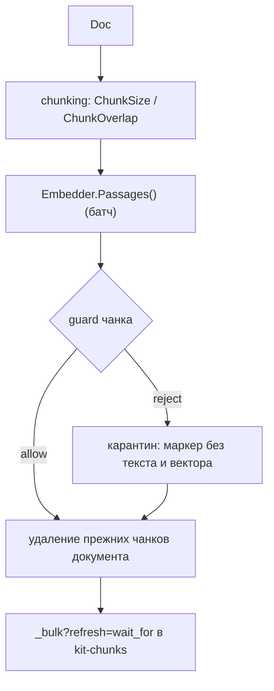
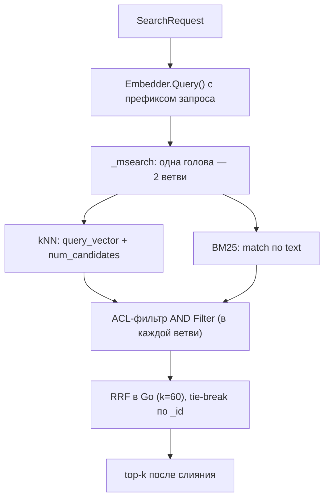

# Как индексировать и искать

`App.Ingest` превращает документ в чанки, считает эмбеддинги, проверяет каждый
чанк guard'ом и пишет в Elasticsearch. `App.Search` ищет гибридно — kNN и BM25 —
и возвращает только то, что разрешено принципалу.

Это how-to: шаги записи и чтения, ACL, язык фильтров, тюнинг и разбор «нулевых
хитов». Замысел — [Поиск](../concepts/retrieval.md); схема индекса — [Индексы
Elasticsearch](../reference/elasticsearch.md).

## Когда использовать

- Ответ нужен по вашим документам, а не по данным модели.
- Доступ к документам различается по ролям и тенанту.
- Нужен контроль над разбиением текста и над политикой обновления индекса.

## Быстрый старт

```go
ctx = kit.WithPrincipal(ctx, kit.Principal{
	UserID: "u-1", Roles: []string{"support"}, Tenant: "acme",
})

if err := app.Ingest(ctx, kit.Doc{
	ID:     "faq-1",
	Text:   "Возврат оформляется в течение 14 дней.",
	ACL:    []string{"support"},
	Source: "faq",
}); err != nil {
	return err
}

hits, err := app.Search(ctx, kit.SearchRequest{Query: "возврат", TopK: 5})
```

`Ingest`, `Search` и `Delete` требуют непустого `Tenant` в принципале: пустой
тенант вернул бы `ErrUnauthorized`. `Ingest` и `Search` требуют `Embedder` в
`Config`, иначе — `ErrInvalidConfig`.

## Путь записи



1. **Чанкование.** `chunk.Chunker.Split` режет текст на перекрывающиеся окна:
   `ChunkSize` токенов (по умолчанию `chunk.DefaultSize` = 400) с перекрытием
   `ChunkOverlap` (по умолчанию 80). Токенайзер берётся из `Config.Tokenizer`.
   Если текст не даёт ни одного токена, `Ingest` возвращает `nil`, **ничего не
   записав** (важно: прежние чанки при этом не удаляются — см. «Подводные
   камни»).
2. **Эмбеддинги.** Все чанки уходят одним батчем в `Embedder.Passages()`; число
   векторов обязано совпасть с числом чанков, иначе `ErrProvider`.
3. **Guard каждого чанка.** Каждый чанк прогоняется через `call.Guard` на рельсе
   `RailInput` (имя observation `guard:chunk`). Отклонённый чанк становится
   **карантинным**: записывается маркером `quarantined: true` **без текста и без
   вектора**. Карантин виден в индексе, но не участвует в поиске.
4. **Удаление прежних чанков.** Перед записью `Ingest` удаляет все чанки этого
   `doc_id` в тенанте принципала (`_delete_by_query` с `refresh=true`), поэтому
   повторный ingest не оставляет «хвостов» от более длинной старой версии.
   Ответ проверяется через `store.ParseDeleteByQuery`.
5. **Запись.** Чанки пишутся одним `_bulk` с `refresh=wait_for`: запись видна
   поиску сразу после возврата `Ingest`. Это read-your-writes, и у него есть
   цена по пропускной способности (см. «Тюнинг»).

> [!WARNING]
> **Токенайзер по умолчанию — `chunk.WhitespaceTokenizer`** (разбиение по
> пробелам), а не «настоящий» BPE-токенайзер. `ChunkSize` при этом — число
> «слов», а не токенов модели. Для точных окон по токенам свяжите свой
> `chunk.Tokenizer` (интерфейс `Tokens(text) []chunk.Token`) в `Config.Tokenizer`.

Размерность векторов — контракт: `store.ValidateChunk(c, dims)` требует, чтобы у
обычного чанка был вектор ровно `dims` длины (`Embedder.Dim()`), а у карантинного
не было ни текста, ни вектора. Это гейт на запись.

## Путь чтения



1. **Эмбеддинг запроса.** `Embedder.Query(ctx, []string{req.Query})` — с
   обязательным префиксом запроса (у e5: `query: `). `Query` и `Passages`
   разделены, чтобы префиксы нельзя было забыть.
2. **Один `_msearch`.** Формируется NDJSON из двух запросов — kNN и BM25 — с
   общим ACL-фильтром, AND-нутым с пользовательским `SearchRequest.Filter`.
   `_source` каждой ветви — только `doc_id`, `text`, `position`.
3. **Клампы.** `TopK` ≤ `store.MaxTopK` (1000); `num_candidates` по умолчанию
   `TopK * 10`, но не меньше 100 и не больше `store.MaxNumCandidates` (10000).
4. **RRF в Go.** Слияние считается на стороне kit (`store.RRF`, `k=60`), а не на
   сервере: так работает basic-лицензия без server-side RRF. Tie-break —
   детерминированный, по `_id`. `top-k` применяется **после** слияния.
5. **Строгий разбор.** `store.ParseMSearch` падает громко: ошибка в любой ветви
   `_msearch` или `_shards.failed > 0` — это ошибка всего вызова
   (`ErrProvider`). Молча вернуть половину результатов framework не станет.

`SearchHit.Score` — это RRF-скор слияния, а не исходный BM25-скор.

## ACL: как считается и как фильтруется

| Где               | Что происходит                                                           |
| ----------------- | ------------------------------------------------------------------------ |
| Запись (`Ingest`) | `tenant` принципала и `Doc.ACL` (роли) пишутся в **каждый** чанк         |
| Чтение (`Search`) | фильтр = `term tenant` + `terms acl: [роли]` + `term quarantined: false` |
| Deny-by-default   | нет совпадения ACL — чанк не возвращается                                |
| Пустые роли       | `terms: {"acl": []}` не совпадает ни с одним документом                  |

ACL — не RBAC:

- RBAC (`"*"` в `policy.yaml`) — про **права на операции**; ACL — про **права на
  документы**.
- В ACL роли совпадают **буквально**: `"*"` — это роль со звёздочкой в списке
  `Doc.ACL`, а **не** wildcard. Хотите «видно всем» — перечислите роли явно.
- Фильтр всегда добавляется и к kNN, и к BM25; обойти его параметром `Filter`
  нельзя (пользовательский фильтр только сужает).

## Язык фильтров метаданных

`SearchRequest.Filter` (`store.Filter`) компилируется в ES-query и AND-ится с
ACL. Доступные поля и операторы:

| Поля                                                        | Операторы                                                                                   |
| ----------------------------------------------------------- | ------------------------------------------------------------------------------------------- |
| `doc_id`, `source`, `position`, `created_at`, `quarantined` | `$eq`, `$ne`, `$gt`, `$gte`, `$lt`, `$lte`, `$in`, `$nin`, `$exists`, `$and`, `$or`, `$not` |

Правила:

- голое значение — это `$eq` (`"source": "faq"`);
- неизвестное поле или оператор — `ErrInvalidArgs`;
- логические операторы **нельзя** вкладывать в поле (`"source": {"$and": …}` —
  ошибка); они живут на верхнем уровне;
- `$not` требует непустой фильтр;
- пустой `Filter` не добавляет клаузу.

Рецепты:

```go
// По источнику
Filter: store.Filter{"source": "faq"}

// По диапазону дат
Filter: store.Filter{"created_at": map[string]any{"$gte": "2025-01-01T00:00:00Z"}}

// По окну позиций внутри документа
Filter: store.Filter{
	"doc_id":   "faq-1",
	"position": map[string]any{"$gte": 2, "$lt": 10},
}

// Вложенно: (source == faq ИЛИ source == kb) И создано после даты
Filter: store.Filter{
	"$and": []store.Filter{
		{"$or": []store.Filter{{"source": "faq"}, {"source": "kb"}}},
		{"created_at": map[string]any{"$gt": "2025-06-01T00:00:00Z"}},
	},
}

// Список источников и явное исключение карантина (он и так исключён ACL)
Filter: store.Filter{
	"source":      map[string]any{"$in": []any{"faq", "kb", "policy"}},
	"quarantined": false,
}

// $not: всё, что НЕ из источника spam
Filter: store.Filter{
	"$not": store.Filter{"source": "spam"},
}
```

Поле `quarantined` доступно в фильтре, но ACL уже требует `quarantined: false`,
поэтому «показать карантин» через фильтр нельзя — фильтр может только сузить.

## Индекс: создаётся автоматически

`App.Setup(ctx)` вызывает `store.EnsureSchema(ctx, es, dims)`, где `dims` —
`Embedder.Dim()`. Что создаётся:

- ILM-политика `kit-traces-30d`, шаблоны data streams `kit-traces` и
  `kit-observations`;
- индекс `kit-chunks` — **только если** `dims > 0` (то есть задан `Embedder`).

Маппинг `kit-chunks`: `doc_id`/`tenant`/`acl`/`source` — `keyword`, `text` —
`text`, `vector` — `dense_vector` с `dims` из эмбеддера, `similarity: cosine`,
`position` — `integer`, `created_at` — `date`, `quarantined` — `boolean`.

> [!WARNING]
> Размерность `dense_vector` берётся из эмбеддера **на момент `Setup`**. Смена
> эмбеддера меняет размерность, а существующий индекс её не подстроит: нужен
> **переиндексация** (новый индекс или пересоздание и повторный `Ingest` всех
> документов).

**Версия и лицензия ES.** Нужна Elasticsearch **≥ 8.14**, basic-лицензия. RRF
считается в Go именно поэтому: server-side RRF в basic нет.

## `Delete`, `Prune`, `Score`

- `App.Delete(ctx, docID)` — право `delete`, удаляет по `doc_id` + tenant
  принципала (`_delete_by_query`, `refresh=true`, идемпотентно). Ответ
  проверяется: `failures`/`version_conflicts` в теле — ошибка
  (`store.ParseDeleteByQuery`).
- `App.Prune(ctx, olderThan)` — право `prune`, **без требования тенанта**
  (тенант не нужен: это глобальное действие по времени, как ILM). Удаляет trace
  и observation старше срока по `@timestamp` (`refresh=false`), возвращает число
  удалённых документов.

  ```go
  deleted, err := app.Prune(ctx, 30*24*time.Hour)
  ```

- `App.Score(ctx, trace.Score)` — право `trace`, пишет оценку трейса в
  `kit-traces`. Тенант не нужен.

> [!NOTE]
> `PruneBody` при `olderThan < 0` трактует срок как `0`, то есть удаляет
> **всё** до «сейчас». Не передавайте отрицательный срок случайно.

## Инструмент поиска

```go
if _, err := kit.RetrievalTool(app, "search_knowledge"); err != nil {
	return err
}
```

`kit.RetrievalTool` даёт модели агентность: она сама решает, что искать.
`In = {query, top_k}`, `Out = {hits: [{doc_id, text, position}]}`. Внутри
вызывается тот же `Search`, поэтому право `search` и ACL-фильтр применяются
повторно (плюс право `tool:search_knowledge`). Имя по умолчанию —
`kit.DefaultRetrievalToolName`. Без `Embedder` регистрация возвращает
`ErrInvalidConfig`.

## Тюнинг

| Что                          | Как влияет                                                                                                                                                   |
| ---------------------------- | ------------------------------------------------------------------------------------------------------------------------------------------------------------ |
| `ChunkSize` / `ChunkOverlap` | Крупнее чанк — меньше «разорванных» мыслей, но грубее гранулярность и больше текста на хит. overlap спасает границы; `overlap >= size` — `ErrInvalidConfig`. |
| `TopK`                       | `top-k` применяется **после** RRF: увеличение сглаживает усечение, но расширяет контекст. Кламп 1000.                                                        |
| `num_candidates`             | Больше — точнее kNN, дороже. Дефолт `TopK * 10` (min 100, max 10000).                                                                                        |
| `refresh`                    | `wait_for` на `_bulk` даёт read-your-writes; для массовой загрузки это дорого. Загружайте пачками и ждите один раз в конце, а не после каждого документа.    |
| `store.ValidateChunk`        | Гейт размерности; вызывается при записи. Несовпадение dims — ошибка, а не тихая порча индекса.                                                               |

## Подводные камни и диагностика

| Симптом                                        | Причина                                                                        | Что проверить                                                                      |
| ---------------------------------------------- | ------------------------------------------------------------------------------ | ---------------------------------------------------------------------------------- |
| Нулевые хиты после успешного `Ingest`          | ACL не совпал; чанки в карантине; пустые роли; разная размерность; нет индекса | `tenant`/`Roles` принципала, `Doc.ACL`, наблюдения `guard:chunk`, `Embedder.Dim()` |
| Чанки есть в индексе, но не находятся          | Они карантинные (`quarantined: true`)                                          | Поиск всегда фильтрует `quarantined: false`                                        |
| 400 от ES на тело kNN                          | Размерность `query_vector` не совпадает с `dims` индекса                       | `Embedder.Dim()` и маппинг индекса                                                 |
| «Старые хвосты» после укорочения документа     | Повторный `Ingest` короче прежнего, либо пустой текст                          | `Ingest` удаляет прежние чанки, но при **нуле чанков** выходит раньше              |
| Плохое качество поиска на не-английском тексте | Поле `text` — обычный `text`, без языкового анализатора                        | Это забота вашего ES: задайте анализатор в маппинге на своей стороне               |
| `ErrProvider` из `Search`                      | Ошибка одной из ветвей `_msearch` или `_shards.failed > 0`                     | Ответ ES; `ParseMSearch` не глотает частичные сбои                                 |

> [!WARNING]
> **Индексация пустого текста не удаляет прежние чанки.** Если `Split` не дал ни
> одного токена, `Ingest` возвращает `nil` до шага удаления. Чтобы «стереть»
> документ, используйте `App.Delete`, а не `Ingest` с пустым текстом.

> [!NOTE]
> Языковой анализатор — **не** часть kit. Маппинг использует простое поле `text`;
> если нужен `russian`/`english`-анализатор, настройте его в ES на своей стороне
> (шаблон индекса), иначе BM25 будет токенизировать по умолчанию.

## Чего фреймворк не делает (ограничения)

- **Нет клиента Elasticsearch** — вы приносите реализацию `store.ES`; kit не
  выводит `Content-Type`/`refresh` из пути (I-12).
- **Токенайзер по умолчанию — whitespace,** а не токенайзер модели. Точные
  оконные размеры требуют своего `chunk.Tokenizer`.
- **RRF считается в Go,** потому что server-side RRF требует лицензии выше
  basic. RRF-скор — не сопоставим с BM25/kNN-скорингами напрямую.
- **Нет ре-ранкера и нет модельного ре-скоринга** — после RRF идёт только
  top-k.
- **Нет языковых анализаторов** в маппинге (см. выше).
- **Нет автоматической реиндексации** при смене эмбеддера или guard-модели:
  `dims` и вердикты карантина фиксируются в момент записи.
- **Нет частичной отдачи kNN/BM25:** любая ошибка ветви или шарда — ошибка
  всего поиска.
- **Карантин нельзя «прочитать»** через поиск: ACL жёстко фильтрует
  `quarantined: false`.
- **Один индекс чанков** (`kit-chunks`); разделения по тенантам на уровне индекса
  нет — изоляция только через ACL-фильтр.

## Дальше

| Цель                                  | Куда идти                                              |
| ------------------------------------- | ------------------------------------------------------ |
| Прочитать про карантин и рельсы       | [Настройка guardrails](./guardrails.md)                |
| Дать модели инструмент поиска         | [Вызов инструментов](./tool-calling.md)                |
| Схема индекса и тело `_msearch`       | [Индексы Elasticsearch](../reference/elasticsearch.md) |
| Смотреть хиты и латентность в трейсах | [Наблюдаемость](./observability.md)                    |

## Смотрите также

- [Поиск](../concepts/retrieval.md) — замысел ingest/search и эмбеддеры
- [Elasticsearch](../reference/elasticsearch.md) — `store.Request`, маппинг индексов, `_msearch`
- [Доступ](../concepts/access-control.md) — RBAC против ACL
- [Бизнес-правила](../internals/business-rules.md) — `BR-10`…`BR-14`, `BR-34`…`BR-39`, `BR-49`
