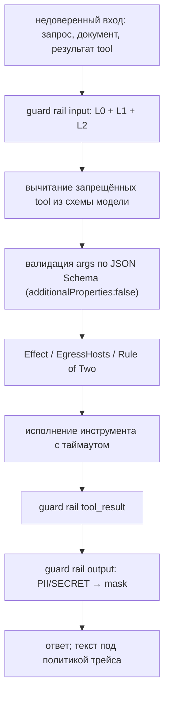

# Безопасность: как закрыть деплой

Этот гид — про эксплуатацию безопасности `kit`: откуда берётся принципал, что
проверяет RBAC и ACL, как читать эгресс-контроли и что остаётся за пределами
фреймворка. «Почему так» — [Доступ](../concepts/access-control.md),
[Guardrails](../concepts/guardrails.md), [Инструменты](../concepts/tools.md); здесь
— решения, чек-лист и честные пределы.

## Модель доверия: кто делает AuthN

**AuthN — ваш.** `kit` не выдаёт токены, не проверяет подписи и не ходит в ваш
IdP. Он получает уже готовый `kit.Principal` из контекста:

```go
type Principal struct {
	UserID string
	Roles  []string
	Tenant string
}
```

```go
// AuthN делает ваш слой: проверьте токен и положите принципала в контекст.
ctx = kit.WithPrincipal(ctx, kit.Principal{
	UserID: "u-1",
	Roles:  []string{"user"},
	Tenant: "acme",
})
```

| Источник                                                                 | Что доверяем                                     |
| ------------------------------------------------------------------------ | ------------------------------------------------ |
| gateway (`X-User-ID`, `X-Roles`, `X-Tenant`)                             | только трафик из сети gateway (сетевая политика) |
| ваш сервис (bearer-токен, как в `demo`)                                  | подпись токена проверяет ваш сервис              |
| тело запроса, история сообщений, документы, результат tool, ответ модели | **не доверяем ничего**                           |

> [!WARNING]
> `Tenant` — доверенный вход. Если вы берёте его из тела запроса, а не из
> аутентифицированной личности, ACL перестаёт защищать: поиск фильтрует
> `tenant == principal.Tenant` **и** `acl ⊇ {роли}`, поэтому подмена тенанта с
> подходящей ролью открывает чужие документы. Берите `Tenant` только из вашего
> AuthN-слоя.

Последствия ошибки в принципале:

| Ошибка                               | Что ломается                                                            |
| ------------------------------------ | ----------------------------------------------------------------------- |
| принципала нет / он пуст             | любая операция → `ErrUnauthorized` (`Principal.IsZero()`)               |
| `Tenant` пуст у ingest/search/delete | `ErrUnauthorized` (`Principal.Validate()`), запись/поиск не расширяется |
| `Roles` от клиента                   | RBAC и ACL становятся управляемыми извне                                |
| `Tenant` от клиента                  | ACL-граница сдвигается: см. предупреждение выше                         |

## RBAC: `policy.yaml` и право на каждую операцию

Политика — RBAC с deny-by-default; разбор строгий (`KnownFields(true)`), неверный
файл — `ErrInvalidConfig` при `kit.New`, сервис не поднимается.

```yaml
version: 1
default: deny
roles:
  user:
    permissions:
      - chat
      - tool:get_weather
  admin:
    permissions:
      - "*"
```

| Право         | Константа              | Проверяется                           |
| ------------- | ---------------------- | ------------------------------------- |
| `chat`        | `authz.PermChat`       | `App.Chat` (модель и цикл)            |
| `memory`      | `authz.PermMemory`     | операции памяти и `Chat` с `ThreadID` |
| `search`      | `authz.PermSearch`     | `App.Search` (эмбеддер и `_msearch`)  |
| `ingest`      | `authz.PermIngest`     | `App.Ingest` (эмбеддер и запись)      |
| `delete`      | `authz.PermDelete`     | `App.Delete`                          |
| `trace`       | `authz.PermTrace`      | `App.Score`                           |
| `generate`    | `authz.PermGenerate`   | `Generate[T]`                         |
| `prune`       | `authz.PermPrune`      | `App.Prune`                           |
| `tool:<name>` | `authz.ToolPermission` | исполнение и вычитание tool-схемы     |
| `*`           | wildcard               | разрешает любое право                 |

`Authz.Authorize` вызывает **сам примитив** `internal/call` на **каждом** вызове
(`authz → guard → span → fn`). Отсюда главное свойство: **отсутствие права — это
отказ, а не тихий пропуск**. Нет отдельной ветки «если политика не настроена, то
всё можно»: нет права — `ErrUnauthorized`.

Нюансы, которые важно знать при отладке:

- Права ролей объединяются: достаточно совпадения в любой роли принципала.
- Пустое право (`""`) проверку пропускает — так устроен вызов модели в `Chat`
  (у него права нет, принципал всё равно обязателен).
- `Ingest`/`Search`/`Delete` требуют непустого `Tenant`; `Prune` — только
  принципала и права `prune`.
- `Chat` требует права `chat`; гейт на инструменты проверяется дополнительно.

Проверить файл без запуска сервиса:

```sh
kitctl policy check ./policy.yaml
```

## ACL документов

ACL задаёт вызывающий в `kit.Doc.ACL` при `Ingest` — это список ролей, которым
документ разрешён. Значение считается **при записи** и хранится в каждом чанке.
Поиск всегда добавляет ACL-фильтр принципала в kNN и BM25:

```json
{
  "bool": {
    "filter": [
      { "term": { "tenant": "acme" } },
      { "terms": { "acl": ["support"] } },
      { "term": { "quarantined": false } }
    ]
  }
}
```

| Факт                         | Следствие                                                                                       |
| ---------------------------- | ----------------------------------------------------------------------------------------------- |
| `"*"` — **не** ACL-wildcard  | совпадение буквальное (`terms`); чтобы «всем», перечислите роли                                 |
| Пустой `Roles`               | `{"terms":{"acl":[]}}` не совпадает ни с чем — deny-by-default                                  |
| `Tenant` обязателен          | без него `ACLFilter` возвращает ошибку                                                          |
| Модель ACL = роли + `tenant` | ABAC, владельцев и иерархии ролей нет (`BR-14`)                                                 |
| Карантин                     | отклонённый guard чанк хранится без текста и вектора, поиск его не вернёт (`quarantined:false`) |

## Авторизация инструментов: защита в глубину

Инструмент, зарегистрированный через `kit.Tool`, по умолчанию требует право
`tool:<имя>` (переопределяется `kit.Perm`). Проверка идёт **дважды**:

1. **Вычитание из схемы.** `allowedToolSpecs` оставляет модели только разрешённые
   инструменты. Запрещённый инструмент в схеме не появляется — модель о нём не
   знает и запросить не может.
2. **Повторная проверка при исполнении.** `execTool` снова зовёт
   `policy.Authorize` — решение принимает рантайм, а не модель.

> [!WARNING]
> Отказ по праву инструмента **прерывает ход**, а не превращается в результат
> `{"error": …}`. Модель не получит «тебе нельзя», ход завершится с
> `ErrUnauthorized`. Не рассчитывайте, что модель «увидит отказ и передумает».

Не путайте с неизвестным инструментом: если модель запросила имя, которого нет,
это **результат-ошибка** для модели, а не фатальный отказ. Также результатами
становятся превышение `max_calls`, слишком большие args (лимит `ArgsMaxBytes`) и
первый невалидный набор args (`BR-23`); второй невалидный args по тому же
инструменту за ход — фатален.

## Эгресс, `Effect` и SSRF в `webfetch`

Эгресс — свойство инструмента, а не модели (`I-10`, `BR-51`):

```go
kit.Tool(app, "get_weather", getWeather,
	kit.Desc("Return the weather by city."),
	kit.Effects(kit.EffectEgress),   // помечает инструмент как отправляющий данные наружу
	kit.EgressHosts("wttr.in"),      // host-allowlist по аргументам
)
```

| Контроль              | Что делает                                                                             |
| --------------------- | -------------------------------------------------------------------------------------- |
| `Effect`              | `Read` / `Write` / `Egress`; рантайм применяет правила, не спрашивая модель            |
| `EgressHosts(hosts…)` | извлекает хосты URL из аргументов (`urlHosts`) и сверяет с allowlist по границе домена |
| `EgressAny()`         | явный opt-in «любой хост»; пустой allowlist без него — отказ                           |
| `Egress.RuleOfTwo`    | запрещает эгресс в ходе, где уже был недоверенный ввод (`untrusted`)                   |
| Отказ                 | `ErrUnauthorized`, **фатально для хода**                                               |

Совпадение хоста — по границе домена: `a==host` или `host` оканчивается на
`.a`. Глобы и `"*"` **не** работают как wildcard.

> [!NOTE]
> Egress-инструмент обязан объявить политику хостов: `EgressHosts(...)` или
> явный `EgressAny()`. Пустой allowlist **без** `EgressAny()` — отказ
> (`ErrUnauthorized`, fail-closed), поэтому «забыть» про хосты нельзя.

### SSRF-позиция `webfetch`

`webfetch.New(app, name, cfg)` регистрирует инструмент как `EffectEgress` +
`EgressHosts(cfg.AllowHosts…)` (при пустом `AllowHosts` — явный `EgressAny()`),
поэтому рантаймовые правила применимы и к нему.
Сам фетч дополнительно закрыт на уровне транспорта:

| Контроль             | Где                                                                                                        | Что закрывает                             |
| -------------------- | ---------------------------------------------------------------------------------------------------------- | ----------------------------------------- |
| Схемы `http`/`https` | `validateURL` и `CheckRedirect`                                                                            | `file://`, `gopher://`, `ftp://` и прочее |
| Резолв и проверка IP | `safeDialContext` (внутри dialer'а)                                                                        | редиректы и DNS-rebinding                 |
| Блокировка адресов   | loopback, RFC 1918, link-local, unspecified, multicast, CGNAT `100.64.0.0/10`, ULA `fc00::/7`, IPv4-mapped | SSRF в облако и внутреннюю сеть           |
| Потолок редиректов   | `Config.MaxRedirects` (по умолчанию 5)                                                                     | цепочки редиректов                        |
| Потолок тела         | `Config.MaxBytes` (по умолчанию 1 MiB), `Out.Truncated`                                                    | выкачивание гигабайтов                    |
| Прокси выключен      | `Transport.Proxy = nil`                                                                                    | обход allowlist через переменную `Proxy`  |
| Не-2xx — данные      | `Out.Status` возвращается как есть                                                                         | 404/500 не превращаются в «падение»       |

Проверяется **каждый** резолвнутый адрес, и соединение идёт по IP, а не по имени
— поэтому rebinding (разный ответ DNS между проверкой и коннектом) не проходит.
Хост-allowlist проверяется и на редиректе.

## Guardrails как защита в глубину и её пределы

Guard — это `authz → guard → span → fn` внутри примитива: вход проверяется **до**
модели, результат инструмента — до возврата в контекст, выход — до ответа.
Fail-closed: недоступность guard (`ErrGuardUnavailable`) отклоняет операцию.

Честные пределы (см. также [Guardrails](../concepts/guardrails.md)):

- **Модельные рельсы обходимы.** L2 — это ML; состязательный вход может пройти.
  Детерминированный слой (L1) ловит структурированные ID и известные фразы, но не
  заменяет модель полностью.
- **Маскирование необратимо для модели** (`BR-04`): модель видит `[PII:SNILS]`.
  Реальные значения доходят только до инструментов с `kit.AllowPII(true)` и только
  при однозначном отображении заглушки; трейс и хуки видят маску.
- **Хвост за потолком токенов L2 не размечается моделью.** L1 видит весь текст
  окна guard (`GuardMaxChars`), а L2 — только первые `Config.MaxTokens` токенов
  (`BR-70`). Длинный вход после потолка проходит через L1 без вердикта модели.
- **Подавление находки L2 — только явное.** Незнакомая немаппленная метка
  трактуется как `UNSAFE` (`BR-72`), поэтому «новая метка» не пропускает контент
  молча.

## Approval и fingerprint для необратимых действий

Инструмент с `kit.RequireApproval(true)` не исполняется без `Config.Approver`
(или `ApproverFunc`). Одобрение привязано к **fingerprint** — SHA-256 от имени
инструмента и канонических аргументов:

```go
app, err := kit.New(ctx, kit.Config{
	ES: es, LLM: llm, Policy: policy,
	Approver: kit.ApproverFunc(func(ctx context.Context, req kit.ApprovalRequest) (bool, error) {
		// req.Tool, req.Args, req.Fingerprint, req.Effect, req.UserID, req.Tenant
		return yourUIGate(ctx, req.Fingerprint, req.Tool, req.Args)
	}),
})
```

| Свойство                          | Значение                                                   |
| --------------------------------- | ---------------------------------------------------------- |
| Нет `Approver`                    | `ErrApprovalRequired` (fail-closed)                        |
| `Approver` вернул `false`/ошибку  | `ErrApprovalRequired`                                      |
| Повтор того же fingerprint в ходе | `ErrApprovalRequired` — одобрение расходуется **один раз** |
| Другие аргументы                  | другой fingerprint → отдельное одобрение                   |
| Новый ход                         | счётчик одобрений начинается заново                        |

Так сценарий «одобрили один раз, а инструмент повторён N раз с теми же
аргументами» невозможен (`BR-63`). Связывайте fingerprint с вашим UI-гейтом, а не
с текстом, который может переписать модель.

## Секреты

| Что                           | Как                                                                                |
| ----------------------------- | ---------------------------------------------------------------------------------- |
| Ключи провайдеров             | из окружения; `.env` в `.gitignore` (`GIGACHAT_CREDENTIALS` и т. п.)               |
| Самоподписанный CA (GigaChat) | `GIGACHAT_CA_FILE`: PEM читается в `x509.CertPool`, TLS ≥ 1.2                      |
| Модели                        | `KIT_MODELS_DIR` / `./models`, `models/` и `.ort/` в `.gitignore`                  |
| ORT-библиотека                | `KIT_ORT_LIB`                                                                      |
| Логи и трейсы                 | текстов сообщений в `slog` нет (`BR-47`); `TraceText` по умолчанию `masked` (I-07) |

> [!WARNING]
> `trace.TextFull` пишет **необработанный** текст в Elasticsearch и требует
> явного opt-in: при `kit.New` с ним выводится `slog.Warn`. Включайте только
> осознанно и не в мультитенантном контуре.

Никогда не передавайте секреты в аргументы инструментов, которые модель может
повторить в трейсе; помните, что содержимое аргументов маскируется guard'ом
только если совпало с правилами L1/L2.

## Инъекция промпта: цепочка детерминированных контролей

Инъекция — не одна проверка, а цепочка «дешёвое → дорогое», где ML стоит поверх
детерминированных контролей:



Что остаётся возможным при всём этом:

- **Семантическая инъекция, прошедшая L2.** Если модель не пометила текст, а L1
  не нашёл фразы/ID, вредоносная инструкция может повлиять на ответ модели (но не
  на права, аргументы и эгресс — их решает рантайм).
- **Эксфильтрация через легитимный `Egress`-инструмент**, если он вызывается до
  появления недоверенного ввода и `RuleOfTwo` не включён.
- **Утечка через результат инструмента**, который guard пометил `Detect`
  (неблокирующая категория): находка записана, текст не изменён.
- **Ответ модели, содержащий unsafe/injection**, помечается на рельсе `output`
  действием `Detect`, а не блокируется — ответ не калечится молча.

## Мультитенантность

`kit` разделяет доступ **внутри** приложения (RBAC/ACL), но не изолирует тенантов
на уровне Elasticsearch.

| Аспект                      | Реальность                                                                                         |
| --------------------------- | -------------------------------------------------------------------------------------------------- |
| Трейсы в ES                 | общий data stream (`kit-traces`, `kit-observations`); `tenant` — обычное keyword-поле, не изоляция |
| Кто читает трейсы           | любой, у кого есть доступ к ES; security-model ES — ваш                                            |
| `deploy/docker-compose.yml` | ES запущен с `xpack.security.enabled=false` — годится только для локального стенда                 |
| Чанки                       | хранятся в одном индексе `kit-chunks`, разделены полями `tenant` + `acl`                           |

> [!WARNING]
> `docker-compose` из `deploy/` **нельзя** переносить в прод как есть: там
> security у ES выключена, а Grafana — анонимная. Для прода включите
> xpack-security, TLS и аутентификацию к ES (`проверьте у себя`).

## Чек-лист перед продом

| Что                                                              | Как                                                                 |
| ---------------------------------------------------------------- | ------------------------------------------------------------------- |
| AuthN на входе                                                   | токен проверяет ваш сервис/gateway; `Principal` кладётся в контекст |
| `Tenant` и `Roles` из доверенного источника                      | никогда из тела запроса                                             |
| `policy.yaml` — deny-by-default, без лишних `"*"`                | `kitctl policy check ./policy.yaml`                                 |
| ACL задан для каждого документа                                  | `Doc.ACL` заполнен при `Ingest`; проверить поиском от другой роли   |
| Инструменты получили `Effects` и политику хостов                 | ни одного `EffectEgress` без `EgressHosts` или `EgressAny`          |
| `Egress.RuleOfTwo` включён для агентов с внешними данными        | `Config.Egress.RuleOfTwo = true`                                    |
| `RequireApproval` на необратимых действиях + реальный `Approver` | `kit.RequireApproval(true)`, `Config.Approver`                      |
| Guard L2 включён и fail-closed                                   | `GuardL2` задан; окно сверено (I-06)                                |
| Окно guard ≤ окно модели                                         | `kitctl verify window --model-context …`                            |
| Модели/паритет проверены                                         | `kitctl verify models`, `kitctl verify parity` (`-tags ort`)        |
| `TraceText` = `masked`                                           | не выставлять `full` без нужды                                      |
| Сэмплинг и лимиты экспорта настроены                             | `Sampler`, `HideInput`/`HideOutput`                                 |
| Секреты из окружения, `.env` не закоммичен                       | `.gitignore` содержит `.env`, `models/`, `.ort/`                    |
| ES и Grafana закрыты аутентификацией                             | ваш контур; `deploy/` — только локальный стенд                      |
| `guardtest.AllowAll` не попал в прод                             | `grep -r AllowAll` по вашему коду — только тесты                    |

## Чего фреймворк не делает

- **Не делает AuthN** и не проверяет токены/подписи — принципал приходит готовым.
- **Не делает rate limiting** на запросы и на инструменты (есть только лимиты
  хода: `MaxSteps`, `MaxCallsPerTool`, `ToolTimeout`).
- **Не ведёт квоты и бюджет** сверх `Config.MaxTotalTokens` на один ход: нет
  месячных квот, нет учёта по тенанту на стороне фреймворка.
- **Не деанонимизирует PII**: публичного API деанонимизации нет; маска необратима
  для модели, а реальное значение попадает только в args инструмента с
  `AllowPII(true)` и только внутри вызова (`BR-04`).
- **Не управляет сетевой политикой** за пределами host-allowlist инструмента: нет
  firewall, нет egress-прокси, нет белого списка на уровне приложения.
- **Не пишет аудит-лог изменений принципала**: кто кому выдал роль — не в `kit`.
- **Не шифрует данные at rest**: это задача Elasticsearch и вашей инфраструктуры.

## Ограничения

- ACL — статическая модель (роли + `tenant`); ABAC, владельцы и наследование ролей
  не поддерживаются (`BR-14`), то есть «доступ к своим документам» выражается
  ролями, а не владельцем.
- Трейсы не изолированы по тенантам: контроль доступа к ES — ваш.
- `policy.yaml` — единственный источник прав; динамических ролей из БД нет.
- Guard fail-closed означает, что **падение L2 отклоняет операции**: доступность
  guard становится частью SLA.
- Egress-allowlist — сопоставление по имени хоста, без порта и пути; точную
  политику по путям задавайте внутри самого инструмента.

## Смотрите также

- [Доступ](../concepts/access-control.md) — RBAC, ACL и принципал
- [Guardrails](../concepts/guardrails.md) — рельсы, действия и пределы
- [Инструменты](../concepts/tools.md) — эффекты, хуки, approval, `webfetch`
- [Ошибки](./errors.md) — `ErrUnauthorized`, `ErrGuardReject`, `ErrApprovalRequired`
- [policy.yaml](../reference/policy.md) — формат политики
- [Устройство: архитектура](../internals/architecture.md) — раздел «Безопасность»
- [Бизнес-правила](../internals/business-rules.md) — `BR-01`…`BR-14`, `BR-50`…`BR-63`
