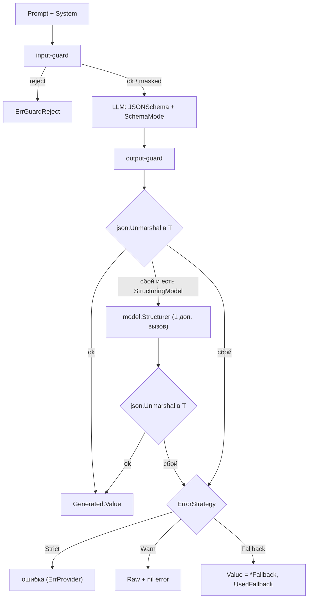

# Как получить структурированный ответ

`kit.Generate[T]` просит модель вернуть значение типа `T` и декодирует ответ в
`T`. Схема ответа выводится из Go-типа: вы описываете результат структурой, а не
строкой, и получаете типизированное значение вместо текста, который надо разбирать
руками.

Это how-to: рецепты, поля, числа и разбор сбоев. Замысел операции и место
`Generate` в модели вызова — [Chat](../concepts/chat.md); сигнатуры — [Справочник
kit](../reference/kit.md#generate).

## Когда использовать

- Нужен типизированный объект: классификация, извлечение полей, булев вердикт.
- Ответ модели должен попадать в ваш Go-код без ручного `json.Unmarshal`.
- Нужен детерминированный контракт для eval: одинаковый `T` — одинаковая схема.

Если ответ — свободный текст, берите `App.Chat`. Если нужен вызов функции — это
инструменты, а не `Generate`.

## Быстрый старт

```go
type Review struct {
	Approved bool   `json:"approved"`
	Notes    string `json:"notes"`
}

g, err := kit.Generate[Review](ctx, app, kit.GenerateRequest[Review]{
	Prompt: "Проверь заявку: клиент просит возврат через 40 дней.",
	System: "Ты ревьюер. Отвечай строго по схеме.",
})
if err != nil {
	return err
}
fmt.Println(g.Value.Approved, g.Value.Notes) // g.Value — обычная Go-структура
```

Право `generate` нужно роли вызывающего, а принципал — в контексте (иначе
`ErrUnauthorized`). Схема `Review` минимальна: `{"approved": bool, "notes": string}`
с `additionalProperties: false`.

## Как использовать

Поток одного вызова:



### Схема выводится из типа `T`

Схема считается в момент вызова: `schemaFor[T]()` вызывает
`invopop/jsonschema` с `DoNotReference: true, ExpandedStruct: true`, затем из
результата удаляются `$schema` и `$id` и принудительно ставится
`"additionalProperties": false`. Тот же механизм используется у `kit.Tool` и у
`flow`.

| Что в типе `T`            | Что попадает в схему                                   |
| ------------------------- | ------------------------------------------------------ |
| поле с тегом `json:"..."` | свойство с этим именем                                 |
| `jsonschema:"enum=a,b"`   | `enum` для свойства (подсказка модели)                 |
| вложенная структура       | вложенный объект                                       |
| срез/массив               | `array`                                                |
| **интерфейс / `any`**     | практически ничего — схема перестаёт что-либо задавать |

`Generate` **не** валидирует результат по схеме: он декодирует ответ через
`json.Unmarshal` в `T`. Схема — это контракт для модели (и для провайдерского
декоринга), а не проверка на стороне kit. Поэтому `T = any` проходит «успешно»
почти всегда, и `ErrorStrategy` не сработает.

### Поля `GenerateRequest[T]`

| Поле               | Назначение                                                             |
| ------------------ | ---------------------------------------------------------------------- |
| `Prompt`           | Текст запроса; проходит input-guard.                                   |
| `System`           | Системная инструкция; уходит ролью `system`.                           |
| `MaxTokens`        | Потолок токенов ответа.                                                |
| `Temperature`      | `*float64`; `nil` — дефолт провайдера.                                 |
| `SessionID`        | Кладётся в trace как `session_id`.                                     |
| `SchemaMode`       | Как передать схему: `SchemaNative` / `SchemaInline` / `SchemaSystem`.  |
| `ErrorStrategy`    | `Strict` (по умолчанию) / `Warn` / `Fallback`.                         |
| `Fallback`         | `*T`; обязателен при стратегии `Fallback`.                             |
| `Tags`             | Метки trace (`kit-traces.tags`).                                       |
| `StructuringModel` | Второй клиент для структурирующего вызова при неудачном декодировании. |

### Результат `Generated[T]`

| Поле           | Что это                                                                                       |
| -------------- | --------------------------------------------------------------------------------------------- |
| `Value`        | Декодированное значение типа `T`.                                                             |
| `Raw`          | Текст ответа, **уже прошедший output-guard** (маскированный, если были находки).              |
| `UsedFallback` | `true`, если сработала стратегия `Fallback`.                                                  |
| `FinishReason` | Нормализованная причина остановки: `stop`, `tool_calls`, `length`, `content_filter`, `other`. |

`Raw` — это guarded-текст, а не сырой ответ провайдера: при `masked`-политике он
уже содержит заглушки (`[PII:...]`). Сырой необработанный ответ не сохраняется.

### `ErrorStrategy`: `Strict`, `Warn`, `Fallback`

Стратегия применяется только когда `json.Unmarshal` ответа не удался (и
структурирующий вызов, если он был, тоже не помог).

| Стратегия         | Что возвращает при неудачном декодировании                                                                                            |
| ----------------- | ------------------------------------------------------------------------------------------------------------------------------------- |
| `Strict` (дефолт) | `Generated[T]{}` (нулевое) и ошибку, обёрнутую вокруг `ErrProvider`.                                                                  |
| `Warn`            | `Generated[T]`, заполненный тем, что удалось декодировать (`Raw` и `FinishReason` на месте), и **`nil` as error**; пишет `slog.Warn`. |
| `Fallback`        | `Value = *Fallback`, `UsedFallback = true`, и **`nil` as error**.                                                                     |

- `Warn` возвращает **без ошибки**: проверяйте, что `g.Value` осмысленно, или
  сверяйте `g.Raw`. Это «не падать на мусоре».
- `Fallback` требует ненулевой `Fallback`; иначе `Generate` сразу возвращает
  `ErrInvalidConfig` (проверка идёт до вызова модели).

```go
fallback := Review{Approved: false, Notes: "не удалось разобрать ответ"}
g, err := kit.Generate[Review](ctx, app, kit.GenerateRequest[Review]{
	Prompt:        "Проверь заявку",
	ErrorStrategy: kit.Fallback,
	Fallback:      &fallback,
})
// err == nil; при сбое g.UsedFallback == true, g.Value == fallback
```

### `SchemaMode` и правило «auto»

Поле `SchemaMode` (`model.SchemaMode`) решает, как схема доходит до модели:

| Режим                | Что делает                                                             |
| -------------------- | ---------------------------------------------------------------------- |
| `model.SchemaNative` | Отдаёт схему нативно (`response_format` / `format` / forced function). |
| `model.SchemaInline` | Дописывает инструкцию со схемой в последнее `user`-сообщение.          |
| `model.SchemaSystem` | Дописывает инструкцию со схемой в системное сообщение.                 |

**Правило auto.** Нулевое значение `SchemaMode` — это `SchemaNative`. Перед
вызовом `Generate` проверяет: если режим `SchemaNative`, а провайдер нативную
схему не умеет (`!model.SupportsNativeSchema(app.cfg.LLM)`), режим **молча
переключается на `SchemaInline`**:

```go
mode := req.SchemaMode
if mode == model.SchemaNative && !model.SupportsNativeSchema(app.cfg.LLM) {
	mode = model.SchemaInline
}
```

`model.SupportsNativeSchema` возвращает `true` для `*model.OpenAIClient`
(и обёртки `model.VLLM`) и `*model.OllamaClient`, `false` — для
`*model.GigaChatClient` и для любого клиента, который не объявил
`SupportsNativeSchema() bool`. То есть через этот интерфейс свой клиент может
переопределить поведение.

### Различия провайдеров

| Провайдер     | Как передаётся схема при `SchemaNative`                               | `SupportsNativeSchema` |
| ------------- | --------------------------------------------------------------------- | ---------------------- |
| OpenAI / vLLM | `response_format: {type: "json_schema", ...}` (имя схемы `output`).   | `true`                 |
| Ollama        | native `format` — JSON Schema.                                        | `true`                 |
| GigaChat      | Схема эмулируется принудительным вызовом функции `structured_output`. | `false` → auto inline  |
| Свой клиент   | По вашему выбору; объявите `SupportsNativeSchema() bool`.             | по реализации          |

> [!NOTE]
> Различия провайдеров — деталь транспорта, а не ваша забота: правило auto
> подбирает рабочую комбинацию, если вызов идёт с `SchemaNative` (по умолчанию).
> Явно ставьте `SchemaSystem`, когда системный префикс стабилен и вы хотите
> prompt-кэш, и `SchemaInline`, если хотите держать схему рядом с данными.

### Структурирующий второй вызов

Если прямой `json.Unmarshal` ответа не удался **и** задан
`GenerateRequest.StructuringModel`, kit делает **один дополнительный модельный
вызов** через `model.Structurer`: он отдаёт провайдеру ту же схему и просит
преобразовать «прозу» ответа в JSON. Затем результат снова декодируется в `T`.

```go
g, err := kit.Generate[Review](ctx, app, kit.GenerateRequest[Review]{
	Prompt:           "Проверь заявку",
	StructuringModel: cheapClient, // обычно дешёвая/быстрая модель
})
```

- Это **дороже**: один лишний round-trip к модели, и только при провайдерском
  сбое декодирования.
- Он **не** добавляется к `usage` trace `generate`: `tr.Usage` отражает только
  первый вызов. Использование структурирующего вызова не удваивается.
- Он **пишется отдельной observation** (`kind: GENERATION`, `metadata.structuring:
true`), но, поскольку span структурирующего вызова не заполняет `Usage`,
  токены этого вызова в observation **не проставляются**. Считайте это «вызов
  виден, расход — нет».

`model.Structurer` можно использовать и напрямую — он берёт `Client`, `Schema`,
`SchemaMode`, `MaxTokens`, `Temperature` и необязательные `Instructions`.

### `Generate` — полноценная операция примитива

`Generate` идёт тем же путём, что `Chat`/`Ingest`/`Search`: принципал → право →
guard → span трейса → выполнение (`internal/call`, инвариант I-01). Из этого
следует:

- Без принципала в контексте — `ErrUnauthorized`.
- Без права `generate` у роли — `ErrUnauthorized`.
- `Prompt` проходит input-guard: reject даёт `ErrGuardReject` (fast-fail, модель
  не вызывается); PII/секреты маскируются **необратимо**.
- `Raw`/`Value` отражают **output-guard**: на рельсе `output` PII/секреты
  маскируются, INJECTION/UNSAFE дают `Detect` (текст не меняется).
- Создаётся trace `generate` с `session_id`, `tags`, `usage` первого вызова.

Обойти это нельзя: отдельной «сырой» точки входа у `Generate` нет.

### Стриминга нет

`model.Client` не имеет стриминга, и `Generate` буферизует ответ целиком:
output-guard должен видеть весь текст. Если нужен поток — собирайте его поверх
готового `Generated`, на своём слое.

## Рецепты

### Классификация в tagged union

Заведите поле-дискриминатор и опишите допустимые значения тегом `jsonschema`:

```go
type Kind string

const (
	KindBilling   Kind = "billing"
	KindTechnical Kind = "technical"
	KindOther     Kind = "other"
)

type Triage struct {
	Kind       Kind    `json:"kind" jsonschema:"enum=billing,enum=technical,enum=other"`
	Confidence float64 `json:"confidence"`
	Summary    string  `json:"summary"`
}

g, err := kit.Generate[Triage](ctx, app, kit.GenerateRequest[Triage]{
	Prompt: ticketText,
	System: "Разложи обращение по трём категориям. Верни JSON по схеме.",
})
```

Проверяйте `g.Value.Kind` в своём коде; enum в схеме — это подсказка модели, а
не проверка (см. «Схема выводится из типа `T`»).

### Извлечение полей из документа

```go
type Invoice struct {
	Number string  `json:"number"`
	Date   string  `json:"date"` // ISO-8601
	Total  float64 `json:"total"`
	VAT    *float64 `json:"vat,omitempty"`
}

g, err := kit.Generate[Invoice](ctx, app, kit.GenerateRequest[Invoice]{
	Prompt:    invoiceText,
	System:    "Извлеки поля счёта. Даты — только ISO-8601. Если НДС нет — не включай поле.",
	MaxTokens: 512,
})
```

Поля-указатели (`*float64`) отличают «ноль» от «поля нет». Если модель вернёт
число строкой (`"total": "1000"`), декодирование в `float64` упадёт — это
типичный повод для структурирующего вызова или более точного промпта.

### `Fallback` для некритичного обогащения

Когда структурированный ответ — улучшение, а не обязательный результат,
`Fallback` превращает сбой декодирования в предсказуемое значение:

```go
defaultTags := Tags{Topics: []string{"general"}}

g, err := kit.Generate[Tags](ctx, app, kit.GenerateRequest[Tags]{
	Prompt:        "Определи темы обращения.",
	ErrorStrategy: kit.Fallback,
	Fallback:      &defaultTags,
})
if err != nil {
	return err // остаются только настоящие сбои: guard, провайдер, авторизация
}
if g.UsedFallback {
	metrics.Inc("tagging.fallback")
}
```

`Fallback` не глотает фатальные ошибки: `ErrUnauthorized`, `ErrGuardReject`,
ошибку провайдера и отмену контекста вы всё равно получаете как `err`.

### `Generate` внутри шага `flow`

`flow` — типизированный конвейер; `Generate` удобно вызывать внутри шага, чтобы
выход шага был уже разобранным объектом:

```go
review, err := flow.New("review",
	func(ctx context.Context, _ flow.State, in Draft) (Review, error) {
		g, gerr := kit.Generate[Review](ctx, app, kit.GenerateRequest[Review]{
			Prompt: in.Body,
			System: "Оцени черновик и верни JSON по схеме.",
		})
		if gerr != nil {
			return Review{}, gerr
		}
		return g.Value, nil
	})
```

Схемы `flow` (из `In`/`Out`/payload) и схема `Generate` выводятся одним и тем же
механизмом, поэтому контракты шага и модели согласованы. Подробнее — [Пайплайны
(flow)](../concepts/flow.md).

## Диагностика и подводные камни

| Симптом                                                      | Причина                                                                 | Что делать                                                                  |
| ------------------------------------------------------------ | ----------------------------------------------------------------------- | --------------------------------------------------------------------------- |
| `Strict`: ошибка «decode answer»                             | Модель обернула JSON в прозу или в ` ```json ` -ограждение              | Задайте `StructuringModel`, режим `SchemaSystem` или более строгий `System` |
| `g.Value` пустой, ошибки нет, но есть `slog.Warn`            | Это `Warn`-стратегия: декодирование не удалось, но вы просили не падать | Сверяйте `g.Raw`; для прода ставьте `Strict`                                |
| `g.UsedFallback == true`, но данные выглядят «правдоподобно» | Сработал `Fallback`, `Value` — ваш дефолт                               | Различайте факт через `UsedFallback`, ведите метрику                        |
| Ответ обрезан, декодирование падает                          | `FinishReason == model.FinishLength` — модель упёрлась в `MaxTokens`    | Поднимите `MaxTokens` или сократите `T`; проверяйте `g.FinishReason`        |
| Число/строка приходит «не тем типом»                         | Провайдер вернул `"1000"` вместо `1000`                                 | Промпт, структурирующий вызов или более терпимый тип (`json.Number`)        |
| `T` без полей (`any`, интерфейс) всегда «успешен»            | Схема ничего не задаёт, `json.Unmarshal` в `any` принимает любой JSON   | Не используйте интерфейсы как `T`; опишите структуру                        |
| `ErrInvalidConfig`: «Fallback strategy requires Fallback»    | `ErrorStrategy: Fallback` без `Fallback`                                | Передайте `Fallback: &defaultValue`                                         |
| `ErrUnauthorized`                                            | Нет принципала или нет права `generate`                                 | Положите принципала, добавьте `generate` в `policy.yaml`                    |
| Результат «съехал» после правки `T`                          | Поменялся `T` — поменялась схема и промпт                               | Обновите ожидания eval вместе с типом                                       |

> [!WARNING]
> Смена `T` меняет схему, а значит и то, что видит модель (в `SchemaInline` —
> буквально текст инструкции). Если у вас есть eval-кейсы на этот вызов,
> пересмотрите их в том же изменении, иначе тесты будут ловить не регрессию, а
> смену формата.

> [!NOTE]
> `FinishReason` возвращается, но `Generate` сам его не проверяет. Если хотите
> отличать «модель не уложилась в лимит» от «не по схеме», смотрите
> `g.FinishReason` в своём коде.

## Чего фреймворк не делает (ограничения)

- **Не валидирует результат по схеме.** `Generate` декодирует ответ `json.Unmarshal`
  в `T`, но не прогоняет его через JSON Schema. Проверка схемы есть у tool-аргументов
  (`kit.Tool`), а у результата `Generate` — нет. Паттерн «строгая типизация» здесь
  означает «декодируется в `T`», а не «соответствует схеме».
- **Нет стриминга** — ответ буферизуется целиком.
- **Нет ретраев декодирования** — при сбое есть ровно один структурирующий вызов
  (если задан `StructuringModel`), и всё.
- **Токены структурирующего вызова не попадают в usage** ни trace, ни observation.
- **Нет авто-ремонта** невалидного числа/строки: типы декодируются строго по
  правилам `encoding/json`, приведений нет.
- **Схема — просьба, а не гарантия.** Модель может вернуть лишние поля (они
  отбрасываются `additionalProperties:false` только в схеме; на декодирование это
  не влияет) или не заполнить обязательные.
- **`Fallback`/`Warn` возвращают `err == nil`** при неудачном декодировании —
  не забывайте проверять `UsedFallback` и `Raw`, иначе сбой станет «тихим».

## Дальше

| Цель                                   | Куда идти                               |
| -------------------------------------- | --------------------------------------- |
| Понять общий путь вызова               | [Chat](../concepts/chat.md)             |
| Вызывать инструменты                   | [Вызов инструментов](./tool-calling.md) |
| Собрать шаги в типизированный пайплайн | [Пайплайны (flow)](../concepts/flow.md) |
| Проверять ответы по записанным трейсам | [Eval](../concepts/eval.md)             |
| Ограничить, что модель видит и говорит | [Настройка guardrails](./guardrails.md) |

## Смотрите также

- [Справочник kit](../reference/kit.md#generate) — `Generate`, `GenerateRequest`, `Generated`, `ErrorStrategy`
- [Провайдеры](../reference/providers.md) — `SchemaMode`, `SupportsNativeSchema`, `FinishReason`
- [Chat](../concepts/chat.md) — общий путь вызова, буферизация ответа
- [Ошибки](../reference/errors.md) — `ErrProvider`, `ErrGuardReject`, `ErrUnauthorized`
