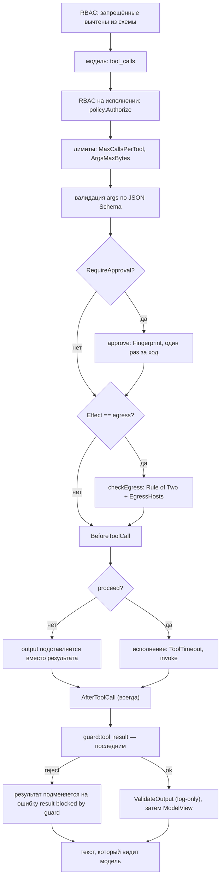

# Как вызывать инструменты

Инструмент — типизированная Go-функция, которую модель вызывает по имени. kit
выводит JSON Schema из типа аргументов, отдаёт модели только разрешённые
инструменты, а при исполнении заново проверяет право, валидирует аргументы,
применяет эффекты и хуки и прогоняет результат через guard.

Это how-to: порядок шагов, числа, рецепты и разбор сбоев. Зачем это устроено так
— [Инструменты](../concepts/tools.md); сигнатуры — [Справочник
kit](../reference/kit.md#инструменты).

## Когда использовать

- Модели нужны данные из вашей системы, которых нет в промпте.
- Аргументы вызова надо проверить по строгой схеме **до** исполнения.
- Вызов надо ограничить правом роли, подтверждением пользователя или allowlist
  хостов.
- Результат функции — недоверенные данные, которые должны пройти guard.

## Быстрый старт

```go
type weatherIn struct {
	City string `json:"city"`
}

func getWeather(ctx context.Context, in weatherIn) (string, error) {
	return fmt.Sprintf("В городе %s солнечно, 12 °C", in.City), nil
}

if _, err := kit.Tool(app, "get_weather", getWeather,
	kit.Desc("Текущая погода в городе."),
); err != nil {
	return err
}
```

Право по умолчанию — `tool:get_weather`. Роль должна его иметь, иначе инструмент
не попадёт в схему, которую видит модель.

## Жизненный цикл одного вызова

Порядок шагов фиксирован в `App.execTool` (`kit.go`). Ссылка на код — рядом с
каждым шагом.



### 1. RBAC: вычитание из схемы

`App.allowedToolSpecs(pr)` обходит зарегистрированные инструменты и оставляет
только те, на которые у принципала есть право (`a.policy.Allows(pr,
def.permission)`). Запрещённые инструменты **не попадают в `model.ToolSpec`**,
который уходит модели: модель не знает об их существовании и не может их
запросить. Вычитание — не «не выполняем», а «не показываем».

### 2. Повторная проверка права на исполнении

При каждом запрошенном моделью вызове `execTool` заново вызывает
`a.policy.Authorize(t.principal, def.permission)`. Это не дублирование: решение
принимает рантайм, а не модель. Отказ RBAC здесь **фатален** — `ErrUnauthorized`
прерывает ход, а не возвращается модели как результат.

### 3. Лимиты вызова

| Проверка                                 | Источник                      | Что при срабатывании                                          |
| ---------------------------------------- | ----------------------------- | ------------------------------------------------------------- |
| `t.callsPerTool[name] > MaxCallsPerTool` | `DefaultMaxCallsPerTool` = 3  | результат-ошибка `{"error":"tool … exceeded its call limit"}` |
| `len(tc.Args) > ArgsMaxBytes`            | `DefaultArgsMaxBytes` = 32 KB | результат-ошибка `{"error":"arguments too large"}`            |

Счётчик вызовов увеличивается на каждом запрошенном вызове, поэтому лимит
срабатывает ровно на `MaxCallsPerTool + 1`-м вызове.

### 4. Валидация аргументов

Схема аргументов выводится из `In` при регистрации (`invopop/jsonschema`,
`DoNotReference`, `ExpandedStruct`), компилируется через
`santhosh-tekuri/jsonschema/v6`, из схемы удалены `$schema`/`$id` и принудительно
стоит `"additionalProperties": false`. Поэтому лишнее поле от модели — уже
ошибка.

`def.validate` разбирает `tc.Args` как JSON и прогоняет по схеме. При провале:

- счётчик `invalidTries[name]` растёт;
- **первый** невалидный вызов возвращается модели как результат-ошибка (модель
  получает текст ошибки и может исправиться);
- **второй** невалидный вызов для того же инструмента в этом ходе фатален:
  `execTool` возвращает `ErrInvalidArgs`, ход прерывается (BR-23).

### 5. Подтверждение (approval)

Срабатывает, только если у инструмента `RequireApproval(true)`:

- без настроенного `Config.Approver` вызов даёт `ErrApprovalRequired` сразу;
- иначе вызывается `Approver.Approve(ctx, ApprovalRequest)`;
- `Fingerprint` = SHA-256 от `имя инструмента + \x00 + канонические аргументы`
  (`json.Marshal` разобранного объекта, поэтому порядок ключей не влияет);
- одобрение **расходуется один раз за ход**: повторный вызов с тем же
  fingerprint возвращает `ErrApprovalRequired`. Другой набор аргументов — другой
  fingerprint и новое одобрение. В новом ходе счётчик начинается заново.

Отказ (`!ok`) и ошибка `Approver` фатальны — `ErrApprovalRequired`.

### 6. Эффекты и эгресс

`Effects(EffectRead|EffectWrite|EffectEgress)` — свойство инструмента, а не
модели. Для `EffectEgress` `checkEgress` применяет два правила:

- **host allowlist**: из аргументов регуляркой извлекаются хосты URL
  (`urlHosts`), каждый обязан совпасть с `EgressHosts` по границе домена
  (`example.com` покрывает `cdn.example.com`, но не `notexample.com`); пустой
  `EgressHosts` **не** ограничивает хосты — это явный opt-in «любой хост»;
- **Rule of Two**: если `Config.Egress.RuleOfTwo == true` и на этом ходу уже был
  недоверенный ввод (`turn.untrusted` — любая маска или находка guard на любом
  рельсе), эгресс запрещён.

Отказ любого правила — `ErrUnauthorized` и прерывание хода.

### 7. Хуки `BeforeToolCall` / `AfterToolCall`

Хуки бывают двух уровней:

- на инструменте — опции `kit.BeforeToolCall(h)` / `kit.AfterToolCall(h)`;
- на приложении — `Config.BeforeToolCall` / `Config.AfterToolCall` (для всех
  инструментов).

**Правило разрешения:** хук инструмента **заменяет** приложенческий для этого
инструмента; приложенческий применяется, только если у инструмента своего хука
нет. Хуки не складываются.

```go
type ToolCallInfo struct {
	UserID      string
	Tenant      string
	Tool        string
	Args        string
	Fingerprint string // хэш tool + канонических аргументов
	Effect      Effect
	CallIndex   int // 1-based счётчик вызовов этого инструмента в ходе
}

type BeforeToolHook func(ctx context.Context, info ToolCallInfo) (proceed bool, output string, err error)
type AfterToolHook  func(ctx context.Context, info ToolCallInfo, result string, err error) (string, error)
```

- `BeforeToolCall` идёт **после валидации** и **до исполнения**. Возврат
  `proceed == false` подставляет `output` вместо результата и **пропускает**
  исполнение инструмента. Ненулевая ошибка идёт по тому же каналу, что сбой
  инструмента.
- `AfterToolCall` вызывается **всегда**: при успехе, при сбое и для результата,
  подставленного before-хуком. Возвращённая ошибка **заменяет** исходную.

### 8. Исполнение и таймаут

Инструмент вызывается через `call.Do` (kind `tool`) с контекстом, ограниченным
`Config.ToolTimeout` (по умолчанию `DefaultToolTimeout` = 30 s). `ToolCallInfo`
передаётся хукам с `Effect` и `CallIndex`.

### 9. Guard результата — последним

Результат (уже после after-хука) прогоняется через `call.Guard` на рельсе
`RailToolResult`, имя observation — `guard:tool_result`.

- **Reject** → результат заменяется на `{"error":"result blocked by guard"}`, ход
  помечается как видевший недоверенный ввод.
- **Mask** → заглушки применяются к тексту, результат идёт модели уже
  маскированным.
- Любая находка помечает ход как недоверенный (влияет на Rule of Two).

Порядок важен: guard идёт **после** обоих хуков, поэтому результат, порождённый
хуком, проверяется так же, как результат самого инструмента, и обойти guard
нельзя (BR-62).

### 10. `ValidateOutput` и `ModelView`

- `ValidateOutput(true)` — при регистрации выводится схема из типа `Out`;
  результат после guard проверяется по ней. Несовпадение **только логируется**
  (`slog.Warn`), ход не прерывается. Смысл — сигнал о «поехавшем» инструменте,
  а не гейт: результат уже получен, и валидация с побочными эффектами хуже, чем
  предупреждение.
- `ModelView(fn)` — что увидит модель вместо результата. Приложению уходит
  исходная строка; модели — то, что вернул `fn`. Пустой `ModelView` возвращает
  результат без изменений.

### 11. Ошибка — данные для модели

Нефатальная ошибка (неизвестный инструмент, превышение лимита, невалидные или
слишком большие аргументы, сбой функции, ошибка нефатального хука, reject guard)
возвращается модели как `{"error": "..."}` (инвариант I-11), и цикл продолжается.
Фатальны только:

- отказ авторизации (RBAC и эгресс-политика) — `ErrUnauthorized`;
- сбой провайдера — `ErrProvider`;
- отмена/дедлайн контекста — `context.Canceled` / `context.DeadlineExceeded`;
- отсутствие требуемого подтверждения — `ErrApprovalRequired`;
- второй невалидный набор аргументов — `ErrInvalidArgs` (BR-23).

`isFatalExecErr` проверяет ровно этот список.

### Завершение хода: `tool_choice = "none"`

На последнем шаге цикла (`step == MaxSteps-1`), если у принципала вообще есть
инструменты, kit принудительно ставит `tool_choice = "none"`. Ход заканчивается
финальным ответом, а не «висячим» вызовом, который уже не исполнится. Если
модель сделала вызовов больше, чем `MaxSteps`, возвращается `ErrMaxSteps`.

### Бюджет хода

`Config.MaxTotalTokens > 0` включает бюджет: после каждого ответа модели
суммарные токены сверяются с лимитом, превышение → `ErrBudget`.

## Рецепты

### Инструмент только для чтения

```go
type searchIn struct {
	Query string `json:"query"`
}

if _, err := kit.Tool(app, "find_order", findOrder,
	kit.Desc("Найти заказ по номеру или описанию."),
	kit.Effects(kit.EffectRead), // чтение: без эгресса и подтверждения
); err != nil {
	return err
}
```

### Egress-инструмент с allowlist и Rule of Two

```go
app, err := kit.New(ctx, kit.Config{
	ES: es, LLM: llm, Policy: policy,
	Egress: kit.EgressPolicy{RuleOfTwo: true}, // блокировать эгресс после недоверенного ввода
})

if _, err := kit.Tool(app, "send_report", sendReport,
	kit.Desc("Отправить отчёт на внешний webhook."),
	kit.Effects(kit.EffectEgress),
	kit.EgressHosts("hooks.example.com"), // только этот хост и его поддомены
); err != nil {
	return err
}
```

### Инструмент с подтверждением

```go
if _, err := kit.Tool(app, "close_ticket", closeTicket,
	kit.Desc("Закрыть тикет поддержки."),
	kit.Effects(kit.EffectWrite),
	kit.RequireApproval(true),
); err != nil {
	return err
}
```

```go
app, err := kit.New(ctx, kit.Config{
	ES: es, LLM: llm, Policy: policy,
	Approver: kit.ApproverFunc(func(ctx context.Context, req kit.ApprovalRequest) (bool, error) {
		// req.Fingerprint привязан к инструменту и каноническим аргументам:
		// одобрение нельзя переиграть на другой набор аргументов.
		return askHuman(req), nil
	}),
})
```

### Редакция результата через `ModelView`

```go
if _, err := kit.Tool(app, "customer_card", customerCard,
	kit.Desc("Данные карты клиента."),
	kit.ModelView(func(s string) string {
		return "Данные получены заявителем." // модель не видит сырой результат
	}),
); err != nil {
	return err
}
```

`ModelView` не заменяет guard: результат сначала проходит `tool_result`, и
только потом на него смотрит `ModelView`.

### Хуки для логирования и rate-limit

```go
kit.Tool(app, "close_ticket", closeTicket,
	kit.Effects(kit.EffectWrite),
	kit.BeforeToolCall(func(ctx context.Context, info kit.ToolCallInfo) (bool, string, error) {
		log.Printf("tool=%s call=%d effect=%s fp=%s", info.Tool, info.CallIndex, info.Effect, info.Fingerprint)
		if !rateLimiter.Allow(info.UserID) {
			return false, `{"error":"rate limited"}`, nil // пропускаем исполнение
		}
		return true, "", nil
	}),
	kit.AfterToolCall(func(ctx context.Context, info kit.ToolCallInfo, result string, err error) (string, error) {
		if err != nil {
			return result, err // пробрасываем как есть
		}
		return result, nil
	}),
)
```

### Встроенный поиск как инструмент

```go
if _, err := kit.RetrievalTool(app, "search_knowledge"); err != nil {
	return err
}
```

`kit.RetrievalTool` регистрирует типизированный инструмент (`In = {query, top_k}`,
`Out = {hits: [{doc_id, text, position}]}`) поверх `App.Search`. Внутри
повторно проверяются право `search` и ACL-фильтр, поэтому ACL применяется
дважды. Имя по умолчанию — `kit.DefaultRetrievalToolName` (`search_knowledge`);
без `Embedder` регистрация возвращает `ErrInvalidConfig`.

## Отладка

| Симптом                                                       | Вероятная причина                                                                     | Что проверить                                                                                        |
| ------------------------------------------------------------- | ------------------------------------------------------------------------------------- | ---------------------------------------------------------------------------------------------------- |
| Модель вообще не видит инструмент                             | Право вычтено из схемы; пустой `Desc`; последний шаг с `tool_choice:"none"`           | `policy.yaml` (`tool:<name>`), `kit.Desc`, номер шага в трейсе                                       |
| «arguments invalid» в результате                              | Схема не соответствует тому, как модель заполняет поля (`additionalProperties:false`) | Схема инструмента (`ToolDef.Schema()`), `jsonschema`-теги, обязательность полей                      |
| Ход падает на втором невалидном вызове                        | Исчерпан один ретрай на невалидные аргументы (BR-23)                                  | Упростите схему или опишите аргументы точнее — модель должна попасть с первого раза                  |
| Инструмент есть в схеме, модель просит, но шаг не выполняется | before-хук вернул `proceed=false`                                                     | Логи из `BeforeToolCall`; результат подставлен, исполнения нет                                       |
| Результат не дошёл до модели как ожидалось                    | `AfterToolCall` переписал результат или `ModelView` редактирует                       | Порядок: after-хук → guard → `ValidateOutput` → `ModelView`                                          |
| `{"error":"result blocked by guard"}`                         | Результат попал под `INJECTION`/`UNSAFE` на рельсе `tool_result`                      | Что возвращает инструмент; режет ли `GuardMaxChars`/`L2`; при необходимости маскируйте в инструменте |
| Подтверждение не запрашивается                                | `RequireApproval(false)` или `Approver` не задан (тогда была бы ошибка)               | Опции инструмента и `Config.Approver`                                                                |
| `ErrApprovalRequired` на повторном вызове                     | Одобрение того же fingerprint уже израсходовано в этом ходе                           | Спроектируйте флоу так, чтобы одно одобрение = один вызов (или меняйте аргументы)                    |
| Эгресс отклонён                                               | Хост вне `EgressHosts` или сработал Rule of Two                                       | Извлечённые хосты из аргументов, `turn.untrusted`, `Config.Egress.RuleOfTwo`                         |
| Валидация результата «не прошла», но ход успешен              | `ValidateOutput` логирует, но не падает                                               | Ищите `slog.Warn` «tool output does not match its schema»                                            |
| `ErrBudget`                                                   | Превышен `MaxTotalTokens` хода                                                        | Значение лимита и число шагов/вызовов                                                                |

## Чего фреймворк не делает (ограничения)

- **`ValidateOutput` — только лог.** Несовпадение результата со схемой `Out` не
  прерывает ход и не подменяет результат. Это сигнал, а не гейт.
- **Несколько `tool_calls` в одном ответе исполняются последовательно.** Модель может вернуть сразу несколько вызовов в одном сообщении; kit обходит их в цикле по одному и не запускает конкурентно, поэтому задержки складываются. Результаты возвращаются в том же порядке.
- **Инструмент не получает принципала аргументом.** Он берёт его сам:
  `kit.PrincipalFrom(ctx)`. Роль как аргумент модели — путь к подмене; не
  делайте так.
- **Нет «выключателей» guard для результата инструмента.** Результат всегда
  проходит `tool_result`; в публичном API отключить это нельзя (I-15).
- **Хуки не складываются.** Нельзя «дополнить» приложенческий хук
  инструментным — только заменить.
- **Один ретрай на невалидные аргументы.** Больше попыток не будет; второй
  невалидный вызов фатален.
- **`ModelView` не влияет на guard и на `ValidateOutput`** — он применяется
  последним и только к тому, что уходит модели.
- **Нет учёта денег за вызов инструмента.** Токены считает модель, а не
  инструмент.

## Дальше

| Цель                                       | Куда идти                                         |
| ------------------------------------------ | ------------------------------------------------- |
| Понять цикл «модель → инструмент → модель» | [Chat](../concepts/chat.md)                       |
| Ограничить права роли на инструмент        | [Доступ](../concepts/access-control.md)           |
| Настроить guardrails                       | [Настройка guardrails](./guardrails.md)           |
| Дать модели типизированный ответ           | [Структурированный ответ](./structured-output.md) |
| Посмотреть вызовы в трейсах                | [Наблюдаемость](./observability.md)               |

## Смотрите также

- [Справочник kit](../reference/kit.md#инструменты) — `Tool`, `ToolOption`, `ToolCallInfo`, `Approver`, `RetrievalTool`
- [Инструменты](../concepts/tools.md) — развёрнутое объяснение эффектов, хуков и эгресса
- [Бизнес-правила](../internals/business-rules.md) — `BR-15`…`BR-23`, `BR-50`…`BR-53`, `BR-61`…`BR-63`, `BR-68`
- [Ошибки](../reference/errors.md) — `ErrApprovalRequired`, `ErrInvalidArgs`, `ErrBudget`
