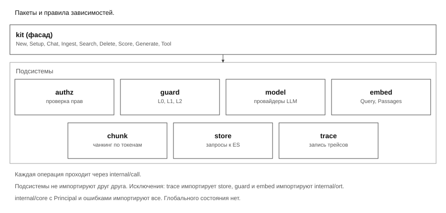
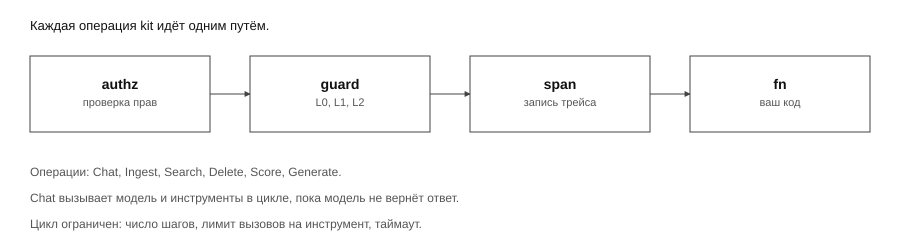
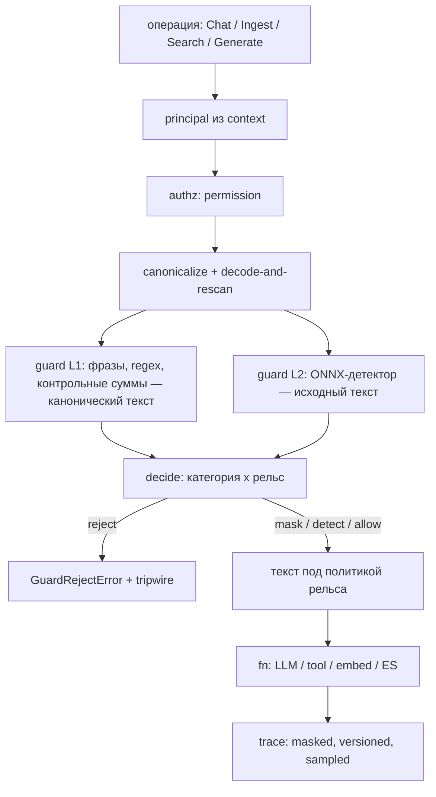
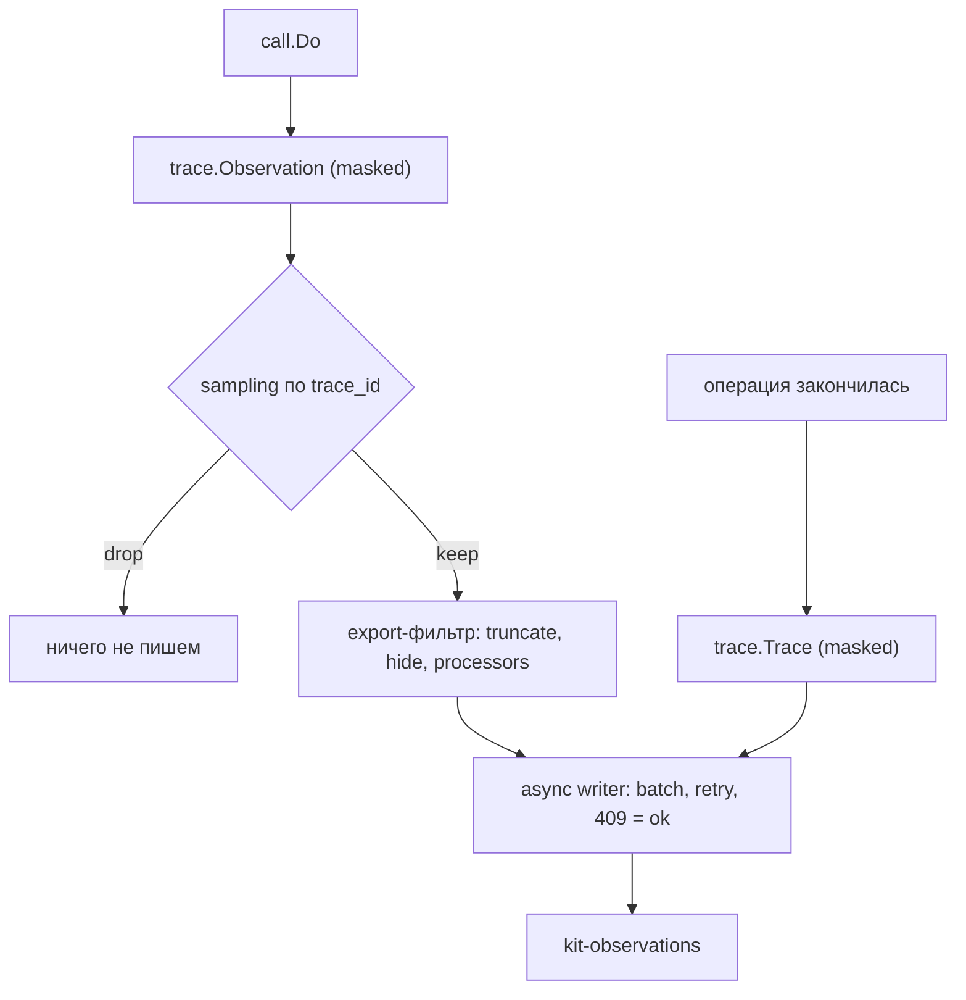

# Архитектура

kit — библиотека, а не сервис. Ей нужен один Go-процесс; всё остальное внешнее
и подключается пользователем. Раздел описывает контейнеры развёртывания,
раскладку пакетов, зависимости, путь вызова, рантайм и границы доверия.

Роли документов разведены (`D52`): этот документ владеет **раскладкой** (пакеты,
зависимости, рантайм), **поведение** — в [Бизнес-правилах](./business-rules.md),
**сигнатуры и инварианты** — в [Дизайне v1](./design.md).


> [!NOTE]
> **Спецификация живёт в `docs/`.** Комментарии в коде — не контракт: если код и
> документация расходятся, правятся docs (AGENTS.md). Объяснительных комментариев
> в `.go`-файлах нет: остаются только функциональные директивы (`//go:build`,
> `//go:embed`, `//go:generate`, `//nolint` и т. п.), поэтому ни наличие, ни
> отсутствие комментария ничего не доказывает и ни на что не опирается.
> Обязательные свойства зафиксированы инвариантами (`design.md` §2), контракты — в
> [Дизайне v1](./design.md) и [Бизнес-правилах](./business-rules.md).

## Контейнеры

kit — библиотека. Ей нужен один процесс на Go; всё остальное внешнее.

| Контейнер                   | Образ / владелец                                                                 | Порты                                  | Протокол         | Роль                                                           | Состояние              |
| --------------------------- | -------------------------------------------------------------------------------- | -------------------------------------- | ---------------- | -------------------------------------------------------------- | ---------------------- |
| `demo`                      | собирает команда; builder `golang:1.24-bookworm`, runtime `debian:bookworm-slim` | 8080/tcp                               | HTTP/JSON        | чат-бот: mock-авторизация + ручка чата с tools (guard, трейсы) | нет (stateless)        |
| `elasticsearch`             | `elasticsearch:8.x`, basic-лицензия                                              | 9200/tcp (9300 только внутри кластера) | HTTP(S)/JSON     | чанки, векторы, трейсы, оценки                                 | да                     |
| `grafana`                   | `grafana/grafana`                                                                | 3000/tcp                               | HTTP             | дашборды поверх ES                                             | provisioning из файлов |
| `vllm` (внешний)            | `vllm/vllm-openai`                                                               | 8000/tcp                               | HTTP, OpenAI API | локальная LLM                                                  | веса                   |
| `ollama` (внешний)          | `ollama/ollama`                                                                  | 11434/tcp                              | HTTP             | локальная LLM                                                  | веса                   |
| OpenAI-compatible (внешний) | сторонний                                                                        | 443/tcp                                | HTTPS            | LLM и embeddings по API                                        | —                      |
| GigaChat (внешний)          | Sber                                                                             | 9443/tcp (OAuth), 443/tcp (API)        | HTTPS            | LLM и embeddings                                               | —                      |

## Ресурсы и сетевые правила

Ресурсы `demo` (оценка): 4 vCPU, 4 GB RAM **с одним L1**; полный режим с L2
требует ≥6 GB (пиковый RSS ≈4.5 GB, см. «ORT-сессии»). Оценка памяти в полной сборке: guard
1.2 GB весов в fp32 (≈0.4 GB в int8), эмбеддер ≈0.5 GB, остальное рантайм. GPU не
используется. Резидентный набор процесса с загруженной guard-моделью заметно выше
размера весов — замер в «ORT-сессии» ниже (≈4.5 GB пикового RSS после того, как у
L2 появился потолок токенов).

Сетевые правила: `demo` → ES, GigaChat или локальные LLM, внешний API погоды
(исходящие). Grafana → ES. Входящий трафик только на 8080. Локальные модели
загружаются заранее (`kitctl model pull`) для ORT-сборки.

## Модули

Репозиторий — монорепозиторий из девяти Go-модулей (`D85`). Ядро — корневой модуль
`github.com/KirillYuzh/Gobellim`: только его собирает `go build ./...` из корня и
только его подключают через `go get`. Опциональные пакеты — отдельные модули с тем
же префиксом пути; `rerank` остаётся в ядре, потому что фасад его импортирует
(`D84`).

| Модуль                           | Пакеты                                                                                                    | Зависит от                              |
| -------------------------------- | --------------------------------------------------------------------------------------------------------- | --------------------------------------- |
| `github.com/…/Gobellim`          | корневой фасад, `internal/**`, `authz`, `guard/**`, `model`, `embed`, `chunk`, `store`, `trace`, `rerank` | —                                       |
| `github.com/…/Gobellim/mcp`      | `mcp`, `mcp/stdio`                                                                                        | ядро                                    |
| `github.com/…/Gobellim/webfetch` | `webfetch`                                                                                                | ядро                                    |
| `github.com/…/Gobellim/flow`     | `flow`                                                                                                    | ядро, две jsonschema-библиотеки (`D67`) |
| `github.com/…/Gobellim/eval`     | `eval`                                                                                                    | ядро (`trace`, `internal/core`)         |
| `github.com/…/Gobellim/kittest`  | `kittest`                                                                                                 | ядро (`model`, `guard`, `trace`)        |
| `github.com/…/Gobellim/cmd`      | `cmd/kitctl`                                                                                              | ядро                                    |
| `github.com/…/Gobellim/demo`     | `demo/cmd/**`, `demo/internal/**`                                                                         | ядро                                    |
| `github.com/…/Gobellim/scripts`  | `scripts/docslint`, `scripts/perfbudget`, `scripts/guardqual`                                             | ядро                                    |

Подмодули объявляют `require github.com/KirillYuzh/Gobellim v0.0.0` и
`replace github.com/KirillYuzh/Gobellim => ..`, поэтому локальная сборка не требует
публикации и `go.work`. Команды из подмодуля запускаются как
`go -C <dir> run ./<cmd>`; `make check` и CI собирают, vet-ят и тестируют каждый
модуль отдельно. Линтер запускается в каждом модуле, поэтому пути в его правилах
модульно-относительные; межмодульную границу ядра проверяет
`internal/importrules`, который обходит дерево целиком, включая подмодули.

## Пакеты

```
kit/
  kit.go principal.go tool.go calltool.go retrieval.go memory.go stream.go toolsearch.go errors.go   фасад: New, Setup, Chat, ChatStream, Health, CallTool, Ingest, Search, Delete, Score, Prune, Generate[T], Tool[In,Out], RawTool, RetrievalTool, MemoryLoad/Append/Recall/Clear/Working/SetWorking
  internal/core/                            общий лист: Principal + sentinel-ошибки + HealthStatus/HealthChecker (без зависимостей)
  internal/call/                            единый примитив вызова; штампует аудит-поля (guard/policy/text); владеет GuardRejectError (kit реэкспортирует его как kit.GuardRejectError)
  internal/ort/                             пул сессий инференса (реализацию сессии даёт вызывающий; токенайзера здесь нет)
  internal/httpjson/ internal/oauth/        общие листы для адаптеров провайдеров
  internal/id/                              генерация идентификаторов трейсов и observation
  internal/ratelimit/                       token bucket на ключ с эвикцией простаивающих
  internal/cache/                           LRU+TTL кэш ответов модели
  authz/                                    policy.yaml, Load/Parse, Authorize(principal, permission)
  guard/                                    Rail/Detector/Pipeline, canonical.go; L1 — rules/, L2 — gliner/ (ONNX под тегом ort, заглушка без него)
  guard/guardtest/                          AllowAll — тестовый детектор (I-15)
  model/                                    Message, Client, openai.go openai_stream.go vllm.go ollama.go gigachat.go, chain.go, history.go
  embed/                                    Embedder, presets.go, remote.go, openai.go, gigachat.go, local.go, local_ort.go
  chunk/                                    токенный чанкер + Tokenizer (обязателен для Ingest)
  store/                                    ES interface + Request, index.go (маппинги), chunks.go, search.go, filter.go, bulk.go, memory.go (индексы и запросы памяти), maintenance.go, ensure.go
  trace/                                    модель Langfuse, async writer (writer.go), policy.go (TextPolicy/Sampler), sink.go, otlp.go (Sink OTLP/HTTP)
  eval/                                     [модуль] детерминированные проверки трейсов (только stdlib; зависит от trace и internal/core, не от kit) — ноль внешних зависимостей
  kittest/                                  [модуль] тестовый набор: fake model.Client, скриптовый guard.Detector, контрактные тесты для плагинов
  flow/                                     [модуль] один типизированный шаг `Step[In,Out]` со schema-контрактом и suspend/resume (без Pipeline/builder-DSL, D47); внешние зависимости — валидатор схем (D67)
  rerank/                                   реранкер за интерфейсом Reranker + адаптер TEI/Cohere (/rerank), детерминированный `Reorder` (в ядре: D84)
  mcp/                                      [модуль] клиент Model Context Protocol (stdio и streamable HTTP) + `Register` — инструменты как `mcp:<server>:<tool>`; сервер `NewServer`/`FromTool` отдаёт инструменты наружу через `App.CallTool`
  webfetch/                                 [модуль] SSRF-защищённый инструмент исходящего HTTP (эффект egress)
  internal/importrules/                     stdlib-тест правил импортов (I-13); обходит дерево целиком, включая подмодули
  cmd/kitctl/                               [модуль] model pull, policy check, verify window/models/parity/latency
  demo/                                     [модуль] пример на Clean Architecture: cmd/bot + internal/{domain,usecase,adapter}
    deploy/                                 Dockerfile, docker-compose.yml, grafana/ (policy — demo/policy.yaml)
  scripts/                                  [модуль] docslint, perfbudget, guardqual
  docs/                                     документация: getting-started/, concepts/, reference/, internals/ (README-индекс)
  testdata/                                 золотые файлы, parity-фикстуры
  .github/workflows/ci.yml                  CI: build, test, race, ort-vet, lint, fumpt
  .golangci.yml Makefile                    линтер (gofumpt/govet/errcheck/staticcheck/gosec/depguard) и локальный `make check`
```

`kittest` импортирует только порты (`model`, `guard`, `trace`) и никогда фасад `kit`, поэтому его может импортировать и тест самого ядра. Контрактные тесты `kittest.DetectorContract`, `kittest.SinkContract` и `kittest.ScopeIsolation` (D78) — условие качества, но не объявление «официальным»: официальный плагин — обещание поддержки, поэтому поставляется ровно один референсный — `guard/gliner` (L2, `-tags ort`); `guard-remote`, `store-es` и `trace-otel` не реализованы (D76).

**Правила зависимостей.** Правила обязательны (I-13) и **подключены**: их проверяют
stdlib-тест `internal/importrules` (в `go test ./...` корневого модуля; тест обходит
дерево целиком, включая подмодули) и правила `depguard` в `.golangci.yml` (в
`make check` и в CI-джобе `lint`; линтер запускается в каждом модуле, поэтому
семейные правила действуют в ядре, а межмодульные границы держит тест).

1. `kit` импортирует всё. `internal/call` зависит от контрактов
   `authz`/`guard`/`trace` как от интерфейсов (`Authorizer`, `Guarder`,
   `Tracer`), а напрямую импортирует `guard` (типы rail/verdict) и `trace` (тип
   observation); он также владеет `GuardRejectError` и штампует аудит-поля на
   каждой observation.
2. Пакеты `authz`, `guard`, `model`, `embed`, `chunk`, `store`, `trace` не импортируют
   друг друга; `guard/**` для этого правила — одна семья.
3. Исключения: `trace → store` (интерфейс ES), `guard → internal/ort`,
   `embed → internal/ort`, `eval → trace`.
4. `eval` не импортирует `kit` (и вообще фасад): его проверки читают только
   `trace` и `internal/core`, поэтому он запускается из `go test` без
   остального модуля.
5. `internal/core` — общий лист (Principal, sentinel-ошибки) без зависимостей;
   его импортируют все пакеты. `internal/httpjson`, `internal/oauth`,
   `internal/id`, `internal/ort`, `internal/ratelimit`, `internal/cache`,
   `internal/importrules` — тоже листья и не импортируют фасад.
6. Глобального состояния нет; `init()` не используется; всё приходит через
   конструкторы и `context.Context`.

Правила `internal/importrules` перечисляют ровно те пакеты, которые им подчинены. Помимо них
**границу ядра** закрепляет правило `core-no-optional` (D84): ядро — фасад `kit`,
`internal/**`, `authz`, `guard/**`, `model`, `embed`, `chunk`, `store`, `trace` — не
зависит от опциональных пакетов (`mcp`, `webfetch`, `flow`, `eval`, `kittest`,
`rerank`, `cmd/**`, `demo/**`, `scripts/**`). Обратное направление свободно: они
зависят вниз (`rerank → internal/core`, `webfetch → kit`, `mcp → kit`, `eval → trace`),
а цикл исключён тем, что ни один файл под `internal/` не импортирует фасад;
импорт фасада из `webfetch` и `mcp` — обычная зависимость листа-инструмента, а не
исключение.

Правило смотрит на компилируемый код, поэтому импорт опционального пакета из теста
ядра разрешён: `kittest` и есть тестовый набор для тестов ядра (D78). Единственное
записанное ребро ядра — `kit → rerank`
(`Config.Reranker`, `SearchRequest.Rerank`): оно лежит в `coreOptionalExceptions`, и
тест проверяет, что список исключений **точно** совпадает с наблюдаемыми рёбрами,
поэтому молча вырасти не может. В `depguard` это правило не
продублировано: там нельзя исключить тестовый импорт, а без такого исключения
`kittest` в тестах ядра давал бы ложные срабатывания.

`flow` — примитив (D67), с D85 — отдельный модуль; правило
`flow-internal-leaves-only` продолжает применяться, потому что тест обходит дерево
целиком, и `flow` может импортировать только листья `internal/**`.
Запрещены фасад `kit` (цикл), `internal/call` (он тянет `guard` и `trace`, то есть
провёл бы в примитив всё семейство ядра), семейство ядра
(`authz`/`guard`/`model`/`embed`/`chunk`/`store`/`trace`) и соседние пакеты
(`eval`, `rerank`, `mcp`, `webfetch`). Стандартная библиотека и две
jsonschema-библиотеки из D67 правилом не охвачены. В `depguard` это ограничение не
дублируется: паттерны его правил модульно-относительные, и внутри модуля `flow` они
не отличили бы его файлы от любых других.

Ограничение на `eval` — единственное правило теста, которое не про семейство ядра:
`eval-trace-and-internal-only` («`eval` may import only `trace` and `internal/**`,
and must never import the root kit façade») запрещает ему подниматься выше трейса.
Правила `core-family` и `leaf-internal-only` на `flow` и `eval` не распространяются:
первое ограничивает только `authz`/`guard`/`model`/`embed`/`chunk`/`store`/`trace`,
второе — только листья под `internal/`. Поэтому граница, зафиксированная для `flow`
и `eval` в D67 («`eval` — ноль внешних зависимостей, `flow` — две jsonschema-библиотеки
ради схем `In`/`Out`»), сегодня держится на stdlib-тесте `go test ./...` (он обходит
дерево целиком, включая подмодули), а не на `depguard`: новое внешнее ребро в
`flow` этот тест не поймает. Расширение правила на `flow` — открытая работа, а не
состоявшееся свойство.



## Библиотеки

Версии фиксируются в `go.mod` при старте (последние стабильные, возрасту не
менее 2 недель). Прямых зависимостей в сборке по умолчанию четыре:
`gopkg.in/yaml.v3`, `github.com/invopop/jsonschema`,
`github.com/santhosh-tekuri/jsonschema/v6`, `golang.org/x/text` (NFKC в
`guard`). Зависимости ONNX Runtime (`github.com/yalue/onnxruntime_go`,
`github.com/daulet/tokenizers`) подключаются только в сборке с тегом `ort`.

| Библиотека                                 | Для чего                                                                | Примечание                                                    |
| ------------------------------------------ | ----------------------------------------------------------------------- | ------------------------------------------------------------- |
| `github.com/yalue/onnxruntime_go`          | вызов ONNX Runtime                                                      | только `-tags ort`; динамическая загрузка `libonnxruntime.so` |
| `github.com/daulet/tokenizers`             | токенайзеры HF (`tokenizer.json`), offsets                              | только `-tags ort`; требует `libtokenizers.a` при сборке      |
| `gopkg.in/yaml.v3`                         | `policy.yaml`                                                           | строгий режим `KnownFields(true)`                             |
| `github.com/invopop/jsonschema`            | JSON Schema из Go-структур tools                                        | только при регистрации                                        |
| `github.com/santhosh-tekuri/jsonschema/v6` | валидация args и structured output                                      | схемы компилируются один раз при `New`                        |
| `golang.org/x/text`                        | Unicode-нормализация NFKC (`guard.Canonicalize`)                        | прямая зависимость сборки по умолчанию                        |
| stdlib                                     | `net/http`, `encoding/json`, `log/slog`, `context`, `unicode`, `regexp` | HTTP-клиенты провайдеров, логи                                |

ES-клиент в зависимости не входит (D10). Тестовые зависимости — только stdlib.
`Config.ES` опционален (D69, BR-102): без него работают `Chat`, `ChatStream`,
`CallTool`, `Generate`, `Score` и инструменты, а операции хранилища дают
`ErrInvalidConfig`, `Setup` — no-op.

## Рантайм и сборка

### cgo

`CGO_ENABLED=1`. Dockerfile: стадия builder ставит `libtokenizers.a`, собирает
бинарь; стадия runtime копирует бинарь и `libonnxruntime.so` (в `/usr/lib`),
переменная `KIT_ORT_LIB` указывает путь. Запуск от non-root, rootfs read-only,
`/models` монтируется read-only.

### ORT-сессии

Для каждой модели (guard, embed) создаётся пул из N сессий (по умолчанию 2), по
одному batch на сессию одновременно. `intra_op_threads` = `NumCPU / (число
сессий всех пулов)`, минимум 1. Запрос берёт сессию из канала, при ожидании
дольше 2 с возвращает `ErrGuardUnavailable` (для embed — `ErrProvider`). Это
ограничивает память и защищает от DoS.

Пул guard-модели создаёт `gliner.New` (`Config.Sessions`, `Config.Wait`); сессии
`internal/ort` дают единый канал на модель. Путь к разделяемой библиотеке ORT —
`KIT_ORT_LIB`; по умолчанию `.ort/lib/libonnxruntime.dylib` (darwin) или
`.ort/lib/libonnxruntime.so`.

Модель guard — 1.2 GB весов; замеренный пиковый RSS процесса с загруженной моделью —
**≈4.5 GB** (darwin/arm64, fp32, 2 сессии, `intra_op_threads` = 4), и он заметно не
растёт при переходе с одной сессии на две. Замер — `kitctl verify latency`
(`ps -o rss=`), см. [Концепции: Guardrails](../concepts/guardrails.md). Память
планируйте по замеру на целевой машине, а не по размеру файла весов.

До того как у L2 появился потолок токенов (`gliner.Config.MaxTokens`), тензорный вход
строился из всех слов окна guard, и стоимость L2 росла сверхлинейно: на окне по
умолчанию (8000 рун) одна проверка занимала ≈50–71 с, а пиковый RSS доходил до
**≈7.3 GB**. С потолком стоимость L2 стала плоской **в пределах одного окна
детекции**; длинный вход сканируется несколькими окнами, поэтому полная цена растёт
с длиной (`D60`; см. [Концепции: Guardrails](../concepts/guardrails.md)).

### Эмбеддер

Поддерживаются энкодерные модели в ONNX с выходом `last_hidden_state` (mean или
CLS pooling) или готовым `sentence_embedding`. Пресеты (`embed/presets.go`):
семейство `intfloat/multilingual-e5-*` (mean, префиксы `query: ` / `passage: `,
L2-норма), `BAAI/bge-m3` (CLS, без префиксов, L2-норма). Неизвестную модель
можно описать файлом `kit_embedder.json` рядом с весами (`pooling`,
`query_prefix`, `passage_prefix`, `normalize`, `max_len`); иначе `NewLocal`
возвращает ошибку. Вход обрезается по `max_len` (512), батч сортируется по
длине, размер батча 32, пул сессий задаётся `LocalConfig.Sessions` (по
умолчанию 2).

### Каталог моделей

`<models_dir>/<org>__<name>/` с файлами `model.onnx`, `tokenizer.json`,
`config.json`. `models_dir` берётся из опции (`embed.Dir`, `gliner.Config.Dir`),
переменной `KIT_MODELS_DIR` или `./models`.

Guard L2 — `<models_dir>/hivetrace__gliner-guard-omni/`: `model.onnx` (энкодер +
span-голова + count-голова + классификатор, fp32, opset 17), `tokenizer.json`
(HF `tokenizers`) и `config.json`. `config.json` — машиночитаемый контракт: метки,
пороги, константный `prefix_ids`, позиции маркеров, имена и формы входов и выходов
ONNX. Детектор читает его, а не хардкодит, поэтому повторный экспорт с другой
pin-схемой продолжает работать. Экспорт и parity-фикстуры — `tools/gliner/`.

### Quantization

По умолчанию fp32. Int8 допускается, если parity-тесты (см. [План](./plan.md))
проходят.

> [!NOTE]
> Сборка по умолчанию (`go build ./...` без тега `ort`) нативных библиотек не
> требует: `guard/gliner` и `embed.NewLocal` стоят за `//go:build !ort` и
> возвращают ошибку, fail-closed. Полный режим — сборка с тегом `ort`
> (`CGO_ENABLED=1 CGO_LDFLAGS="-L.ort/lib" go build -tags ort ./...`) и образом с
> `libonnxruntime.so`. Под тегом `ort` `guard/gliner` и `embed.NewLocal` —
> реальные реализации: ONNX-детектор guard и ONNX-энкодер эмбеддера.
>
> Что из этого доступно «из коробки»: детерминированный L1 (`guard/rules`) —

<!-- derived: BR-26 -->

> всегда, в сборке по умолчанию. L2 — плагин, а не часть сборки по умолчанию:
> поставляемый ML-детектор — `guard/gliner` (`-tags ort`), а `guard-remote` не
> реализован — удалённый guard вне границ v1. Fail-closed означает «ошибка guard
> отклоняет операцию», а не «все слои включены всегда»: без L2 kit маскирует и
> отклоняет по L1, а режим только-L1 запрашивается явно через `guard.L1Only()`.

## Путь вызова

Все операции kit идут через `internal/call`: проверка прав, guard, span трейса,
затем сама операция. Промежуточного слоя middleware нет.



Путь вызова после шлифовки: принципал берётся из контекста, проверяется право,
каноникализация и decode-and-rescan выполняются до слоёв guard, но потоки у них
разные — L1 читает канонический текст, L2 — исходный, а находки L1 переводятся в
исходные координаты (`I-03`, `I-21`). Решение принимает таблица
(allow/mask/detect/reject), и только потом идёт сама операция; трейс маскирован,
версионирован и сэмплирован.



## Безопасность

**Границы доверия.** AuthN выполняет gateway; `demo` доверяет заголовкам
`X-User-ID`, `X-Roles`, `X-Tenant` только из сети gateway (сетевая политика).
Всё остальное недоверенное: тело запроса, история сообщений, документы,
результаты tools, ответ модели.

| Угроза                                                     | Контроль                                                                                                                          | Слой              |
| ---------------------------------------------------------- | --------------------------------------------------------------------------------------------------------------------------------- | ----------------- |
| Прямая инъекция в промпте                                  | guard rail `input` (L1: фразы/regex + decode-and-rescan; L2: `unsafe`/PII)                                                        | ML + правила      |
| Косвенная инъекция через документ                          | карантин чанков при ingest; guard `tool_result`                                                                                   | ML                |
| Подделка истории клиентом (`system`, `tool`, `tool_calls`) | BR-30: клиентские роли только `user` и `assistant`, `tool_calls` отбрасываются; все `user` и `assistant` сообщения проходят guard | детерминированный |
| Вызов запрещённого tool                                    | вычитание из схемы + повторная проверка при исполнении                                                                            | детерминированный |
| Некорректные или вредоносные args tool                     | JSON Schema со `additionalProperties:false`, лимит размера args 32 KB                                                             | детерминированный |
| Утечка чужих данных через поиск                            | ACL-фильтр tenant + roles внутри kNN и BM25; deny-by-default                                                                      | детерминированный |
| Утечка чужой памяти по `thread_id`                         | фильтр `tenant` + `user_id` в истории, очистке и recall; `thread_id` сам по себе доступа не даёт (I-17)                           | детерминированный |
| Утечка PII и секретов в ответе                             | guard rail `output` (mask); инъекция/unsafe на выходе помечаются `Detect`                                                         | правила + ML      |
| Эксфильтрация через инструмент                             | `Effects` инструмента, host-allowlist для `Egress`, «Rule of Two» в рантайме                                                      | детерминированный |
| PII в трейсах                                              | текст под явной политикой `Config.TraceText` (`masked` по умолчанию; `full` — opt-in с предупреждением)                           | детерминированный |
| DoS через guard                                            | лимит `max_chars`, пул сессий, таймаут очереди, fail-closed по умолчанию; явный fail-open по рельсам (`Config.GuardFailOpen`)     | детерминированный |
| Бесконечный цикл tools                                     | `max_steps`, `max_calls` на tool, таймаут tool                                                                                    | детерминированный |
| Утечка секретов в логах                                    | `slog` не пишет тексты сообщений; только id, размеры, категории                                                                   | дисциплина        |

Маскирование PII на входе необратимо для модели: она видит заглушки вида
`[PII:SNILS]`. Реальные значения подставляются в args только у инструментов с
`kit.AllowPII(true)` и только при однозначном отображении заглушки (`BR-04`, `D55`);
подстановка живёт внутри вызова, трейс и хуки видят маску.

## Observability

Каждый вызов оборачивается в `internal/call` и создаёт observation; trace
создаётся на входе `Chat`, `Ingest`, `Search` и `Generate`. Модель данных
совместима по смыслу с [Langfuse](https://langfuse.com/): trace → observations (SPAN, GENERATION, EVENT)
→ scores, session как группировка по `session_id`. Подробности полей —
[Справочник kit](../reference/kit.md) и схема ES.

Текст в документах подчиняется явной политике (`Config.TraceText`): по умолчанию
`masked`, то есть хранится только текст, прошедший guard; `full` — явный opt-in с
предупреждением в логе. Каждый документ несёт аудит-поля `guard_version`,
`guard_model`, `policy_hash`, `text_policy` (I-07, I-08). Перед постановкой в
очередь observation проходит export-фильтр: обрезка строк (`MaxStringLength`),
массивов (`MaxArrayLength`) и ключей объектов (`MaxObjectKeys`), ограничение
глубины (`MaxDepth`), а также `Processors` (процессор может изменить или
выбросить observation).

Request-scoped метаданные можно приложить к контексту один раз — `kit.WithTraceMetadata`
(обёртка над `core.WithSpanMetadata`): они попадают в `metadata` **каждой**
observation этого запроса, а значение, заданное на конкретном вызове, перекрывает
одноимённый ключ из контекста. Так помечают трафик (A/B-плечо, request id, флаг)
без протаскивания через каждую операцию; отдельного dot-селектора, как
`requestContextKeys` в [Mastra](https://mastra.ai/), нет — вызывающий передаёт ровно ту карту, которую
хочет видеть в трейсе.



Запись: observations накапливаются в памяти на время запроса; при завершении
trace и observations уходят в очередь асинхронного писателя (очередь 4096
документов, batch 500 или 2 с или 5 MB, три повтора с backoff 200 мс;
item-статус `409`/`version_conflict` считается успехом). Sampling детерминирован
по `trace_id` (`always`/`never`/`ratio`), поэтому trace и его observations делят
судьбу. При переполнении очереди новые документы отбрасываются и растёт счётчик
`dropped` (логируется `slog.Warn`); запрос никогда не блокируется трейсингом.
`App.Close(ctx)` сбрасывает очередь.

JSON-API чтения трейсов нет: потребители читают ES (Kibana/Grafana) или CLI-ридер
`demo/cmd/traces` (список трейсов и разбор одного с observations и scores).
JSON-API остаётся запланированным.

Помимо ES-writer'а, трейсы можно направить в любой `trace.Sink` через
`Config.Sinks`: встроен `trace.NewOTLP` (`trace/otlp.go`) — OTLP/HTTP JSON без
внешних зависимостей, с детерминированными id (sha256), атрибутами `gen_ai.*` и
`kit.*` и scores отдельным событием `score`.

Grafana: в `demo/deploy/grafana/` лежат provisioning ES-datasource и дашборды:
латентность и ошибки по `name`/`kind`, токены по модели и tenant (панель
стоимости читает `usage.cost`, который библиотека заполняет по `Config.Pricing`;
`0`, если цена не задана — см. [Наблюдаемость](../concepts/observability.md)),
срабатывания guard по категориям и rail, топ tools и отказы авторизации,
таблица последних trace.

## Смотрите также

- [Бизнес-правила](./business-rules.md) — правила, которые обязана сохранять
  архитектура
- [Решения и допущения](./decisions.md) — журнал `D1`…`D85` и допущения
  `A1`…`A9`
- [План](./plan.md) — этапы, тесты, риски, Definition of Done
- [Ориентиры](./references.md) — Go-проекты, с которых снимаются идеи
- [Ошибки](../reference/errors.md) — sentinel-ошибки фасада
- [Конфигурация](../reference/configuration.md) — значения по умолчанию
