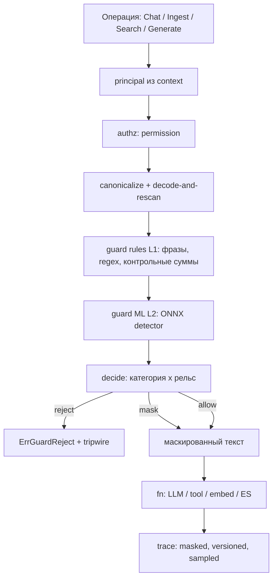
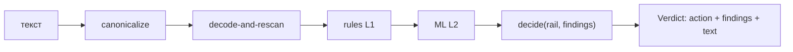
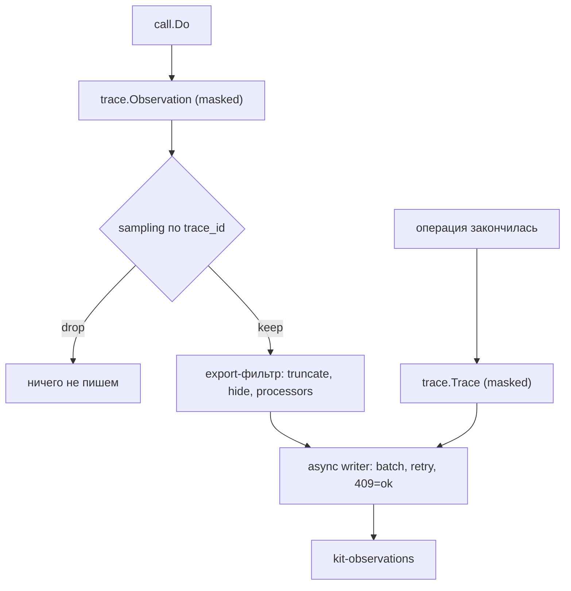

# Дизайн v1 (замороженные контракты)

Этот документ — **спецификация изменений** к v1. Он фиксирует инварианты и
сигнатуры, по которым вносятся правки в пакеты. Всё, что здесь описано, имеет
приоритет над [architecture.md](./architecture.md) и [business-rules.md](./business-rules.md)
там, где они расходятся; расхождения правятся в том же изменении (AGENTS.md).

Цель правок: привести код в соответствие с собственной спекой, закрыть найденные
дефекты корректности и добавить функциональность, перенесённую из Mastra
(см. §4 «Решения»).

## 1. Схемы

Путь вызова после шлифовки: каноникализация и guard идут до авторизации
операции, детерминированный слой раньше ML, решение принимает рантайм.



Конвейер guard: детекторы не знают про рельс, решение — чистая таблица.



Поток трейсинга: один документ на trace в конце, observations отдельным потоком;
в ES уходит только разрешённый политикой текст.



## 2. Инварианты

Обязательные свойства; каждое проверяемо тестом или конфигурацией.

| ID   | Инвариант                                                                                                                                                                                                                                                                                                                                                                                                                                                                                                                                                 |
| ---- | --------------------------------------------------------------------------------------------------------------------------------------------------------------------------------------------------------------------------------------------------------------------------------------------------------------------------------------------------------------------------------------------------------------------------------------------------------------------------------------------------------------------------------------------------------- |
| I-01 | Любой I/O (LLM, tool, embed, ES, guard) идёт через `internal/call`. Обойти политику нельзя: `Generate` — такая же операция примитива.                                                                                                                                                                                                                                                                                                                                                                                                                     |
| I-02 | Детекторы guard не зависят от рельса. Рельс влияет только на решение (`decide`), а не на детекцию. Кэш вердиктов ключуется каноническим текстом и версией guard.                                                                                                                                                                                                                                                                                                                                                                                          |
| I-03 | Каноникализация и decode-and-rescan выполняются **до** L1 и L2; оба слоя видят один и тот же канонический текст.                                                                                                                                                                                                                                                                                                                                                                                                                                          |
| I-04 | Mask перезаписывает текст: последующие слои и последующие рельсы видят маску, а не исходные значения.                                                                                                                                                                                                                                                                                                                                                                                                                                                     |
| I-05 | Fail-closed различим: недоступность модели — `ErrGuardUnavailable`; битая конфигурация/модель на старте — `ErrInvalidConfig`.                                                                                                                                                                                                                                                                                                                                                                                                                             |
| I-06 | Окно guard не уже окна модели: если клиент реализует `model.ContextWindow`, `New` сверяет `guard.max_chars` с `ContextTokens()` и возвращает `ErrInvalidConfig` при превышении. Окно модели в токенах, лимит guard в рунах — это верхняя оценка, а не точная гарантия.                                                                                                                                                                                                                                                                                    |
| I-07 | В трейсы не попадает необработанный текст по умолчанию. Политика текста трейса — явная: `masked` / `full`.                                                                                                                                                                                                                                                                                                                                                                                                                                                |
| I-08 | Вердикт guard воспроизводим: в observation пишутся версия guard, хэш политики, id и хэш модели.                                                                                                                                                                                                                                                                                                                                                                                                                                                           |
| I-09 | Лимиты и деньги — часть контракта: `ErrBudget` (бюджет хода) и `ErrRateLimited` (429 от провайдера); `Retry-After` учитывается в `internal/httpjson`; таймауты приходят как `context.DeadlineExceeded`/`ErrProvider`.                                                                                                                                                                                                                                                                                                                                     |
| I-10 | Эгресс — явное свойство инструмента (`Effects`), хосты — allowlist; «Rule of Two» проверяется рантаймом.                                                                                                                                                                                                                                                                                                                                                                                                                                                  |
| I-11 | Ошибка инструмента — данные для модели: результат приходит как `{"error": "..."}`, и ход продолжается. Прерывают ход: отказ авторизации (RBAC и эгресс-политика), ошибка провайдера, отмена/дедлайн контекста, отсутствие требуемого подтверждения (`ErrApprovalRequired`) и исчерпание одного ретрая на невалидные аргументы (BR-23).                                                                                                                                                                                                                    |
| I-12 | Контракт ES-запроса явный: метод, путь, тип контента, refresh, идемпотентность — поля запроса, а не вывод из строки пути.                                                                                                                                                                                                                                                                                                                                                                                                                                 |
| I-13 | Тесты — только stdlib. Обвязка **подключена**: CI (`.github/workflows/ci.yml`) гоняет джобы build, test, race, ort-vet, lint, fumpt; `golangci-lint` (`gofumpt`, `govet`, `errcheck`, `staticcheck`, `gosec`, `depguard` и др.) и `make check` дают ту же планку локально. Правила импортов закодированы дважды — `depguard` в `.golangci.yml` и stdlib-тест `internal/importrules`. Обвязка **подключена и зелёная**: `golangci-lint` v2.13.0 локально даёт 0 замечаний, а прогоны workflow на раннере зелёные (push в `develop`/`main` и pull request). |
| I-14 | Единственный источник правды о вердиктах — этот документ и `guardrails.md`; `BR-27`/`architecture.md` не заявляют больше, чем умеет модель.                                                                                                                                                                                                                                                                                                                                                                                                               |
| I-15 | Публичный API не содержит «выключателей безопасности»: `AllowAll` живёт в `guard/guardtest`.                                                                                                                                                                                                                                                                                                                                                                                                                                                              |

## 3. Контракты пакетов

### 3.1 `internal/core`

Добавляются sentinel-ошибки (и реэкспорт в `errors.go`):

```go
var (
	ErrTool             = errors.New("kit: tool error")        // падение внутри инструмента
	ErrBudget           = errors.New("kit: budget exceeded")   // лимит токенов/стоимости
	ErrRateLimited      = errors.New("kit: rate limited")      // 429 от провайдера
	ErrApprovalRequired = errors.New("kit: approval required") // tool требует подтверждения
)
```

`Principal` получает метод `Validate() error`: `Tenant` обязателен (I-12b).

### 3.2 `store`

```go
// Request — явный контракт ES-запроса (I-12).
type Request struct {
	Method      string // GET, POST, PUT, DELETE
	Path        string
	Body        []byte
	ContentType string // "" -> application/json
	Refresh     string // "", "true", "wait_for" -> ?refresh=<v>
	Idempotent  bool   // можно ретраить без последствий
}

type ES interface {
	Do(ctx context.Context, req Request) (statusCode int, body []byte, err error)
}

func JSONRequest(method, path string, body any) (Request, error)
func NDJSONRequest(method, path string, body []byte) Request
func RawRequest(method, path string, body []byte, contentType string) Request
```

Поиск:

- убрать `"k"` из `knn`-query; `k` задаётся `size`;
- `msearchResponse` получает `Error json.RawMessage` и `Status int`; ошибка любой
  ветви — ошибка вызова; `_shards.failed > 0` — ошибка;
- `NumCandidates` клампится до `10000`; `TopK` валидируется (`1..1000`);
- RRF: детерминированный tie-break по `_id`;
- `SearchQuery` получает `Filter Filter`.

Фильтр метаданных (подмножество операторов, компилируется в ES-query):

```go
type Filter map[string]any // {"doc_id": "1", "position": map[string]any{"$gte": 2}}

// Поддерживаются: $eq, $ne, $gt, $gte, $lt, $lte, $in, $nin, $exists, $and, $or, $not.
// Разрешённые поля: doc_id, source, position, created_at, quarantined.
func CompileFilter(f Filter) (map[string]any, error)
```

Обслуживание (домены хранения, ретенция):

```go
func PruneBody(olderThan time.Duration) []byte        // delete_by_query по @timestamp
func ParseDeleteByQuery(body []byte) (deleted int, err error) // failures учитываются
```

### 3.3 `trace`

```go
// Sink принимает готовые документы. Writer его реализует; Recorder — для тестов и eval.
type Sink interface {
	Enqueue(Trace)
	EnqueueObservation(Observation)
	EnqueueScore(Score)
}

func NewRecorder() *Recorder           // in-memory, потокобезопасный
func (r *Recorder) Snapshot() Snapshot // Traces, Observations, Scores

type TextPolicy int
const (
	TextMasked TextPolicy = iota // по умолчанию (I-07)
	TextFull                     // требует явного opt-in + slog.Warn при старте
)

type Sampler func(traceID string) bool
var SamplerAlways Sampler = func(string) bool { return true }
var SamplerNever  Sampler = func(string) bool { return false }
func SamplerRatio(p float64) Sampler   // решение детерминировано по trace_id
```

`Options` дополняется:

```go
type Options struct {
	ES store.ES
	Sinks []Sink       // writer всегда добавляется первым
	Text TextPolicy
	Sampler Sampler
	HideInput, HideOutput bool
	MaxStringLength int // по умолчанию 131072
	MaxDepth        int // 8
	MaxArrayLength  int // 50
	MaxObjectKeys   int // 50
	Processors []func(*Observation) // export-фильтр; может скрыть (nil -> drop)
	Logger *slog.Logger
	// QueueSize, BatchSize, FlushInterval, MaxBatchBytes, MaxRetries, RetryBackoff — как было.
}
```

`Trace`/`Observation` получают поля версии guard и политики текста:
`GuardVersion`, `GuardModel`, `PolicyHash`, `TextPolicy` (для аудита, I-08).

`Observation` получает `Tags []string` (отдельно от `Metadata`, item 9).

Правки писателя:

- нет гонки `Enqueue`/`Close` (закрытие через `chan struct{}` + mutex);
- ретрай идемпотентен: item-статус `409`/`version_conflict` считается успехом;
- `Close(ctx)` уважает контекст; остаток очереди дописывается;
- `lastErr` не липкий; `estimateSize` не маршалит дважды;
- детали ошибок берутся из `store.BulkErrors`.

### 3.4 `guard`

```go
// Action дополняется значением Detect (записать находку, не менять текст).
const (
	Allow Action = iota
	Detect
	Mask
	Reject
)

type Tripwire struct {
	Reason   string
	RuleID   string
	Metadata map[string]any
}

type Verdict struct {
	Action   Action
	Rail     Rail
	Findings []Finding
	Text     string
	Tripwire *Tripwire
	Version  string
}
```

- `Detector` больше не принимает rail: `Detect(ctx context.Context, text string) ([]Finding, error)`.
- `Options` дополняется `Version string` и `OnViolation func(Verdict)`;
  `Pipeline.Version()` возвращает версию (хэш имени слоёв + конфигурации).
- Решение — таблица `actionFor(rail, category)`; `Detect` возвращает true, если
  находка есть, текст не меняется.
- `canonicalize(text) string`: NFKC (`golang.org/x/text/unicode/norm`), case-fold,
  удаление zero-width/bidi, фолдинг кириллических гомоглифов, нормализация цифр.
- `decodedVariants(text) []string`: base64/hex/percent-encoded фрагменты,
  декодированные и переданные повторно в L1.
- L1 (`guard/rules`) дополняется: `Luhn` для карт, `IBAN mod-97`, `CVV`,
  `JWT`/`BEARER`/`GOOGLE_API_KEY`/`SLACK_TOKEN` как секреты, RU-паспорт, плюс
  regex-паттерны инъекций (не только дословные фразы).
- `maskRunes` остаётся, но перед маскированием спаны объединяются и
  сортируются; приоритет категорий задаётся таблицей.
- `AllowAll` переезжает в `guard/guardtest`.

### 3.5 `embed`

- `embed/local.go` — заглушка `//go:build !ort` (как сейчас).
- `embed/local_ort.go` — **реализация** `//go:build ort`:
  ONNX-энкодер из `internal/ort`, `daulet/tokenizers`, пресеты e5/bge-m3
  (mean/CLS pooling, префиксы, L2-норма), обрезка по `MaxLen`, батч ≤ 32,
  сортировка по длине для эффективности, `Dim()` определяется из выхода модели.
- `Preset.Validate()` проверяет пресет (в том числе загруженный из `kit_embedder.json`);
  `LocalConfig` получает поле `Sessions` (размер пула, по умолчанию `DefaultSessions` = 2).
- `NewLocal` под `!ort` возвращает `ErrInvalidConfig` (как сейчас).

### 3.6 `model`

```go
type FinishReason string
const (
	FinishStop          FinishReason = "stop"
	FinishToolCalls     FinishReason = "tool_calls"
	FinishLength        FinishReason = "length"
	FinishContentFilter FinishReason = "content_filter"
	FinishOther         FinishReason = "other"
)

type Response struct {
	Message      Message
	Usage        Usage
	Model        string
	FinishReason FinishReason
}

// Схемная инъекция (item 3): как передать JSON Schema провайдеру.
type SchemaMode int
const (
	SchemaNative SchemaMode = iota // response_format / format
	SchemaInline                   // добавить в последнее user-сообщение
	SchemaSystem                   // добавить в системное сообщение
)

type Request struct {
	Messages    []Message
	Tools       []ToolSpec
	Temperature *float64
	MaxTokens   int
	JSONSchema  json.RawMessage
	SchemaMode  SchemaMode
	ToolChoice  string // "", "auto", "none", "required"
	Seed        *int
	Stop        []string
	ProviderOptions map[string]any
}

// Capability сообщает, поддерживает ли провайдер/модель нативную схему.
func SupportsNativeSchema(client Client) bool
```

- Цепочка фолбэков и ретраев (item 8 §6 частично + §4.5):

```go
type ChainConfig struct {
	MaxRetries int           // на звено
	Backoff    time.Duration
}
func Chain(cfg ChainConfig, clients ...Client) (Client, error) // Client impl
```

- `model/history.go` (item 14):

```go
type Counter interface{ Count(text string) int }
type ByteCounter struct{}
func (ByteCounter) Count(text string) int // len(text)/4, документированное приближение

type History struct {
	Counter  Counter // обязателен; nil отключает обрезку
	Budget   int     // токены; <= 0 отключает обрезку
	KeepLast int     // минимум хвостовых сообщений, по умолчанию 2
}
// Trim сохраняет пары tool_call/tool, системный префикс и последнее сообщение.
func (h History) Trim(msgs []Message) []Message
```

- `model/structurer.go`: второй модельный вызов, который превращает прозу в JSON по схеме (Go-ответ на «structuring agent»).

```go
type Structurer struct {
	Client       Client
	Schema       json.RawMessage
	SchemaMode   SchemaMode // SchemaNative инлайнится, если клиент не умеет нативно
	MaxTokens    int
	Temperature  *float64
	Instructions string // заменяет встроенный префикс инструкции
}
// Structure просит клиента выразить prose как JSON по Schema и возвращает сырой текст
// (без валидации: декодирование — на вызывающем). Проза фенсится, чтобы читалась как данные.
func (s Structurer) Structure(ctx context.Context, prose string) (string, error)
```

### 3.7 `eval` (новый пакет, item 7)

Только stdlib. Зависит от `trace`; **не** импортирует `kit`.

```go
// Trace — записанный трейс с его observation.
type Trace struct {
	Trace        trace.Trace
	Observations []trace.Observation
}

// Check возвращает nil, если трейс удовлетворяет проверке.
type Check func(t Trace) error

func Includes(s string) Check
func Excludes(s string) Check
func Equals(s string) Check
func Matches(re *regexp.Regexp) Check
func Similarity(want string, min float64) Check // Dice по биграммам слов
func CalledTool(name string) Check
func DidNotCall(name string) Check
func UsedNoTools() Check
func MaxToolCalls(n int) Check
func ToolOrder(names ...string) Check // подпоследовательность, не обязательно подряд
func NoToolErrors() Check
func All(fs ...Check) Check
func Any(fs ...Check) Check
func Not(f Check) Check

// DiceSimilarity — метрика, на которой построен Similarity.
func DiceSimilarity(a, b string) float64

// Recorded возвращает последний трейс рекордера.
func Recorded(rec *trace.Recorder) (Trace, error)

type Case struct {
	Name     string
	Input    string
	Checks   []Check
	Metadata map[string]any
}

type Result struct {
	Name    string
	Passed  bool
	Err     error
	Trace   Trace
	Elapsed time.Duration
}

type Report struct {
	Total, Passed, Failed int
	Results               []Result
}
func Summarize(results []Result) Report
func (r Report) OK() bool
func (r Report) String() string // одна строка на кейс

// Run сбрасывает рекордер перед каждым кейсом, прогоняет его через run и
// проверяет трейс. Ошибка run делает кейс провальным без проверок.
func Run(ctx context.Context, rec *trace.Recorder, cases []Case,
	run func(ctx context.Context, input string) error) []Result
```

Конвенции: tool-observation — это `Kind == trace.KindSpan`, имя — `Name`; текстовые
проверки читают `Trace.Output` (вход не инспектируется).

### 3.8 `kit` (фасад)

`Config` дополняется:

```go
type Config struct {
	// ... ES, LLM, Embedder, Policy, GuardL2, GuardMaxChars, GuardCacheSize,
	//     Tokenizer, ChunkSize, ChunkOverlap, MaxSteps, MaxCallsPerTool,
	//     ToolTimeout, ArgsMaxBytes, TopK, Logger
	TraceText      trace.TextPolicy
	Sampler        trace.Sampler
	HideInput      bool
	HideOutput     bool
	Sinks          []trace.Sink
	MaxTotalTokens int          // бюджет хода (0 — без лимита)
	Egress         EgressPolicy // Rule of Two и allowlist инструментов
	Approver       Approver     // вызывается для tool с RequireApproval
	BeforeToolCall BeforeToolHook // app-level hook; per-tool hook его заменяет
	AfterToolCall  AfterToolHook  // app-level hook; per-tool hook его заменяет
}

type EgressPolicy struct {
	RuleOfTwo bool // запрет эгресса, если на ходу был недоверенный ввод и приватные данные
}
```

Новые/изменённые операции:

- `Generate[T]` — через примитив: `principal` → `PermGenerate` → input-guard →
  модель → output-guard; `System` идёт ролью `system`; поддержка
  `ErrorStrategy` (`strict`/`warn`/`fallback`), `SchemaMode`, `UsedFallback`.
  `GenerateRequest[T].StructuringModel` — второй модельный вызов, который при
  неудачном прямом декодировании переписывает прозу в схему **до** применения
  `ErrorStrategy`; он пишется отдельной observation и не добавляет usage к итогу хода.
- `SearchRequest.Filter store.Filter`.
- `Ingest` — валидация размерности векторов, удаление прежних чанков документа
  перед записью новых (иначе остаются хвосты), карантин не индексирует текст.
- `Delete` — проверяет `deleted`/`failures`; корректная метка observation.
- `Prune(ctx, olderThan)` — удаление старых трейсов (ретенция).
- `RetrievalTool(app, opts)` — инструмент поиска по KB как типизированный `Tool`
  (item 10).

`Tool` дополняется опциями (items 4, 5, 12, I-10):

```go
func Effects(e Effects) ToolOption            // Read | Write | Egress
func EgressHosts(hosts ...string) ToolOption  // allowlist для Egress
func RequireApproval(b bool) ToolOption
func ValidateOutput(b bool) ToolOption        // item 5: валидация выхода
func ModelView(f func(string) string) ToolOption // item 4: что видит модель
func BeforeToolCall(h BeforeToolHook) ToolOption // per-tool hook заменяет Config.BeforeToolCall
func AfterToolCall(h AfterToolHook) ToolOption   // per-tool hook заменяет Config.AfterToolCall

// ToolCallInfo — что видит хук; Fingerprint привязан к tool + каноническим args.
type ToolCallInfo struct {
	UserID, Tenant, Tool, Args, Fingerprint string
	Effect                                 Effect
	CallIndex                             int // 1-based в этом ходе
}
type BeforeToolHook func(ctx context.Context, info ToolCallInfo) (proceed bool, output string, err error)
type AfterToolHook func(ctx context.Context, info ToolCallInfo, result string, err error) (string, error)
```

`ToolDef` получает `effects`, `egress`, `requireApproval`, `validateOutput`,
`modelView`, `outputSchema`.

Цикл `Chat`:

- ошибка инструмента возвращается модели как результат с `isError` (I-11);
- «ходовые» хуки: до вызова — RBAC, approval (по fingerprint, consume-once), egress-политика, затем `BeforeToolCall`; после исполнения — `AfterToolCall`, за ним guard результата (**последним**), `ValidateOutput`, `ModelView`. Ошибка хука становится результатом-ошибкой модели (I-11), если она не фатальна.
- `ArgsMaxBytes`, `max_steps`, `max_calls`, timeout — как было;
- бюджет хода (`MaxTotalTokens`) → `ErrBudget`.

## 4. Решения (дополнение к decisions.md)

| #   | Решение                                                                                                | Обоснование                                                                                                                                                                                          | Отвергнуто                     |
| --- | ------------------------------------------------------------------------------------------------------ | ---------------------------------------------------------------------------------------------------------------------------------------------------------------------------------------------------- | ------------------------------ |
| D21 | `store.ES` принимает `store.Request` с типом контента, refresh и флагом идемпотентности                | тип контента нельзя выводить из подстроки пути (I-12)                                                                                                                                                | эвристика по пути              |
| D22 | Guard: детекция один раз, решение по таблице; каноникализация перед слоями                             | измеренный класс атак на уровне символов; −работы на рельсах                                                                                                                                         | rail-зависимые детекторы       |
| D23 | Политика текста трейса — `masked` по умолчанию; `full` требует opt-in                                  | соответствие BR-41 (I-07)                                                                                                                                                                            | сырой текст по умолчанию       |
| D24 | Sampling трейсов детерминирован по `trace_id`                                                          | воспроизводимость eval и снижение нагрузки на ES                                                                                                                                                     | случайная выборка              |
| D25 | Эгресс — свойство инструмента + Rule of Two в рантайме                                                 | защита от эксфильтрации без ML                                                                                                                                                                       | доверие к модели               |
| D26 | Ошибка инструмента — результат для модели                                                              | цикл не рушится на первой ошибке инструмента                                                                                                                                                         | падение хода                   |
| D27 | Модель guard версионируется; версия и хэш политики пишутся в трейс                                     | апгрейд guard — смена политики, а не патч                                                                                                                                                            | безусловный кэш вердиктов      |
| D28 | L2 отвечает за семантику (safety и таксономия), L1 — за структурированные ID (карты, ИНН, SNILS, IBAN) | данные GLiNER Guard: model-only F1 на RU-ID ≈ 0; правила дешевле; Go-сторона поддерживает полную таксономию модели (N групп, `thresholds`, `category_map`), поставляемый артефакт — компактный (D35) | ML на структурированных ID     |
| D29 | Схемная инъекция выбирается по возможностям провайдера (`SchemaMode`)                                  | провайдеры различаются в поддержке `response_format`                                                                                                                                                 | обязательный `response_format` |
| D30 | Пакет `eval` с детерминированными проверками вместо LLM-судей                                          | воспроизводимо, без стоимости и без сети                                                                                                                                                             | LLM-as-judge для авторизации   |

## 5. Что изменилось в API (справочник для документации)

Этот раздел — единственный авторитетный список изменений v1; документация и
README описывают именно это поведение.

### 5.1 `store`

- `ES` теперь `Do(ctx, store.Request) (int, []byte, error)`;
  `Request{Method, Path, Body, ContentType, Refresh, Idempotent}` и
  `Request.EffectivePath()`; хелперы `JSONRequest`, `NDJSONRequest`, `RawRequest`.
  Тип контента и `refresh` — поля запроса, клиент пользователя их применяет (I-12).
- Поиск: в kNN-запросе нет `k` (`k` = `size`); ошибка любой ветви `_msearch` и
  `_shards.failed > 0` — ошибка вызова; `TopK` клампится до 1000, `num_candidates`
  — до 10000; RRF с детерминированным tie-break по `_id`.
- `store.Filter` (item 11): операторы `$eq $ne $gt $gte $lt $lte $in $nin $exists $and $or $not`,
  поля `doc_id source position created_at quarantined`; `store.CompileFilter`
  компилирует в ES-query и AND-ится с ACL-фильтром.
- `store.ValidateChunk`, `store.ChunksBulkBody(chunks, dims)`; карантинный чанк не
  несёт ни текста, ни вектора.
- `store.DeleteByDocBody`, `store.ParseDeleteByQuery`, `store.PruneBody`.
- `store.IsVersionConflict`, `store.VersionConflictError`, `store.BulkErrors`.

### 5.2 `trace`

- `Sink`, `Recorder`, `Snapshot`, `Fanout`; `Writer` реализует `Sink`.
- `TextPolicy` (`TextMasked` по умолчанию / `TextFull`), `Sampler`
  (`SamplerAlways`, `SamplerNever`, `SamplerRatio`, `SamplerFromString`).
  Решение сэмплера детерминировано по `trace_id`.
- `Options`: `Sinks`, `Text`, `Sampler`, `HideInput`, `HideOutput`,
  `MaxStringLength` (131072), `MaxDepth` (8), `MaxArrayLength` (50),
  `MaxObjectKeys` (50), `Processors` (очистка `Name` удаляет observation).
- Поля `Trace`/`Observation`: `Tags`, `GuardVersion`, `GuardModel`, `PolicyHash`,
  `TextPolicy`.
- Писатель: нет гонки `Enqueue`/`Close`, идемпотентные ретраи (409 = успех),
  `Close(ctx)` учитывает контекст, ошибка не липкая.

### 5.3 `guard`

- `Detector.Detect(ctx, text)` — без рельса (I-02); детекция один раз, решение по
  таблице `decide(rail, findings)`; кэш по каноническому тексту и версии.
- `Canonicalize`, `DecodedVariants` (I-03); `Action` дополнен `Detect`;
  `Verdict.Tripwire`, `Verdict.Version`; `Tripwire{Reason, RuleID, Metadata}`;
  `Options.Version`, `Options.OnViolation`, `Pipeline.Version()`.
- L1 расширен: `BANK_CARD` (Luhn), `IBAN` (mod-97), `CVV`, `PASSPORT`,
  `JWT`, `BEARER`, `GOOGLE_API_KEY`, `SLACK_TOKEN`; regex-паттерны инъекций.
- `AllowAll` переехал в `guard/guardtest` (I-15).
- На рельсе `output` категории INJECTION/UNSAFE дают `Detect`, а не `Mask`.
- L2 GLiNER: метки сущностей → `PII`; метки классификации маппятся так: явный `category_map` переопределяет всё; значение-категория (`PII`/`SECRET`/`INJECTION`/`UNSAFE`) задаёт категорию; значение **`SAFE`** подавляет находку для этой метки (`category_map` принимает именно эти пять значений); без маппинга работает эвристика (`unsafe/harmful/...` → `UNSAFE`, `inject/jailbreak/attack/override/exfiltrat/abuse` → `INJECTION`), а встроенный список безопасных имён даёт «ничего не сообщать». Незнакомая, немаппленная метка fail-safe → `UNSAFE` (I-14). Go принимает N групп классификации: у каждой своё имя `output`, `multi_label` + `sigmoid`, пороги на метку/группу (`thresholds`). Поставляемый по умолчанию экспорт компактен (`person/email/phone` + `safe/unsafe`); богатый (32 сущности, 5 групп, 70 меток классификации; адверсариальные метки дают `INJECTION`) собирается `export.py --schema full` (D28, D35).
- L2 получает не всё окно guard: тензорный вход ограничен `Config.MaxTokens` (`DefaultMaxTokens` = 512, кламп до `max_sequence_length` модели), поэтому хвост длинного входа размечает только L1 (D34).

### 5.4 `embed`

- `NewLocal` реализован под `-tags ort`: ONNX-энкодер, пресеты e5 (mean,
  префиксы, L2) и bge-m3 (CLS, L2), `kit_embedder.json`, батч 32, `max_len` 512,
  размерность берётся из графа; `LocalConfig.Sessions` (по умолчанию 2).
  Под `!ort` — прежняя заглушка `ErrInvalidConfig`.

### 5.5 `model`

- `Response.FinishReason` (`FinishStop/ToolCalls/Length/ContentFilter/Other`),
  `ParseFinishReason`; `Request.SchemaMode` (`SchemaNative/Inline/System`),
  `SupportsNativeSchema`; `Request.ToolChoice`, `Seed`, `Stop`, `ProviderOptions`.
- `Chain(ChainConfig, ...Client)`: фолбэк-цепочка с ретраями и `Retry-After`.
- `History`/`Counter`/`ByteCounter`: обрезка истории по бюджету с сохранением пар
  `tool_call`/`tool` и стабильного системного префикса.
- `internal/httpjson`: `Config`, `NewClient` (ретраи, `Retry-After`),
  `StatusError`, `IsRetryable`, `RetryAfter`.

### 5.6 `kit`

- `Generate[T](ctx, app, GenerateRequest[T]) (Generated[T], error)` — полноценная
  операция примитива: принципал, право `generate`, input/output guard, трейс;
  `System` уходит ролью `system`; `ErrorStrategy` `Strict/Warn/Fallback`
  и `Generated.UsedFallback`; при `SchemaNative` и отсутствии поддержки
  провайдера схема автоматически инлайнится.
- Права: добавлены `generate` и `prune`; `Ingest`, `Search`, `Delete`
  требуют непустой `Tenant` (иначе `ErrUnauthorized`). `Prune` требует
  принципала и право `prune`, но не тенант: это глобальное действие
  эксплуатации по времени (как ILM), а не тенант-скоупная операция.
- `Tool`-опции: `Effects`, `EgressHosts`, `RequireApproval`, `ValidateOutput`,
  `ModelView`, `BeforeToolCall`, `AfterToolCall`; `Config.Approver`, `ApproverFunc`,
  `ApprovalRequest.Fingerprint` (хэш `tool` + канонических аргументов).
  Хук на инструменте **заменяет** хук приложения (`Config.BeforeToolCall`/
  `AfterToolCall`), а не складывается с ним; `ToolCallInfo` несёт `Fingerprint` и
  `CallIndex`. Одобрение расходуется один раз за ход (повтор того же fingerprint →
  `ErrApprovalRequired`).
- `GenerateRequest[T].StructuringModel` — второй модельный вызов при неудачном прямом
  декодировании; `model.Structurer` — сама операция структурирования.
- `kit.WithTraceMetadata(ctx, md)` / `kit.TraceMetadataFrom(ctx)` — request-scoped
  метаданные, которые примешиваются в `metadata` каждой observation (per-call значение
  перекрывает значение из контекста).
- `Config.MaxTotalTokens` → `ErrBudget`; `Config.Egress.RuleOfTwo`;
  `Config.TraceText`, `Config.Sampler`, `Config.HideInput`, `Config.HideOutput`,
  `Config.Sinks`.
- Ошибка инструмента возвращается модели как `{"error": "..."}` (I-11); отказ
  RBAC и ошибки провайдера по-прежнему прерывают ход; неизвестный инструмент —
  результат-ошибка; на последнем шаге цикла `tool_choice` = `none`.
- `Ingest` удаляет прежние чанки документа, валидирует размерность вектора;
  `Delete` проверяет `deleted`/`failures`; новый `App.Prune(ctx, olderThan)`.
- Новый `kit.RetrievalTool(app, name, opts...)` — поиск как типизированный tool.
- `kit.GuardRejectError` (алиас типа из `internal/call`, доступен через
  `errors.As`): `Rail`, `Tripwire`, `Version`; `errors.Is(err, kit.ErrGuardReject)`
  сохраняется.
- Новые sentinel-ошибки: `ErrTool`, `ErrBudget`, `ErrRateLimited`,
  `ErrApprovalRequired`.

### 5.7 `eval` (новый пакет)

- `Check`, `Trace`, `Case`, `Result`, `Report`, `Summarize`, `Run`, `Recorded`,
  `DiceSimilarity`; проверки `Includes`, `Excludes`, `Equals`, `Matches`,
  `Similarity`, `CalledTool`, `DidNotCall`, `UsedNoTools`, `MaxToolCalls`,
  `ToolOrder`, `NoToolErrors`, `All`, `Any`, `Not`.
- Применяется с `trace.NewRecorder()` и `kit.Config.Sinks`; только stdlib;
  не импортирует `kit`.

### 5.8 `flow`, `webfetch`, `cmd/kitctl verify` и новые хелперы

- `flow` (новый пакет): `State`, `Status` (`success`/`failed`/`suspended`),
  `Suspension`/`Suspend`, `Step[In,Out]`, `New`, `NewResumable`, `Pipeline`,
  `StepResult`, `Result[Out]`; пакетные generic-функции `Then`, `Chain`, `Chain3`
  (метод в Go не объявляет свои параметры типа); `Step.Pipeline`,
  `Pipeline.Run`/`RunWithState`/`Resume` через `Result.Snapshot`.
  Схемы выводятся из Go-типов, входы/выходы/resume валидируются в рантайме.
  Branch/parallel/foreach/loop DSL намеренно отсутствует (D31).
- `webfetch` (новый пакет): `Config` (`AllowHosts`, `MaxBytes`, `Timeout`,
  `MaxRedirects`, `Headers`), `In` (`url`), `Out` (`status`, `content_type`,
  `text`, `truncated`), `New(app, name, cfg)`. Регистрируется через
  `Effects(EffectEgress)` + `EgressHosts(...)`, поэтому host-allowlist и Rule of Two
  рантайма применяются тоже; SSRF-проверки — в dialer'е (включая CGNAT `100.64.0.0/10`
  и ULA `fc00::/7`), с потолками редиректов и тела; не-2xx — данные (D33).
- `cmd/kitctl verify` (новые подкоманды): `window` (I-06), `models`
  (`gliner.VerifyDir`/`embed.VerifyDir`), `parity` (`gliner.CheckParity`, требует
  `-tags ort`), `latency`. Флаги принимаются до и после позиционных аргументов.
- Новые экспортированные хелперы: `gliner.VerifyDir`, `gliner.CheckParity`/
  `gliner.Report`, `embed.VerifyDir`, `model.Structurer`,
  `gliner.Config.MaxTokens` (`gliner.DefaultMaxTokens` = 512, кламп до
  `max_sequence_length` модели = 2048).
- CI: `.github/workflows/ci.yml` (build, test, race, ort-vet, lint, fumpt),
  `.golangci.yml` (`gofumpt`, `govet`, `errcheck`, `staticcheck`, `gosec`, `depguard`
  и др.), `Makefile` (`make check`) и `internal/importrules` (I-13).
