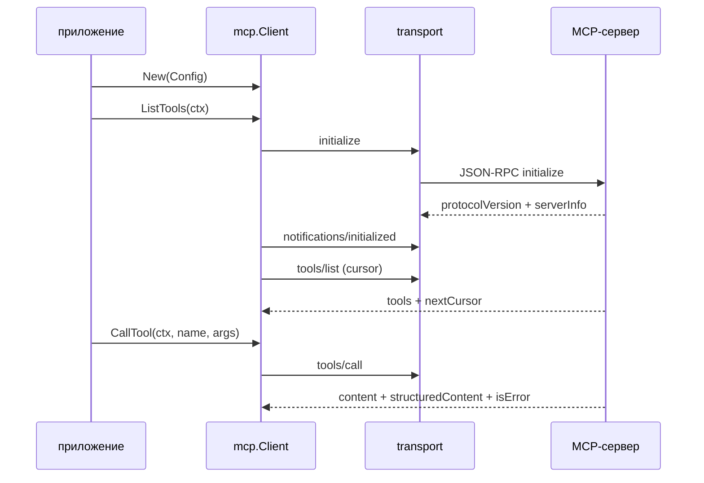

# MCP: как это устроено

`mcp` это отдельный модуль `github.com/KirillYuzh/Gobellim/mcp`. Он говорит с
MCP-сервером по stdio или streamable HTTP и превращает его инструменты в
обычные `gobellim.ToolDef`. Ядро о MCP не знает.

## Пакеты и границы

| Часть | Где | Задача |
| --- | --- | --- |
| `Client` | `mcp/mcp.go` | ленивый handshake, `tools/list`, `tools/call` |
| `stdioTransport` | `mcp/stdio.go` | JSON-RPC построчно через stdin/stdout дочернего процесса |
| `httpTransport` | `mcp/http.go` | JSON-RPC поверх POST, JSON или SSE |
| `Register` | `mcp/register.go` | MCP-инструменты как `gobellim.RawTool` с egress-политикой |
| `Server` | `mcp/server.go` | обратная сторона: отдать свои инструменты по MCP |

Модуль импортирует `gobellim` и `internal/core`. Обратной зависимости нет:
`internal/importrules` запрещает ядру импортировать `mcp`.

## Поток



`Register` вызывается один раз при старте. Он делает `ListTools` и возвращает
`[]gobellim.ToolDef`, которые регистрируются в общем `gobellim.Registry`.

## Ключевые типы

```go
type Transport interface {
	Call(ctx context.Context, method string, params any) (json.RawMessage, error)
	Notify(ctx context.Context, method string, params any) error
	Close() error
}

type Client struct {
	cfg       Config
	transport Transport
	mu        sync.RWMutex
	serverInfo ServerInfo
	ready     bool
	initMu    sync.Mutex
}
```

Транспорт отвечает только за JSON-RPC. Клиент отвечает за порядок вызовов,
handshake и разбор ответов.

## Выбор транспорта

`New` требует ровно одно из двух: `Command` или `URL`.

```go
switch {
case cfg.Command != "" && cfg.URL != "":
	return nil, fmt.Errorf("mcp: set either Command or URL, not both: %w", core.ErrInvalidConfig)
case cfg.Command != "":
	tr, err = newStdioTransport(cfg)
case cfg.URL != "":
	tr, err = newHTTPTransport(cfg)
default:
	return nil, fmt.Errorf("mcp: Command or URL is required: %w", core.ErrInvalidConfig)
}
```

`withDefaults` подставляет имя клиента, версию протокола и таймауты.

## Handshake

Handshake ленивый: его делает первый `ListTools` или `CallTool`. Два
одновременных первых вызова не отправляют два `initialize`, это сериализует
`initMu`.

```go
c.initMu.Lock()
defer c.initMu.Unlock()
c.mu.RLock()
ready = c.ready
c.mu.RUnlock()
if ready {
	return nil
}
raw, err := c.transport.Call(ctx, "initialize", params)
```

После ответа клиент отправляет `notifications/initialized` и запоминает
`serverInfo`. Если сервер назвал другую версию протокола, клиент пишет
предупреждение и продолжает: версия ниже это не ошибка транспорта.

## tools/list

Список читается страницами. `nextCursor` не пустой значит, что нужно попросить
следующую страницу.

```go
for {
	params := map[string]any{}
	if cursor != "" {
		params["cursor"] = cursor
	}
	raw, err := c.transport.Call(ctx, "tools/list", params)
	// ...
	out = append(out, page.Tools...)
	if page.Next == "" {
		return out, nil
	}
	cursor = page.Next
}
```

Пустой `tools` и пустой `nextCursor` дают пустой список, это нормальный ответ.

## tools/call

`CallTool` принимает сырые аргументы. Пустые заменяются на `{}`, невалидный JSON
даёт `ErrInvalidArgs` до сети.

```go
if len(args) == 0 {
	args = json.RawMessage(`{}`)
}
var arguments any
if err := json.Unmarshal(args, &arguments); err != nil {
	return CallResult{}, fmt.Errorf("mcp: %s: tool %s: invalid arguments: %w: %w",
		c.cfg.Name, name, err, core.ErrInvalidArgs)
}
raw, err := c.transport.Call(ctx, "tools/call", map[string]any{"name": name, "arguments": arguments})
```

`CallResult` содержит `content`, `structuredContent` и `isError`. `Text()`
склеивает текстовые блоки, `structuredContent` имеет приоритет при регистрации.

## stdio

Stdio это JSON-RPC по строкам, максимум 8 MiB на сообщение. У каждого запроса
свой id и свой канал ответа; `pending` защищён мьютексом.

```go
id := t.nextID.Add(1)
ch := make(chan rpcResponse, 1)
t.pendMu.Lock()
t.pending[id] = ch
t.pendMu.Unlock()
```

Запись идёт через очередь. Вызывающий ждёт свой контекст, а не pipe, поэтому
зависший дочерний процесс не блокирует отменённый вызов.

```go
select {
case t.writeCh <- b:
	return nil
case <-ctx.Done():
	return ctx.Err()
case <-t.done:
	return t.closedErr()
}
```

`writeLoop` пишет в stdin в одном месте, чтобы строки не перемешивались.
`Close` закрывает stdin и всегда дожидается `cmd.Wait`; если процесс не вышел
за две секунды, он его убивает. Конец stdout не означает конец процесса.

## HTTP

HTTP-транспорт отправляет POST и принимает `application/json` или
`text/event-stream`.

```go
req.Header.Set("Content-Type", "application/json")
req.Header.Set("Accept", "application/json, text/event-stream")
req.Header.Set("MCP-Protocol-Version", h.cfg.ProtocolVersion)
if session != "" {
	req.Header.Set(sessionHeader, session)
}
```

`Mcp-Session-Id` из ответа запоминается и уходит в следующие запросы. Для SSE
чтение останавливается, когда пришло сообщение с нужным id. Медленный поток не
считается сломанным.

```go
if strings.HasPrefix(resp.Header.Get("Content-Type"), "text/event-stream") {
	return readSSE(resp.Body, h.cfg.Name, wantID)
}
```

Тело ограничено `maxMessageBytes`. Ответ может быть одним объектом или
массивом объектов.

## Регистрация инструментов

`Register` даёт каждому инструменту имя `mcp:<server>:<tool>`, берёт схему
сервера и делает `gobellim.RawTool`.

```go
def := gobellim.RawTool(ToolPrefix(c.Name(), t.Name), t.InputSchema, callHandler(c, t.Name), base...)
```

Политика egress строится из endpoint. Для HTTP это хост из `URL`. Для stdio
хоста нет, поэтому вызывающий обязан передать свою политику; дефолта,
открывающего egress на любой хост, нет.

```go
if c.cfg.URL == "" {
	return nil, fmt.Errorf("mcp: %s: a stdio client has no endpoint host: pass an egress policy ...: %w",
		c.cfg.Name, core.ErrInvalidConfig)
}
```

`callHandler` превращает `isError` в `core.ErrTool`, а `structuredContent`
отдаёт как есть. Остальное идёт текстом.

## Сервер

`Server` отдаёт инструменты приложения по MCP. `ServeStdio` читает построчно
из `io.Reader`, `Handler` отдаёт `http.Handler`. `initialize`, `tools/list` и
`tools/call` собраны в `handle`; `originAllowed` проверяет Origin для браузерных
клиентов. Инструмент сервера это `ServerTool`: имя, описание, схема и функция.

## Отказы

| Ситуация | Что возвращается |
| --- | --- |
| JSON-RPC error | `rpcError.wrap()` с `core.ErrProvider` |
| битые аргументы | `core.ErrInvalidArgs` до запроса |
| неизвестный id в ответе | ошибка протокола |
| дочерний процесс умер | `t.done` и `closedErr()` |
| отмена контекста | `ctx.Err()` |
| stdio без egress-политики | `core.ErrInvalidConfig` |

Ошибки сервера не роняют клиента. `Close` не отменяет вызовы в полёте: они
завершаются по своему контексту или по ошибке транспорта.

## Тесты

`mcp/mcp_test.go` проверяет список и вызовы на фейковом HTTP-сервере.
`mcp/server_test.go` гоняет сервер. `mcp/register_test.go` проверяет имя,
egress-политику и отказ для stdio. Отдельные тесты stdio проверяют, что
заблокированная запись уважает контекст, а `Close` добивает процесс, который
закрыл stdout но остался жив.

## Смотрите также

- [Плагины](../plugins/README.md)
- [Инструменты](../tools/implementation.md)
- [Справочник API](../reference/gobellim.md)
