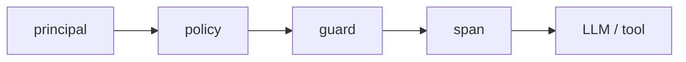

# Обзор

Безопасность обеспечивается за счёт того, что любая операция проходит через единый путь:



## Быстрый старт: чат с двумя инструментами

Пример ниже показывает минимальное приложение с двумя инструментами:

1. `get_greeting` — возвращает строку.
2. `get_weather` — уходит в интернет за погодой (egress).

### Код приложения

```go
package main

import (
	"context"
	"fmt"
	"log"

	"github.com/KirillYuzh/Gobellim"
	"github.com/KirillYuzh/Gobellim/authz"
	"github.com/KirillYuzh/Gobellim/guard"
	"github.com/KirillYuzh/Gobellim/model"
)

type greetingIn struct {
	Name string `json:"name"`
}

type weatherIn struct {
	City string `json:"city"`
}

func getGreeting(_ context.Context, in greetingIn) (string, error) {
	return fmt.Sprintf("Привет, %s!", in.Name), nil
}

func getWeather(_ context.Context, in weatherIn) (string, error) {
	return fmt.Sprintf("В городе %s солнечно, 12 °C", in.City), nil
}

func main() {
	ctx := context.Background()

	// 1) Политика доступа: policy.yaml, deny by default.
	policy, err := authz.Load("policy.yaml")
	if err != nil {
		log.Fatal(err)
	}

	// 2) Клиент модели: любой OpenAI-совместимый провайдер.
	llm, err := model.NewOpenAI(model.OpenAIConfig{
		BaseURL: "http://localhost:8000/v1",
		Model:   "qwen2.5-7b-instruct",
	})
	if err != nil {
		log.Fatal(err)
	}

	// 3) Каталог инструментов. Схемы выводятся из типов аргументов.
	tools, err := gobellim.NewRegistry().Register(
		gobellim.Tool("get_greeting", getGreeting,
			gobellim.Desc("Поздороваться с пользователем"),
		),
		gobellim.Tool("get_weather", getWeather,
			gobellim.Desc("Узнать погоду в городе"),
			gobellim.Egress("api.example.com"),
		),
	).Build()
	if err != nil {
		log.Fatal(err)
	}

	// 4) Приложение.
	app, err := gobellim.New(ctx, gobellim.Config{
		LLM:     llm,
		Policy:  policy,
		Tools:   tools,
		GuardL2: guard.L1Only(), // L2 выключен явно; L1 всегда работает
	})
	if err != nil {
		log.Fatal(err)
	}
	defer func() { _ = app.Close(context.Background()) }()

	// 5) Получатель вызова.
	ctx = gobellim.WithPrincipal(ctx, gobellim.Principal{
		UserID: "u-1",
		Tenant: "acme",
		Roles:  []string{"user"},
	})

	// 6) Ход модели: policy → guard → span → модель и инструменты.
	res, err := app.Chat(ctx, gobellim.ChatRequest{
		System: "Ты ассистент поддержки. Отвечай кратко.",
		Messages: []model.Message{
			{Role: model.RoleUser, Content: "Поздоровайся и скажи погоду в Москве"},
		},
	})
	if err != nil {
		log.Fatal(err)
	}

	fmt.Println(res.Message.Content)
}
```

### policy.yaml

```yaml
version: 1
default: deny

roles:
  user:
    permissions:
      - chat
      - tool:get_greeting
      - tool:get_weather
```

## Что здесь происходит

| Этап        | Что делает библиотека                                                                 |
| ----------- | ------------------------------------------------------------------------------------- |
| `principal` | Берёт `UserID`, `Tenant`, `Roles` из контекста через `gobellim.WithPrincipal`         |
| `policy`    | Проверяет право `chat` и права на инструменты `tool:get_greeting`, `tool:get_weather` |
| `guard`     | Маскирует PII во вводе, проверяет инъекции, валидирует аргументы инструментов         |
| `span`      | Записывает трейс вызова (маскированный текст по умолчанию)                            |
| `fn`        | Выполняет модель и инструменты                                                        |

## Что не относится к библиотеке (пишете вы сами)

- Реализация Elasticsearch-клиента (`store.ES`) — нужна только для `Ingest`/`Search`/`Delete`/`Prune`; для чистого чата можно передать `nil`.
- Реализация LLM-провайдера — любой OpenAI-совместимый клиент (`model.NewOpenAI`, `model.NewOllama` и т.д.).
- Политика доступа — файл `policy.yaml` с правами вашего приложения.

## Содержание документации

| Раздел                                             | О чём                                                  |
| -------------------------------------------------- | ------------------------------------------------------ |
| [Инструменты](./tools/README.md)                   | `gobellim.Tool`, эффекты, эгресс, подтверждение, права |
| [Рабочие процессы](./workflows/README.md)          | сценарии `Flow[S]`, типизированные шаги                |
| [Защита (guards)](./guard/README.md)               | L1/L2 слои, пороги, рельсы, маскирование               |
| [Трассировка и наблюдаемость](./tracing/README.md) | OTel-провайдер, трейс-райтер, аудит-лог, метрики       |
| [Поиск и индексация](./retrieval/README.md)        | `Ingest`/`Search`, ACL, эмбеддер, чанкер               |
| [Провайдеры моделей](./providers/README.md)        | OpenAI-совместимые, Ollama, vLLM, GigaChat, эмбеддеры  |
| [Память](./memory/README.md)                       | рабочая память, история, recall                        |
| [MCP](./mcp/README.md)                             | MCP-клиент, регистрация инструментов                   |
| [Справочник API](./reference/gobellim.md)          | `Config`, операции, типы                               |
| [Установка](./installation.md)                     | требования, сборка, переменные окружения               |
