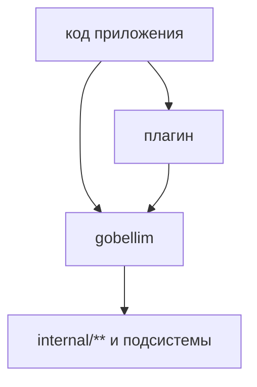

# Обзор плагинов

Плагин здесь означает опциональный пакет или отдельный Go-модуль репозитория,
который подключается к ядру `gobellim` снаружи. Ядро собирается и работает без
плагинов. Каждый плагин включает одну возможность: хранилище, провайдера,
экспорт трейсов, инструменты MCP, CLI.

## Границы модулей

Ядро это корневой модуль: фасад `gobellim`, `internal/**` и семь подсистем
(`authz`, `guard`, `model`, `embed`, `chunk`, `store`, `trace`). Плагины живут в
отдельных модулях и импортируют ядро. Обратного импорта нет.



Правило проверяет тест `internal/importrules`: ядро не может импортировать
опциональный пакет. Единственное записанное исключение, `gobellim -> rerank`
(`D84`). `rerank` остаётся в корневом модуле, потому что фасад его использует.

`depguard` в `.golangci.yml` повторяет семейные запреты внутри каждого модуля.
Межмодульную границу держит только `internal/importrules`, потому что шаблоны
`depguard` относительны модулю.

## Список плагинов

| Пакет                   | Модуль                                                 | Что даёт                                       | Тег сборки |
| ----------------------- | ------------------------------------------------------ | ---------------------------------------------- | ---------- |
| `plugins/elasticsearch` | `github.com/KirillYuzh/Gobellim/plugins/elasticsearch` | транспорт `store.ES` поверх `net/http`         | нет        |
| `plugins/gigachat`      | `github.com/KirillYuzh/Gobellim/plugins/gigachat`      | `model.Client` и `embed.Embedder` для GigaChat | нет        |
| `plugins/otel`          | `github.com/KirillYuzh/Gobellim/plugins/otel`          | адаптер `trace.Provider` для OpenTelemetry     | нет        |
| `mcp`                   | `github.com/KirillYuzh/Gobellim/mcp`                   | клиент MCP по stdio и streamable HTTP          | нет        |
| `webfetch`              | `github.com/KirillYuzh/Gobellim/webfetch`              | исходящий HTTP-инструмент с защитой от SSRF    | нет        |
| `flow`                  | `github.com/KirillYuzh/Gobellim/flow`                  | типизированные шаги `Step[In,Out]` и сценарии  | нет        |
| `eval`                  | `github.com/KirillYuzh/Gobellim/eval`                  | детерминированные проверки записанных трейсов  | нет        |
| `kittest`               | `github.com/KirillYuzh/Gobellim/kittest`               | фейковый `model.Client` и контракты детекторов | нет        |
| `cmd`                   | `github.com/KirillYuzh/Gobellim/cmd`                   | CLI `kitctl`                                   | частично   |
| `scripts`               | `github.com/KirillYuzh/Gobellim/scripts`               | `docslint`, `perfbudget`, `guardqual`          | нет        |
| `lite-demo`             | `github.com/KirillYuzh/Gobellim/lite-demo`             | локальный стек `docker compose`                | нет        |

<!-- derived: BR-26 -->

Два плагина не вынесены в модуль. ML-детектор L2 живёт в `guard/gliner` внутри
ядра. Локальный ONNX-эмбеддер живёт в `embed`. Оба включаются тегом `ort`.

## Как выбрать

| Задача                                | Плагин                                        |
| ------------------------------------- | --------------------------------------------- |
| Подключить Elasticsearch              | [`plugins/elasticsearch`](./elasticsearch.md) |
| Считать эмбеддинги локально           | [`embed`](./embeddings.md), тег `ort`         |
| Считать эмбеддинги через API          | [`embed`](./embeddings.md), GigaChat          |
| Включить ML-слой guard                | [`guard/gliner`](./l2-onnx.md), тег `ort`     |
| Отдавать трейсы в OpenTelemetry       | `plugins/otel`                                |
| Добавить инструменты внешнего сервера | `mcp`                                         |
| Дать модели доступ к сети             | `webfetch`                                    |
| Собрать пайплайн                      | `flow`                                        |
| Проверять качество по трейсам         | `eval`                                        |

Если задача решается настройкой ядра, плагин не нужен. Ваш собственный клиент
может реализовать `store.ES` или `embed.Embedder` без отдельного модуля.

## `replace` в тестах

Модуль плагина импортирует ядро по версии. Для локальной разработки в `go.mod`
стоит `replace`. Пример из `plugins/gigachat/go.mod`:

```go
module github.com/KirillYuzh/Gobellim/plugins/gigachat

require github.com/KirillYuzh/Gobellim v0.1.0

replace github.com/KirillYuzh/Gobellim => ../..
```

Так тест плагина собирает текущее дерево. CI проверяет каждый модуль отдельно.

## Теги сборки

Обычная сборка не требует нативных библиотек:

```sh
go build ./...
```

Тег `ort` включает код, который грузит ONNX Runtime:

```sh
go build -tags ort ./...
```

Тег нужен для `guard/gliner` и `embed.NewLocal`. Без тега эти конструкторы
существуют, но возвращают ошибку `ErrGuardUnavailable` или `ErrInvalidConfig`.
Подробности в [L2 ONNX](./l2-onnx.md) и [эмбеддингах](./embeddings.md).

## Проверка

`make check` собирает, проверяет `vet`, гоняет тесты, `gofumpt` и
`golangci-lint` для ядра и каждого модуля. Отдельный модуль можно проверить
командой:

```sh
go -C plugins/elasticsearch test ./...
```

## Правила

- Ядро не импортирует плагины. Новый плагин оформляется отдельным модулем.
- Плагин не меняет политику ядра. Права, guard и трейсы остаются в
  `internal/call`.
- Экспортируемый API пакета имеет godoc. Контракт задаёт `docs/`, комментарий
  его не заменяет.
- Ошибки плагина оборачивают `core.ErrInvalidConfig`, `core.ErrProvider` или
  другой сентинел ядра, чтобы вызывающий мог их различить.

## Смотрите также

- [L2 ONNX](./l2-onnx.md), ML-детектор guard
- [Эмбеддинги](./embeddings.md), локальные и удалённые модели
- [Elasticsearch](./elasticsearch.md), транспорт хранилища
- [Гибридный поиск](./hybrid-search.md), kNN, BM25, RRF, rerank
- [Справочник API](../reference/elasticsearch.md), индексы и маппинги
