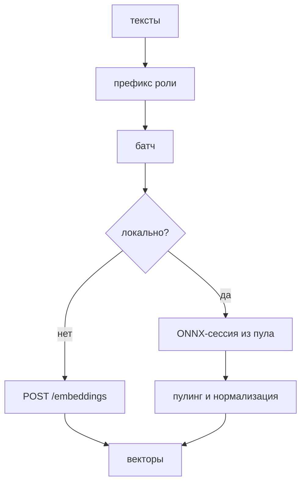

# Эмбеддинги

Эмбеддер превращает текст в вектор. В поиске он считает векторы для чанков при
записи и вектор запроса при поиске. Ядро зависит от интерфейса `embed.Embedder`,
конкретную модель выбирает приложение.

## Интерфейс

```go
type Embedder interface {
	Query(ctx context.Context, texts []string) ([][]float32, error)
	Passages(ctx context.Context, texts []string) ([][]float32, error)
	Dim() int
	Model() string
}
```

`Query` и `Passages` разделены, потому что пресет может добавлять разные
префиксы к запросу и к документу. Векторы возвращаются в порядке входа.

`embed.Closer` освобождает ONNX-сессии. `NormalizeL2` приводит вектор к единичной
длине на месте, нулевой вектор не трогает.

## Границы

`embed` входит в ядро. Локальный ONNX-энкодер лежит в `embed/local_ort.go` за
тегом `ort`. Без тега `NewLocal` возвращает `ErrInvalidConfig`.

Удалённые эмбеддеры:

- `embed.NewOpenAI` для любого OpenAI-совместимого `/embeddings`;
- `plugins/gigachat.NewEmbedder` для GigaChat, отдельный модуль.

## Роли и пресеты

`Preset` описывает препроцессинг: префиксы, пулинг, нормализацию и лимит длины.
`MaxLen` применяет только локальный энкодер. Удалённый провайдер обрезает текст
на своей стороне.

| Пресет   | Семейство         | Пулинг | Query     | Passage     | Нормализация | MaxLen |
| -------- | ----------------- | ------ | --------- | ----------- | ------------ | ------ |
| `e5`     | `multilingual-e5` | mean   | `query: ` | `passage: ` | да           | 512    |
| `bge-m3` | `bge-m3`          | cls    | пусто     | пусто       | да           | 8192   |

Семейство определяется по сегменту имени модели. Сегмент равен имени семейства
или начинается с него и разделителя `-`, `_`, `.`. Имя
`intfloat/multilingual-e5-small` даёт `e5`. Имя `my-bge-m3-tuned` семейства не
даёт: упоминание в середине сегмента не считается.

`PresetFor` отдаёт пресет и `false`, если семейство не найдено или найдено
несколько. Локальный энкодер и `NewOpenAI` на неоднозначном имени возвращают
`ErrInvalidConfig`, потому что неверный пресет молча меняет все векторы.

Явный пресет заменяет вычисленный. Файл `kit_embedder.json` рядом с весами
задаёт `pooling`, `query_prefix`, `passage_prefix`, `normalize`, `max_len`.
Неизвестные поля в файле запрещены.

## Конфигурация

```go
type LocalConfig struct {
	Dir      string
	Model    string
	Sessions int
}
```

`Dir` по умолчанию берётся из `KIT_MODELS_DIR`, затем `./models`. `Sessions`
по умолчанию 2. Каталог модели строит `ModelDir`: слэш в имени заменяется на
`__`, поэтому `intfloat/multilingual-e5-small` лежит в
`intfloat__multilingual-e5-small`.

```go
type OpenAIConfig struct {
	BaseURL    string
	APIKey     string
	Model      string
	Dim        int
	Preset     *Preset
	HTTPClient *http.Client
	BatchSize  int
}
```

`BaseURL` и `Model` обязательны. Запрос идёт на `BaseURL` + `/embeddings`.

GigaChat принимает `EmbedConfig` с `Credentials`, `BaseURL`, `AuthURL`, `Scope`,
`Model`, `Dim`, `Preset`, `BatchSize`, `HTTPClient`. Пустые адреса и модель
заменяются на значения по умолчанию.

## Путь вызова



### Локальный ONNX

`NewLocal` требует `model.onnx`, `tokenizer.json`, `config.json` в каталоге
модели. Пресет берётся из `kit_embedder.json` или из имени модели. Без файла и
без известного семейства загрузка падает.

Граф инспектируется до создания сессий. Входы `input_ids` и `attention_mask`
обязательны, `token_type_ids` добавляется, если он есть. Выход выбирается по
имени:

- `sentence_embedding` используется напрямую;
- `last_hidden_state` пулингуется по маске;
- `token_embeddings` пулингуется так же.

Пулинг `mean` усредняет токены по маске внимания. Пулинг `cls` берёт первый
токен. Длина урезается до `Preset.MaxLen`. Тексты в батче сортируются по длине
перед инференсом и возвращаются в исходном порядке. Батч локального энкодера:
32 текста.

### Удалённый OpenAI-совместимый

`NewOpenAI` шлёт `{"model": ..., "input": [...]}` и разбирает `data[].embedding`
по `index`. Ответ должен содержать столько векторов, сколько текстов отправлено.
Батч по умолчанию 64. Заголовок `Authorization: Bearer <APIKey>` добавляется,
если ключ задан.

Размерность запоминается по первому ответу. Если следующий ответ даёт другую
длину, вызов падает с `ErrProvider`: смена размерности под работающим индексом
портит его молча.

### GigaChat

`plugins/gigachat.NewEmbedder` получает OAuth-токен через
`internal/oauth`, затем шлёт запрос на `/v1/embeddings`. По умолчанию
используются `https://api.giga.chat`, `https://ngw.devices.sberbank.ru:9443/api/v2/oauth`,
scope `GIGACHAT_API_PERS` и модель `Embeddings`. `Credentials` обязательны.

Пресет вычисляет `embed.ResolvePreset`, который не падает на незнакомом имени и
отдаёт пустой пресет.

## Кэш

`NewCached(inner, CacheConfig{Size: N})` оборачивает любой эмбеддер. Ключ это
SHA-256 от домена, роли (`query` или `passage`), имени модели и текста. Запрос и
документ никогда не делят запись.

Кэш хранит копии векторов. Повторы внутри одного вызова схлопываются, наружу
возвращается по вектору на каждый текст. `Size <= 0` отключает кэш. `Close`
закрывает вложенный эмбеддер, если тот реализует `Closer`.

В `gobellim.Config` кэш включается полем `EmbedCache`.

## Проверка размерности

`VerifyDir` проверяет файлы и пресет. В сборке с `ort` он ещё загружает и
закрывает энкодер. `Dim()` отдаёт известную размерность или 0 до первого
ответа. Для локальной модели размерность берётся из формы выхода.

Несовпадение размерностей внутри батча и смена размерности между вызовами
возвращают `ErrProvider`.

## Сборка и запуск

```sh
go build -tags ort ./...
go test -tags ort ./embed/...
go -C plugins/gigachat test ./...
```

Локальному энкодеру нужны `libtokenizers.a` при сборке и ONNX Runtime при
запуске. Путь к библиотеке задаёт `KIT_ORT_LIB`.

## Отказы

| Симптом                             | Причина                                | Ошибка             |
| ----------------------------------- | -------------------------------------- | ------------------ |
| `local ONNX embedder requires ...`  | сборка без `-tags ort`                 | `ErrInvalidConfig` |
| `model file ...`                    | нет файла модели                       | `ErrInvalidConfig` |
| `preset: ... no known family`       | имя не определяет семейство, файла нет | `ErrInvalidConfig` |
| `identifies several known families` | имя подходит к двум семействам         | `ErrInvalidConfig` |
| `got N vectors for M inputs`        | провайдер вернул не то число векторов  | `ErrProvider`      |
| `dimension N does not match ...`    | размерность изменилась                 | `ErrProvider`      |

## Тесты

`embed` проверяет пресеты, батчи, кэш и разбор ответов. `embed/local_ort_test.go`
работает только с тегом `ort`. `plugins/gigachat/embed_test.go` проверяет
OAuth-запрос и форму `/v1/embeddings`.

## Смотрите также

- [Плагины](./README.md), границы модулей
- [Гибридный поиск](./hybrid-search.md), как вектор используется в kNN
- [Провайдеры](../providers/README.md), настройка моделей и эмбеддеров
- [Поиск и индексация](../retrieval/README.md), `Ingest` и `Search`
