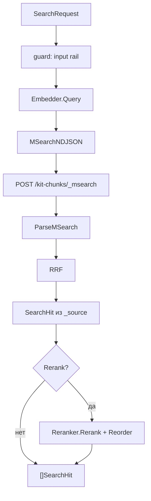

# Гибридный поиск

Поиск идёт двумя ветками: kNN по вектору и BM25 по тексту. Обе ветки
фильтруются одинаково, результаты сливаются через reciprocal rank fusion.
Rerank опционален и работает поверх объединённого списка.

## Границы

Логика живёт в ядре:

- `store/search.go` строит `_msearch`, разбирает ответ и считает RRF;
- `store/filter.go` компилирует метаданные в запрос;
- `internal/app/app.go` ведёт вызов: guard, эмбеддер, `_msearch`, слияние,
  rerank;
- `rerank` реализует `Reranker` и `Reorder`.

Elasticsearch подключается через `store.ES`. Транспорт даёт плагин
[`plugins/elasticsearch`](./elasticsearch.md).

## Запрос

```go
type SearchQuery struct {
	Index         string
	Text          string
	Vector        []float32
	Principal     core.Principal
	TopK          int
	NumCandidates int
	Filter        Filter
	EmbedModel    string
}
```

`TopK` по умолчанию 10, максимум 1000. `NumCandidates` по умолчанию
`max(TopK*10, 100)`, максимум 10000. `Index` по умолчанию `kit-chunks`.
`Filter` объединяется через AND с ACL и фильтром по `embed_model`.

## Путь вызова



Запрос проходит guard до эмбеддера. `Reject` останавливает поиск. `Mask`
заменяет текст, и в эмбеддер, BM25 и трейс уходит уже замаскированный текст.

## Две ветки `_msearch`

Тело состоит из четырёх NDJSON строк: заголовок, kNN, заголовок, BM25.
Источник: `doc_id`, `text`, `position`.

```go
header := map[string]any{"index": q.Index}
knn := map[string]any{
	"size": q.TopK,
	"knn": map[string]any{
		"field":          VectorField,
		"query_vector":   q.Vector,
		"num_candidates": q.NumCandidates,
		"filter":         filter,
	},
	"_source": source,
}
```

BM25 ищет по полю `text` с анализатором `russian`.

```go
bm25 := map[string]any{
	"size": q.TopK,
	"query": map[string]any{
		"bool": map[string]any{
			"must":   []any{map[string]any{"match": map[string]any{TextField: q.Text}}},
			"filter": []any{filter},
		},
	},
	"_source": source,
}
```

Обе ветки получают один и тот же `filter`. Это важно: ACL и tenant не зависят
от того, какая ветка нашла документ.

## ACL и tenant

Фильтр по умолчанию запрещает всё. Нужны совпадение tenant, хотя бы одна роль
из `acl` и `quarantined: false`.

```go
return map[string]any{
	"bool": map[string]any{
		"filter": []any{
			map[string]any{"term": map[string]any{TenantField: p.Tenant}},
			map[string]any{"terms": map[string]any{ACLField: roles}},
			map[string]any{"term": map[string]any{QuarantineField: false}},
		},
	},
}
```

Пустой tenant даёт `ErrInvalidArgs`. `nil` роли превращаются в пустой список,
он не совпадает ни с одним чанком. Так отсутствие ролей не открывает доступ.

`effectiveFilter` добавляет к ACL условие `embed_model`, если модель задана, и
скомпилированный `Filter`. Итог это `bool.filter` из всех условий.

## Язык фильтров

`CompileFilter` принимает поля `doc_id`, `source`, `position`, `created_at`,
`quarantined`. Операторы: `$eq`, `$ne`, `$gt`, `$gte`, `$lt`, `$lte`, `$in`,
`$nin`, `$exists`, `$and`, `$or`, `$not`. Неизвестное поле или оператор даёт
`ErrInvalidArgs`. Пустой фильтр даёт `nil`.

## Разбор ответа

`ParseMSearch` возвращает по списку попаданий на каждую ветку. Любая ошибка
отменяет весь вызов:

- ветка вернула `error`;
- ветка `timed_out`;
- ветка `terminated_early`;
- есть упавшие шарды.

Частичный результат не выдаётся за полный. Ошибки оборачивают `ErrProvider`.

## RRF

Слияние считает каждый документ как сумму `1 / (k + rank + 1)`. Константа `k`
по умолчанию 60. При равенстве счёта порядок решает `ID` по возрастанию.

```go
for _, list := range lists {
	for rank, h := range list {
		if _, seen := byID[h.ID]; !seen {
			order = append(order, h.ID)
		}
		byID[h.ID] = h
		scores[h.ID] += 1.0 / float64(rankConstant+rank+1)
	}
}
```

Документ, найденный двумя ветками, получает сумму двух вкладов.

## Кандидаты и rerank

Без rerank из ES забирается `TopK` кандидатов. С rerank забирается больше,
чтобы модель было из чего выбирать.

`DefaultRerankMultiplier` равен 4. `RerankCandidates` задаёт число явно.
Значение урезается до `store.MaxTopK`, то есть 1000, и не может быть меньше
`TopK`.

`Reranker.Rerank` получает исходный запрос и тексты кандидатов. `Reorder`
сортирует по убыванию счёта, при равенстве по возрастанию индекса. Индексы без
оценки остаются в конце в исходном порядке. `topK` обрезает результат.

TEI-клиент шлёт `{"query": ..., "texts": [...], "truncate": true}` на
`/rerank`. Ответ принимается в форме массива TEI и в форме `{"results": [...]}`
Cohere. Поле `score` важнее `relevance_score`, нулевой счёт не перезаписывается.

Rerank получает замаскированный запрос и уже отфильтрованных кандидатов.

## Отказы

| Симптом                     | Причина                           | Ошибка             |
| --------------------------- | --------------------------------- | ------------------ |
| `empty query`               | пустой `SearchRequest.Query`      | `ErrInvalidArgs`   |
| `requires an Embedder`      | `Config.Embedder` равен `nil`     | `ErrInvalidConfig` |
| `Rerank is set but ... nil` | нет `Config.Reranker`             | `ErrInvalidConfig` |
| `no principal`              | в контексте нет принципала        | `ErrUnauthorized`  |
| `no principal`              | в контексте нет принципала        | `ErrUnauthorized`  |
| `msearch response N ...`    | ошибка, таймаут или упавшие шарды | `ErrProvider`      |
| `index N out of range`      | rerank вернул чужой индекс        | `ErrProvider`      |

## Тесты

`store/search_test.go` и `store/search_fuzz_test.go` проверяют тело `_msearch`,
разбор и RRF. `store/filter_test.go` и `filter_fuzz_test.go` проверяют
компилятор фильтров. `rerank/tei_test.go` проверяет разбор обоих форматов
ответа. `internal/app/app_extra_test.go` проверяет rerank кандидатов и ошибку
без reranker.

## Смотрите также

- [Эмбеддинги](./embeddings.md), откуда берётся вектор запроса
- [Elasticsearch](./elasticsearch.md), транспорт и индексы
- [Поиск и индексация](../retrieval/README.md), `Ingest`, `Search`, ACL
- [Справочник API](../reference/gobellim.md), `SearchRequest`, `SearchHit`
