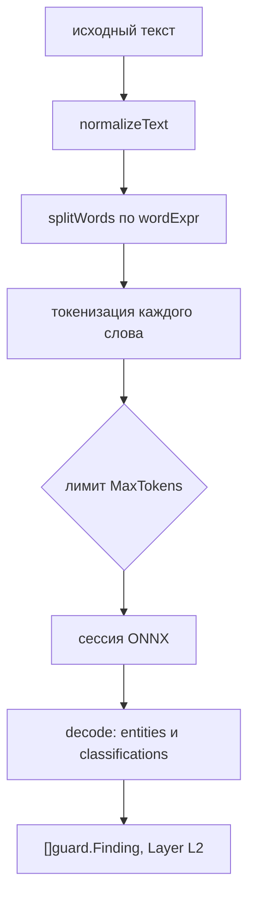

# L2 ONNX: ML-детектор guard

`guard/gliner` это второй слой guard. Он читает исходный текст, находит
сущности и классифицирует содержание. Слой возвращает `[]guard.Finding` с
меткой `L2`. Первый слой, L1, остаётся детерминированным и работает всегда.

## Границы

Детектор живёт в ядре, в пакете `guard/gliner`. Отдельного модуля нет. Код
разделён по тегу сборки:

- `gliner.go` без тега `ort`: заглушка, `Detect` возвращает `ErrGuardUnavailable`;
- `gliner_ort.go` с тегом `ort`: модель, токенизатор, пул сессий.

Ядро не требует нативных библиотек. ONNX Runtime грузится только в сборке с
тегом.

Без тега `ort` `Detect` возвращает `ErrGuardUnavailable`. Заглушка нужна для
fail-closed поведения. Если `Config.GuardL2` задан, а сборка
без `ort`, вызов падает с `ErrGuardUnavailable`. Исключение задаёт
`Config.GuardFailOpen`: там слой пропускается, вердикт дают остальные слои.

## Конфигурация

| Поле        | По умолчанию                       | Смысл                   |
| ----------- | ---------------------------------- | ----------------------- |
| `Dir`       | `KIT_MODELS_DIR`, затем `./models` | корень каталога моделей |
| `Model`     | `hivetrace__gliner-guard-omni`     | имя подкаталога модели  |
| `Sessions`  | `2`                                | число сессий ONNX       |
| `Wait`      | `2s` (`ort.DefaultWait`)           | ожидание сессии из пула |
| `MaxTokens` | `512`                              | лимит токенов входа     |

`MaxTokens` урезается до `max_sequence_length` из `config.json`. В поставляемой
модели это 2048.

## Файлы модели

Каталог модели: `<Dir>/<Model>`. В нём три файла.

| Файл             | Что содержит                                         |
| ---------------- | ---------------------------------------------------- |
| `model.onnx`     | энкодер, span-голова, count-голова, классификатор    |
| `tokenizer.json` | токенизатор DebertaV2                                |
| `config.json`    | метки, пороги, `prefix_ids`, маркеры, формы тензоров |

`config.json` это контракт. Go-код читает из него `prefix_ids`,
`max_sequence_length`, `max_width`, `count_max`, метки и пороги сущностей,
позиции маркеров, группы классификации, `decode.default_span_threshold` и
`category_map`. Метки и пороги не хардкодятся в Go. Смена схемы требует нового
экспорта и новых фикстур.

## Путь вызова



Текст нормализуется: в конец добавляется точка, если её нет. Слова режет
регулярное выражение `wordExpr`. Оно покрывает URL, email, упоминания и слова с
дефисами. Каждое слово токенизируется отдельно, в нижнем регистре, без
специальных токенов.

Вход собирается из `prefix_ids` и токенов слов. Лимит считается по всем
токенам, включая префикс. Слово добавляется, пока помещается целиком.

```go
seq := make([]int64, 0, len(d.cfg.PrefixIDs)+limit)
seq = append(seq, d.cfg.PrefixIDs...)
first := make([]int64, 0, len(words))
kept := 0
for _, w := range words {
	ids, _ := d.tk.Encode(w.token, false)
	if !keepWord(len(seq), len(ids), limit, kept > 0) {
		break
	}
	first = append(first, int64(len(seq)))
	for _, id := range ids {
		seq = append(seq, int64(id))
	}
	kept++
}
```

Хвост за лимитом не инспектируется. Детектор не сообщает об этом отдельно.
Увеличение `MaxTokens` повышает стоимость инференса и память.

## Декодирование

Сначала работает счётчик сущностей. Если `argmax(count_logits) < 1`,
сущностей нет.

```go
if argmax(countLogits) >= 1 {
	n := len(p.words)
	res.entities = make(map[string][]span, len(labels))
	for qi, label := range labels {
		th := cfg.Decode.DefaultSpanThreshold
		if v, ok := cfg.Schema.Entities.Thresholds[label]; ok {
			th = v
		}
```

Для каждой метки перебираются начала и ширины до `max_width`. Спан проходит,
если вероятность не ниже порога. Кандидаты сортируются по убыванию счёта,
пересекающиеся отбрасываются. Повторы по тексту и смещению удаляются.

Классификация с `multi_label: true` считает sigmoid и сравнивает каждую метку со
своим порогом. Обычная группа считает softmax и берёт максимум. Порог задаётся
`thresholds[label]`, затем `threshold`, затем `cls_threshold`, затем 0.5.

## Находки и категории

Смещения `Start` и `End` считаются в рунах. Конец урезается до длины текста.
Классификация покрывает весь текст: `Start: 0`, `End: p.nRunes`.

Категория берётся из `category_map`. Значение `SAFE` скрывает находку.
Неизвестная метка сущности по умолчанию становится `PII`. Для классификации
задачи `intent`, `tone`, `topic` и подобные считаются информационными и не дают
находок без явной записи в `category_map`.

## Пул сессий ORT

Пул живёт в `internal/ort`. Он выдаёт сессию на один вызов и возвращает её
обратно. Ожидание по умолчанию 2 с (`ort.DefaultWait`). Таймаут даёт
`ErrQueueTimeout`, закрытый пул даёт `ErrPoolClosed`.

`Acquire` ждёт свободную сессию, отмену контекста или таймаут. `Release`
закрывает сессию, если пул уже закрыт или сессия лишняя. Так нативная арена не
утекает. `Close` закрывает все сессии. `Stats` отдаёт размер и число свободных
сессий, их использует `Health`.

## Сборка и запуск

Нужны `libtokenizers.a` при сборке и `libonnxruntime.dylib` или `.so` при
запуске.

```sh
go build -tags ort ./...
go test -tags ort ./guard/...
go -C cmd run ./kitctl verify models --dir models
```

Путь к библиотеке задаёт `KIT_ORT_LIB`. Без переменной берётся
`.ort/lib/libonnxruntime.dylib` на macOS и `.ort/lib/libonnxruntime.so` на
Linux.

Модель собирает `tools/gliner/export.py`:

```sh
python3 tools/gliner/export.py --out /tmp/gliner
mkdir -p models/hivetrace__gliner-guard-omni
cp /tmp/gliner/model/{model.onnx,tokenizer.json,config.json} models/hivetrace__gliner-guard-omni/
```

`kitctl model pull` здесь не подходит. Репозиторий модели на HF содержит
`model.safetensors`, а ONNX-граф создаёт скрипт экспорта.

## Отказы

| Симптом                     | Причина                                  | Ошибка                |
| --------------------------- | ---------------------------------------- | --------------------- |
| `built without ORT support` | сборка без `-tags ort`                   | `ErrGuardUnavailable` |
| `model file ...`            | нет одного из трёх файлов модели         | `ErrInvalidConfig`    |
| `config ...`                | `config.json` не читается или не JSON    | `ErrInvalidConfig`    |
| `ort init`                  | библиотека не найдена или не загрузилась | `ErrGuardUnavailable` |
| `acquire`                   | все сессии заняты дольше `Wait`          | `ErrGuardUnavailable` |
| `inference`                 | ошибка ONNX Runtime                      | `ErrGuardUnavailable` |

Ошибка инференса оборачивает `ErrGuardUnavailable`. Политика решает, отклонить
запрос или продолжить без L2.

## Тесты

Тесты с тегом `ort` лежат рядом с кодом. `gliner_ort_test.go` проверяет
загрузку и находки, `schema_ort_test.go` сверяет метки и пороги с
`config.json`, `parity_ort_test.go` сравнивает выход с фикстурами PyTorch,
`budget_ort_test.go` проверяет бюджет латентности.

Parity-гейт запускается отдельно:

```sh
go -C cmd run ./kitctl verify parity --dir models --min-agreement 1.0
```

Без тега `ort` тесты проверяют только заглушку и `VerifyDir`.

## Смотрите также

- [Защита](../guard/README.md), рельсы, вердикты, fail-closed
- [Плагины](./README.md), границы модулей и теги сборки
- [Эмбеддинги](./embeddings.md), второй потребитель пула ORT
- [Ошибки](../reference/errors.md), `ErrGuardUnavailable`, `ErrGuardReject`
