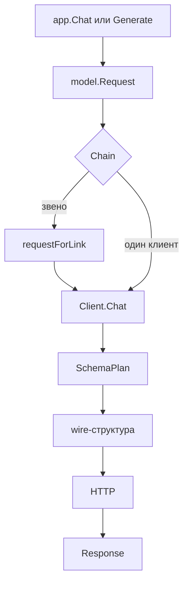

# Как устроены провайдеры

## Что это

`model.Client` это порт чата. `Chat` получает `model.Request` и возвращает
`model.Response`, а `Model()` отдаёт имя модели. Ядро не знает про HTTP:
провайдер переводит `Request` в свой wire-формат и обратно.

Сверх порта есть `ContextWindow`, `Streamer`, `Regional` и
`SupportsNativeSchema()`. Ядро проверяет их через type assertion. Клиент без них
работает, но теряет стриминг, нативную схему и проверку окна контекста.

## Пакеты и границы

| Пакет                                | Что внутри                                                                               | Границы                                              |
| ------------------------------------ | ---------------------------------------------------------------------------------------- | ---------------------------------------------------- |
| `model`                              | `Client`, `Request`/`Response`, `SchemaPlan`, `Chain`, `Structurer`, `Pricing`, `Region` | `internal/core`, `internal/httpjson`                 |
| `embed`                              | `Embedder`, `OpenAIEmbedder`, пресеты, кэш, ONNX под тегом `ort`                         | `internal/cache`, `internal/core`                    |
| `plugins/gigachat`                   | чат и эмбеддер GigaChat поверх OAuth                                                     | отдельный модуль; `model`, `embed`, `internal/oauth` |
| `internal/httpjson`, `internal/core` | HTTP-слой и сентинелы ошибок                                                             | непубличные                                          |
| `internal/app`                       | вызывает `Client`, применяет guard, регион, окно, стоимость                              | не входит в `model`                                  |

Провайдер не импортирует `internal/app`. Зависимость идёт от приложения к порту.

## Поток



## Ключевые типы

```go
// Client is the chat port: Chat sends one request and Model reports the
// provider's model name.
type Client interface {
	Chat(ctx context.Context, req Request) (Response, error)
	Model() string
}
```

`Request` несёт `Messages`, `Tools`, `Temperature`, `MaxTokens`, `JSONSchema`,
`SchemaMode`, `ToolChoice`, `Seed`, `Stop` и `ProviderOptions`. `Response` несёт
`Message`, `Usage`, имя модели и `FinishReason`. `ParseFinishReason` сводит
провайдерские строки к `stop`, `tool_calls`, `length`, `content_filter` и
`other`. Стоимость считает приложение через `Pricing.Cost`.

## Шаг 1: схема ответа

`SchemaPlan` (`model/schema.go`) решает, уйдёт схема полем провайдера или
текстом. `SchemaNative` возвращает `native == true` и не меняет сообщения.
`SchemaInline` дописывает инструкцию в последнее `user`-сообщение,
`SchemaSystem` в системное. Пустая схема даёт `native == false`.
`ApplyProviderOptions` вливает `ProviderOptions` в map, кроме ключей `model`,
`messages`, `stream`, `tools`, `tool_choice`, `response_format` и `format`.

## Шаг 2: OpenAI chat-completions

`model/openai.go` постит на `<BaseURL>/chat/completions`. Результат инструмента
уходит ролью `tool` с `tool_call_id` и `name`.

```go
om := oaiMessage{Role: string(m.Role), Content: m.Content, ToolCallID: m.ToolCallID, Name: m.Name}
for _, tc := range m.ToolCalls {
	ot := oaiToolReq{ID: tc.ID, Type: "function"}
	ot.Function.Name = tc.Name
	ot.Function.Arguments = tc.Args
	om.ToolCalls = append(om.ToolCalls, ot)
}
```

`ToolSpec` становится `{"type":"function",...}`. `oaiToolChoice` отправляет
`auto`, `none` и `required` строкой, а имя инструмента объектом. Нативный путь
это `response_format` с `json_schema` и именем `output`; режима `json_object` в
порту нет. Ответ берётся из первого `choices`, пустой список даёт `ErrProvider`.

## Шаг 3: Ollama /api/chat

`model/ollama.go` шлёт `POST <BaseURL>/api/chat` с `stream: false`. Аргументы
инструмента здесь объект, поэтому строку из `ToolCall.Args` надо разобрать.

```go
args, err := parseObject(tc.Args)
if err != nil {
	return Response{}, fmt.Errorf("model: ollama: tool %s: %w", tc.Name, err)
}
otc := ollamaToolCall{}
otc.Function.Name = tc.Name
otc.Function.Arguments = args
```

`tools` не отправляются при `ToolChoice == "none"`, остальные значения
игнорируются. В `ollamaMessage` нет `tool_call_id` и `name`, поэтому результат
инструмента теряет идентификатор и имя, роль `tool` остаётся. У ответа может не
быть `id`, клиент синтезирует `<name>-<index>`. Параметры сэмплинга уходят в
`options` как `temperature`, `num_predict`, `seed` и `stop`; в режиме `native`
схема кладётся в `format`. `usage` собирается из `prompt_eval_count` и
`eval_count`.

## Шаг 4: стриминг

Стриминг реализует только `OpenAIClient` (`model/openai_stream.go`). Запрос идёт
с `stream: true` и `stream_options.include_usage`. Клиент читает SSE построчно и
останавливается на `[DONE]`; ошибка из `onDelta` обрывает чтение.

```go
call, ok := calls[tc.Index]
if !ok {
	call = &ToolCall{}
	calls[tc.Index] = call
	order = append(order, tc.Index)
}
call.Args += tc.Function.Arguments
```

`id` и `name` приходят в первом куске, аргументы дописываются. `order` хранит
порядок первого появления индекса. Ollama и GigaChat стриминга не реализуют.

## Шаг 5: структурированный вывод

`Structurer` (`model/structurer.go`) понижает режим, если клиент не умеет
нативную схему, и возвращает сырой JSON. `Generate` валидирует ответ и
разбирает его в `T`; при ошибке он один раз пробует `StructuringModel` через
`app.structure`, затем применяет `ErrorStrategy` (`internal/app/app.go`).

| `ErrorStrategy` | Поведение при неудачном декодировании                       |
| --------------- | ----------------------------------------------------------- |
| `Strict`        | ошибка с `ErrProvider`, значение не возвращается            |
| `Warn`          | предупреждение в лог, `Raw` заполнен, `Decoded` равен false |
| `Fallback`      | подставляется `Fallback`, `UsedFallback` равен true         |

`SchemaNative` понижается до `SchemaInline` и в `Generate`, и в `Structurer`,
когда `SupportsNativeSchema` вернул false.

## Шаг 6: fallback-цепочка

`model.Chain` перебирает клиентов по порядку; `Model()` возвращает имя первого
звена. Звено ретраится при retryable-ошибке до `MaxRetries`, с паузой от
`httpjson.Backoff` и учётом `Retry-After` (`model/chain.go`). Провал всех звеньев
даёт `errors.Join`. `requestForLink` понижает `SchemaNative` для звена без
нативной схемы. `chainClient` сообщает поддержку нативной схемы только когда её
поддерживают все звенья.

## Шаг 7: окно контекста, регион, стоимость

`OpenAIClient` и `OllamaClient` реализуют `ContextWindow`. При `gobellim.New`
приложение сравнивает `GuardMaxChars` (или `guard.DefaultMaxChars`) с
`ContextTokens`: широкое окно guard даёт `ErrInvalidConfig`, нулевое окно даёт
предупреждение.

`Region` нужен для правила резидентности. Маскирование обязательно, если клиент
не реализует `Regional` или объявил регион вне `RegionRU`
(`internal/app/app.go`, `piiMaskingRequired`). Тогда инструменты с `AllowPII`
видят плейсхолдеры. GigaChat не реализует `Regional`, поэтому для него
маскирование обязательно. Стоимость считает `Pricing.Cost`.

## Шаг 8: эмбеддинги

`embed/openai.go` постит на `<BaseURL>/embeddings`. `Query` и `Passages` режут
тексты на батчи по `BatchSize` (по умолчанию 64), добавляют префикс пресета и
при `Normalize` нормируют вектор по L2. Ответ раскладывается по `index`, поэтому
порядок входа сохраняется. Размерность фиксируется на первом ответе, другой
размер даёт `ErrProvider` (`embed/remote.go`).

Пресет выводится из имени модели: `multilingual-e5` даёт `mean` и префиксы
`query: `/`passage: `, `bge-m3` даёт `cls`. Имя, которое только упоминает
семейство, это ошибка.

Локальный энкодер живёт за тегом `ort` (`embed/local_ort.go`): он читает
`model.onnx`, `tokenizer.json` и `config.json` и берёт размерность из графа.
Без тега `NewLocal` сразу возвращает `ErrInvalidConfig`. Батч не больше 32
текстов сортируется по длине, затем порядок восстанавливается.

## Шаг 9: GigaChat

`plugins/gigachat` это отдельный модуль. Токен берёт `oauth.TokenSource` по
`AuthURL`, `Credentials` и `Scope`, запрос идёт на
`<BaseURL>/v1/chat/completions` с `Authorization: Bearer`. Роль `tool`
переводится в `function`, невалидный JSON результата заворачивается в
`{"result": "..."}`. Провайдер несёт один `function_call` на сообщение и
отвергает сообщение с несколькими `tool_call` как `ErrProvider`.

| `ToolChoice`     | GigaChat                                                        |
| ---------------- | --------------------------------------------------------------- |
| пусто или `auto` | `function_call: "auto"`, если функции есть                      |
| `required`       | ошибка `ErrProvider`                                            |
| имя инструмента  | `{"name": ...}`, ошибка `ErrInvalidArgs` без такого инструмента |
| `none`           | блок функций пропускается целиком                               |

Structured output эмулируется функцией `structured_output` с принудительным
`function_call`. `SupportsNativeSchema()` возвращает false, поэтому `Generate`
и `Structurer` понижают режим до inline. `Streamer` клиент не реализует.

## Отказы и пределы

| Условие                                   | Поведение                   |
| ----------------------------------------- | --------------------------- |
| отрицательный `ContextTokens`             | `ErrInvalidConfig`          |
| пустой `choices`                          | `ErrProvider`               |
| невалидные аргументы инструмента у Ollama | ошибка с именем инструмента |
| несколько `tool_call` у GigaChat          | `ErrProvider`               |
| `ToolChoice: required` у GigaChat         | `ErrProvider`               |
| смена размерности эмбеддинга              | `ErrProvider`               |
| локальный энкодер без тега `ort`          | `ErrInvalidConfig`          |

Контекст отменяет HTTP-запрос и паузы цепочки. Провайдер не ретраит сам:
ретраи есть у `Chain` и у транспортного клиента `internal/httpjson`.

## Тесты

`model/finish_test.go` проверяет `ParseFinishReason`, `model/schema_test.go`
режимы схемы, `model/capabilities_test.go` понижение схемы в `Chain` и
`Structurer`, `model/chain_test.go` ретраи. `embed/*_test.go` покрывают батчи,
пресеты и локальный энкодер. `plugins/gigachat/gigachat_test.go` держит маппинг
функций и OAuth.

## Смотрите также

- [Провайдеры](./README.md), выбор и подключение
- [Справочник провайдеров](../reference/providers.md), поля конфигурации
- [Поиск и индексация](../retrieval/README.md), использование эмбеддера
- [Защита](../guard/README.md), маскирование и регион
- [Ошибки](../reference/errors.md), классификация через `errors.Is`
