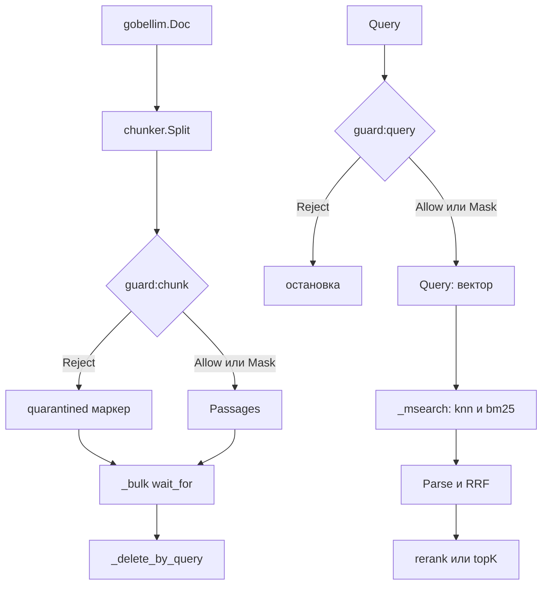

# Как устроены поиск и индексация

`Ingest` и `Search` живут в `internal/app`. Они собирают запросы к Elasticsearch
из `chunk`, `embed`, `store` и `rerank`.

## Пакеты и границы

| Пакет           | Роль                            | Файлы                               |
| --------------- | ------------------------------- | ----------------------------------- |
| `chunk`         | окна по токенайзеру             | `chunk/chunk.go`                    |
| `embed`         | векторы, пресеты, кеш, батчи    | `embed/*.go`                        |
| `store`         | тела запросов, ACL, RRF, разбор | `store/*.go`                        |
| `rerank`        | переупорядочивание              | `rerank/rerank.go`, `rerank/tei.go` |
| `internal/app`  | порядок шагов, guard, трейс     | `internal/app/app.go`               |
| `internal/call` | `authz → guard → span → fn`     | `internal/call`                     |

`store` не вызывает guard и не знает про принципала, кроме готового фильтра.
Порядком владеет `internal/app`: guard, эмбеддер, затем ES. Каждый вызов
эмбеддера и ES идёт через `call.Do` с правом и `traceID`.

## Поток



## Ключевые типы

```go
// store/chunks.go
type Chunk struct {
	ID         string
	DocID      string
	Tenant     string
	ACL        []string
	Text       string
	Vector     []float32
	EmbedModel string
	DocVersion int64
	Position   int
	Source     string
	CreatedAt  time.Time
	Quarantine bool
}
```

`SearchQuery` (`store/search.go`) несёт текст, вектор, принципала, `TopK`,
`Filter` и `EmbedModel`.

## Шаг 1. Нарезка

```go
// chunk/chunk.go
func (c *Chunker) Split(text string) []string {
	toks := c.tok.Tokens(text)
	if len(toks) == 0 {
		return nil
	}
	runes := []rune(text)
	step := c.size - c.overlap
```

Размер по умолчанию 400 токенов, перекрытие 80. Токенайзер отдаёт смещения в
рунах, текст не аллоцирует. Смещения клампятся в границы строки, потому что
`Tokenizer` это публичный интерфейс. Без `Config.Tokenizer` `Ingest` даёт
`ErrInvalidConfig`.

## Шаг 2. Guard и векторы

```go
// internal/app/app.go
v, gerr := call.Guard(ctx, a.calls, call.Req{
	Kind: call.KindGuard, Name: "guard:chunk", Rail: guard.RailInput,
	Text: text, TraceID: traceID,
})
```

Отклонённый чанк становится маркером без текста, вектора и модели. Эмбеддер его
не видит. Остальные получают маскированный `v.Text`, затем идёт один вызов
`Passages(ctx, pending)`.

Батчи режет эмбеддер: `DefaultRemoteBatchSize = 64` (`embed/openai.go`),
`DefaultBatchSize = 32` у локального ONNX (`embed/local_ort.go`). `Query` и
`Passages` разделены из-за префиксов пресета, например `"query: "` у e5.

## Шаг 3. Bulk, версии и маппинг

`DocVersion` это `time.Now().UTC().UnixNano()`. Новая версия пишется через
`_bulk` с `Refresh: "wait_for"`. Потом `_delete_by_query` удаляет старые
документы и исключает сохранённую версию через `must_not` по `doc_version`.
Порядок важен: падение между шагами оставляет документ доступным.

```go
// store/index.go
"properties": map[string]any{
	"doc_id":        map[string]any{"type": "keyword"},
	TenantField:     map[string]any{"type": "keyword"},
	ACLField:        map[string]any{"type": "keyword"},
	TextField:       textField(),
	VectorField:     map[string]any{"type": "dense_vector", "dims": dims, "index": true, "similarity": "cosine"},
	"doc_version":   map[string]any{"type": "long"},
	QuarantineField: map[string]any{"type": "boolean"},
	EmbedModelField: map[string]any{"type": "keyword"},
},
```

Текст анализируется анализатором `russian`. `Setup` создаёт индекс чанков
только при `Embedder.Dim() > 0`, поэтому холодный эмбеддер без `Dim`
откладывает создание индекса. `embed_model` пишется в каждый чанк и входит в
фильтр поиска.

## Шаг 4. Поиск

Запрос проходит input rail, и в эмбеддер уходит только маскированный текст.
Кандидатов считает `candidateCount`: `TopK` без rerank, иначе
`RerankCandidates` или `TopK * 4`, но не больше `store.MaxTopK`.

```go
// internal/app/app.go
vectors, err := call.Do(ctx, a.calls, call.Req{
	Kind: call.KindEmbed, Name: a.cfg.Embedder.Model(), Permission: authz.PermSearch, TraceID: traceID,
}, func(ctx context.Context, span trace.Span) ([][]float32, error) {
	return a.cfg.Embedder.Query(ctx, []string{query})
})
```

Дальше `MSearchNDJSON`, `ParseMSearch`, `RRF`, опциональный rerank и обрезка до
`TopK`.

## `_msearch`: kNN и BM25

```go
// store/search.go
knn := map[string]any{
	"size": q.TopK,
	"knn": map[string]any{
		"field":          VectorField,
		"query_vector":   q.Vector,
		"num_candidates": q.NumCandidates,
		"filter":         filter,
	},
	"_source": source,
}
```

`knn` стоит на верхнем уровне, рядом с `size`, без обёртки в `query`. Это форма
Elasticsearch 8. BM25 это `bool.must` с `match` по `text` и тот же `filter`.
Оба подзапроса получают одинаковый `size` и фильтр. `NumCandidates` по
умолчанию `max(TopK*10, 100)`.

`ParseMSearch` валит весь вызов при ошибке любой ветки, упавшем шарде,
таймауте или раннем завершении. Частичный ответ не выдаётся за полный.

## ACL и фильтры

```go
// store/search.go
return map[string]any{
	"bool": map[string]any{
		"filter": []any{
			map[string]any{"term": map[string]any{TenantField: p.Tenant}},
			map[string]any{"terms": map[string]any{ACLField: roles}},
			map[string]any{"term": map[string]any{QuarantineField: false}},
		},
	},
}, nil
```

Это deny-by-default: нужен tenant, хотя бы одна роль в `acl` и
`quarantined: false`. Пустой tenant даёт `ErrInvalidArgs`, `nil` роли
превращаются в пустой список. `effectiveFilter` добавляет term по
`embed_model` и пользовательский `Filter`. Тот же фильтр попадает в обе ветки.

`CompileFilter` разрешает `doc_id`, `source`, `position`, `created_at`,
`quarantined` и операторы `$eq`, `$ne`, `$gt`, `$gte`, `$lt`, `$lte`, `$in`,
`$nin`, `$exists`, `$and`, `$or`, `$not`. Неизвестное поле даёт `ErrInvalidArgs`.

## RRF и rerank

```go
// store/search.go
for _, list := range lists {
	for rank, h := range list {
		if _, seen := byID[h.ID]; !seen {
			order = append(order, h.ID)
		}
		byID[h.ID] = h
		scores[h.ID] += 1.0 / float64(rankConstant+rank+1)
	}
}
```

`Search` передаёт `rankConstant = 0`, поэтому берётся 60. Ничьи разрешаются по
возрастанию `_id`. Обрезка идёт до `fetchK`. `rerankHits` отправляет запрос в
`Rerank`, затем вызывает `rerank.Reorder(len(hits), ranks, topK)`. Индексы без
оценки остаются в конце.

## Ошибки и пределы

| Ситуация                       | Результат                       |
| ------------------------------ | ------------------------------- |
| пустой `Doc.ACL`               | `ErrInvalidArgs`, до эмбеддинга |
| нет `Tokenizer` или `Embedder` | `ErrInvalidConfig`              |
| guard отклонил запрос          | `ErrGuardReject`                |
| пустой `Query`                 | `ErrInvalidArgs`                |
| `Rerank` без `Reranker`        | `ErrInvalidConfig`              |
| длина вектора не равна `Dim()` | `ErrInvalidArgs`                |
| чужое число векторов           | `ErrProvider`                   |
| ошибка `_bulk`                 | `ErrBulkItem` и `ErrProvider`   |
| ошибка ветки `_msearch`        | `ErrProvider`                   |
| не-2xx от ES                   | `ErrProvider` через `esDo`      |

Смену размерности ловит `OpenAIEmbedder`: `checkDim` не даёт смешать длины в
батче, `setDim` отвергает смену между запросами. При `Dim() == 0` проверка
пропускается. Границы: `MaxTopK = 1000`, `MaxNumCandidates = 10000`.

## Тесты

`chunk`: `TestSplitWindows`, `TestSplitSurvivesBrokenOffsets`.

`store`: `TestACLFilterDenyByDefault`, `TestMSearchNDJSON`,
`TestMSearchNDJSONFiltersByEmbedModel`, `TestRRFFusion`.

`embed`: `TestOpenAIEmbedderBatchesRequests`,
`TestOpenAIEmbedderRejectsADimensionChange`.

`internal/app`: `TestIngestWritesBeforeDeletingOldVersions`,
`TestIngestQuarantinedChunkIsNeverEmbedded`,
`TestSearchGuardsTheQueryBeforeEmbedding`, `TestSearchReranksCandidates`.

## Смотрите также

- [Поиск и индексация](./README.md)
- [Защита](../guard/README.md)
- [Справочник API](../reference/gobellim.md)
