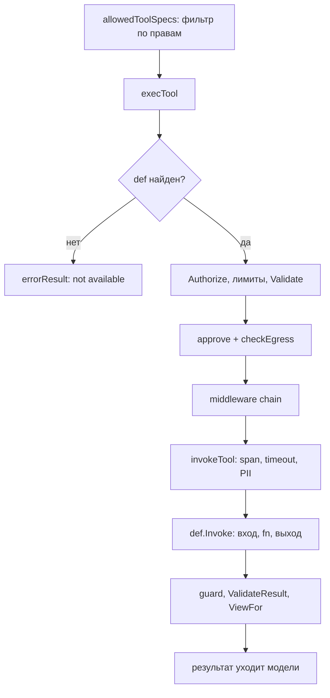

# Как устроены инструменты

`README.md` объясняет, что объявить. Здесь видно, что происходит после
`Registry.Build`. Источники: `tool/tool.go`, `internal/tool/*.go`, функция
`execTool` в `internal/app/app.go`.

`tool.New` выводит схемы из `In` и `Out` и компилирует их. `Registry.Build`
собирает неизменяемый набор и отдаёт все ошибки объявлений сразу.
`App.execTool` проводит вызов через RBAC, лимиты, подтверждение, egress,
middleware, guard и `View`. Ошибка объявления видна при сборке. Ошибка данных
видна при вызове.

## Пакеты и границы

| Пакет           | Роль                                                              |
| --------------- | ----------------------------------------------------------------- |
| `tool`          | публичный `Tool[In, Out]`, опции `Desc`, `Perm`, `View`, политики |
| `internal/tool` | `Def`, `Registry`, `ToolSet`, схемы, `Policy`, канонический ключ  |
| `internal/app`  | `execTool`, `Tool`, `RawTool`, `Call`, `Middleware`, egress       |

`tool` зависит от `internal/tool`. `internal/app` импортирует оба. Обратной
связи нет: `internal/tool` не знает про `App`.

## Поток вызова



`allowedToolSpecs` фильтрует по праву, `execTool` повторяет запрет.

## Ключевые типы

`Def` это граница между типизированным API и движком. `internal/app` работает
только с `Def`, а `fn` внутри `Tool[In, Out]` остаётся типизированной.

```go
// internal/tool/def.go
type Def interface {
	Name() string
	Description() string
	Schema() json.RawMessage
	Invoke(context.Context, json.RawMessage) (json.RawMessage, error)
	Err() error
	Policy() Policy
	Permission() string
	Key(json.RawMessage) string
	Validate(json.RawMessage) error
	ValidateResult(string) error
	ViewFor(context.Context, string) (string, error)
}
```

## Шаг за шагом

### Схема из типа

`SchemaFor` вызывает `invopop/jsonschema` с `DoNotReference` и
`ExpandedStruct`, затем удаляет `$schema` и `$id`. Для `any` остаётся `{}`,
то есть открытая схема. Структура с полями закрывается, map сохраняет схему
значения.

```go
		if props, ok := m["properties"].(map[string]any); ok && len(props) > 0 {
			hasProps = true
		}
		if ap, ok := m["additionalProperties"].(map[string]any); ok && len(ap) > 0 {
			isMapType = true
		}
```

Дальше `hasProps && !isMapType` ставит `additionalProperties: false`.

### Компиляция при объявлении

Схема входа компилируется в `New`, а не при первом вызове. Для `Out`
повторяется то же с именем `name+"_out"`. `CompileSchema` отдаёт документ в
`santhosh-tekuri/jsonschema/v6` через `AddResource` и `Compile`. Любая ошибка
попадает в `t.err`.

### Registry.Build склеивает ошибки

`Register` ошибку не возвращает. Повтор имени копится в `r.errs`, `Build`
добавляет `def.Err()` каждого объявления и отдаёт всё через `errors.Join`.

```go
	for _, def := range r.defs {
		if err := def.Err(); err != nil {
			errs = append(errs, err)
			continue
		}
		set.byName[def.Name()] = def
		set.order = append(set.order, def.Name())
	}
	if len(errs) > 0 {
		return nil, errors.Join(errs...)
	}
	return set, nil
```

При ошибке `Build` возвращает `nil` вместо набора. `Names` сортирует имена,
`All` держит порядок регистрации.

### Вызов и двойная валидация

`execTool` проверяет аргументы до подтверждения. `Invoke` проверяет их снова.
Пустые аргументы становятся `{}`.

```go
	if len(args) > a.cfg.ArgsMaxBytes {
		return errorResult("arguments too large"), nil
	}
	if err := def.Validate(args); err != nil {
		return errorResult(err.Error()), nil
	}
	if def.Policy().RequiresApproval() {
		if err := a.approve(ctx, def, args, t); err != nil {
			return "", err
		}
	}
```

`Invoke` разбирает `In`, зовёт `fn`, сериализует `Out` и проверяет результат
по схеме выхода. `View` применяется последней, уже после проверки.

```go
	// Validate result against the output schema.
	if t.outCompiled != nil {
		var v any
		if err := json.Unmarshal(raw, &v); err != nil {
			return nil, fmt.Errorf("tool: %s: result is not JSON: %w", t.name, err)
		}
		if err := t.outCompiled.Validate(v); err != nil {
			return nil, fmt.Errorf("tool: %s: result does not match output schema: %w", t.name, err)
		}
	}
```

### Право по умолчанию

Без `Perm` право строится из имени. `ToolPermission` возвращает `"tool:" +
name`. Забытая опция сужает доступ, а не расширяет его. Имя живёт в пакете,
который делят объявление и RBAC.

### Policy merge

Политика это `Option`. Ноль означает `read`, без egress и подтверждения.
`Merge` не понижает egress: если любая сторона объявила `EffectEgress`,
результат остаётся egress, поэтому поздний `Write()` или `Read()` не снимает
allowlist. Хосты берутся из стороны, где они заданы. Подтверждение
включается, если его требует любая сторона. `AllowPII` аддитивен.

`Validate` отвергает egress без хостов и без `AnyHost`. Ошибка тоже видна в
`Build`.

### RawTool

`RawTool` берёт внешнюю схему, например из MCP. Аргументы приходят как
`json.RawMessage`, результат объявлен строкой. Пустая схема становится
`{"type":"object"}`. `SetSchema` перекомпилирует её, ошибка снова уходит в
`t.err`.

### Порядок middleware

Первый элемент `Config.Middleware` становится внешним слоем, последний лежит
ближе всего к `Invoke`.

```go
	for i := len(mws) - 1; i >= 0; i-- {
		mw, inner := mws[i], next
		next = func(ctx context.Context) (json.RawMessage, error) {
			return mw(ctx, c, inner)
		}
	}
```

Middleware может остановить вызов без `next` или переписать результат.
Результат всё равно проходит guard, схему выхода и `View`.

## Отказы и лимиты

| Условие                         | Что видит вызывающий                     |
| ------------------------------- | ---------------------------------------- |
| имя не зарегистрировано         | `errorResult`, модель читает текст       |
| аргументы больше `ArgsMaxBytes` | `errorResult("arguments too large")`     |
| аргументы не проходят схему     | `errorResult` с текстом ошибки           |
| RBAC запретил                   | `ErrUnauthorized`, ход прерывается       |
| нет `Approver`                  | `ErrApprovalRequired`, ход прерывается   |
| egress-хост не разрешён         | `ErrUnauthorized` и security event       |
| падение инструмента             | `errorResult`, модель видит текст        |
| guard заблокировал результат    | `errorResult("result blocked by guard")` |
| результат не прошёл схему       | `errorResult`, ход помечен untrusted     |

По умолчанию `ArgsMaxBytes` 32 КиБ, `MaxCallsPerTool` 3, `ToolTimeout` 30
секунд. Лимита результата нет: его обрезает `guard:tool_result` по
`GuardMaxChars`, что помечает ход untrusted и может сломать `ValidateResult`.

## Тесты

- `tool/tool_test.go`: право по умолчанию, `Perm`, доставка опций, egress, сырые аргументы.
- `internal/tool/policy_test.go`: egress не понижается, `AllowPII` переживает `Merge`.
- `internal/tool/registry_test.go`: сборка, повтор имени, nil-объявление.
- `internal/tool/schema_test.go`: закрытая схема, детерминизм, отказ битой схеме.
- `internal/tool/canonical_test.go`: пустые аргументы, сортировка ключей.

## Смотрите также

- [Инструменты](./README.md)
- [Рабочие процессы](../workflows/README.md)
- [Справочник API](../reference/gobellim.md)
