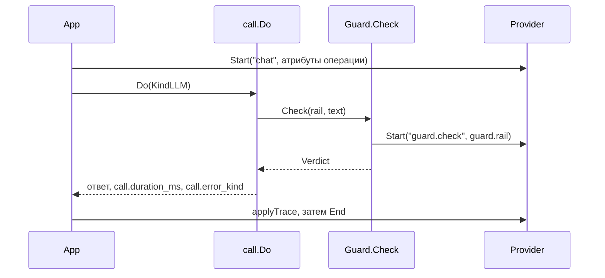

# Как устроена трассировка

`trace` описывает спаны, но не хранит их. В пакете нет экспортёра, записи на диск и sink. Провайдер создаёт спан, вызывающий заканчивает его, приложение решает, куда спан уходит. OpenTelemetry живёт в отдельном модуле `plugins/otel`, сам `trace` импортирует только `context`.

## Пакеты и границы

| Файл                    | Роль                                                         |
| ----------------------- | ------------------------------------------------------------ |
| `trace/trace.go`        | `Span`, `Provider`, `Attribute`, noop                        |
| `trace/config.go`       | `ContentMode` и его строковое имя                            |
| `trace/attrs.go`        | ключи `gen_ai.*` и `gobellim.*`, типизированные конструкторы |
| `internal/call/call.go` | спан вызова, спан guard, классификация ошибок                |
| `internal/app/app.go`   | `startOperation`, `applyTrace`, `recordOutput`               |
| `internal/app/audit.go` | отдельный аудит-лог, не связанный со спанами                 |
| `plugins/otel/otel.go`  | адаптер к OpenTelemetry                                      |
| `eval/` (модуль)        | читает переданные наблюдения, сам спаны не пишет             |

## Поток



## Ключевые типы

```go
type Span interface {
	End()
	SetAttributes(attrs ...Attribute)
	SetError()
	RecordError(err error, attrs ...Attribute)
	Event(name string, attrs ...Attribute)
	SetTokens(inputTokens, outputTokens int)
}
```

```go
type Attribute struct {
	Key   string
	Value any
}

type Provider interface {
	Start(ctx context.Context, name string, attrs ...Attribute) (context.Context, Span)
}
```

`Attribute.Value` допускает `string`, `int`, `int64`, `int32`, `float64`, `float32`, `bool` и `[]string`. Значение другого типа провайдер отбрасывает, чтобы не записать пустую строку вместо данных.

`Noop()` возвращает провайдер, который ничего не пишет и не меняет контекст. `App.New` подставляет его, если `Config.TracerProvider` пуст.

```go
const (
	ContentRedacted ContentMode = iota
	ContentNone
	ContentFull
)
```

Нулевое значение это `ContentRedacted`. Приложение, которое не настроило режим, пишет маскированный текст.

## По шагам

### 1. Спан операции

Контекст со спаном передаётся дальше, поэтому все вызовы становятся его детьми.

```go
attrs := []trace.Attribute{
	trace.Tenant(pr.Tenant),
	trace.UserID(pr.UserID),
	trace.String(trace.AttrTraceID, traceID),
	trace.GuardVersion(a.calls.GuardVersion),
	trace.GuardModel(a.calls.GuardModel),
	trace.PolicyHash(a.policyHash),
}
```

Теги добавляются к этому списку, затем вызывается `provider.Start(ctx, name, attrs...)`.

Поля `Deps` (`GuardVersion`, `GuardModel`, `TextPolicy`) заполняет `App.New`, сам `call.Do` их в спан не пишет.

### 2. Спан вызова

Каждая операция и каждый инструмент идут через `call.Do`. Он ставит `call.kind`, измеряет длительность и записывает модель.

```go
out, err := run(ctx, deps, req, fn, span)

span.SetAttributes(
	trace.Int("call.duration_ms", int(time.Since(start).Milliseconds())),
	trace.String("call.model", req.Model),
)
if err != nil {
	span.RecordError(err)
	span.SetError()
	span.SetAttributes(trace.String("call.error_kind", errorKindOf(err)))
}
```

После этого пишется событие `call.complete` с флагом `call.success`, и `deps.Tracer.Observe` получает спан.

`errorKindOf` переводит ошибку в стабильную метку: `unauthorized`, `guard_reject`, `guard_unavailable`, `invalid_args`, `tool_not_found`, `tool`, `max_steps`, `budget`, `rate_limited`, `approval_required`, `not_found`, `provider` или `internal`. Текст ошибки в атрибут не попадает. `Tracer` в приложении это `tracerAdapter`, его `Observe` добавляет событие `call.observed`.

### 3. Спан guard

Проверка рельсы получает собственный спан. Отказ пишется событием, остальные вердикты оставляют атрибуты tripwire.

```go
if verdict.Action == guard.Reject {
	guardSpan.Event("guard.rejected",
		trace.String("guard.action", "reject"),
		trace.String("guard.categories", categoriesToString(verdict.Findings)),
	)
	guardSpan.End()
	return ctx, guard.Verdict{}, &GuardRejectError{...}
}
```

`GuardRejectError` разворачивается в `core.ErrGuardReject`, поэтому внешний спан получит `call.error_kind = guard_reject`. Для неотклонённого вердикта с tripwire пишутся `tripwire_rule` и `tripwire_reason`.

### 4. Итог операции

Когда операция заканчивается, `applyTrace` пишет сводку в её спан.

```go
func (a *App) applyTrace(span trace.Span, tr Trace) {
	if a.cfg.TraceContent != trace.ContentNone {
		if tr.Input != "" {
			span.SetAttributes(trace.String(trace.AttrInput, tr.Input))
		}
		if tr.Output != "" {
			span.SetAttributes(trace.String(trace.AttrOutput, tr.Output))
		}
	}
}
```

Ниже по функции добавляются токены, стоимость, `gobellim.error.kind`, `gobellim.status.message` и поля `Trace.Metadata`, например число найденных документов.

Вход выбирает `recordedInput`: при `ContentFull` берётся исходный текст, иначе маскированный. Спан генерации получает выход только в режиме `ContentFull`.

```go
func (a *App) recordOutput(span trace.Span, output string) {
	if a.cfg.TraceContent != trace.ContentFull || output == "" {
		return
	}
	span.SetAttributes(trace.String(trace.AttrOutput, output))
}
```

Итоговый выход операции приходит в `applyTrace` уже в нужном виде. `ContentNone` убирает текст полностью, `ContentRedacted` оставляет плейсхолдеры guard, `ContentFull` пишет сырой текст.

### 5. Что пишет инструмент

Спан инструмента создаётся в `invokeTool` с `call.kind = tool`. Он несёт `gobellim.kind = span`, `gobellim.tool.name` и `gobellim.tool.effect`. Выход инструмента идёт в спан через `recordOutput`, то есть только при `ContentFull`.

В спане генерации стоят `gobellim.kind = generation`, `gen_ai.request.model`, `gen_ai.operation.name`, `gen_ai.response.finish_reasons`, токены, стоимость и `gobellim.cache` при попадании в кэш ответа.

### 6. Аудит отдельно от трейса

Аудит-лог это отдельный `*slog.Logger` в `Config.AuditLog`. Он не читает спаны и пишет одну запись на операцию.

```go
args := []any{
	"operation", ao.op,
	"user_id", ao.pr.UserID,
	"tenant", ao.pr.Tenant,
	"outcome", outcome,
	"error_kind", kind,
	"trace_id", ao.traceID,
}
```

К ним добавляются `roles`, `duration_ms` и поля `ao.field`.

`outcome` принимает `ok`, `denied` или `error`. Отказ политики, guard и отсутствие подтверждения дают `denied`. В лог попадают идентификаторы, поэтому guard его не маскирует. Если `AuditLog` равен `nil`, запись не создаётся.

### 7. Адаптер OpenTelemetry

`otel.NewProvider` берёт `oteltrace.Tracer`. При `nil` возвращается `trace.Noop()`. Иначе каждый `trace.Span` оборачивается в `spanWrapper`.

```go
switch v := a.Value.(type) {
case string:
	return attribute.String(a.Key, v), true
case int:
	return attribute.Int(a.Key, v), true
case int64:
	return attribute.Int64(a.Key, v), true
case float64:
	return attribute.Float64(a.Key, v), true
case bool:
	return attribute.Bool(a.Key, v), true
case []string:
	return attribute.StringSlice(a.Key, v), true
default:
	return attribute.KeyValue{}, false
}
```

`SetError` ставит статус `codes.Error`. `RecordError` пишет исключение как событие спана и пропускает `nil`. `Event` вызывает `AddEvent`. `SetTokens` это сахар над двумя атрибутами `gen_ai.usage.*`. `Start` возвращает контекст с OTel-спаном, поэтому дочерние вызовы видят родителя.

## Отказы и пределы

Без провайдера операции работают, спаны никуда не идут. Без трейсера `otel.NewProvider` возвращает noop.

Атрибут неизвестного типа отбрасывается молча. `Metadata` с вложенной структурой в спан не попадёт.

`ContentFull` включает предупреждение при старте приложения. Сырой текст в трейсе остаётся на ответственности того, кто включил режим.

`Verdict.ObservationMetadata` умеет отдавать `truncated` и `inspected_chars`, но текущий путь `call` его не вызывает: обрезка видна только в самом вердикте.

Аудит-лог не маскируется. В `ao.field` передают идентификаторы; пользовательский текст туда не попадает.

Пакет не хранит спаны. Долговременный след обеспечивает экспортёр OTel, который настраивает приложение.

## Тесты

- `trace/trace_test.go`: noop сохраняет контекст, конструкторы атрибутов, `ContentRedacted` по умолчанию, `finish_reasons` как список.
- `plugins/otel/otel_test.go`: корневой и дочерний спан, отображение атрибутов, отброс неподдерживаемого типа, ошибка и событие, токены.
- `internal/app/app_test.go`: атрибуты спана операции и спана генерации.
- `internal/app/audit_test.go`: исходы и отсутствие текста ошибки в записи.

## Смотрите также

- [Трассировка](./README.md)
- [Справочник API](../reference/gobellim.md)
- [Защита](../guard/README.md)
- [Как устроен guard](../guard/implementation.md)
