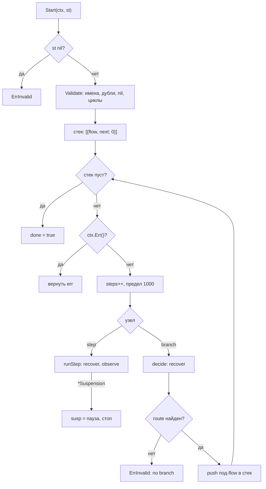

# Как устроены рабочие процессы

`README.md` показывает, как объявить сценарий. Здесь видно, что происходит
внутри `flow/workflow` и `flow`. Источники: `flow/flow.go`,
`flow/workflow/workflow.go` и их тесты.

## Пакеты и границы

| Пакет           | Роль                                                               |
| --------------- | ------------------------------------------------------------------ |
| `flow/workflow` | `Flow[S]`, `Step[S]`, `Branch[S]`, `Observer`, `Execution`, лимиты |
| `flow/session`  | `Session[S]`: вопросы, продолжение, хранилище запусков             |
| `flow`          | `Step[In, Out]`, схемы, snapshot, `Suspend`, `Resume`              |
| `internal/core` | `ErrInvalidConfig` и `ErrInvalidArgs`                              |

`flow` не импортирует `workflow`. Это два независимых слоя: сценарий и
отдельный шаг с проверкой границы. `session` собирается поверх `workflow` и
добавляет вопросы пользователю и хранилище запусков.

## Поток Run



Обход идёт не рекурсией, а явным стеком кадров. Кадр — это flow и номер
следующего узла. Поэтому `Start` можно остановить на любом шаге и потом
продолжить с того же места.

## Ключевые типы

`Flow` хранит упорядоченный список узлов, узел бывает шагом или веткой.

```go
type node[S any] struct {
	step   *Step[S]
	branch *Branch[S]
}

type Flow[S any] struct {
	name  string
	nodes []node[S]
	obs   Observer[S]
}
```

`Then` добавляет узел с шагом, `Branch` добавляет узел с `Decide` и картой
маршрутов. Оба возвращают тот же `*Flow[S]`, чтобы вызовы цеплялись.

## Шаг за шагом

### Validate

`Validate` обходит дерево и возвращает первую структурную ошибку. Он ловит
пустые имена, nil-колбэки, повторы имён, ветку без маршрутов, пустой маршрут
и nil вместо под-flow. Карта `path` отслеживает текущую ветку рекурсии:
повторный вход в тот же flow даёт `cycle`. `defer delete` снимает отметку при
выходе, поэтому один под-flow можно подключить в двух местах без ложного
цикла. `MaxSteps` и `MaxDepth` проверяются во время обхода, а не в
`Validate`.

### Лимиты и контекст

`Run` проверяет nil-состояние, вызывает `Validate` и запускает обход с
нулевой глубиной и общим счётчиком узлов. Перед каждым узлом проверяется
`ctx.Err()`. Отменённый контекст возвращается как есть, шаг после отмены не
выполняется. Повторный вход в flow во время `Run` даёт ошибку `cycle`, а
глубина больше 32 даёт отдельную ошибку `ErrInvalid`.

Счётчик `steps` общий для вложенных flow. Он растёт на каждом узле, включая
ветку, и ограничен `maxSteps`. Константы: `maxDepth = 32`, `maxSteps = 1000`.
Глубина ограничивает вложенные ветки, счётчик ограничивает суммарную работу
одного `Run`.

### Шаг и его паника

`runStep` изолирует колбэк. Паника становится ошибкой, обычная ошибка
получает путь `flow/step`. Observer вызывается после шага.

```go
func (f *Flow[S]) runStep(ctx context.Context, s *Step[S], st *S, obs Observer[S]) (err error) {
	start := time.Now()
	defer func() {
		if rec := recover(); rec != nil {
			err = fmt.Errorf("%s/%s: panic: %v", f.name, s.Name, rec)
		} else if err != nil {
			err = fmt.Errorf("%s/%s: %w", f.name, s.Name, err)
		}
		if oerr := observe(ctx, obs, f.name, s.Name, st, err, time.Since(start)); oerr != nil && err == nil {
			err = oerr
		}
	}()
	return s.Run(ctx, st)
}
```

Observer получает `Event` с именем flow, именем шага, состоянием, ошибкой и
длительностью. Он не может остановить сценарий. Паника observer
перехватывается в `observe` и возвращается как `ErrObserver`.

### Ветка и Decide

`decide` тоже ловит панику. Отсутствующий маршрут это `ErrInvalid` с текстом
`no branch`, а не тихий пропуск. Под-flow получает то же состояние и
повышенную глубину. Паника `Decide` возвращается обычной ошибкой без
обёртки `ErrInvalid`.

### Наследование observer

Observer передаётся вниз по дереву. Если у под-flow есть свой, он заменяет
родительский. Свойство проверено тестом `TestObserverIsInheritedBySubFlows`.

### Пауза и продолжение

Шаг может вернуть `workflow.Suspend(ctx, payload)`. Это не ошибка сценария, а
сигнал остановиться: `runStep` распознаёт `*Suspension` через `errors.As`,
запоминает её в `Execution` и не оборачивает в путь `flow/step`.

```go
type Execution[S any] struct {
	st    *S
	stack []frame[S]
	steps int
	susp  *Suspension
	done  bool
}
```

Номер узла в кадре уже сдвинут вперёд, поэтому `Resume` начинает со следующего
узла, а не повторяет шаг-вопрос. `Resume` принимает функцию `apply`:

```go
func (e *Execution[S]) Resume(ctx context.Context, apply func(*S) error) error
```

`apply` вызывается ровно один раз и только пока сценарий ждёт ответа. Ошибка
`apply` отменяет продолжение и оставляет паузу. Так состояние меняется в одном
месте, и сценарий не может продолжиться с полуприменённым ответом.

`Run` остаётся удобным вариантом для сценариев без пауз: он возвращает
`*Suspension` как ошибку, чтобы вызов не прошёл молча.

### Сессия поверх потока

`flow/session` строит `Flow` из объявлений `AskText`, `AskChoice`, `Do`,
`Branch` и `Case`. Вопрос — это шаг, который возвращает `Suspend` с указателем
на объявление; по нему `Resume` находит функцию применения ответа, проверяет
ответ по вариантам и хранит запуск в `MemoryStore` с TTL, лимитами и
проверкой владельца.

## Что делает flow.Step

`Step[In, Out]` это отдельный типизированный шаг. `New` проверяет id и
функцию и выводит две схемы.

```go
func New[In, Out any](id string, fn func(ctx context.Context, st State, in In) (Out, error)) (*Step[In, Out], error) {
	if id == "" {
		return nil, fmt.Errorf("flow: step id is required: %w", core.ErrInvalidConfig)
	}
	if fn == nil {
		return nil, fmt.Errorf("flow: step %s: run function is required: %w", id, core.ErrInvalidConfig)
	}
	in, err := schemaFor[In](id + ":in")
	if err != nil {
		return nil, err
	}
```

Для `Out` повторяется то же с именем `id + ":out"`. `schemaFor` использует
`invopop/jsonschema` и закрывает структуру через `additionalProperties:
false`. Для `any` и интерфейса схема не строится, то есть шаг остаётся без
проверки границы.

`Run` валидирует вход до вызова и выход после.

```go
func (s *Step[In, Out]) Run(ctx context.Context, st State, in In) Result[Out] {
	if st == nil {
		st = State{}
	}
	raw, err := json.Marshal(in)
	if err != nil {
		return Result[Out]{Status: StatusFailed, Error: fmt.Errorf("flow: encode input: %w: %w", err, core.ErrInvalidArgs), State: st}
	}
	if err := ctx.Err(); err != nil {
		return Result[Out]{Status: StatusFailed, Error: err, State: st}
	}
	out, err := s.r.run(ctx, st, raw)
```

### Suspend и Resume

`Suspend(payload)` возвращает `*Suspension`. `Run` распознаёт его через
`errors.As` и отдаёт `StatusSuspended` вместе со snapshot.

```go
type snapshot struct {
	StepID    string          `json:"step_id"`
	State     map[string]any  `json:"state"`
	StepInput json.RawMessage `json:"step_input"`
}
```

`Resume` проверяет контекст, разбирает snapshot и сверяет id шага.

```go
func (s *Step[In, Out]) Resume(ctx context.Context, snapshotBytes []byte, data any) Result[Out] {
	if err := ctx.Err(); err != nil {
		return Result[Out]{Status: StatusFailed, Error: err}
	}
	var snap snapshot
	if err := json.Unmarshal(snapshotBytes, &snap); err != nil {
		return Result[Out]{Status: StatusFailed, Error: fmt.Errorf("flow: decode snapshot: %w: %w", err, core.ErrInvalidArgs)}
	}
	if snap.StepID != s.r.id() {
		return Result[Out]{Status: StatusFailed, Error: fmt.Errorf("flow: snapshot belongs to step %q, not %q: %w", snap.StepID, s.r.id(), core.ErrInvalidArgs)}
	}
```

Snapshot может прийти из внешнего хранилища, поэтому вход проверяется заново
по схеме шага. Payload проверяется по схеме `Resume`. Шаг без `onResume`
отвечает `ErrInvalidArgs`. Ошибка шага сохраняет путь `flow/step`.

## Отказы и лимиты

| Условие                          | Результат                          |
| -------------------------------- | ---------------------------------- |
| nil flow или nil state           | `ErrInvalid`                       |
| пустое имя, nil шаг, повтор      | `ErrInvalid`                       |
| цикл в дереве                    | `ErrInvalid` с текстом `cycle`     |
| маршрут не найден                | `ErrInvalid` с текстом `no branch` |
| глубина больше 32                | `ErrInvalid`                       |
| больше 1000 узлов за `Run`       | `ErrInvalid`                       |
| отменённый контекст              | `context.Canceled`                 |
| паника шага или `Decide`         | обычная ошибка с текстом `panic`   |
| паника observer                  | `ErrObserver`                      |
| битый или чужой snapshot         | `ErrInvalidArgs`                   |
| payload не прошёл схему `Resume` | `ErrInvalidArgs`                   |

Состояние в snapshot это `map[string]any`, поэтому после JSON числа
возвращаются как `float64`. Тест `TestSuspendThenResume` проверяет именно это.

## Тесты

- `flow/workflow/workflow_test.go`: порядок шагов и веток, путь ошибки,
  контекст, паники шага, `Decide` и observer, наследование observer, нили,
  цикл, отсутствующий маршрут, пауза и продолжение.
- `flow/session/session_test.go`: вопрос и ответ, ветки A/B, отказ по
  вариантам, чужой запуск, идемпотентность, TTL, лимиты, битые объявления.
- `flow/flow_test.go`: типизированный шаг, композиция, suspend/resume, чужая
  и битая snapshot, отказ payload, отменённый контекст, типы без схемы.

## Смотрите также

- [Рабочие процессы](./README.md)
- [Сессия с вопросами](./session.md)
- [Инструменты](../tools/README.md)
- [Справочник API](../reference/gobellim.md)
