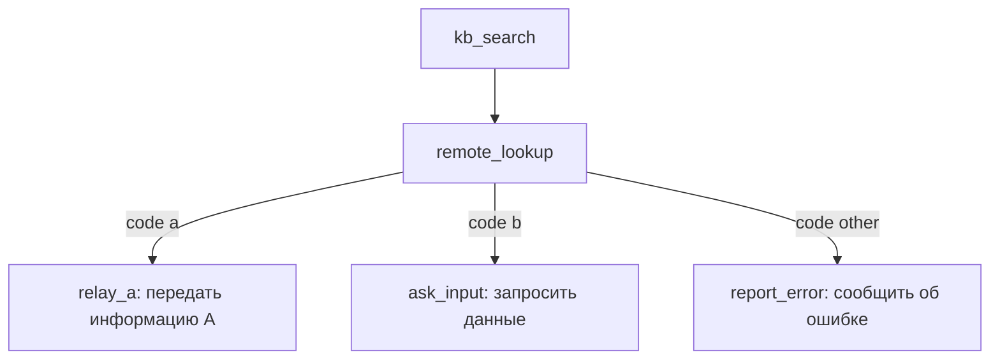

# Работа с моделями, эмбеддингами, инструментами агентов

## Эмбеддинги

Эмбеддинг это вектор чисел. В примерах будет использвоаться модель `multilingual-e5-small` с длиной векторов 384. Разные модели строят разные эмбеддинги, поэтому для поиска и построения должна использоваться строго одна модель.

### Вектор и модель

```go
const (
	model = "intfloat/multilingual-e5-small"
	// длина вектора нужна для маппинга Elasticsearch
	dim = 384
)
```

Дальше `dim` понадобится для Elasticsearch, который создаёт поле `dense_vector` с фиксированным `dims`, и изменить его потом без переиндексации нельзя.

### Запрос

Сервер эмбеддингов принимает батч текстов.

```go
// один запрос может нести несколько текстов
type embedRequest struct {
	Model string   `json:"model"`
	Input []string `json:"input"`
}
```

Батч экономит сетевые вызовы. Для нашей модели (intfloat/multilingual-e5-small) к каждому тексту добавляется префикс.

```go
body, err := json.Marshal(embedRequest{Model: model, Input: texts})

req, err := http.NewRequestWithContext(ctx, http.MethodPost, base+"/embeddings", bytes.NewReader(body))

req.Header.Set("Content-Type", "application/json")
```

`base` это адрес OpenAI-совместимого API, например `http://localhost:8088/v1`.
`WithContext` связывает запрос с отменой: если клиент ушёл, вызов прервётся.

### Ответ

Из ответа нужны только векторы.

```go
var out struct {
	Data []struct {
		Embedding []float32 `json:"embedding"`
	} `json:"data"`
}
if err := json.Unmarshal(raw, &out); err != nil {
	return nil, err
}
if len(out.Data) != len(texts) {
	return nil, fmt.Errorf("Запрос на %d векторов вернул неверое количество: %d", len(texts), len(out.Data))
}
```

Статус проверяйте до разбора JSON. Иначе HTML-страница ошибки превратится в непонятную ошибку декодирования. Формата:

```txt
invalid character '<' looking for beginning of value
```

### Нормализация

```go
func normalize(v []float32) []float32 {
	var sum float64
	for _, x := range v {
		sum += float64(x) * float64(x)
	}
	if sum == 0 {
		return v
	}
	inv := float32(1 / math.Sqrt(sum))
	for i := range v {
		v[i] *= inv
	}
	return v
}
```

После нормализации длина вектора равна 1. Тогда скалярное произведение
совпадает с косинусом. Elasticsearch с `similarity: cosine` ожидает именно
такие векторы.

> При поиске мы сверяем косинусное сходство (угол) и длина вектора на ответ не влияет.

Нулевой вектор надо пропустить, иначе деление на ноль. На практике он почти не
встречается, но проверка стоит одной строки.

### Два вида текста

```go
func queryText(s string) string   { return "query: " + s }
func passageText(s string) string { return "passage: " + s }
```

Разработчики обучали эту модель на наборах данных, где текст всегда был размечен одним из двух префиксов. В процессе обучения модель поняла, что:

- "query: ": это вопрос или запрос, который нужно сопоставить с чем-то.
- "passage: ": это фрагмент документа или ответ, который содержит информацию.

Из-за этого в векторном пространстве модели запросы и документы образуют два разных «облака» (кластера).
Если перепутать префиксы, поиск станет заметно хуже, хотя ошибок не будет.

### Батчи

Батч — это пачка текстов, которые вы отправляете в модель одним HTTP-запросом.
Рекомендуется держать 16 или 32 текста в батче и ограничивать длину текста. Для нашей модели это 512 токенов.

### Guard

Guard (фильтр безопасности) состоит из двух слоёв:

1. Регулярные выражения, нормализация, известные шаблоны.
2. ML-модель (или LLM-судья). Она находит сущности и оценивает текст. Ловит перефразирования, но может ошибаться и стоит десятки миллисекунд (LLM-судья на GPU ~0.8с, на CPU ~8c).
   Текст может нести персональные данные или попытку изменить поведение модели/prompt injection, поэтому фильтр проверяет три источника (все потенциально недостоверные): ввод пользователя, результат инструмента и ответ модели.

```go
// оба слоя реализуют один интерфейс
type Detector interface {
	Detect(ctx context.Context, text string) ([]Finding, error)
}
```

Одинаковый интерфейс позволяет сложить находки в один список и принять одно
решение.

### Находка guard

```go
type Finding struct {
	Category Category // PII, SECRET, INJECTION, UNSAFE
	Label    string   // email, person, phone
	Start    int      // начало в рунах
	End      int      // конец, не включая
	Score    float64  // уверенность
	Layer    string   // rules или ML
}
```

`Start` и `End` нужны для маскирования. `Score` и `Layer` нужны, чтобы отсечь шумные находки ML-слоя и не трогать правила.

```go
// действие выбирает вызывающий код
type Action int

// Allow = 0, Mask = 1, Reject = 2
const (
	Allow Action = iota
	Mask
	Reject
)

// результат проверки
type Verdict struct {
	Action   Action
	Text     string
	Findings []Finding
}
```

`Text` это текст после маскирования.

### Модель

Модель для фильтрации ввода состоит из трёх файлов:

```txt
models/gliner-guard/
  model.onnx
  tokenizer.json
  config.json
```

`config.json` хранит метки и пороги.

```go
det, err := gliner.New(gliner.Config{
	Dir:      "models",
	Model:    "gliner-guard",
	Sessions: 2,
})
```

`Sessions` это число параллельных сессий ONNX. Две сессии быстрее под нагрузкой,
но каждая занимает память. Модель в fp32 весит около 1.2 ГБ.

Сборка требует cgo и двух библиотек:

```sh
CGO_ENABLED=1 CGO_LDFLAGS="-L.ort/lib" go build -tags ort ./...
```

Без `cgo` Go-компилятор не будет обрабатывать import "C" и не сможет слинковаться с нативной библиотекой ONNX Runtime, которая нужна для работы с моделями.

`CGO_LDFLAGS="-L.ort/lib"` передаёт линковщику дополнительный путь для поиска библиотек. -L указывает директорию, где лежит `libonnxruntime.so` (`.dylib` на macOS). В вашем случае это относительный путь .ort/lib, то есть папка lib внутри .ort в корне проекта. Без этого флага линковщик не найдёт библиотеку и сборка упадёт с ошибкой вида library not found for -lonnxruntime.

При запуске нужен `KIT_ORT_LIB`, он указывает бинарнику, где лежит `.so/.dylib`.

### Решение на основе результатов фильтра

```go
for _, f := range findings {
	switch f.Category {
	case INJECTION, UNSAFE:
		// запрещаем сообщение только если INJECTION/UNSAFE
		// получены из "input" и "tool_result" (от ползователя или инструмента),
		// чтобы не блокировать ответ модели
		if rail == "output" {
			continue
		}
		return Reject
	case PII, SECRET:
		mask = true
	}
}
if mask {
	return Mask
}
return Allow
```

### Пороги

По умолчанию порог `0.5`, на просьбу дать данные модель модет выставить `0.53` на валидный ввод, поэтому можно изменить уровень чуствительости. Аналогичные изменения можно сделать для оценки PII.

```go
for _, f := range in {
	if f.Layer == "ML" && f.Category == PII && f.Score < piiThreshold {
		continue
	}
	out = append(out, f)
}
```

### Маскирование

```go
runes := []rune(text)
b.WriteString(string(runes[prev:start]))
b.WriteString("[" + string(category) + ":" + label + "]")
prev = end
```

Текст режется по рунам, а не по байтам. Иначе русский символ разрежется
посередине.

Спаны сортируются по началу. Если два правила нашли один email, второй спан
пропускается, чтобы не было двойной замены.

Маскирование идёт до записи в лог и до отправки в модель.

## Elasticsearch

В индексе нужны:

- текст для BM25
- вектор для k-NN (k nearest neighbors, поиск самых близких эмьеддингов)
- поля доступа

### Маппинг

```json
{
  "mappings": {
    "properties": {
      "doc_id": { "type": "keyword" },
      "tenant": { "type": "keyword" },
      "acl": { "type": "keyword" }, // access control list, модель управления доступом
      "text": { "type": "text", "analyzer": "russian" }, // текст чанка
      "vector": {
        // вектор
        "type": "dense_vector",
        "dims": 384,
        "index": true,
        "similarity": "cosine"
      },
      "embed_model": { "type": "keyword" },
      "quarantined": { "type": "boolean" }
    }
  }
}
```

BM25 здесь неявно задан самим типом text, это стандартный полнотекстовый поиск Elasticsearch.

`embed_model` не даёт смешать векторы разных моделей после обновления.
`quarantined` помечает чанк, который фильтр отклонил.

### Клиент

Клиенту достаточно одного метода.

```go
type ES interface {
	Do(ctx context.Context, req Request) (status int, body []byte, err error)
}
```

Существующий клиент оборачивается в него. Внутри вы ставите метод, путь, тело и `Content-Type`. Для `_bulk` это `application/x-ndjson`.

### Чанки

```go
chunker, err := chunk.New(modelTokenizer, 400, 80)
// 400: длина чанка, 80: перекрытие
// считаются в токенах модели (ограничение модели: 512 токенов)
// modelTokenizer реализует Tokens(text) []chunk.Token
// и отдаёт BPE-токены со смещениями в рунах.

parts := chunker.Split(text)
```

### Документ

```go
doc := map[string]any{
	"doc_id":      docID,
	"tenant":      tenant,
	"acl":         acl, // права на чтение (access control list)
	"text":        maskedText,
	"vector":      vector,
	"embed_model": model,
	"position":    i,
	"quarantined": false,
}
```

### Bulk

Каждый документ в bulk это две строки (чанки документов):

```json
// действие и _id
{"index":
  {
    "_index":"chunks",
    "_id":"doc#1#0"
  }
}
// содержание документа
{
  "doc_id":"doc",
  "tenant":"acme",
  "acl":["user"],
  "text":"фрагмент документа...", // чанк документа
  "vector":[0.01,-0.02, ...]
}
```

## Поиск

### BM25

```json
{
  "size": 10,
  "query": {
    "bool": {
      "must": [
        {
          "match": {
            "text": "пользовательский запрос" // запрос пользователя
          }
        }
      ],
      "filter": [
        // фильтрация по правам и другим тегам
        { "term": { "tenant": "acme" } },
        { "terms": { "acl": ["user"] } },
        { "term": { "quarantined": false } }
      ]
    }
  },
  "_source": ["doc_id", "text", "position"] // возвращает
}
```

### k-NN

```json
{
  "size": 10,
  "knn": {
    "field": "vector",
    "query_vector": [0.01, -0.02, 0.03], // вектор запроса пользователя
    "num_candidates": 100, // число кандидатов
    "filter": [
      // фильтрация по правам и другим тегам
      { "term": { "tenant": "acme" } },
      { "terms": { "acl": ["user"] } },
      { "term": { "quarantined": false } }
    ]
  }
}
```

### Гибрид

Оба запроса отправляются одним `_msearch`. В теле чередуются заголовок и запрос.

```
{"index":"chunks"}
{"size":10,"knn":{...}}
{"index":"chunks"}
{"size":10,"query":{"bool":{"must":[{"match":{"text":"..."}}],"filter":[...]}}}
```

`_msearch` возвращает два списка, которые дальше будем сливать в один.

### RRF

Reciprocal Rank Fusion смотрит на места BM25 и k-NN в списках.

```
score(id) = sum(1 / (k + rank + 1))
```

`rank` начинается с 0, `k` обычно 60 (значение RRF по умолчанию в Elastic). Документ, который высоко в обоих списках,
получает больший score, потому что мы складываем дроби обоих алгоритмов.

## Ollama и vLLM

Оба сервера принимают историю сообщений и список инструментов, отличается только формат.

### Общий интерфейс

```go
type Client interface {
	Chat(ctx context.Context, req Request) (Response, error)
}

type Request struct {
	Messages []Message
	Tools    []ToolSpec
}

type Response struct {
	Content   string
	ToolCalls []ToolCall
}
```

Бизнес-логика работает с этим интерфейсом, а адаптер решает, куда идти.

### Ollama

Запрос:

```json
{
  "model": "t-tech/T-lite-it-2.1:q4_K_M",
  "stream": false,
  "messages": [
    { "role": "system", "content": "Ты помощник по Go" },
    { "role": "user", "content": "Добавь ссылку на документацию go. }
  ],
  "tools": [ // модель видит только имена, описания и схемы
    {
      "type": "function",
      "function": {
        "name": "link",
        "description": "Добавить ссылку",
        "parameters": { "type": "object", "properties": {} }
      }
    }
  ]
}
```

Ответ:

```json
{
  "message": {
    "role": "assistant",
    "content": "", // пустой, если модель использует инструмент
    "tool_calls": [
      {
        "function": {
          "name": "kb_search",
          "arguments": { "query": "go.mod" }
        }
      }
    ]
  },
  "done": true
}
```

### vLLM

Запрос:

```json
{
  "model": "t-tech/T-lite-it-2.1:q4_K_M",
  "messages": [
    { "role": "user", "content": "Добавь ссылку на документацию go." }
  ],
  "tools": [
    {
      "type": "function",
      "function": {
        "name": "link",
        "description": "Добавить ссылку",
        "parameters": { "type": "object", "properties": {} }
      }
    }
  ],
  "tool_choice": "auto"
}
```

Ответ:

```json
{
  "choices": [
    {
      "message": {
        "role": "assistant",
        "content": null,
        "tool_calls": [
          {
            "id": "call_1",
            "function": {
              "name": "kb_search",
              "arguments": "{\"query\":\"go.mod\"}"
            }
          }
        ]
      },
      "finish_reason": "tool_calls"
    }
  ]
}
```

### Разница

|           | Ollama        | vLLM                   |
| --------- | ------------- | ---------------------- |
| Путь      | `/api/chat`   | `/v1/chat/completions` |
| Аргументы | объект        | строка JSON            |
| id вызова | не обязателен | обязателен             |
| Стриминг  | строки JSON   | SSE `data:`            |

## Инструменты

Инструмент это функция, которую модель может попросить выполнить. Модель не вызывает код. Она возвращает имя и аргументы, а сервис (ollama/vLLM) решает, запускать ли это.

### Контракт

```go
type Tool[In, Out any] struct {
	Name        string // some_specific_tool
	Description string // "это инструмент X, используй его когда пользователь спрашивает про Y"
	Permission  string // acl
	Effect      Effect // read, write, egress
	Schema      json.RawMessage // выводится из In
	Run         func(ctx context.Context, in In) (Out, error)
}
```

Схема выводится из `In`, компилируется один раз при регистрации и проверяет
аргументы до `Run`. `Out` сериализуется в JSON и проверяется по своей схеме.
Вложенный вызов идёт через сессию запроса:

```go
type Session struct{ /* principal, policy, budget */ }

func (s *Session) CallTool(ctx context.Context, name string, args map[string]any) (Result, error)
```

`Session` даёт инструменту только `CallTool`: сырой клиент внешнего сервиса в
него не попадает, а право, бюджет и схема проверяются и для вложенного вызова.

Схема должна описывать объект: иначе регистрация падает с `ErrConfig`, а не
первый вызов. Сессия не принимает неподготовленный инструмент. Если guard
замаскировал аргументы так, что JSON стал невалидным, это `ErrGuardUnavailable`,
а не `ErrInvalid`: ошибку допустил guard, а не модель.

### Аргументы

На примере инструмента получения погоды:

```go
type WeatherArgs struct {
	City string `json:"city"`
	Unit string `json:"unit,omitempty"`
}
```

```json
{
  "type": "object",
  "properties": {
    "city": { "type": "string", "minLength": 2, "maxLength": 80 },
    "unit": { "type": "string", "enum": ["c", "f"] }
  },
  "required": ["city"],
  "additionalProperties": false
}
```

### Реализация инструмента

```go
func weather(ctx context.Context, in WeatherArgs) (Result, error) {
	ctx, cancel := context.WithTimeout(ctx, 3*time.Second)
	defer cancel()
	out, err := client.Lookup(ctx, in.City)
	if err != nil {
		return Result{}, fmt.Errorf("upstream: %w", ErrUpstream)
	}
	return Result{Data: out}, nil
}
```

Сервер уже проверил аргументы по JSON Schema до `Run`, а Go-типы получены из
`In` — ручной разбор `map[string]any` не нужен.

### Вызов

```go
// проверка политики перед попаданием инструмента к модели
if !policy.Allows(user, tool.Permission) {
	return Result{}, ErrUnauthorized
}

// аргументы проверяются по схеме до запуска
if err := validate(tool.Schema, args); err != nil {
	return Result{}, ErrInvalid
}

// аргументы проходят отдельный rail, а не input
av := filter.Check(ctx, "tool_args", string(args))

if av.Action == Reject {
	return Result{}, ErrFilterReject
}

// вызов инструмента
res, err := tool.Run(ctx, tc, args)

if err != nil {
	return Result{}, err
}

// результат проверяется перед возвратом модели
rv := filter.Check(ctx, "tool_result", string(res))

if rv.Action == Reject {
	return Result{}, ErrFilterReject
}
```

### Схема для модели

```go
for _, tool := range tools {
	if !policy.Allows(user, tool.Permission) {
		continue
	}
	specs = append(specs, spec(tool))
}
```

Модель не видит запрещённые инструменты. Повторная проверка в вызове нужна на случай, если модель всё равно назвала запрещённый инструмент (галлюцинация/промпт-инъекция).

## Workflow

Workflow описывает сценарий из нескольких шагов, он детерминирован и гарантированно выполняется в заданном порядке вне зависимости от действий модели. Данные прошлого шага становятся входом следующего.

> Workflow по аналогии с фреймворком Mastra

### Состояние

```go
type researchState struct {
	Session *Session
	Query   string
	KB      Result
	Lookup  Result
	Result  Result
}
```

Состояние типизировано. Шаг получает `*researchState` и меняет его явно;
компилятор ловит опечатки в полях, а не возвращает нулевое значение из map.

### Шаг

`Then` добавляет шаг и возвращает `Flow`:

```go
func (f *Flow[S]) Then(name string, run func(context.Context, *S) error) *Flow[S] {
	f.nodes = append(f.nodes, Node[S]{Step: &Step[S]{Name: name, Run: run}})
	return f
}
```

### Развилка

```go
func (f *Flow[S]) Branch(name string, decide func(*S) string, routes map[string]*Flow[S]) *Flow[S] {
	f.nodes = append(f.nodes, Node[S]{Branch: &Branch[S]{Name: name, Decide: decide, Routes: routes}})
	return f
}
```

`decide` читает состояние и возвращает имя ветки, ветка это отдельный `Flow`.

### Запуск

```go
func (f *Flow[S]) Run(ctx context.Context, st *S) error {
	if st == nil {
		return ErrInvalid
	}
	if err := f.Validate(); err != nil {
		return err
	}
	for _, n := range f.nodes {
		if err := ctx.Err(); err != nil {
			return err
		}
		if n.Step != nil {
			if err := n.Step.Run(ctx, st); err != nil {
				return fmt.Errorf("%s/%s: %w", f.name, n.Name, err)
			}
			continue
		}
		name := n.Branch.Decide(st)
		route, ok := n.Branch.Routes[name]
		if !ok {
			return fmt.Errorf("no branch %q", name)
		}
		if err := route.Run(ctx, st); err != nil {
			return err
		}
	}
	return nil
}
```

Ошибка шага останавливает цепочку и возвращается с полным путём
`flow/route/step`; состояние остаётся у вызывающего. `Validate` проверяет
nil-шаги, дубликаты и циклы. `Run` проверяет `ctx`, ограничивает глубину и число
шагов, ловит панику шага. `WithObserver` вызывается после шага и отдаёт duration
и error; паника observer не роняет flow, а возвращается из `Run` как `ErrObserver`.

### Пример



```go
func researchKB(ctx context.Context, st *researchState) error {
	res, err := st.Session.CallTool(ctx, "kb_search", map[string]any{"query": st.Query})
	st.KB = res
	return err
}

func researchLookup(ctx context.Context, st *researchState) error {
	res, err := st.Session.CallTool(ctx, "remote_lookup", map[string]any{"query": st.Query})
	st.Lookup = res
	return err
}

func researchRoute(st *researchState) string {
	if st.Lookup.Code == "" {
		return "other"
	}
	return st.Lookup.Code
}

func researchRelay(_ context.Context, st *researchState) error {
	st.Result = Result{Code: "a", Body: st.Lookup.Body, Data: st.KB.Data}
	return nil
}

func researchAsk(_ context.Context, st *researchState) error {
	st.Result = Result{Code: "b", Question: st.Lookup.Question, NeedInput: true}
	return nil
}

func researchReport(_ context.Context, st *researchState) error {
	msg := st.Lookup.Error
	if msg == "" {
		msg = "upstream returned an unknown code"
	}
	st.Result = Result{Code: "other", Error: msg}
	return nil
}

flow := New[researchState]("research").
	Then("kb", researchKB).
	Then("lookup", researchLookup).
	Branch("route", researchRoute, map[string]*Flow[researchState]{
		"a":     New[researchState]("a").Then("relay", researchRelay),
		"b":     New[researchState]("b").Then("ask", researchAsk),
		"other": New[researchState]("other").Then("report", researchReport),
	})

st := researchState{Session: session, Query: q}
if err := flow.Run(ctx, &st); err != nil {
	return err
}
```

Все вызовы инструментов идут через ту же функцию, что и обычный инструмент (проверка прав и фильтров).
