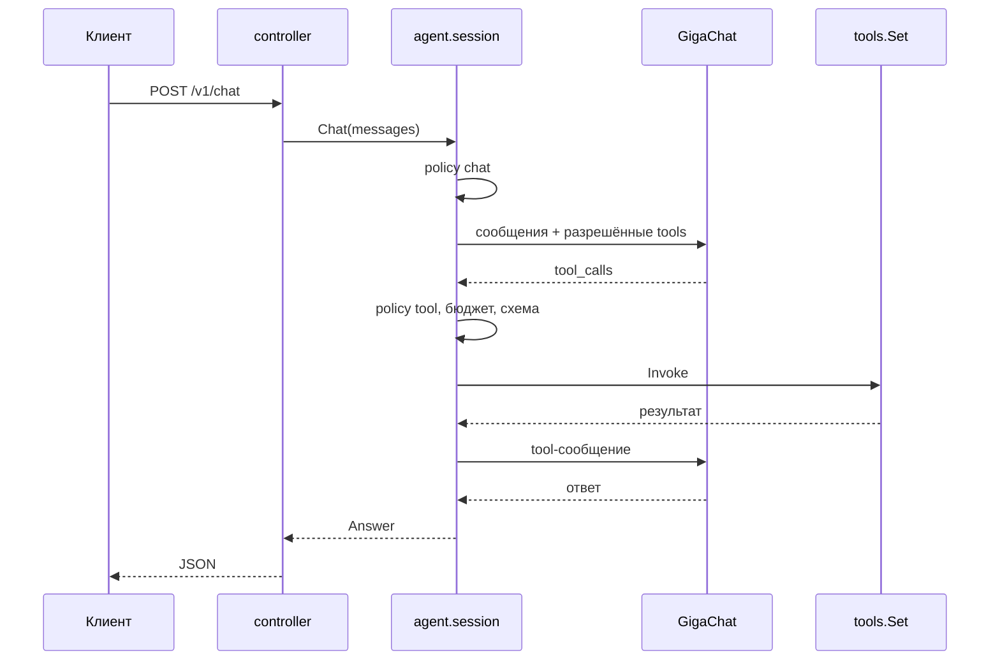

# lite-demo

Минимальный сервис на Go, который показывает, как устроены инструменты и
детерминированные workflow вокруг LLM. Это самостоятельный пример: у него своя
реализация движка инструментов, свой workflow и свой клиент GigaChat. Пакеты
`github.com/KirillYuzh/Gobellim` в зависимостях нет.

Демо не про безопасность: guard, gate и trace здесь намеренно отсутствуют.
Осталось то, что показывает сценарий: principal, policy, инструменты, бюджет и
workflow.

## Сценарий

`research` — сценарий с паузой. Модель его только запускает, дальше ведёт код:

1. сразу спрашивает путь: A (готовый текст) или B (ещё один вопрос);
2. в пути B спрашивает тему и отдаёт ответ X или Y.

Отдельного вопроса перед выбором нет: тема уже есть в запросе, а ветвление
зависит только от нажатой кнопки.

Ветку выбирает код по состоянию. Модель не выбирает переход и не видит
`run_id`.

| Инструмент       | Право                 | Что делает                            |
| ---------------- | --------------------- | ------------------------------------- |
| `link`           | `tool:link`           | дописывает mock-ссылку в конец ответа |
| `start_research` | `tool:start_research` | запускает сценарий и отдаёт вопрос    |

Продолжение — отдельный эндпоинт `POST /v1/research/{run_id}/resume`, а не
инструмент. Пользователь отвечает приложению, приложение применяет ответ и
продолжает сценарий с того шага, где он остановился.

## Один путь

Каждый инструмент, который назвала модель, идёт через одну функцию
`session.call`: право → бюджет → схема аргументов → обработчик. Шаги `research`
— обычные функции, вложенных инструментов нет.



## Быстрый старт

Нужен Docker с BuildKit:

```sh
docker compose up -d --build
```

Ключ `GIGACHAT_API_KEY` лежит в `lite-demo/.env`; compose передаёт его
контейнеру через `env_file`.

Откройте <http://localhost:8080> — там страница чата. Она встроена в бинарник,
сборка фронтенда не нужна.

Через `curl` сценарий выглядит так:

```sh
# 1. запуск: модель вызывает start_research, сценарий останавливается на вопросе
curl -s http://localhost:8080/v1/chat \
  -H 'Content-Type: application/json' \
  -d '{
    "user": {"id": "u-1", "tenant": "acme", "roles": ["support"]},
    "messages": [{"role": "user", "content": "Проведи исследование по go modules"}]
  }'
# → {"status":"awaiting_user","run_id":"run-...","question":{...}}

# 2. ответ на вопрос: текст
curl -s http://localhost:8080/v1/research/run-.../resume \
  -H 'Content-Type: application/json' \
  -d '{"user": {"id": "u-1", "tenant": "acme", "roles": ["support"]}, "text": "go modules"}'

# 3. ответ на вопрос: вариант
curl -s http://localhost:8080/v1/research/run-.../resume \
  -H 'Content-Type: application/json' \
  -d '{"user": {"id": "u-1", "tenant": "acme", "roles": ["support"]}, "choice": "A"}'
```

## Локально

Нужен только ключ `GIGACHAT_API_KEY` в `lite-demo/.env`:

```sh
set -a; . ./.env; set +a
go run ./cmd/lite-demo
```

## API

`POST /v1/chat`, `POST /v1/research/{run_id}/resume`, `GET /healthz`, `GET /`.

Статусы: `ok`, `awaiting_user`, `max_steps`, `budget`.

| Код | Когда                                          |
| --- | ---------------------------------------------- |
| 400 | битый JSON, лишние поля, ответ не по вариантам |
| 403 | policy запретила действие                      |
| 404 | запуск неизвестен, истёк или чужой             |
| 502 | не ответил GigaChat                            |
| 504 | истёк дедлайн запроса                          |
| 500 | внутренняя ошибка                              |

Текст ошибки всегда безопасный: детали upstream и policy остаются в логе.

## Права

`policy.json` — deny by default:

```json
{
  "default": "deny",
  "roles": {
    "user": ["chat", "tool:link"],
    "support": ["chat", "tool:link", "tool:start_research", "research"]
  }
}
```

Права проверяются дважды: `specs` не показывает модели инструмент, на который у
роли нет права, а `call` повторяет проверку перед запуском. Поэтому модель не
видит запрещённый инструмент, а если придумает его сама — получит отказ.

В демо principal приходит в теле запроса. В проде здесь JWT/OIDC на границе
`controller`, а usecase не меняется.

## Инструменты

`internal/tools` — типизированный движок. Схема аргументов выводится из `In`,
результат проверяется по схеме `Out`, а права по умолчанию — `tool:<name>`:

````go
tools.New("link", link,
	tools.Desc("Добавить ссылку в конец ответа. Приложение сделает это само."),
	tools.Read(),
)

```go
tools.New("start_research", u.startResearch,
	tools.Desc("Начать исследование по теме."),
	tools.Read(),
)
````

Ветку модель не выбирает: в аргументах только тема запроса.

`Registry` собирает каталог один раз; ошибка объявления и повтор имени видны в
`Build`, а не в рантайме.

## Сессия

`internal/session` — копия пакета `flow/session` из библиотеки: объявление
вопросов, пауза, продолжение, хранилище запусков. `internal/workflow` — копия
`flow/workflow`: шаги, ветки и `Suspend`.

```go
func newResearch() *session.Session[researchState] {
	return session.New[researchState]("research").
		AskChoice("path", "Путь A или B?", []string{"A", "B"},
			func(st *researchState, answer string) error {
				st.Path = answer
				return nil
			}).
		Branch(func(st *researchState) string { return st.Path }).
		Case("A", func(f *session.Session[researchState]) {
			f.Do("finish_a", finishA)
		}).
		Case("B", func(f *session.Session[researchState]) {
			f.AskChoice("topic", "Что показать?", []string{"X", "Y"}, applyTopic).
				Do("finish_b", finishB)
		})
}
```

`Start` возвращает либо вопрос с `run_id`, либо готовое состояние. `Resume`
проверяет ответ по объявлению вопроса, применяет его и продолжает ровно с шага
паузы. Чужой запуск, истёкший TTL и ответ не по вариантам отсекаются до
продолжения.

## Структура

| Путь                  | Что                                                        |
| --------------------- | ---------------------------------------------------------- |
| `cmd/lite-demo`       | точка входа сервиса                                        |
| `internal/app`        | сборка зависимостей, сервер, graceful shutdown             |
| `internal/agent`      | системная часть: цикл модель → инструменты, права и бюджет |
| `internal/config`     | окружение и проверки старта                                |
| `internal/controller` | HTTP-граница: разбор запроса, вызов usecase, ответ         |
| `internal/entity`     | типы домена и ошибки-сентинелы                             |
| `internal/errmap`     | ошибка → HTTP-код и безопасное сообщение                   |
| `internal/llm`        | клиент GigaChat `/v1/chat/completions`                     |
| `internal/policy`     | роли и права, deny by default                              |
| `internal/routes`     | таблица маршрутов и recover                                |
| `internal/tools`      | движок инструментов: схема, каталог, вызов                 |
| `internal/usecase`    | сценарии: чат, инструменты и health                        |
| `internal/session`    | копия `flow/session`: вопросы, пауза, хранилище запусков   |
| `internal/workflow`   | копия `flow/workflow`: шаги, ветки, `Suspend`              |
| `web`                 | страница чата, встроенная в бинарник                       |
| `pkg/rest`            | JSON-ответ и разбор тела запроса                           |

## Настройки

| Переменная          | По умолчанию                                        | Зачем                                  |
| ------------------- | --------------------------------------------------- | -------------------------------------- |
| `APP_ENV`           | dev                                                 | `prod` отклоняется                     |
| `HTTP_ADDR`         | `:8080`                                             | адрес сервера                          |
| `POLICY_PATH`       | `policy.json`                                       | файл прав                              |
| `GIGACHAT_API_KEY`  | из `.env`                                           | OAuth-ключ, обязателен                 |
| `GIGACHAT_MODEL`    | `GigaChat-2`                                        | модель                                 |
| `GIGACHAT_BASE_URL` | `https://api.giga.chat`                             | API                                    |
| `GIGACHAT_AUTH_URL` | `https://ngw.devices.sberbank.ru:9443/api/v2/oauth` | OAuth                                  |
| `GIGACHAT_SCOPE`    | `GIGACHAT_API_PERS`                                 | скоуп OAuth                            |
| `REQUEST_TIMEOUT`   | `3m`                                                | дедлайн одного запроса                 |
| `LOG_LEVEL`         | `info`                                              | `debug` печатает запрос и ответ модели |

### Что получила модель

На уровне `debug` сервис печатает каждый запрос к GigaChat и ответ на него:
системный промпт, историю, схемы функций и результаты инструментов. Включите
его в `.env` и перезапустите стек:

```sh
echo 'LOG_LEVEL=debug' >> .env
docker compose up -d

# только тела запросов, без обёртки лога
docker compose logs app \
  | jq -r 'select(.msg == "llm request") | .body | fromjson'
```

## Проверки

```sh
go test -race -shuffle=on ./...
go vet ./...
golangci-lint run
gofumpt -l .
```
