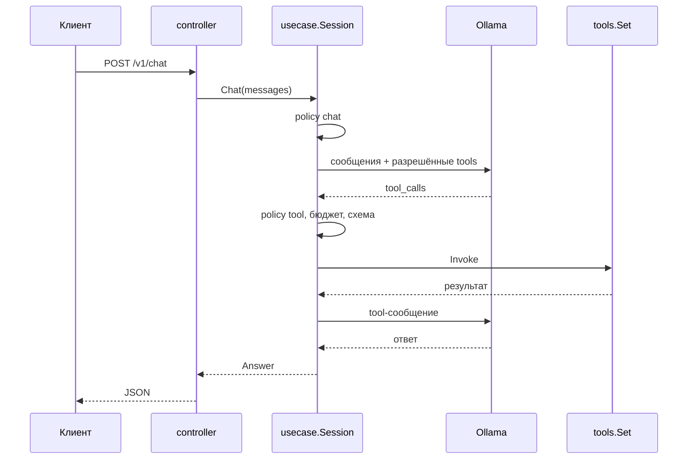

# lite-demo

Минимальный сервис на Go, который показывает, как устроены инструменты и
детерминированные workflow вокруг LLM. Это самостоятельный пример: у него своя
реализация движка инструментов, свой workflow и свой клиент Ollama. Пакеты
`github.com/KirillYuzh/Gobellim` в зависимостях нет.

Демо не про безопасность: guard, gate и trace здесь намеренно отсутствуют.
Осталось то, что показывает сценарий: principal, policy, инструменты, бюджет и
workflow.

## Сценарий

Модель отвечает на вопрос и может вызвать инструмент:

| Инструмент        | Право                | Что делает                                         |
| ----------------- | -------------------- | -------------------------------------------------- |
| `link`            | `tool:link`          | добавляет mock-ссылку в конец ответа               |
| `kb_search`       | `tool:kb_search`     | ищет чанки в mock-базе знаний                      |
| `remote_lookup`   | `tool:remote_lookup` | mock-upstream; отвечает кодом `a`, `b` или `other` |
| `remote_followup` | `tool:remote_lookup` | второй запрос с уточнением пользователя            |
| `research`        | `tool:research`      | `kb_search` → `remote_lookup` → ветка по коду      |

`research` — не отдельный движок, а workflow из трёх шагов. Ветка `a` отдаёт
тело A вместе с чанками, `b` возвращает `need_input` и вопрос, `other` —
безопасный текст ошибки.

## Один путь

Каждый вызов инструмента — от модели, из `research` или из `POST /v1/tools` —
идёт через одну функцию `Session.CallTool`: право → бюджет → схема аргументов →
типизированный обработчик. Второго пути нет.



## Быстрый старт

Нужен Docker с BuildKit:

```sh
docker compose up -d --build
```

Первый запуск скачивает `t-tech/T-lite-it-2.1:q4_K_M` в Ollama:

```sh
docker compose logs -f ollama-pull
```

Запрос:

```sh
curl -s http://localhost:8080/v1/chat \
  -H 'Content-Type: application/json' \
  -d '{
    "user": {"id": "u-1", "tenant": "acme", "roles": ["support"]},
    "messages": [{"role": "user", "content": "Найди в базе знаний, что такое go modules"}]
  }'
```

Прямой вызов инструмента, без модели:

```sh
curl -s http://localhost:8080/v1/tools/kb_search \
  -H 'Content-Type: application/json' \
  -d '{"user": {"id": "u-1", "tenant": "acme", "roles": ["user"]}, "args": {"query": "go modules"}}'
```

Второй шаг сценария B:

```sh
curl -s http://localhost:8080/v1/followup \
  -H 'Content-Type: application/json' \
  -d '{"user": {"id": "u-1", "tenant": "acme", "roles": ["support"]}, "query": "go test", "input": "1.22"}'
```

## Локально

Нужны запущенные Ollama (`ollama serve`) и mockd:

```sh
go run ./cmd/mockd &
go run ./cmd/lite-demo
```

По умолчанию сервис ждёт `http://localhost:11434` и `http://localhost:8081`.

## API

`POST /v1/chat`, `POST /v1/followup`, `POST /v1/tools/{name}`, `GET /healthz`.

Статусы чата: `ok`, `need_input`, `max_steps`, `budget`.

| Код | Когда                                     |
| --- | ----------------------------------------- |
| 400 | битый JSON, лишние поля, нет пользователя |
| 403 | policy запретила действие                 |
| 404 | неизвестный инструмент                    |
| 429 | исчерпан бюджет tool calls                |
| 502 | не ответила Ollama или mock-сервис        |
| 504 | истёк дедлайн запроса                     |
| 500 | внутренняя ошибка                         |

Текст ошибки всегда безопасный: детали upstream и policy остаются в логе.

## Права

`policy.json` — deny by default:

```json
{
  "default": "deny",
  "roles": {
    "user": ["chat", "tool:link", "tool:kb_search"],
    "support": [
      "chat",
      "tool:link",
      "tool:kb_search",
      "tool:remote_lookup",
      "tool:research"
    ]
  }
}
```

Права проверяются дважды: `Session.specs` не показывает модели инструмент, на
который у роли нет права, а `Session.CallTool` повторяет проверку перед запуском.
Поэтому модель не видит запрещённый инструмент, а если придумает его сама —
получит `403`.

В демо principal приходит в теле запроса. В проде здесь JWT/OIDC на границе
`controller`, а usecase не меняется.

## Инструменты

`internal/tools` — типизированный движок. Схема аргументов выводится из `In`,
результат проверяется по схеме `Out`, а права по умолчанию — `tool:<name>`:

```go
tools.New("kb_search", u.kbSearch,
	tools.Desc("Поиск по mock-базе знаний"),
	tools.Read(),
)
```

`Registry` собирает каталог один раз; ошибка объявления и повтор имени видны в
`Build`, а не в рантайме.

## Workflow

`internal/workflow` — типизированный state machine. Шаг получает `*S` и меняет
его явно, поэтому опечатка в поле — ошибка компиляции. Ветка выбирает
под-workflow по состоянию.

```go
flow := workflow.New[researchState]("research").
	Then("kb", func(ctx context.Context, st *researchState) error {
		res, err := st.Session.CallTool(ctx, "kb_search", map[string]any{"query": st.Query})
		st.KB = res
		return err
	}).
	Then("lookup", func(ctx context.Context, st *researchState) error {
		res, err := st.Session.CallTool(ctx, "remote_lookup", map[string]any{"query": st.Query})
		st.Code = res.Code
		return err
	}).
	Branch("route", func(st *researchState) string { return st.Code }, routes)
```

Ошибка шага останавливает цепочку и возвращается с путём `research/kb`. `Run`
проверяет циклы и дубли имён, ограничивает глубину и число шагов, ловит панику
шага, а паника observer возвращает `ErrObserver`.

## Структура

| Путь                  | Что                                                |
| --------------------- | -------------------------------------------------- |
| `cmd/lite-demo`       | точка входа сервиса                                |
| `cmd/mockd`           | mock базы знаний и upstream                        |
| `internal/app`        | сборка зависимостей, сервер, graceful shutdown     |
| `internal/config`     | окружение и проверки старта                        |
| `internal/controller` | HTTP-граница: разбор запроса, вызов usecase, ответ |
| `internal/entity`     | типы домена и ошибки-сентинелы                     |
| `internal/errmap`     | ошибка → HTTP-код и безопасное сообщение           |
| `internal/llm`        | клиент Ollama `/api/chat`                          |
| `internal/policy`     | роли и права, deny by default                      |
| `internal/repository` | клиент mock-сервиса                                |
| `internal/routes`     | таблица маршрутов и recover                        |
| `internal/tools`      | движок инструментов: схема, каталог, вызов         |
| `internal/usecase`    | сценарии: чат, followup, инструменты, бюджет       |
| `internal/workflow`   | типизированный workflow с ветками                  |
| `pkg/rest`            | JSON-ответ и разбор тела запроса                   |

## Настройки

| Переменная        | По умолчанию                  | Зачем                  |
| ----------------- | ----------------------------- | ---------------------- |
| `APP_ENV`         | dev                           | `prod` отклоняется     |
| `HTTP_ADDR`       | `:8080`                       | адрес сервера          |
| `POLICY_PATH`     | `policy.json`                 | файл прав              |
| `MOCK_BASE_URL`   | `http://localhost:8081`       | mock-сервис            |
| `OLLAMA_URL`      | `http://localhost:11434`      | Ollama                 |
| `OLLAMA_MODEL`    | `t-tech/T-lite-it-2.1:q4_K_M` | модель                 |
| `REQUEST_TIMEOUT` | `3m`                          | дедлайн одного запроса |

## Проверки

```sh
go test -race -shuffle=on ./...
go vet ./...
golangci-lint run
gofumpt -l .
```
