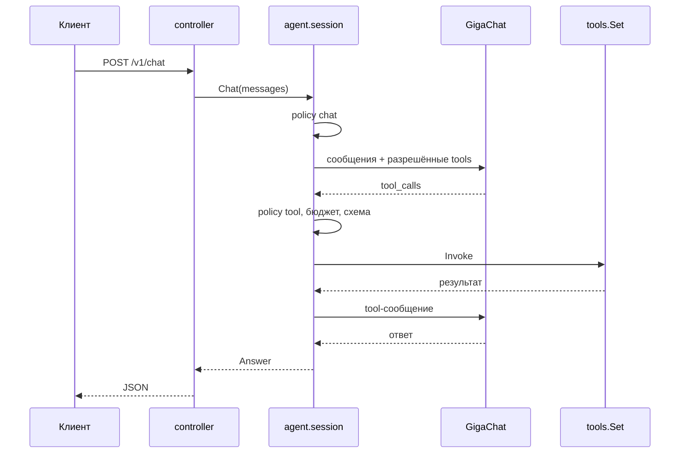

# lite-demo

Минимальный сервис на Go, который показывает, как устроены инструменты и
детерминированные workflow вокруг LLM. Это самостоятельный пример: у него своя
реализация движка инструментов, свой workflow и свой клиент GigaChat. Пакеты
`github.com/KirillYuzh/Gobellim` в зависимостях нет.

Демо не про безопасность: guard, gate и trace здесь намеренно отсутствуют.
Осталось то, что показывает сценарий: principal, policy, инструменты, бюджет и
workflow.

## Сценарий

Модель отвечает на вопрос и может вызвать инструмент:

| Инструмент | Право           | Что делает                                    |
| ---------- | --------------- | --------------------------------------------- |
| `link`     | `tool:link`     | возвращает mock-ссылку                        |
| `research` | `tool:research` | база знаний → upstream → ветка по коду ответа |

`research` — workflow из трёх шагов. Ветка `a` отдаёт тело A вместе с чанками,
`b` возвращает `need_input` и вопрос, `other` — безопасный текст ошибки. Шаги
вызывают обычные функции мока, без вложенных инструментов.

## Один путь

Каждый инструмент, который назвала модель, идёт через одну функцию
`session.call`: право → бюджет → схема аргументов → обработчик. Вложенных
вызовов нет: шаги `research` вызывают обычные функции мока.



## Быстрый старт

Нужен Docker с BuildKit:

```sh
docker compose up -d --build
```

Ключ `GIGACHAT_API_KEY` лежит в `lite-demo/.env`; compose передаёт его
контейнеру через `env_file`.

Запрос:

```sh
curl -s http://localhost:8080/v1/chat \
  -H 'Content-Type: application/json' \
  -d '{
    "user": {"id": "u-1", "tenant": "acme", "roles": ["support"]},
    "messages": [{"role": "user", "content": "Найди в базе знаний, что такое go modules"}]
  }'
```

## Локально

Нужны mockd и ключ `GIGACHAT_API_KEY` в `lite-demo/.env`:

```sh
set -a; . ./.env; set +a
go run ./cmd/mockd &
go run ./cmd/lite-demo
```

По умолчанию сервис ждёт mock-сервис на `http://localhost:8081`.

## API

`POST /v1/chat`, `GET /healthz`.

Статусы чата: `ok`, `need_input`, `max_steps`, `budget`.

| Код | Когда                                     |
| --- | ----------------------------------------- |
| 400 | битый JSON, лишние поля, нет пользователя |
| 403 | policy запретила действие                 |
| 502 | не ответил GigaChat или mock-сервис       |
| 504 | истёк дедлайн запроса                     |
| 500 | внутренняя ошибка                         |

Текст ошибки всегда безопасный: детали upstream и policy остаются в логе.

## Права

`policy.json` — deny by default:

```json
{
  "default": "deny",
  "roles": {
    "user": ["chat", "tool:link"],
    "support": ["chat", "tool:link", "tool:research"]
  }
}
```

Права проверяются дважды: `specs` не показывает модели инструмент, на который у
роли нет права, а `call` повторяет проверку перед запуском. Поэтому модель не
видит запрещённый инструмент, а если придумает его сама — получит отказ.

В демо principal приходит в теле запроса. В проде здесь JWT/OIDC на границе
`controller`, а usecase не меняется.

## Инструменты

`internal/tools` — типизированный движок. Схема аргументов выводится из `In`,
результат проверяется по схеме `Out`, а права по умолчанию — `tool:<name>`:

```go
tools.New("link", link,
	tools.Desc("Добавить mock-ссылку в конец ответа"),
	tools.Read(),
)

tools.New("research", u.research,
	tools.Desc("База знаний, upstream и ветка по коду ответа"),
	tools.Egress(),
)
```

`Registry` собирает каталог один раз; ошибка объявления и повтор имени видны в
`Build`, а не в рантайме.

## Workflow

`internal/workflow` — типизированный state machine. Шаг получает `*S` и меняет
его явно, поэтому опечатка в поле — ошибка компиляции. Ветка выбирает
под-workflow по состоянию.

```go
func researchKB(ctx context.Context, st *researchState) error {
	chunks, err := st.Mock.KB(ctx, st.Query)
	st.KB = chunks
	return err
}

func researchLookup(ctx context.Context, st *researchState) error {
	out, err := st.Mock.Lookup(ctx, st.Query)
	st.Lookup = out
	return err
}

flow := workflow.New[researchState]("research").
	Then("kb", researchKB).
	Then("lookup", researchLookup).
	Branch("route", researchRoute, routes)
```

Ошибка шага останавливает цепочку и возвращается с путём `research/kb`. `Run`
проверяет циклы и дубли имён, ограничивает глубину и число шагов, ловит панику
шага, а паника observer возвращает `ErrObserver`.

## Структура

| Путь                  | Что                                                        |
| --------------------- | ---------------------------------------------------------- |
| `cmd/lite-demo`       | точка входа сервиса                                        |
| `cmd/mockd`           | mock базы знаний и upstream                                |
| `internal/app`        | сборка зависимостей, сервер, graceful shutdown             |
| `internal/agent`      | системная часть: цикл модель → инструменты, права и бюджет |
| `internal/config`     | окружение и проверки старта                                |
| `internal/controller` | HTTP-граница: разбор запроса, вызов usecase, ответ         |
| `internal/entity`     | типы домена и ошибки-сентинелы                             |
| `internal/errmap`     | ошибка → HTTP-код и безопасное сообщение                   |
| `internal/llm`        | клиент GigaChat `/v1/chat/completions`                     |
| `internal/policy`     | роли и права, deny by default                              |
| `internal/repository` | клиент mock-сервиса                                        |
| `internal/routes`     | таблица маршрутов и recover                                |
| `internal/tools`      | движок инструментов: схема, каталог, вызов                 |
| `internal/usecase`    | сценарии: чат, инструменты и health                        |
| `internal/workflow`   | типизированный workflow с ветками                          |
| `pkg/rest`            | JSON-ответ и разбор тела запроса                           |

## Настройки

| Переменная          | По умолчанию                                        | Зачем                  |
| ------------------- | --------------------------------------------------- | ---------------------- |
| `APP_ENV`           | dev                                                 | `prod` отклоняется     |
| `HTTP_ADDR`         | `:8080`                                             | адрес сервера          |
| `POLICY_PATH`       | `policy.json`                                       | файл прав              |
| `MOCK_BASE_URL`     | `http://localhost:8081`                             | mock-сервис            |
| `GIGACHAT_API_KEY`  | из `.env`                                           | OAuth-ключ, обязателен |
| `GIGACHAT_MODEL`    | `GigaChat-2`                                        | модель                 |
| `GIGACHAT_BASE_URL` | `https://api.giga.chat`                             | API                    |
| `GIGACHAT_AUTH_URL` | `https://ngw.devices.sberbank.ru:9443/api/v2/oauth` | OAuth                  |
| `GIGACHAT_SCOPE`    | `GIGACHAT_API_PERS`                                 | скоуп OAuth            |
| `REQUEST_TIMEOUT`   | `3m`                                                | дедлайн одного запроса |

## Проверки

```sh
go test -race -shuffle=on ./...
go vet ./...
golangci-lint run
gofumpt -l .
```
