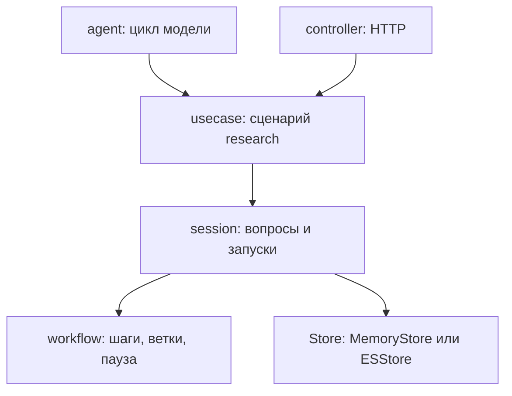
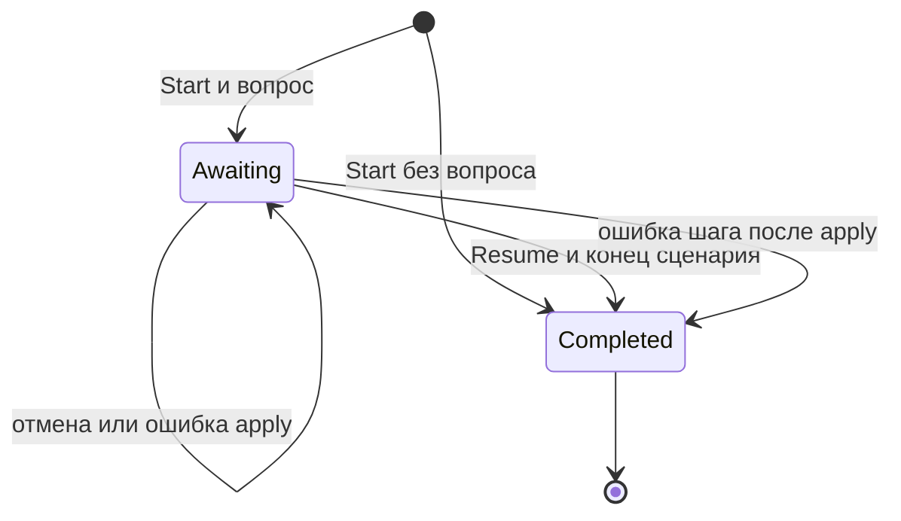
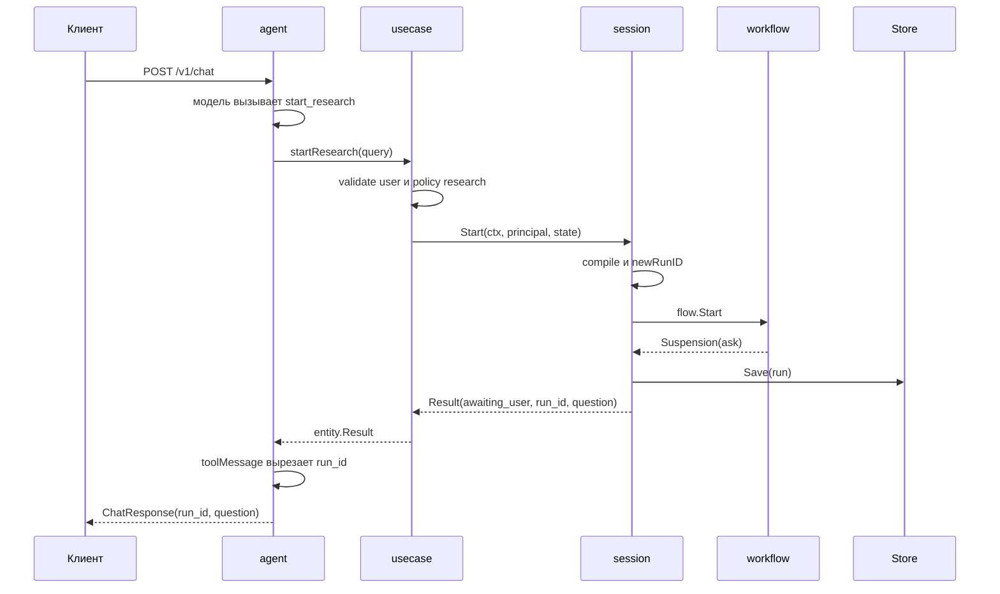
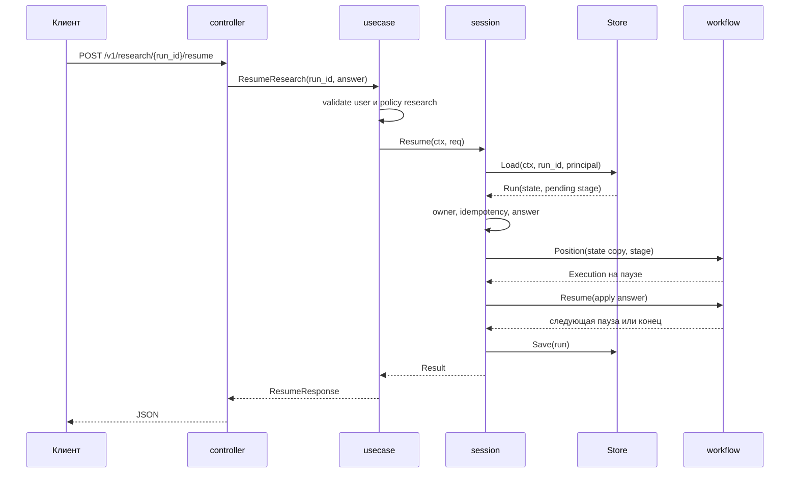

# Workflow и вопросы в lite-demo

Документ описывает, как в `lite-demo` устроен сценарий с вопросами: объявление,
компиляция, исполнение, пауза, продолжение и хранение запусков. Отдельно
разобрано, что именно движок workflow знает о вопросах и как вопрос
восстанавливается после рестарта.

Код: `internal/workflow` (движок), `internal/session` (сценарий, вопросы,
хранилище), `internal/usecase` (объявление `research`), `internal/agent` (цикл
модель → инструменты).

## 1. Два слоя

`internal/workflow` это типизированная машина состояний. У неё есть
упорядоченные шаги, ветки по состоянию и пауза. О вопросах, ответах, владельцах
и `run_id` она не знает.

`internal/session` строится поверх движка. Он объявляет вопросы, превращает
паузу в типизированный `Question`, проверяет ответ, хранит запуск и
восстанавливает исполнение после рестарта.



Граница проходит по ответственности:

| Слой       | Что решает                                                                  | Чего не делает                  |
| ---------- | --------------------------------------------------------------------------- | ------------------------------- |
| `workflow` | порядок шагов, ветка, позиция исполнения, пауза                             | не знает про вопросы и `run_id` |
| `session`  | какой вопрос задать, как проверить ответ, кто владеет запуском, где хранить | не знает про HTTP и модель      |
| `usecase`  | какой сценарий объявить, какие права нужны                                  | не знает про транспорт          |
| `agent`    | какие инструменты видит модель, как вызвать и что вернуть                   | не выбирает ветку сценария      |

## 2. Термины

`Flow` это объявленный поток: список узлов, где узел либо шаг, либо ветка.

`Step` это именованная функция `func(context.Context, *S) error`. Шаг может
вернуть `workflow.Suspend(ctx, payload)`, и тогда поток останавливается.

`Branch` выбирает подпоток по состоянию. Функция `decide(*S) string` возвращает
имя маршрута. Маршруты объявлены заранее.

`Execution` это запущенный поток: состояние, стек кадров, текущая пауза,
счётчик шагов и признак завершения.

`Suspension` это пауза. Внутри лежит `Payload any`, который положил шаг.

`Session` это объявление сценария плюс хранилище его запусков.

`Run` это сохранённая часть запуска: `ID`, `Principal`, `Expires`, `ResumeID`,
`Last Result[S]`. Исполнение в `Run` не хранится.

`ask` это объявление вопроса внутри `session`: стадия, текст, тип ввода,
варианты, `SkipIf` и функция применения ответа.

## 3. Объявление сценария

Сценарий объявляется цепочкой вызовов на `*Session[S]`:

```go
func newResearch(store session.Store[researchState]) *session.Session[researchState] {
	return session.New[researchState]("research").
		WithStore(store).
		AskChoice("path", "Путь A или B?", []string{"A", "B"},
			func(st *researchState, answer string) error {
				st.Path = answer
				return nil
			}).
		Branch(func(st *researchState) string { return st.Path }).
		Case("A", func(f *session.Session[researchState]) {
			f.Do("finish_a", finishA)
		}).
		Case("B", func(f *session.Session[researchState]) {
			f.AskChoice("topic", "Что показать?", []string{"X", "Y"}, applyTopic).
				Do("finish_b", finishB)
		})
}
```

Объявление складывается в две структуры:

- `steps []step[S]` хранит порядок шагов, вопросов и веток;
- `asks map[string]*ask[S]` хранит вопросы по стадии.

`Case` объявляет маршрут на отдельной под-сессии. Под-сессия получает тот же
`asks` и тот же `store`, поэтому стадии и запуски общие для всего сценария.

Правила объявления:

| Правило                                                         | Где проверяется      |
| --------------------------------------------------------------- | -------------------- |
| у вопроса есть непустая стадия                                  | `build`              |
| у вопроса есть функция применения ответа                        | `build`              |
| у `InputChoice` есть хотя бы один вариант                       | `build`              |
| стадия вопроса уникальна во всём сценарии                       | `ask` при объявлении |
| имя шага, вопроса или ветки уникально внутри своего потока      | `build`              |
| ветка имеет `decide` и хотя бы один `Case`                      | `build`              |
| `Case` без `Branch`, пустой маршрут и повтор маршрута запрещены | `Case`               |
| нет циклов и пустых узлов                                       | `workflow.Validate`  |

Имя шага может повториться в разных ветках. Это нормальный случай: `Do("finish")`
в ветке A и `Do("finish")` в ветке B не конфликтуют, потому что восстановление
идёт только по выбранному маршруту. Стадия вопроса так повторяться не может:
`asks` это единый словарь стадия → объявление, и повтор отвергается при
объявлении.

## 4. Компиляция: из объявления в Flow

`Start` и `Resume` вызывают `compile`. Компиляция выполняется один раз через
`sync.Once`, результат и ошибка кэшируются в `Session`.

`build` переводит шаги объявления в узлы `workflow.Flow`:

| Объявление              | Узел workflow                       |
| ----------------------- | ----------------------------------- |
| `Do(name, run)`         | `flow.Then(name, run)`              |
| `AskText` / `AskChoice` | `flow.Then(stage, closure)`         |
| `Branch(decide)`        | `flow.Branch(name, decide, routes)` |

Замыкание вопроса выглядит так:

```go
flow.Then(a.stage, func(ctx context.Context, st *S) error {
	if a.skip != nil && a.skip(st) {
		return nil
	}
	return workflow.Suspend(ctx, a)
})
```

Ветка получает имя `branch<индекс>` по позиции в объявлении. Имя попадает
только в тексты ошибок и в события наблюдателя.

После сборки вызывается `flow.Validate`. Он проверяет имена, пустые узлы, циклы
и наличие маршрутов. Ошибка оборачивается в `session.ErrInvalid`.

## 5. Исполнение: Execution и кадры

`Execution` хранит:

```go
type Execution[S any] struct {
	st     *S
	stack  []frame[S]
	steps  int
	susp   *Suspension
	done   bool
	failed bool
}
```

Кадр это поток и индекс следующего узла:

```go
type frame[S any] struct {
	flow *Flow[S]
	next int
	obs  Observer[S]
}
```

`run` работает циклом:

1. проверяет `ctx.Err()`;
2. проверяет глубину стека, максимум 32;
3. берёт верхний кадр;
4. если узел кончился, снимает кадр;
5. берёт следующий узел и увеличивает `next`;
6. увеличивает счётчик шагов, максимум 1000;
7. выполняет шаг или выбирает маршрут ветки.

Ветка вызывает `decide`, находит подпоток по имени маршрута и кладёт его кадр в
стек. Если маршрута нет, возвращается `ErrInvalid`.

`Start` возвращает `Execution` даже при паузе. Ошибкой считаются только
настоящие отказы. `Run` это обёртка, которая возвращает `*Suspension` как
ошибку, если поток остановился.

### Пауза

Шаг возвращает `*Suspension` через `workflow.Suspend`. `runStep` перехватывает
эту ошибку, записывает в `e.susp` поток и имя шага, а поток останавливается.
`Execution.Suspension()` возвращает паузу или `nil`.

`Suspend` проверяет `ctx.Err()` перед созданием паузы. Отменённый контекст не
превращается в вопрос.

### Пределы

`maxDepth = 32` ограничивает вложенность веток. `maxSteps = 1000` ограничивает
число узлов за один запуск вместе с вложенными потоками. Оба предела защищают от
ошибочного объявления, которое зациклилось бы.

### Паники

Паника в шаге, в `decide` и в наблюдателе превращается в ошибку. Для шага и
`decide` ошибка содержит имя потока и шага. Для наблюдателя используется
`ErrObserver`. Паника в функции применения ответа (`apply`) перехватывается
`applySafely` в `Execution.Resume` и возвращается обычной ошибкой.

### Наблюдатель

`Observer` вызывается после каждого шага с событием: поток, шаг, состояние,
ошибка и длительность. Паника в наблюдателе не роняет поток, она становится
`ErrObserver`. Если шаг завершился ошибкой, ошибка наблюдателя не подменяет её.

## 6. Пауза: как вопрос становится Suspension

Вопрос это шаг, который возвращает `Suspend` с указателем на объявление:

```go
type ask[S any] struct {
	stage   string
	prompt  string
	input   Input
	options []string
	skip    func(*S) bool
	apply   func(*S, string) error
}
```

`Payload` в `Suspension` имеет тип `any`. `session` кладёт туда `*ask[S]`, а
`workflow` не интерпретирует его.

`session.Start` и `session.Resume` после прогона вызывают `finish`. `finish`
смотрит на `exec.Suspension()`:

- если пауза есть, достаёт `*ask[S]` из `Payload`, собирает `Result` со
  статусом `awaiting_user`, вопросом и копией состояния;
- если паузы нет, собирает `Result` со статусом `completed`.

`Question` содержит стадию, текст, тип ввода и варианты. `run_id` в вопрос не
входит, его добавляет `Result`.



### SkipIf

`SkipIf(cond)` добавляет в объявление вопроса проверку состояния. Если
`cond(st)` истинна, шаг не создаёт паузу и поток идёт дальше. Пропуск не
сохраняется отдельно: он виден только в том, что сценарий не остановился.

## 7. Что движок знает о вопросах

Ничего. `workflow.Suspend(ctx, payload)` принимает `any` и не проверяет его.
`workflow` не знает про текст вопроса, варианты, владельца и `run_id`.

Из этого следуют три свойства:

- движок можно тестировать отдельно от сессии, что и делает `workflow_test.go`;
- проверка ответа, варианты и права живут в `session`;
- `Payload` это указатель на объявление с функциями, поэтому его нельзя
  сериализовать. Отсюда восстановление по состоянию, а не по сохранённому
  `Execution` (раздел 10).

## 8. Start: путь от инструмента до клиента

Сценарий запускает модель через инструмент `start_research`. Инструмент не
выбирает ветку, он только передаёт тему.



Порядок в `Session.Start`:

1. проверка `st != nil`;
2. проверка `Principal`: `UserID` и `Tenant` обязательны;
3. `newRunID`, ошибка `crypto/rand` возвращается наружу;
4. `compile`, ошибка объявления возвращается до исполнения;
5. `flow.Start(ctx, st)`;
6. `Run` с `Expires` от хранилища;
7. `finish` собирает `Result` и сохраняет запуск.

Дальше `usecase.toToolResult` переводит `Result` в `entity.Result`. В поле
`RunID` он кладёт идентификатор запуска, но `agent.toolMessage` вырезает `RunID`
и `Append` перед отправкой модели. Модель видит статус, вопрос и варианты.

`agent.chat` запоминает `pending`, если инструмент вернул `awaiting_user`, и
`reply` добавляет `run_id` и `question` в ответ клиенту, если ход закончился
ответом модели со статусом `ok`. `stepNote` формирует инструкцию модели задать
вопрос. Сам вопрос остаётся данными, а не командой: `run_id` в инструкции нет.

## 9. Resume: путь от HTTP до применения ответа

Продолжение идёт отдельным эндпоинтом, минуя модель:



`Session.Resume` выполняет шаги в таком порядке:

1. `store.Load(ctx, runID, principal)`, чужая или истёкшая запись даёт
   `ErrNotFound`;
2. блокировка `run.mu`, она сериализует продолжения одного запуска в процессе;
3. проверка идемпотентности: если `ResumeID` совпал с сохранённым, вернуть
   `run.Last`;
4. если запуск уже `completed`, вернуть `ErrInvalid`;
5. найти объявление вопроса по стадии из `Last.Question`;
6. проверить ответ: для `choice` он должен быть одним из вариантов, для `text`
   непустой после `TrimSpace`;
7. восстановить исполнение через `workflow.Position`;
8. выполнить `Execution.Resume` с функцией применения ответа;
9. сохранить новое состояние и вернуть `Result`.

Проверка контекста стоит внутри функции применения, до записи ответа в
состояние. Отменённый запрос ничего не применяет.

Если функция применения вернула ошибку, пауза остаётся, и ответ можно повторить.
Если шаг после применения вернул ошибку, запуск помечается завершённым и
сохраняется. Повтор получает `finished`, а не состояние «не ждёт ответа».

## 10. Восстановление исполнения по состоянию

`Execution` нельзя сохранить в Elasticsearch. В нём есть стек кадров с
указателями на `Flow`, а в паузе лежит указатель на объявление вопроса с
функциями. Поэтому `Run` хранит только данные: состояние, владельца, срок,
последний результат и стадию вопроса внутри результата.

При `Resume` исполнение собирается заново:

```go
st := run.Last.State
exec, err := s.compile() // кэшированный Flow
exec, err = flow.Position(&st, pending.stage, pending)
```

`Position` обходит поток с начала:

1. на шаге сравнивает имя с искомой стадией;
2. на ветке вызывает `decide(st)` и заходит только в выбранный маршрут;
3. когда стадия найдена, кладёт в стек кадры пути и ставит `next` на узел после
   найденного;
4. создаёт `Suspension` с переданным payload.

Во время обхода не выполняется ни один шаг. Шаги могут делать внешние вызовы,
и повторный прогон был бы побочным эффектом.

Условие корректности: `decide` должен зависеть только от сохранённого
состояния. В демо это так: `st.Path` записывается ответом на вопрос до ветки.
Если `decide` смотрит на что-то ещё, восстановление выберет другой маршрут.
`Position` не пытается угадать: если стадия не найдена на выбранном пути, он
возвращает `ErrInvalid`.

Сравнение двух подходов:

| Подход                    | Плюс                             | Минус                                   |
| ------------------------- | -------------------------------- | --------------------------------------- |
| сохранить `Execution`     | восстанавливается точная позиция | нужна сериализация функций и указателей |
| восстановить по состоянию | хранится только `S` и стадия     | `decide` обязан быть детерминированным  |

## 11. Состояние и копии

`finish` кладёт в `Result.State` значение `*exec.State()`. Это поверхностная
копия: строки копируются, срезы и указатели внутри `S` остаются общими с
исполнением. Для `researchState` из строк это неважно. Общее правило: вызывающий
не должен менять `Result.State`.

При восстановлении `Resume` копирует `run.Last.State` в локальную переменную и
работает с ней:

```go
st := run.Last.State
return flow.Position(&st, stage, pending)
```

Поэтому неудачное продолжение не портит сохранённый запуск. Новое состояние
попадает в `Run` только в `finish`, после успешного прогона.

Elasticsearch сериализует `Run` в JSON и обратно, поэтому там копия глубже, чем в
памяти.

## 12. Хранилище запусков

Граница хранилища:

```go
type Store[S any] interface {
	Load(ctx context.Context, runID string, p Principal) (*Run[S], error)
	Save(ctx context.Context, run *Run[S]) error
	Expiry() time.Time
}
```

`Load` ищет запуск, проверяет срок и владельца, возвращает `ErrNotFound` для
чужого и истёкшего. `Save` записывает `Run`. `Expiry` возвращает срок для нового
запуска.

### MemoryStore

Используется по умолчанию, когда `ES_URL` пуст.

| Параметр            | Значение                       |
| ------------------- | ------------------------------ |
| TTL                 | 15 минут                       |
| всего запусков      | 1000                           |
| на principal        | 10                             |
| перезапуск процесса | незавершённые запуски теряются |

`Save` сначала удаляет истёкшие записи, затем вытесняет самую раннюю запись
principal, если достигнут лимит, затем самую раннюю запись вообще, если достигнут
общий лимит. `Load` проверяет срок и владельца. Просроченная запись удаляется при
чтении.

Продолжения одного запуска сериализуются мьютексом в `Run`, потому что
`MemoryStore.Load` возвращает указатель на хранимую запись.

### ESStore

Включается переменной `ES_URL`. Один документ на запуск, `_id` равен `run_id`.

Индекс создаётся при старте, если его нет. Маппинг индексирует владельца, срок и
`resume_id`. Поле `last` хранится в `_source`, но не индексируется: запуск
читается по идентификатору, поиск по состоянию не нужен.

Запись:

- первый `Save` создаёт документ с `op_type=create`;
- `Save` после `Load` обновляет документ с `if_seq_no` и `if_primary_term`;
- конфликт версий возвращает `ErrConflict`, документ не перезаписывается.

Чтение проверяет `expires` и владельца. Истёкшие документы не удаляются, они
отсекаются при чтении. Для чистки в проде нужен ILM или отдельный job.

`NewESStore` проверяет URL и создаёт индекс при старте с таймаутом 10 секунд.
Недоступный кластер это ошибка старта, а не сюрприз на первом `Resume`.

### Сохранение при отмене

`finish` и закрытие запуска после ошибки шага сохраняют запись через
`context.WithoutCancel(ctx)`. Переход, который уже произошёл, должен попасть в
хранилище, даже если клиент отключился. Иначе повтор применил бы ответ второй
раз.

## 13. Ошибки и отказы

| Ситуация                                      | Что возвращает `session`     | HTTP                         |
| --------------------------------------------- | ---------------------------- | ---------------------------- |
| запуск не найден                              | `ErrNotFound`                | 404                          |
| запуск другого пользователя, тенанта или чата | `ErrNotFound`                | 404                          |
| TTL истёк                                     | `ErrNotFound`                | 404                          |
| ответ не из вариантов                         | `ErrInvalid`                 | 400                          |
| пустой текстовый ответ                        | `ErrInvalid`                 | 400                          |
| запуск уже завершён                           | `ErrInvalid`                 | 400                          |
| битое объявление сценария                     | `ErrInvalid`                 | 400                          |
| отмена запроса до применения ответа           | `context.Canceled`           | 499                          |
| ошибка функции применения                     | ошибка применения            | 500, если ошибка не доменная |
| ошибка шага после применения                  | ошибка шага, запуск завершён | 500                          |
| паника в шаге, `decide`, `apply`              | ошибка с текстом паники      | 500                          |
| конфликт версий в Elasticsearch               | `ErrConflict`                | 409                          |

`usecase.mapSessionError` переводит ошибки `session` в доменные
`entity.ErrNotFound`, `entity.ErrInvalid` и `entity.ErrConflict`.
`errmap.Status` выбирает код, `errmap.Message` отдаёт безопасный текст.

## 14. Идемпотентность и повтор

`ResumeID` это ключ клиента. `session` хранит только последний успешный
`ResumeID` в запуске. Повтор с этим идентификатором возвращает сохранённый
`Result` и не применяет ответ второй раз.

Что это значит на практике:

- повтор последнего ответа безопасен;
- повтор более старого ответа после следующего шага вернёт `ErrInvalid`, потому
  что сохранён только последний идентификатор;
- завершённый запуск с новым `ResumeID` вернуть прежний результат не может.

Если нужна идемпотентность на всю историю шагов, понадобится журнал
`ResumeID → Result` с ограничением размера. Сейчас его нет.

## 15. Конкурентность

Сценарий создаётся один раз при старте и дальше используется только на чтение.
Компиляция защищена `sync.Once`.

`MemoryStore` защищает карту мьютексом, `Run` защищает переходы мьютексом.
Продолжения одного запуска в процессе идут по очереди.

`ESStore` не имеет общего мьютекса между инстансами. Два одновременных `Resume`
прочитают одну версию документа, и второй `Save` получит конфликт. Первый
результат остаётся, второй клиент получает `409` и может повторить запрос. Шаги
второго запроса при этом уже выполнились в памяти, но их результат не сохранён.
Для шагов с внешними побочными эффектами это надо учитывать.

Горутин `session` и `workflow` не создают. Единственная горутина сервиса это
`ListenAndServe` в `app.Run`, она завершается на `Shutdown`.

## 16. Инварианты

1. В один момент у запуска не больше одного ожидающего вопроса.
2. Стадия вопроса уникальна во всём сценарии.
3. Имена шагов уникальны внутри потока. Повтор между ветками допустим.
4. `decide` зависит только от состояния, которое сохраняется в `Result.State`.
5. Во время восстановления не выполняется ни один шаг.
6. Ответ применяется один раз. Ошибка до применения оставляет паузу, ошибка
   после применения закрывает запуск.
7. Чужой запуск неотличим от несуществующего.
8. `run_id` не попадает к модели. Ветку выбирает код, не модель.
9. Переход сохраняется даже при отмене запроса.
10. `Result.State` это копия, менять её вызывающему нельзя.

## 17. Как добавить вопрос, ветку или store

Новый вопрос:

```go
s.AskText("param", "Какой параметр?", func(st *researchState, answer string) error {
	st.Param = answer
	return nil
})
```

Если ответ уже есть в состоянии, добавь `session.SkipIf`:

```go
s.AskText("param", "Какой параметр?", applyParam,
	session.SkipIf(func(st *researchState) bool { return st.Param != "" }))
```

Новая ветка:

```go
s.Branch(func(st *researchState) string { return st.Path }).
	Case("A", func(f *session.Session[researchState]) { /* шаги A */ }).
	Case("B", func(f *session.Session[researchState]) { /* шаги B */ })
```

Новое хранилище реализует три метода `Store` и передаётся в `WithStore`.
`Load` обязан проверять срок и владельца, `Save` должен уметь отличить создание
от обновления.

## 18. Ограничения

- `MemoryStore` теряет запуски при рестарте.
- `ESStore` не поддерживает аутентификацию. Локальный compose запускает
  Elasticsearch с выключенной security.
- Истёкшие документы в Elasticsearch не удаляются автоматически.
- TTL не продлевается при `Resume`: срок считается от создания запуска.
- Повторный вызов `start_research` в следующем шаге модели создаёт второй
  запуск. Первый остаётся в хранилище до TTL, потому что ссылки на него у
  клиента уже нет.
- Ошибка шага после применения ответа завершает запуск. Клиент получает ошибку,
  а повтор получает `completed` без ответа.
- `ChatID` в демо не заполняется: `usecase.principal` передаёт только `UserID` и
  `Tenant`. Проверка владельца при этом строгая, пустой `ChatID` совпадает только
  с пустым.
